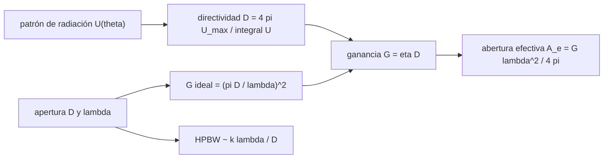

# B91-C01 — Fundamentos de teoría de antenas

<!-- nav:top -->
[🏠 Programa](../../../../README.md) · [📚 Bloque B91](../../../tronco-comun/B91-antenas-y-propagacion-para-enlaces-espaciales.md) · [← Anterior: B90-C24 — Prototipado y modelos de ingeniería de subconjuntos](../../../tronco-comun/B90-integracion-ensayos-y-calificacion-espacial.md#b90-c24) · [Siguiente: B91-C02 — Polarización de antenas y pérdidas por desadaptación →](../B91-C02-polarizacion-de-antenas-y-perdidas-por-desadaptacion/CLASE.md)
<!-- /nav -->

## 1. Ubicación, nivel y alcance

Clase 1 del bloque B91. Nivel N4. Una antena no crea potencia: la concentra en una dirección. Aquí aprendes las cuatro cantidades con las que se compara cualquier antena —directividad, ganancia, abertura efectiva y ancho de haz— y las usas para reproducir, con un cálculo propio, la ganancia publicada de la antena de 70 m de la Red de Espacio Profundo (DSN). El enlace de espacio libre y la ganancia como término del presupuesto se tratan en [B89](../../../tronco-comun/B89-comunicaciones-y-navegacion-satelital.md); las antenas de radiotelescopio, en [B46](../../../tronco-comun/B46-radioastronomia-e-interferometria.md). Aquí se trata la teoría que fija esos números.

## 2. Por qué esta clase existe

Elegir o diseñar una antena empieza por saber qué fija su ganancia y su haz. La decisión central: **¿cuánta ganancia da una apertura de diámetro `D` a la frecuencia `f`, y qué parte de esa ganancia ideal se pierde en la práctica?**

## 3. Lo que podrás hacer al terminar

1. Calcular la directividad de un dipolo de media onda por integración numérica del patrón.
2. Calcular la abertura efectiva `A_e = G λ²/(4π)` a partir de la ganancia.
3. Calcular la ganancia ideal de una apertura circular `G = (πD/λ)²` y su eficiencia implícita frente a un valor publicado.
4. Estimar el ancho de haz `HPBW ≈ kλ/D` y contrastarlo con los valores de la DSN.
5. Escalar la ganancia con la frecuencia (`20 log f`) y convertir entre dB y razón lineal.
6. Separar lo consultado (ganancias y anchos de haz de la DSN) de lo calculado (eficiencia, abertura efectiva).

La evidencia es la **ficha de parámetros de una antena** del ejercicio 12 (sección 20).

## 4. Con qué llegas y cómo comprobarlo

1. ¿Qué es un decibelio y cómo se pasa de dB a razón lineal?
2. ¿Qué es la longitud de onda y cómo se calcula de la frecuencia?
3. ¿Qué significa «isótropa»?
4. ¿Qué es un ángulo sólido y en qué unidad se mide?
5. ¿Qué es un dato sintético?

<details>
<summary>Ver respuestas</summary>

1. `dB = 10 log₁₀(razón)`; razón `= 10^(dB/10)`. 2. `λ = c/f`, con `c = 299 792 458 m/s`. 3. Una antena ideal que radia igual en todas las direcciones; es la referencia de «dBi». 4. La porción de esfera vista desde un punto; esteroradián; la esfera completa es `4π sr`. 5. Uno generado para el ejemplo, no medido.
</details>

Con cuatro o cinco aciertos, sigue; si no, repasa los prerrequisitos.

## 5. Un caso de contexto y casos de referencia

La antena de 70 m de la DSN tiene, en recepción de banda X (8420 MHz), una ganancia publicada de `74,55 dBi` y un ancho de haz de `0,032°`. Una apertura ideal de 70 m a esa frecuencia da `75,81 dBi`: la antena real conserva el `74,7 %` de la ganancia ideal. Es el **ejemplo conductor** y es un dato **consultado** (NASA/JPL, 810-005 módulo 101); el dipolo y las eficiencias derivadas son **calculados**. Otros casos: S-band de transmisión (62,95 dBi, `0,128°`) y X-band de transmisión (73,23 dBi, `0,038°`).

## 6. Vocabulario

La **directividad** `D` es el cociente entre la intensidad de radiación máxima y la que tendría una fuente isótropa con la misma potencia radiada: `D = 4π U_max/∫U dΩ`. La **ganancia** `G = η D` incluye la eficiencia `η` de pérdidas. La **abertura efectiva** `A_e = G λ²/(4π)` es el área equivalente con que la antena captura potencia. El **ancho de haz de media potencia** (HPBW) es el ángulo entre los puntos a −3 dB. Un **dBi** es dB respecto de una antena isótropa; un **dBd**, respecto de un dipolo (`dBi = dBd + 2,15`).

## 7. Modelo mental



*Descripción textual:* del patrón sale la directividad; con la eficiencia, la ganancia; de la ganancia, la abertura efectiva. La apertura física y la longitud de onda dan la ganancia ideal y el ancho de haz.

Analogía: una linterna con reflector concentra la misma potencia en un haz más estrecho; cuanto más grande es el reflector respecto de la longitud de onda, más estrecho es el haz. Límite: la analogía no captura los lóbulos laterales ni la polarización.

## 8. La explicación, paso a paso

### 8.1 Directividad del dipolo de media onda

El patrón de intensidad del dipolo de media onda es `U(θ) = [cos((π/2)cos θ)/sin θ]²`. Integrándolo con la regla de Simpson (`N = 2000` y `N = 4000` subintervalos) resulta `D = 1,6409` (`2,151 dBi`); las dos mallas difieren en `3,1 × 10⁻¹³`. Su abertura efectiva es `A_e = 0,1306 λ²`.

### 8.2 Apertura circular y eficiencia

Para una apertura circular de diámetro `D`, la ganancia ideal (iluminación uniforme, sin pérdidas) es `G = (πD/λ)²`. Con `D = 70 m` y `f = 8420 MHz` (`λ = 35,6 mm`): `πD/λ = 6176`, `G = 3,81 × 10⁷`, o `75,81 dBi`. La ganancia publicada es `74,55 dBi`, de modo que la **eficiencia implícita** es `η = 10^((74,55 − 75,81)/10) = 0,747`.

| Banda | `f` (MHz) | `G` publicada (dBi) | `G` ideal (dBi) | `η` implícita | HPBW publicado | HPBW `1,02 λ/D` | HPBW `1,20 λ/D` |
|---|---|---|---|---|---|---|---|
| S tx | 2115 | 62,95 | 63,81 | 0,819 | 0,128° | 0,118° | 0,139° |
| X tx | 7145 | 73,23 | 74,39 | 0,766 | 0,038° | 0,035° | 0,041° |
| X rx | 8420 | 74,55 | 75,81 | 0,747 | 0,032° | 0,030° | 0,035° |

Los anchos de haz publicados caen entre los de iluminación uniforme (`k = 1,02`) y con apodización típica (`k = 1,20`): es coherente con una apertura iluminada con taper.

### 8.3 Escalado con la frecuencia

El módulo 101 indica que, en la misma banda, la ganancia sube `20 log(f/f₀)`. De 7145 a 8420 MHz: `+1,43 dB`, de `73,23` a `74,66 dBi`; el valor publicado de recepción es `74,55 dBi` (diferencia `−0,11 dB`: son configuraciones distintas).

### 8.4 Qué cambia y qué no

Duplicar `D` (o `f`) suma `6,02 dB` y reduce el haz a la mitad. La abertura efectiva de la antena de 70 m en X es `2876 m²` frente a `3848 m²` de área geométrica (razón `0,747`, la misma `η`). Una ganancia alta implica un haz estrecho: la de 70 m exige apuntar con una precisión de milésimas de grado.

## 9. Magnitudes, símbolos y unidades

| Símbolo | Qué es | Unidad | Valor / nota |
|---|---|---|---|
| `D` | directividad | — (o dBi) | 1,6409 (dipolo) |
| `G` | ganancia | — (o dBi) | 74,55 dBi (70 m, X rx) |
| `η` | eficiencia de apertura | — | 0,747 (calculada) |
| `A_e` | abertura efectiva | m² | 2876 (70 m, X rx) |
| `λ` | longitud de onda | m | 0,0356 a 8420 MHz |
| `HPBW` | ancho de haz a −3 dB | grados | 0,032° publicado |
| `c` | velocidad de la luz | m/s | 299 792 458 (exacta) |

## 10. Convenciones y referencias

Direcciones y ángulos en el sistema de la antena (eje del haz como referencia). Ganancias «en la apertura del alimentador» (feedhorn), sin atmósfera, como las define el módulo 101. Diámetro de la antena: 70 m (texto del módulo). Los coeficientes `k = 1,02` y `1,20` son ilustrativos. Todo el código usa SI y la biblioteca estándar de Python 3.12.

## 11. De dónde sale lo que afirmamos

| ID | Fuente | Localizador | Respalda | Estado |
|---|---|---|---|---|
| S1 | NASA/JPL, DSN Telecommunications Link Design Handbook 810-005, módulo 101 rev. D «70-m Subnet Telecommunications Interfaces» (2011-04-21) — https://deepspace.jpl.nasa.gov/dsndocs/810-005/101/101D.pdf (consultada 2026-11-10) | documento completo (41 págs.) leído con PyMuPDF | Tablas 1 y 2 (ganancia, HPBW de la antena de 70 m); regla de escalado de ganancia `20 log(f/f₀)` | Consultada |
| — | Relaciones estándar de teoría de antenas (directividad, abertura efectiva, HPBW de aperturas) | — | las verifica el laboratorio con convergencia de malla y con los valores publicados | No consultada en una fuente concreta |

Límites: no se consultaron el estándar IEEE 145 ni libros de texto de antenas; la eficiencia y la abertura efectiva son cálculos, no valores publicados por la NASA.

## 12. Cómo ver la ganancia y el haz

| Magnitud | Valor |
|---|---|
| Directividad del dipolo | 1,6409 (2,151 dBi) |
| `G` ideal de 70 m en X rx | 75,81 dBi |
| `η` implícita (X rx) | 0,747 |
| Abertura efectiva X rx | 2876 m² |
| HPBW teórico `1,02 λ/D` frente a publicado | 0,030° frente a 0,032° |

Descripción larga: la eficiencia implícita ronda `0,75–0,82` en las tres bandas y los anchos de haz publicados quedan entre los de apertura uniforme y apodizada.

## 13. Ejemplo trabajado: la eficiencia de la antena de 70 m en X

**Paso 1 · Longitud de onda.** `λ = 299 792 458/8,42 × 10⁹ = 0,035605 m`.

**Paso 2 · Ganancia ideal.** `πD/λ = π × 70/0,035605 = 6176`; `G = 6176² = 3,815 × 10⁷`; `10 log = 75,81 dBi`.

**Paso 3 · Eficiencia.** `η = 10^((74,55 − 75,81)/10) = 0,747`.

**Paso 4 · Abertura efectiva.** `A_e = η π (D/2)² = 0,747 × 3848 = 2876 m²`.

## 14. Distintas formas de describir una antena

**Por patrón:** `U(θ, φ)`. **Por directividad y ganancia:** `D`, `G` (dBi). **Por abertura:** `A_e` (m²). **Por haz:** `HPBW` (°). **Por tamaño eléctrico:** `D/λ`.

## 15. Práctica guiada

**Ejercicio 1 · guiado con los pasos indicados.** Calcula `λ` a 8,42 GHz. *Pasos:* divide `c` por `f`.

<details><summary>Solución comentada</summary>

`299 792 458/8,42 × 10⁹ = 0,0356 m = 35,6 mm`.
</details>

**Ejercicio 2 · guiado con una pista.** Calcula la ganancia ideal de una apertura de 70 m a 8,42 GHz en dBi. *Pista:* `(πD/λ)²`.

<details><summary>Solución comentada</summary>

`πD/λ = 6176`; al cuadrado `3,815 × 10⁷`; `75,81 dBi` (laboratorio).
</details>

**Ejercicio 3 · guiado, casi autónomo.** Obtén la eficiencia implícita si la ganancia publicada es 74,55 dBi. *Casi autónomo:* resta en dB y convierte.

<details><summary>Solución comentada</summary>

`74,55 − 75,81 = −1,26 dB`; `10^(−0,126) = 0,747`.
</details>

## 16. Práctica autónoma, transferencia e integrador

**Ejercicio 4 · autónomo.** Calcula la abertura efectiva de la antena de 70 m en X rx a partir de `G = 74,55 dBi`.

<details><summary>Solución comentada</summary>

`G = 10^7,455 = 2,85 × 10⁷`; `A_e = G λ²/(4π) = 2876 m²` (laboratorio).
</details>

**Ejercicio 5 · autónomo.** HPBW con `k = 1,20` para una antena de 34 m a 8,42 GHz.

<details><summary>Solución comentada</summary>

`1,20 × 0,035605/34 = 1,257 × 10⁻³ rad = 0,072°`.
</details>

**Ejercicio 6 · autónomo.** Escala la ganancia S tx de 2115 MHz a 2295 MHz con `20 log(f/f₀)` y compara con 63,59 dBi (recepción, publicada).

<details><summary>Solución comentada</summary>

`20 log(2295/2115) = +0,71 dB` → `63,66 dBi`; diferencia `+0,07 dB` con el valor publicado de recepción (otra configuración).
</details>

**Ejercicio 7 · autónomo.** ¿Cuánto cambian la ganancia y el haz si se duplica el diámetro?

<details><summary>Solución comentada</summary>

`+6,02 dB` y el haz se reduce a la mitad (`HPBW ∝ 1/D`).
</details>

**Ejercicio 8 · autónomo.** Convierte `73,23 dBi` a razón lineal.

<details><summary>Solución comentada</summary>

`10^7,323 = 2,10 × 10⁷`.
</details>

**Ejercicio 9 · transferencia.** **Transferencia.** Un colega afirma que un dipolo «tiene 2,15 dB de ganancia». ¿Qué le falta aclarar?

<details><summary>Solución comentada</summary>

Que son `dBi` (respecto de la isótropa); en `dBd` (respecto del propio dipolo) su ganancia es `0 dBd`; `dBi = dBd + 2,15`.
</details>

**Ejercicio 10 · transferencia.** **Transferencia.** Una misión necesita `+3 dB` de ganancia manteniendo la frecuencia. ¿Cuánto debe crecer el diámetro?

<details><summary>Solución comentada</summary>

`D' = D × 10^(3/20) = 1,41 D` (+41 %) si la eficiencia no cambia; el haz se estrecha un 29 %.
</details>

**Ejercicio 11 · transferencia.** **Transferencia.** La ganancia medida de una antena nueva es 1,0 dB menor que `(πD/λ)²`. ¿Qué puede explicarlo y por qué no es un error?

<details><summary>Solución comentada</summary>

La eficiencia de apertura `η < 1` (iluminación no uniforme, desbordamiento, bloqueo, errores de superficie, pérdidas); 1,0 dB equivale a `η = 0,79`, dentro del rango `0,75–0,82` de la antena de 70 m.
</details>

**Ejercicio 12 · integrador.** **Integrador.** Elabora tu *ficha de parámetros de una antena*: para la antena de 70 m en X rx, `λ`, `G` ideal y publicada, `η`, `A_e`, HPBW publicado y teórico, y qué es consultado y qué es calculado.

<details><summary>Solución comentada</summary>

Secciones 8.1–8.4 y la salida del laboratorio; marca `G` y HPBW como consultados y `η`, `A_e` como calculados.
</details>

## 17. Laboratorio: dipolo, apertura circular y la antena de 70 m

El script [teoria_antenas.py](teoria_antenas.py) integra el patrón de un dipolo de media onda (convergencia de malla), calcula la abertura efectiva y compara la apertura ideal de 70 m con las ganancias y los anchos de haz publicados de la DSN (**comprueba** convergencia < 1e-9, dipolo frente a 1,6409 < 1e-4 y HPBW teórico dentro de ±25 % del publicado).

**Datos:** ganancias y HPBW del módulo 101 (consultados); eficiencia, abertura efectiva y `k` de HPBW **calculados o ilustrativos**. **Predice antes de ejecutar:** ¿cuánto valdrá la eficiencia en X rx? (≈ 0,75). **Ejecución del 2026-11-10 (Python 3.12.9):**

```text
Python 3.12.9 (biblioteca estandar)
Dipolo lambda/2: D = 1.640922 (2.151 dBi); convergencia |N=2000 - N=4000| = 3.13e-13
Abertura efectiva del dipolo (lambda = 1 m): Ae = 0.1306 m2 (= 0.1306 lambda^2)

Antena de 70 m (DSN, valores PUBLICADOS) frente a apertura ideal (CALCULADA), D = 70 m
 banda   f [MHz]  G_pub [dBi]  G_ideal [dBi]  eta_impl   HPBW_pub [deg]  HPBW k=1.02  k=1.20
 S tx    2115.0      62.95        63.81      0.819       0.128        0.1183  0.1392
 X tx    7145.0      73.23        74.39      0.766       0.038        0.0350  0.0412
 X rx    8420.0      74.55        75.81      0.747       0.032        0.0297  0.0350
Escalado 20 log(f/f0) de 7145 a 8420 MHz: 74.66 dBi (publicado 74.55 en la antena DSS-14: diferencia -0.11 dB)
Abertura efectiva X rx: Ae = 2876 m2; area geometrica = 3848 m2; ratio = 0.747
Pruebas superadas.
```

```bash
python programa/clases/B91/B91-C01-fundamentos-de-teoria-de-antenas/teoria_antenas.py
```

**Límites:** apertura ideal sin bloqueo; la comparación del HPBW depende del coeficiente `k` ilustrativo; no se midió ninguna antena.

## 18. Errores frecuentes y cómo corregirlos

**Confundir dBi con dBd.** Se corrige con la sección 6.

**Usar la ganancia ideal como si fuera la real.** Se corrige con 8.2: la eficiencia ronda 0,75.

**Olvidar que el haz se estrecha al crecer `D/λ`.** Se corrige con 8.4.

**Presentar la eficiencia calculada como un dato de la NASA.** Se corrige con la sección 11.

## 19. Cómo sabrás que vas bien

Tras la sección 8: ¿qué eficiencia esperabas y cuál obtuviste? Si dudas, repasa el ejemplo 13. Tras el laboratorio: ¿qué comprueba? (ver la sección 17).

## 20. Qué entregas y cómo se evalúa

El producto es tu **ficha de parámetros de una antena** (ejercicio 12).

| Criterio | Inicial | En desarrollo | Logrado | Destacado |
|---|---|---|---|---|
| Conceptos | Los confunde | Parciales | Calcula `G`, `η` y `A_e` | Explica los límites |
| Cálculo | Sin unidades | Con errores | Tablas completas con unidades | Calcula casos nuevos |
| Numérico | Sin comprobar | Un caso | Contraste con una segunda vía | Interpreta las diferencias |
| Fuentes | Sin fuente | Sin fecha | Fuentes con fecha y estado | Declara lo sintético y lo no consultado |
| Límites | No los nombra | Uno | Tres | Discute qué falta del modelo |

**Condiciones críticas (no se compensan con promedio):** distinguir lo publicado de lo calculado; no usar la ganancia ideal como real; citar solo lo consultado.

## 21. Ética, seguridad y límites

Clase educativa: los modelos son simplificados y sus datos son sintéticos, ilustrativos o publicados con fuente; ningún resultado sustituye a la norma del operador, a una medición en cámara ni a un diseño certificado. Lo simulado no se presenta como observado. Accesibilidad: tablas equivalentes a las gráficas, fórmulas en texto, ejercicios sin conexión.

## 22. Para cerrar y seguir

La antena de 70 m logra `74,55 dBi` en X, el `74,7 %` de la ganancia ideal, con un haz de `0,032°`. Queda una pregunta: ¿cuánta de esa potencia se acopla si la polarización de la otra antena no coincide?

**Glosario español–inglés.** directividad · *directivity*; ganancia · *gain*; abertura efectiva · *effective aperture*; ancho de haz de media potencia · *half-power beamwidth*; eficiencia de apertura · *aperture efficiency*.

**Continuidad.** [B91-C02](../B91-C02-polarizacion-de-antenas-y-perdidas-por-desadaptacion/CLASE.md) estudia la polarización y las pérdidas por desadaptación.

**Referencias:** ver sección 11.

<!-- nav:bottom -->
---

[← Anterior: B90-C24 — Prototipado y modelos de ingeniería de subconjuntos](../../../tronco-comun/B90-integracion-ensayos-y-calificacion-espacial.md#b90-c24) · [📚 Bloque B91](../../../tronco-comun/B91-antenas-y-propagacion-para-enlaces-espaciales.md) · [Siguiente: B91-C02 — Polarización de antenas y pérdidas por desadaptación →](../B91-C02-polarizacion-de-antenas-y-perdidas-por-desadaptacion/CLASE.md)
<!-- /nav -->
