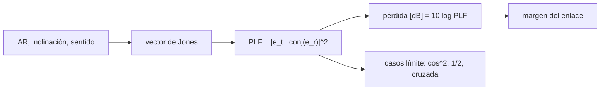

# B91-C02 — Polarización de antenas y pérdidas por desadaptación

<!-- nav:top -->
[🏠 Programa](../../../../README.md) · [📚 Bloque B91](../../../tronco-comun/B91-antenas-y-propagacion-para-enlaces-espaciales.md) · [← Anterior: B91-C01 — Fundamentos de teoría de antenas](../B91-C01-fundamentos-de-teoria-de-antenas/CLASE.md) · [Siguiente: B91-C03 — Arreglos de antenas y antenas de barrido electrónico →](../B91-C03-arreglos-de-antenas-y-antenas-de-barrido-electronico/CLASE.md)
<!-- /nav -->

## 1. Ubicación, nivel y alcance

Clase 2 del bloque B91. Nivel N4. Una antena receptora solo acopla la parte de la onda cuya polarización coincide con la suya. Aquí calculas esa pérdida con vectores de Jones, para polarización lineal, circular y elíptica, y la aplicas a una estación de la DSN cuya elipticidad máxima está publicada. La polarización de la luz se trata en [B42](../../../tronco-comun/B42-optica-fisica-y-optica-adaptativa.md) y la de las fuentes astronómicas en [B46](../../../tronco-comun/B46-radioastronomia-e-interferometria.md); aquí importa la desadaptación entre dos antenas.

## 2. Por qué esta clase existe

Un enlace pierde potencia si las polarizaciones no coinciden, y puede perderla toda si son ortogonales. La decisión central: **¿qué polarización y qué razón axial exigir a las dos antenas para que la desadaptación quede por debajo del margen del enlace?**

## 3. Lo que podrás hacer al terminar

1. Construir el vector de Jones de una polarización elíptica a partir de la razón axial, la inclinación y el sentido.
2. Calcular el factor de pérdida de polarización `PLF = |ê_t · ê_r*|²` entre dos antenas.
3. Obtener los casos límite: lineal–lineal `cos²ψ`, circular–lineal `1/2` y sentidos opuestos.
4. Calcular el intervalo de pérdida entre la mejor y la peor orientación de dos antenas elípticas.
5. Interpretar la elipticidad publicada de una estación de la DSN como razón axial.
6. Separar lo consultado (elipticidad máxima) de lo sintético (razón axial del satélite).

La evidencia es la **tabla de pérdidas por desadaptación de polarización** del ejercicio 12 (sección 20).

## 4. Con qué llegas y cómo comprobarlo

1. ¿Qué es la polarización de una onda?
2. ¿Qué es un número complejo y cuál es su módulo?
3. ¿Qué es la razón axial?
4. ¿Cómo se pasa de dB a razón de potencia?
5. ¿Qué es un dato sintético?

<details>
<summary>Ver respuestas</summary>

1. La figura que traza el campo eléctrico en el plano transversal: línea, círculo o elipse. 2. `a + jb`; módulo `√(a² + b²)`. 3. El cociente entre los semiejes mayor y menor de la elipse; en dB, `20 log(a/b)`. 4. `10^(dB/10)`. 5. Uno generado para el ejemplo, no medido.
</details>

Con cuatro o cinco aciertos, sigue; si no, repasa los prerrequisitos.

## 5. Un caso de contexto y casos de referencia

La antena de 70 m de la DSN transmite y recibe en polarización circular derecha (RCP) o izquierda (LCP), una a la vez, con una elipticidad de `≤ 1,0 dB` en banda X y de `2,2 dB` (máximo) en banda S (valores publicados). Si el satélite tuviera una razón axial de `3,0 dB` (dato **sintético**), la desadaptación sería de `0,055 dB` en la mejor orientación y `0,225 dB` en la peor. Es el **ejemplo conductor**; los números de la DSN son consultados, los del satélite no.

## 6. Vocabulario

El **vector de Jones** `(E_x, E_y)` describe amplitud y fase de las dos componentes transversales. La **razón axial** `AR` (o elipticidad) mide cuánto se aparta una polarización de la circular (`0 dB`) hacia la lineal (`∞`). El **ángulo de inclinación** es el del eje mayor respecto del eje de referencia. El **factor de pérdida de polarización** `PLF = |ê_t · ê_r*|²` va de 0 a 1. El **aislamiento de polarización cruzada** es la atenuación entre dos polarizaciones ortogonales.

## 7. Modelo mental



*Descripción textual:* la razón axial, la inclinación y el sentido definen el vector de Jones; el producto interno entre el de la onda y el de la antena da el factor de pérdida, que se expresa en dB y se resta del margen.

Analogía: dos rejillas de persiana; la luz pasa por completo si sus lamas coinciden y no pasa si son perpendiculares. Límite: la polarización de un enlace real cambia con el trayecto (rotación de Faraday, despolarización por lluvia), que aquí no se modela.

## 8. La explicación, paso a paso

### 8.1 Lineal frente a lineal

Con ambas antenas lineales y un ángulo `ψ` entre sus ejes, `PLF = cos²ψ`. El laboratorio con vectores de Jones reproduce la forma cerrada con error `< 10⁻¹²`:

| `ψ` | 0° | 15° | 30° | 45° | 60° | 90° |
|---|---|---|---|---|---|---|
| `PLF` | 1 | 0,933 | 0,750 | 0,500 | 0,250 | 0 |
| Pérdida (dB) | 0 | −0,30 | −1,25 | −3,01 | −6,02 | −∞ |

(El `−120 dB` del laboratorio en 90° es el piso numérico `10⁻¹²` impuesto al logaritmo.)

### 8.2 Circular frente a lineal

Cualquier antena circular recibe `1/2` de la potencia de una onda lineal, sea cual sea su orientación: `−3,01 dB`. Por eso se usa polarización circular cuando la orientación relativa es desconocida.

### 8.3 Elíptica frente a elíptica

Con el mismo sentido y los ejes alineados, `PLF_max = (1 + R_t R_r)²/((1 + R_t²)(1 + R_r²))`, con `R = 10^(−AR/20)`. Con los ejes perpendiculares se obtiene `PLF_min`:

| `AR_t` (dB) | `AR_r` (dB) | `PLF_max` | `PLF_min` | Pérdida mínima (dB) | Pérdida máxima (dB) |
|---|---|---|---|---|---|
| 1,0 | 1,0 | 1,00000 | 0,98686 | 0,000 | 0,057 |
| 1,0 | 3,0 | 0,98753 | 0,94944 | 0,055 | 0,225 |
| 3,0 | 3,0 | 1,00000 | 0,88959 | 0,000 | 0,508 |
| 2,2 | 3,0 | 0,99806 | 0,91565 | 0,008 | 0,383 |

### 8.4 Sentido opuesto

RCP frente a LCP con razón axial `1,0 dB` en ambas da `PLF = 0,0131` (`−18,8 dB` de aislamiento); con `3,0 dB`, `0,110` (`−9,6 dB`). Una elipticidad de 1 dB limita el aislamiento entre sentidos a unos 19 dB: relevante cuando se reutiliza la frecuencia en las dos polarizaciones.

### 8.5 Qué cambia y qué no

La fase global del vector de Jones no cambia el resultado (el laboratorio lo verifica). Lo que decide la pérdida es la **forma** de las elipses, no su amplitud.

## 9. Magnitudes, símbolos y unidades

| Símbolo | Qué es | Unidad | Valor / nota |
|---|---|---|---|
| `AR` | razón axial | dB | 1,0 (X, DSN, máx.); 3,0 (satélite, sintético) |
| `ψ` | ángulo entre ejes lineales | grados | 0–90 |
| `PLF` | factor de pérdida de polarización | — | 0–1 |
| `R` | `b/a`, semieje menor sobre mayor | — | `10^(−AR/20)` |
| `J` | vector de Jones | — | `(E_x, E_y)` normalizado |

## 10. Convenciones y referencias

Sentido de giro según una convención ilustrativa (derecho = horario visto desde la fuente); la DSN define RCP y LCP en su módulo 101 y no se reprodujo su convención. Vectores de Jones normalizados, plano transversal a la dirección de propagación. El ángulo de inclinación se mide desde el eje `x`. Elipticidad de la DSN: `20 log(V₂/V₁)` (definición del módulo).

## 11. De dónde sale lo que afirmamos

| ID | Fuente | Localizador | Respalda | Estado |
|---|---|---|---|---|
| S1 | NASA/JPL, DSN Telecommunications Link Design Handbook 810-005, módulo 101 rev. D «70-m Subnet Telecommunications Interfaces» (2011-04-21) — https://deepspace.jpl.nasa.gov/dsndocs/810-005/101/101D.pdf (consultada 2026-11-10) | documento completo (41 págs.) leído con PyMuPDF | Tabla 1: polarización RCP o LCP, una a la vez; elipticidad S-band `2,2 dB` (máx.) y X-band `≤ 1,0 dB`; definición de elipticidad `20 log(V₂/V₁)` | Consultada |
| — | Relaciones estándar de polarización (Jones, `cos²ψ`, `PLF_max`) | — | las verifica el laboratorio con dos vías | No consultada en una fuente concreta |

Límites: la razón axial del satélite (3,0 dB) y las orientaciones son sintéticas; no se consultó el estándar IEEE 145 ni normas CCSDS sobre polarización; no se modela despolarización del medio.

## 12. Cómo ver la desadaptación

| Magnitud | Valor |
|---|---|
| Lineal–lineal a 45° | −3,01 dB |
| Circular–lineal | −3,01 dB |
| 1,0 dB frente a 3,0 dB: mejor / peor | −0,055 / −0,225 dB |
| Aislamiento RCP–LCP con 1,0 dB | −18,81 dB |
| Aislamiento RCP–LCP con 3,0 dB | −9,57 dB |

Descripción larga: la pérdida entre polarizaciones casi iguales es de décimas de dB, pero el aislamiento entre sentidos opuestos baja a 19 dB con una razón axial de 1 dB y a 10 dB con 3 dB.

## 13. Ejemplo trabajado: estación de 1,0 dB frente a satélite de 3,0 dB

**Paso 1 · Razones.** `R_t = 10^(−1/20) = 0,891`; `R_r = 10^(−3/20) = 0,708`.

**Paso 2 · Mejor caso.** `PLF_max = (1 + 0,891 × 0,708)²/((1 + 0,794)(1 + 0,501)) = 2,6600/2,6936 = 0,9875`, es decir `−0,055 dB`.

**Paso 3 · Peor caso (ejes perpendiculares).** `PLF_min = 0,9494`, `−0,225 dB` (laboratorio).

**Paso 4 · Intervalo.** `0,171 dB` entre la mejor y la peor orientación.

## 14. Distintas formas de describir una polarización

**Por elipse:** `AR`, inclinación y sentido. **Por vector de Jones:** `(E_x, E_y)`. **Por tipo:** lineal (`AR → ∞`), circular (`AR = 0 dB`) o elíptica. **Por acoplamiento:** `PLF` en dB.

## 15. Práctica guiada

**Ejercicio 1 · guiado con los pasos indicados.** Calcula `PLF` lineal–lineal con `ψ = 30°`. *Pasos:* `cos²ψ` y luego `10 log`.

<details><summary>Solución comentada</summary>

`cos 30° = 0,866`; `cos² = 0,75`; `−1,25 dB`.
</details>

**Ejercicio 2 · guiado con una pista.** Calcula `R = 10^(−AR/20)` para `AR = 3 dB`. *Pista:* `10^(−0,15)`.

<details><summary>Solución comentada</summary>

`R = 0,708`.
</details>

**Ejercicio 3 · guiado, casi autónomo.** ¿Cuánto vale la pérdida entre una antena circular y una lineal? *Casi autónomo:* ¿depende de la orientación?

<details><summary>Solución comentada</summary>

`1/2`, `−3,01 dB`; no depende de la orientación de la lineal.
</details>

## 16. Práctica autónoma, transferencia e integrador

**Ejercicio 4 · autónomo.** Calcula `PLF_max` para `AR_t = 1 dB`, `AR_r = 1 dB`.

<details><summary>Solución comentada</summary>

Mismo `R`: `(1 + R²)²/(1 + R²)² = 1`; pérdida `0 dB`.
</details>

**Ejercicio 5 · autónomo.** ¿Qué ángulo `ψ` da una pérdida de 1 dB entre dos antenas lineales?

<details><summary>Solución comentada</summary>

`cos²ψ = 10^(−0,1) = 0,794`; `ψ = 27,0°`.
</details>

**Ejercicio 6 · autónomo.** ¿Qué aislamiento RCP–LCP da una razón axial de 1,0 dB en ambas?

<details><summary>Solución comentada</summary>

`PLF = 0,0131`, `−18,8 dB` (laboratorio).
</details>

**Ejercicio 7 · autónomo.** ¿Cuántos grados de rotación de la polarización lineal dejan `−0,5 dB`?

<details><summary>Solución comentada</summary>

`cos²ψ = 0,891`; `ψ = 19,3°`.
</details>

**Ejercicio 8 · autónomo.** Con `AR = 3 dB` en ambas, ¿cuál es el peor aislamiento entre sentidos opuestos?

<details><summary>Solución comentada</summary>

`−9,57 dB`.
</details>

**Ejercicio 9 · transferencia.** **Transferencia.** Un satélite lineal y una estación circular: ¿cuánto margen hay que reservar?

<details><summary>Solución comentada</summary>

`3,01 dB` fijos, independientes de la rotación; es el precio de no conocer la orientación (sección 8.2).
</details>

**Ejercicio 10 · transferencia.** **Transferencia.** Un satélite emite RCP y la estación se configuró en LCP por error. ¿Qué pasa con la señal si ambos tienen `AR = 1 dB`?

<details><summary>Solución comentada</summary>

Se recibe `−18,8 dB` respecto de la adaptación: la señal casi desaparece; la estación DSN selecciona RCP o LCP remotamente, y por eso ese ajuste es crítico.
</details>

**Ejercicio 11 · transferencia.** **Transferencia.** Se quiere reutilizar la frecuencia en RCP y LCP con 30 dB de aislamiento. ¿Basta `AR = 1 dB`?

<details><summary>Solución comentada</summary>

No: `AR = 1 dB` limita el aislamiento a unos 19 dB; hace falta `AR` mucho menor (`R` más cercano a 1).
</details>

**Ejercicio 12 · integrador.** **Integrador.** Elabora tu *tabla de pérdidas por desadaptación de polarización*: lineal–lineal, circular–lineal, tres pares elípticos y sentidos opuestos, con dB y qué es consultado y qué es sintético.

<details><summary>Solución comentada</summary>

Secciones 8.1–8.4 y la salida del laboratorio; la elipticidad máxima de la DSN es consultada y el resto, calculado o sintético.
</details>

## 17. Laboratorio: vectores de Jones y pérdida de polarización

El script [polarizacion.py](polarizacion.py) construye los vectores de Jones, calcula `PLF` en los cuatro regímenes y contrasta con las formas cerradas (**comprueba** `< 1e-12` y la invariancia a la fase global).

**Datos:** elipticidad máxima de la DSN (consultada); razón axial del satélite e inclinaciones **sintéticas**. **Predice antes de ejecutar:** ¿cuánto vale `PLF` entre circular y lineal? (0,5). **Ejecución del 2026-11-10 (Python 3.12.9):**

```text
Python 3.12.9 (biblioteca estandar)
1) Lineal - lineal: PLF = cos^2(psi)
   psi =   0 deg   PLF = 1.000000  (   0.00 dB)   cos^2 = 1.000000
   psi =  15 deg   PLF = 0.933013  (  -0.30 dB)   cos^2 = 0.933013
   psi =  30 deg   PLF = 0.750000  (  -1.25 dB)   cos^2 = 0.750000
   psi =  45 deg   PLF = 0.500000  (  -3.01 dB)   cos^2 = 0.500000
   psi =  60 deg   PLF = 0.250000  (  -6.02 dB)   cos^2 = 0.250000
   psi =  90 deg   PLF = 0.000000  (-120.00 dB)   cos^2 = 0.000000
2) Circular - lineal: PLF = 0.500000 (-3.010 dB) ; esperado 0.5
3) Elipse - elipse, mismo sentido, ejes alineados (PLF_max) y perpendiculares (PLF_min)
   AR_t [dB]  AR_r [dB]   PLF_max   PLF_min   perdida_max [dB]  perdida_min [dB]  cerrada_max
       0.0        0.0    1.00000   1.00000        -0.000            -0.000      1.00000
       1.0        1.0    1.00000   0.98686         0.000            -0.057      1.00000
       1.0        3.0    0.98753   0.94944        -0.055            -0.225      0.98753
       3.0        3.0    1.00000   0.88959        -0.000            -0.508      1.00000
       2.2        3.0    0.99806   0.91565        -0.008            -0.383      0.99806
4) Sentido opuesto (RCP frente a LCP): AR 1.0 dB y 3.0 dB
   AR = 1.0 dB en ambos: PLF = 0.01314 (-18.81 dB)  -> aislamiento de polarizacion cruzada
   AR = 3.0 dB en ambos: PLF = 0.11041 (-9.57 dB)  -> aislamiento de polarizacion cruzada
5) Enlace sintetico: estacion X-band (AR 1.0 dB, publicado como maximo) frente a satelite (AR 3.0 dB, SINTETICO)
   mejor orientacion: -0.055 dB ; peor orientacion: -0.225 dB ; intervalo = 0.171 dB
Invariancia a la fase global verificada. Pruebas superadas.
```

```bash
python programa/clases/B91/B91-C02-polarizacion-de-antenas-y-perdidas-por-desadaptacion/polarizacion.py
```

**Límites:** convención de sentido ilustrativa; sin Faraday ni despolarización del medio; antenas ideales con una sola elipse.

## 18. Errores frecuentes y cómo corregirlos

**Creer que la polarización circular pierde 3 dB frente a otra circular.** Solo pierde 3 dB frente a una lineal; ver 8.2.

**Confundir elipticidad con razón axial en razón lineal.** La razón axial en dB es `20 log(a/b)`; ver la sección 6.

**Olvidar el sentido de giro.** Cambiar RCP por LCP baja el acoplamiento a 0,01; ver 8.4.

**Presentar la razón axial del satélite como un dato publicado.** Es sintética; ver la sección 11.

## 19. Cómo sabrás que vas bien

Tras la sección 8: ¿qué pérdida esperabas entre dos elipses casi circulares y cuál obtuviste? Si dudas, repasa el ejemplo 13. Tras el laboratorio: ¿qué comprueba? (ver la sección 17).

## 20. Qué entregas y cómo se evalúa

El producto es tu **tabla de pérdidas por desadaptación de polarización** (ejercicio 12).

| Criterio | Inicial | En desarrollo | Logrado | Destacado |
|---|---|---|---|---|
| Conceptos | Los confunde | Parciales | Calcula `PLF` en los cuatro casos | Explica los límites |
| Cálculo | Sin unidades | Con errores | Tablas completas con unidades | Calcula casos nuevos |
| Numérico | Sin comprobar | Un caso | Contraste con una segunda vía | Interpreta las diferencias |
| Fuentes | Sin fuente | Sin fecha | Fuentes con fecha y estado | Declara lo sintético y lo no consultado |
| Límites | No los nombra | Uno | Tres | Discute qué falta del modelo |

**Condiciones críticas (no se compensan con promedio):** rotular la razón axial del satélite como sintética; no confundir sentido con inclinación; citar solo lo consultado.

## 21. Ética, seguridad y límites

Clase educativa: los modelos son simplificados y sus datos son sintéticos, ilustrativos o publicados con fuente; ningún resultado sustituye a la norma del operador, a una medición en cámara ni a un diseño certificado. Lo simulado no se presenta como observado. Accesibilidad: tablas equivalentes a las gráficas, fórmulas en texto, ejercicios sin conexión.

## 22. Para cerrar y seguir

Entre polarizaciones casi circulares del mismo sentido se pierden décimas de dB, pero con sentido opuesto el acoplamiento cae a `−18,8 dB` con `AR = 1 dB`. Queda una pregunta: ¿cómo se orienta un haz sin mover la antena?

**Glosario español–inglés.** razón axial · *axial ratio*; polarización circular · *circular polarization*; vector de Jones · *Jones vector*; pérdida por desadaptación · *polarization mismatch loss*; polarización cruzada · *cross-polarization*.

**Continuidad.** [B91-C03](../B91-C03-arreglos-de-antenas-y-antenas-de-barrido-electronico/CLASE.md) estudia los arreglos de antenas y el barrido electrónico.

**Referencias:** ver sección 11.

<!-- nav:bottom -->
---

[← Anterior: B91-C01 — Fundamentos de teoría de antenas](../B91-C01-fundamentos-de-teoria-de-antenas/CLASE.md) · [📚 Bloque B91](../../../tronco-comun/B91-antenas-y-propagacion-para-enlaces-espaciales.md) · [Siguiente: B91-C03 — Arreglos de antenas y antenas de barrido electrónico →](../B91-C03-arreglos-de-antenas-y-antenas-de-barrido-electronico/CLASE.md)
<!-- /nav -->
