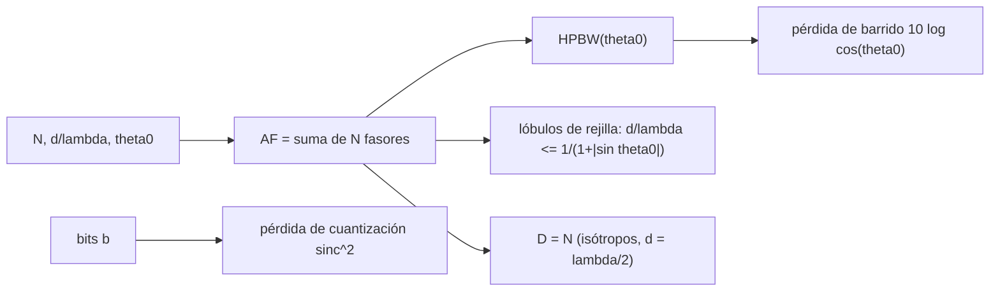

# B91-C03 — Arreglos de antenas y antenas de barrido electrónico

<!-- nav:top -->
[🏠 Programa](../../../../README.md) · [📚 Bloque B91](../../../tronco-comun/B91-antenas-y-propagacion-para-enlaces-espaciales.md) · [← Anterior: B91-C02 — Polarización de antenas y pérdidas por desadaptación](../B91-C02-polarizacion-de-antenas-y-perdidas-por-desadaptacion/CLASE.md) · [Siguiente: B91-C04 — Antenas desplegables y estructuras de gran apertura →](../B91-C04-antenas-desplegables-y-estructuras-de-gran-apertura/CLASE.md)
<!-- /nav -->

## 1. Ubicación, nivel y alcance

Clase 3 del bloque B91. Nivel N4. Un arreglo suma las señales de varios elementos pequeños; cambiando la fase de cada uno se orienta el haz sin mover nada. Aquí calculas el factor de arreglo de un arreglo lineal uniforme, su barrido, el límite de los lóbulos de rejilla y la pérdida por usar desfasadores de pocos bits. La calibración de fase de interferómetros está en [B46](../../../tronco-comun/B46-radioastronomia-e-interferometria.md); aquí se trata el arreglo como antena de un satélite o de una estación. El arreglo es **sintético**: no corresponde a ningún producto.

## 2. Por qué esta clase existe

Las antenas de barrido electrónico apuntan en microsegundos y no tienen partes móviles, pero cuestan más y pierden ganancia al desviar el haz. La decisión central: **¿cuántos elementos, qué separación y cuántos bits de fase hacen falta para un haz de cierto ancho y un barrido sin lóbulos de rejilla?**

## 3. Lo que podrás hacer al terminar

1. Calcular el factor de arreglo `AF` de un arreglo lineal uniforme por suma directa y por forma cerrada.
2. Calcular la directividad de un arreglo de elementos isótropos y verificarla con la integral numérica.
3. Calcular el ancho de haz de media potencia en función del ángulo de barrido.
4. Aplicar la condición de ausencia de lóbulos de rejilla `d/λ ≤ 1/(1 + |sin θ₀|)`.
5. Estimar la pérdida por proyección de apertura `10 log cos θ₀` y la pérdida por cuantización de fase.
6. Rotular el arreglo y el elemento como sintéticos e ilustrativos.

La evidencia es la **ficha de un arreglo lineal con barrido** del ejercicio 12 (sección 20).

## 4. Con qué llegas y cómo comprobarlo

1. ¿Qué es la interferencia constructiva?
2. ¿Qué es una suma geométrica de exponenciales complejas?
3. ¿Qué es un número de onda `k`?
4. ¿Qué es el ángulo de barrido?
5. ¿Qué es una semilla fija?

<details>
<summary>Ver respuestas</summary>

1. La suma de ondas en fase, que refuerza la señal. 2. `Σ e^{jnψ} = (1 − e^{jNψ})/(1 − e^{jψ})`, de módulo `|sin(Nψ/2)/sin(ψ/2)|`. 3. `k = 2π/λ`, en rad/m. 4. El ángulo del haz respecto de la normal al arreglo. 5. Un valor inicial del generador aleatorio que hace reproducible el experimento.
</details>

Con cuatro o cinco aciertos, sigue; si no, repasa los prerrequisitos.

## 5. Un caso de contexto y casos de referencia

Un arreglo **sintético** de `N = 16` elementos isótropos separados `d = 0,5 λ` tiene una directividad de `16,00` (`12,04 dBi`) y un haz de `6,36°` en la normal. Al desviarlo a `60°` el haz se ensancha a `12,99°` y la ganancia proyectada cae `3,01 dB`. Con `d = 0,6 λ` aparece un lóbulo de rejilla a `60°`. Es el **ejemplo conductor**; todo es calculado sobre datos sintéticos: no se consultó ninguna fuente externa.

## 6. Vocabulario

El **factor de arreglo** `AF(θ) = Σₙ e^{jnψ}` con `ψ = k d (sin θ − sin θ₀)` describe la suma de los `N` elementos con una fase progresiva que dirige el haz a `θ₀`. Un **lóbulo de rejilla** es un máximo adicional del mismo nivel que el principal, causado por una separación excesiva. La **pérdida de barrido** es la caída de ganancia al desviar el haz. Un **desfasador de `b` bits** solo ofrece `2^b` fases.

## 7. Modelo mental



*Descripción textual:* de `N`, la separación y el ángulo de barrido sale el factor de arreglo; de él, el ancho de haz, la condición de rejilla y la directividad; el barrido añade una pérdida por proyección y los desfasadores de pocos bits, una pérdida de cuantización.

Analogía: un grupo de personas que lanzan una ola; si cada una empieza con un retraso fijo, la cresta avanza en otra dirección. Límite: se supone acoplamiento mutuo nulo y elementos idénticos; los reales se acoplan y sus bordes distorsionan el patrón.

## 8. La explicación, paso a paso

### 8.1 Factor de arreglo

La suma directa de 16 fasores y la forma cerrada `|sin(Nψ/2)/sin(ψ/2)|` coinciden con error máximo `8 × 10⁻¹⁵` en el rango de −89° a 89° con barrido a 20°.

### 8.2 Directividad y ancho de haz

Con elementos isótropos y `d = λ/2`, la directividad es `N`: la integral numérica da `16,0000` (`12,04 dBi`). El ancho de haz crece al desviar el haz, y `HPBW · cos θ₀` se mantiene casi constante:

| `θ₀` | HPBW (°) | HPBW `cos θ₀` (°) | `D` (isótropos) | Pérdida de proyección (dB) |
|---|---|---|---|---|
| 0° | 6,356 | 6,356 | 16,000 | 0,000 |
| 20° | 6,766 | 6,358 | 16,000 | −0,270 |
| 40° | 8,318 | 6,372 | 16,000 | −1,157 |
| 60° | 12,992 | 6,496 | 16,000 | −3,010 |

La directividad de elementos isótropos no cae con el barrido; la de un elemento real sí, aproximadamente como `cos θ₀` (modelo ilustrativo `U ∼ cos θ`), de ahí la columna de pérdida de proyección. A 60° se pierde la mitad de la ganancia.

### 8.3 Lóbulos de rejilla

Si `d/λ > 1/(1 + |sin θ₀|)` aparece un máximo de nivel igual al principal. Con `N = 16`:

| `d/λ` | `θ₀ = 0°` | `θ₀ = 30°` | `θ₀ = 60°` |
|---|---|---|---|
| límite | 1,000 | 0,667 | 0,536 |
| 0,5 | no | no | no |
| 0,6 | no | no | **sí** |
| 0,8 | no | **sí** | **sí** |

### 8.4 Cuantización de fase

Con desfasadores de `b` bits el error de fase de cada elemento es uniforme en `±π/2^b`; la pérdida media de ganancia es `sinc²(π/2^b)`:

| Bits | Simulada (semilla 91) | `sinc²` teórica |
|---|---|---|
| 2 | −0,854 dB | −0,912 dB |
| 3 | −0,212 dB | −0,224 dB |
| 4 | −0,052 dB | −0,056 dB |
| 6 | −0,003 dB | −0,004 dB |

### 8.5 Qué cambia y qué no

Más elementos estrechan el haz (`HPBW ∝ 1/(N d cos θ₀)`) pero no cambian la condición de rejilla, que depende de `d/λ` y de `θ₀`. Un barrido amplio exige `d` menor que `λ/2`.

## 9. Magnitudes, símbolos y unidades

| Símbolo | Qué es | Unidad | Valor / nota |
|---|---|---|---|
| `N` | número de elementos | — | 16 (sintético) |
| `d` | separación | `λ` | 0,5 |
| `θ₀` | ángulo de barrido | grados | 0–60 |
| `ψ` | `k d (sin θ − sin θ₀)` | rad | — |
| `AF` | factor de arreglo | — | módulo hasta `N` |
| `b` | bits del desfasador | — | 2–6 |

## 10. Convenciones y referencias

`θ` medido desde la normal al arreglo, en el plano del arreglo; arreglo sobre un eje, elementos isótropos idénticos y sin acoplamiento mutuo. La pérdida de barrido `10 log cos θ₀` es un modelo ilustrativo, no se obtiene por integración. Semilla fija 91 y 400 repeticiones para la cuantización.

## 11. De dónde sale lo que afirmamos

| ID | Fuente | Localizador | Respalda | Estado |
|---|---|---|---|---|
| — | Relaciones estándar de arreglos (factor de arreglo, rejilla, `sinc²` de cuantización) | — | las verifica el laboratorio por suma directa y por forma cerrada | No consultada en una fuente concreta |

Límites: no se consultó ninguna fuente externa en esta clase: todo es cálculo sobre un arreglo sintético; la teoría no se contrastó con un libro de texto ni con un arreglo real.

## 12. Cómo ver el barrido

| Magnitud | Valor |
|---|---|
| Directividad broadside | 16,00 (12,04 dBi) |
| HPBW a 0° y 60° | 6,36° y 12,99° |
| Pérdida de proyección a 60° | −3,01 dB |
| Rejilla con `d = 0,6 λ` a 60° | sí |
| Pérdida con 3 bits | −0,21 dB (simulada) |

Descripción larga: el haz se ensancha como `1/cos θ₀`, la ganancia proyectada cae `3 dB` a 60° y la cuantización de 3 bits cuesta unas décimas de dB.

## 13. Ejemplo trabajado: el límite de rejilla a 30°

**Paso 1 · Condición.** `d/λ ≤ 1/(1 + sin 30°) = 1/1,5 = 0,667`.

**Paso 2 · Con `d = 0,5`.** `0,5 < 0,667`: no hay lóbulo de rejilla.

**Paso 3 · Con `d = 0,8`.** `0,8 > 0,667`: aparece un lóbulo de nivel `1,000` del pico.

**Paso 4 · Con `d = 0,6`.** `0,6 < 0,667`: no hay a 30°, pero a 60° el límite es `0,536` y sí hay.

## 14. Distintas formas de describir un arreglo

**Por geometría:** `N`, `d/λ`. **Por fase:** `θ₀` y `b`. **Por patrón:** `AF(θ)`. **Por ganancia:** directividad y pérdida de barrido.

## 15. Práctica guiada

**Ejercicio 1 · guiado con los pasos indicados.** Calcula el límite de rejilla para `θ₀ = 45°`. *Pasos:* `1/(1 + sin θ₀)`.

<details><summary>Solución comentada</summary>

`sin 45° = 0,707`; `1/1,707 = 0,586`.
</details>

**Ejercicio 2 · guiado con una pista.** ¿Cuál es la directividad de un arreglo de 64 isótropos con `d = λ/2`? *Pista:* `D = N`.

<details><summary>Solución comentada</summary>

`64`, es decir `18,06 dBi`.
</details>

**Ejercicio 3 · guiado, casi autónomo.** ¿Cuánto se ensancha el haz a 60° respecto de la normal? *Casi autónomo:* `1/cos θ₀`.

<details><summary>Solución comentada</summary>

`1/cos 60° = 2`; el laboratorio da `12,99/6,36 = 2,04`.
</details>

## 16. Práctica autónoma, transferencia e integrador

**Ejercicio 4 · autónomo.** Calcula la pérdida de proyección a 45°.

<details><summary>Solución comentada</summary>

`10 log cos 45° = −1,50 dB`.
</details>

**Ejercicio 5 · autónomo.** Con 16 elementos, ¿cuántos dB sube la directividad si se pasa a 32 (isótropos, `d = λ/2`)?

<details><summary>Solución comentada</summary>

`+3,01 dB` (`D` pasa de 16 a 32).
</details>

**Ejercicio 6 · autónomo.** Calcula la pérdida por cuantización de 5 bits con `sinc²(π/32)`.

<details><summary>Solución comentada</summary>

`x = 0,0982`; `sinc² = 0,9968`; `−0,014 dB`.
</details>

**Ejercicio 7 · autónomo.** ¿Qué bits hacen falta para que la pérdida de cuantización sea menor que 0,1 dB?

<details><summary>Solución comentada</summary>

3 bits dan `−0,22 dB`; 4 bits dan `−0,056 dB`: se necesitan 4.
</details>

**Ejercicio 8 · autónomo.** ¿Qué `d/λ` máxima permite barrer hasta 30° sin rejilla?

<details><summary>Solución comentada</summary>

`0,667`; en la práctica se elige `0,5` para tener margen.
</details>

**Ejercicio 9 · transferencia.** **Transferencia.** Un fabricante anuncia barrido a ±75° con `d = 0,6 λ`. ¿Es plausible?

<details><summary>Solución comentada</summary>

No: el límite a 75° es `1/(1 + 0,966) = 0,509`; con `0,6 λ` habría lóbulo de rejilla.
</details>

**Ejercicio 10 · transferencia.** **Transferencia.** Un arreglo de barrido pierde 3 dB a 60° y un reflector con motor no pierde nada. ¿Por qué elegir el arreglo?

<details><summary>Solución comentada</summary>

Por velocidad de apuntamiento (microsegundos), ausencia de partes móviles y perturbaciones de actitud nulas; el reflector gana en ganancia por masa y costo (se compara en C06).
</details>

**Ejercicio 11 · transferencia.** **Transferencia.** Un arreglo se diseña para 8,4 GHz y se usa a 12 GHz sin cambiar `d`. ¿Qué pasa con `d/λ`?

<details><summary>Solución comentada</summary>

`d/λ` sube a `0,5 × 12/8,4 = 0,714`: ya excede el límite de 0,667 a 30°; aparecen rejillas.
</details>

**Ejercicio 12 · integrador.** **Integrador.** Elabora tu *ficha de un arreglo lineal con barrido*: `N`, `d/λ`, directividad, HPBW y pérdida a cuatro ángulos, límite de rejilla y pérdida por cuantización, con lo sintético rotulado.

<details><summary>Solución comentada</summary>

Secciones 8.1–8.5 y la salida del laboratorio.
</details>

## 17. Laboratorio: arreglo lineal con barrido

El script [arreglo_lineal.py](arreglo_lineal.py) suma los fasores, contrasta con la forma cerrada, integra la directividad, mide el ancho de haz por bisección, busca lóbulos de rejilla y simula la cuantización de fase (**comprueba** error < 1e-9 y directividad = `N` con 1e-3).

**Datos:** arreglo **sintético**; ninguna fuente externa. **Predice antes de ejecutar:** ¿qué ancho de haz tendrá a 60°? (≈ 13°). **Ejecución del 2026-11-10 (Python 3.12.9):**

```text
Python 3.12.9 (biblioteca estandar)
Arreglo SINTETICO N = 16, d = 0.5 lambda. Suma directa frente a forma cerrada: error maximo = 7.98e-15
Directividad broadside (isotropos): D = 16.0000  (N = 16); 12.04 dBi
Barrido: ancho de haz y perdida de barrido por proyeccion de la apertura (perdida = 10 log cos theta0, modelo ILUSTRATIVO de elemento con U ~ cos theta)
 theta0 [deg]  HPBW [deg]  HPBW*cos(th0) [deg]  D_isotropos  perdida_proyeccion [dB]
        0         6.356          6.356            16.000        0.000
       20         6.766          6.358            16.000       -0.270
       40         8.318          6.372            16.000       -1.157
       60        12.992          6.496            16.000       -3.010
  HPBW*cos(theta0) casi constante: el haz se ensancha como 1/cos(theta0). La directividad de isotropos no cae, la del elemento real si (ver teoria).
Lobulos de rejilla: condicion d/lambda <= 1/(1 + |sin theta0|)
   d = 0.5 lambda, theta0 =  0 deg: limite 1.000; lobulo de rejilla no (maximo fuera del haz = 0.164 del pico)
   d = 0.5 lambda, theta0 = 30 deg: limite 0.667; lobulo de rejilla no (maximo fuera del haz = 0.220 del pico)
   d = 0.5 lambda, theta0 = 60 deg: limite 0.536; lobulo de rejilla no (maximo fuera del haz = 0.390 del pico)
   d = 0.6 lambda, theta0 =  0 deg: limite 1.000; lobulo de rejilla no (maximo fuera del haz = 0.133 del pico)
   d = 0.6 lambda, theta0 = 30 deg: limite 0.667; lobulo de rejilla no (maximo fuera del haz = 0.192 del pico)
   d = 0.6 lambda, theta0 = 60 deg: limite 0.536; lobulo de rejilla SI (maximo fuera del haz = 1.000 del pico)
   d = 0.8 lambda, theta0 =  0 deg: limite 1.000; lobulo de rejilla no (maximo fuera del haz = 0.104 del pico)
   d = 0.8 lambda, theta0 = 30 deg: limite 0.667; lobulo de rejilla SI (maximo fuera del haz = 1.000 del pico)
   d = 0.8 lambda, theta0 = 60 deg: limite 0.536; lobulo de rejilla SI (maximo fuera del haz = 1.000 del pico)
Cuantizacion de fase (semilla 91, 400 repeticiones, theta0 = 30 deg):
  bits   perdida de ganancia media [dB]   sinc^2 teorico [dB]
     2         -0.8539                    -0.9121
     3         -0.2119                    -0.2244
     4         -0.0519                    -0.0559
     6         -0.0033                    -0.0035
Pruebas superadas.
```

```bash
python programa/clases/B91/B91-C03-arreglos-de-antenas-y-antenas-de-barrido-electronico/arreglo_lineal.py
```

**Límites:** elementos isótropos sin acoplamiento mutuo; la pérdida de barrido es un modelo ilustrativo; sin ruido de amplitud ni fallos de elementos.

## 18. Errores frecuentes y cómo corregirlos

**Creer que la directividad no cambia con el barrido.** Con elementos reales cae; ver 8.2.

**Usar `d = λ` por «tener más ganancia».** Aparecen rejillas desde `θ₀ = 0`; ver 8.3.

**Ignorar la cuantización de la fase.** Ver 8.4.

**Presentar el arreglo sintético como un producto real.** Ver la sección 11.

## 19. Cómo sabrás que vas bien

Tras la sección 8: ¿qué ancho de haz esperabas a 60° y cuál obtuviste? Si dudas, repasa el ejemplo 13. Tras el laboratorio: ¿qué comprueba? (ver la sección 17).

## 20. Qué entregas y cómo se evalúa

El producto es tu **ficha de un arreglo lineal con barrido** (ejercicio 12).

| Criterio | Inicial | En desarrollo | Logrado | Destacado |
|---|---|---|---|---|
| Conceptos | Los confunde | Parciales | Calcula `AF`, HPBW y rejilla | Explica los límites |
| Cálculo | Sin unidades | Con errores | Tablas completas con unidades | Calcula casos nuevos |
| Numérico | Sin comprobar | Un caso | Contraste con una segunda vía | Interpreta las diferencias |
| Fuentes | Sin fuente | Sin fecha | Fuentes con fecha y estado | Declara lo sintético y lo no consultado |
| Límites | No los nombra | Uno | Tres | Discute qué falta del modelo |

**Condiciones críticas (no se compensan con promedio):** rotular el arreglo como sintético; no afirmar rendimiento de un producto real; citar solo lo consultado (aquí, nada).

## 21. Ética, seguridad y límites

Clase educativa: los modelos son simplificados y sus datos son sintéticos, ilustrativos o publicados con fuente; ningún resultado sustituye a la norma del operador, a una medición en cámara ni a un diseño certificado. Lo simulado no se presenta como observado. Accesibilidad: tablas equivalentes a las gráficas, fórmulas en texto, ejercicios sin conexión.

## 22. Para cerrar y seguir

Un arreglo de 16 elementos tiene `12,04 dBi` y un haz de `6,4°`; a 60° el haz se duplica y la ganancia proyectada cae `3 dB`. Queda una pregunta: ¿cómo cabe una gran apertura en un cohete?

**Glosario español–inglés.** factor de arreglo · *array factor*; lóbulo de rejilla · *grating lobe*; barrido electrónico · *electronic scanning*; desfasador · *phase shifter*; cuantización · *quantization*.

**Continuidad.** [B91-C04](../B91-C04-antenas-desplegables-y-estructuras-de-gran-apertura/CLASE.md) estudia las antenas desplegables y su límite de precisión.

**Referencias:** ver sección 11.

<!-- nav:bottom -->
---

[← Anterior: B91-C02 — Polarización de antenas y pérdidas por desadaptación](../B91-C02-polarizacion-de-antenas-y-perdidas-por-desadaptacion/CLASE.md) · [📚 Bloque B91](../../../tronco-comun/B91-antenas-y-propagacion-para-enlaces-espaciales.md) · [Siguiente: B91-C04 — Antenas desplegables y estructuras de gran apertura →](../B91-C04-antenas-desplegables-y-estructuras-de-gran-apertura/CLASE.md)
<!-- /nav -->
