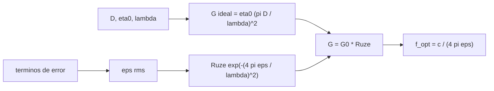

# B91-C04 — Antenas desplegables y estructuras de gran apertura

<!-- nav:top -->
[🏠 Programa](../../../../README.md) · [📚 Bloque B91](../../../tronco-comun/B91-antenas-y-propagacion-para-enlaces-espaciales.md) · [← Anterior: B91-C03 — Arreglos de antenas y antenas de barrido electrónico](../B91-C03-arreglos-de-antenas-y-antenas-de-barrido-electronico/CLASE.md) · [Siguiente: B91-C05 — Medición y calibración de antenas →](../B91-C05-medicion-y-calibracion-de-antenas/CLASE.md)
<!-- /nav -->

## 1. Ubicación, nivel y alcance

Clase 4 del bloque B91. Nivel N4. Un reflector grande no cabe plegado en el carenado: se despliega en órbita, y su malla nunca queda perfectamente parabólica. Aquí calculas cuánta ganancia cuesta ese error de superficie con la fórmula de Ruze, a qué frecuencia deja de compensar un reflector mayor y cómo se suman los errores en un presupuesto. Los mecanismos en general están en [B84](../../../tronco-comun/B84-estructuras-materiales-y-fabricacion-espacial.md); aquí se trata el efecto del error de forma sobre la antena. El reflector de 3 m es **sintético**.

## 2. Por qué esta clase existe

Una malla desplegable pesa poco y cabe plegada, pero su precisión de forma limita la frecuencia útil. La decisión central: **¿hasta qué frecuencia vale la pena usar un reflector con un error de superficie dado, y qué término del presupuesto de error conviene reducir?**

## 3. Lo que podrás hacer al terminar

1. Calcular la ganancia de un reflector con error de superficie con la fórmula de Ruze.
2. Obtener la frecuencia de ganancia máxima `λ_opt = 4π ε` analíticamente y por búsqueda numérica.
3. Convertir una relación `ε/λ` en una pérdida en dB.
4. Combinar términos independientes de error en un presupuesto RSS.
5. Estimar masa y razón de empaquetado de un reflector de malla (datos sintéticos).
6. Rotular el reflector y sus errores como sintéticos.

La evidencia es la **ficha de un reflector desplegable** del ejercicio 12 (sección 20).

## 4. Con qué llegas y cómo comprobarlo

1. ¿Qué es el error cuadrático medio (rms)?
2. ¿Qué es una función exponencial decreciente `e^{−x²}`?
3. ¿Qué es un máximo de una función?
4. ¿Cómo se suman errores independientes?
5. ¿Qué es la eficiencia de apertura?

<details>
<summary>Ver respuestas</summary>

1. La raíz de la media de los cuadrados de las desviaciones. 2. Una curva que cae de 1 hacia 0 cuando `|x|` crece. 3. El punto donde la derivada vale cero y la función deja de crecer. 4. Cuadráticamente (RSS): `√(Σεᵢ²)`. 5. La fracción de la ganancia ideal `(πD/λ)²` que se logra (ver C01).
</details>

Con cuatro o cinco aciertos, sigue; si no, repasa los prerrequisitos.

## 5. Un caso de contexto y casos de referencia

Un reflector **sintético** de `D = 3,0 m` con `η₀ = 0,65` y error rms de superficie `ε = 0,5 mm` tiene su ganancia máxima a `47,71 GHz`, con una eficiencia de superficie de `e⁻¹ = 0,368` (`4,34 dB` perdidos). A 8,4 GHz pierde `0,135 dB`, y a 32 GHz, `1,953 dB`. Es el **ejemplo conductor**; los datos son calculados sobre una malla hipotética y no corresponden a ningún reflector real.

## 6. Vocabulario

El **error rms de superficie** `ε` es la desviación típica de la superficie real respecto de la parabólica ideal. La **fórmula de Ruze** da la eficiencia por superficie `exp(−(4πε/λ)²)`. La **frecuencia óptima** es aquella en la que ganar apertura eléctrica deja de compensar la pérdida. El **presupuesto RSS** suma errores independientes. Una **malla** es una superficie tejida que refleja a radiofrecuencia y pesa poco.

## 7. Modelo mental



*Descripción textual:* la ganancia ideal sube con `f²` y el factor de Ruze baja con `f²` en el exponente; el producto tiene un máximo en `λ = 4π ε`. Los términos independientes del presupuesto se combinan en un `ε` único.

Analogía: un espejo de maquillaje deformado nitidiza hasta cierto aumento y luego solo emborrona. Límite: la fórmula supone errores aleatorios no correlacionados con distribución gaussiana; los errores sistemáticos de despliegue (pliegues, tensión) se correlacionan y se comportan distinto.

## 8. La explicación, paso a paso

### 8.1 Ganancia con error

`G = η₀ (πD/λ)² exp(−(4πε/λ)²)`. Con `x = 1/λ²`, `G ∝ x e^{−a x}` con `a = (4πε)²`: su máximo está en `x = 1/a`, es decir `λ_opt = 4πε`. Con `ε = 0,5 mm`: `λ_opt = 6,283 mm`, `f_opt = 47,7135 GHz`. La búsqueda por sección áurea da `47,7135 GHz` (error relativo `1,3 × 10⁻⁸`). En el óptimo la eficiencia de superficie es `e⁻¹`, `4,34 dB`, y la ganancia, `57,31 dBi`.

### 8.2 Efecto por banda

| Banda | `f` (GHz) | `λ` (mm) | Ruze (dB) | `G` sin error (dBi) | `G` con error (dBi) |
|---|---|---|---|---|---|
| S | 2,2 | 136,27 | −0,009 | 34,93 | 34,92 |
| X | 8,4 | 35,69 | −0,135 | 46,56 | 46,43 |
| Ku | 14,0 | 21,41 | −0,374 | 51,00 | 50,63 |
| Ka | 32,0 | 9,37 | −1,953 | 58,18 | 56,23 |
| Ka alto | 40,0 | 7,49 | −3,052 | 60,12 | 57,07 |

### 8.3 Pérdida según `ε/λ`

| `ε` | Pérdida (dB) |
|---|---|
| `λ/16` | 2,679 |
| `λ/30` | 0,762 |
| `λ/50` | 0,274 |
| `λ/100` | 0,069 |

### 8.4 Presupuesto de error (sintético)

Cuatro términos independientes: malla `0,30 mm`, tensión de cables `0,25`, deformación térmica `0,20` y tolerancia de despliegue `0,25`. El total RSS es `0,505 mm`; la suma lineal, `1,00 mm`, es una cota pesimista que sobrestimaría la pérdida cuatro veces en dB. El término mayor (la malla) domina.

### 8.5 Empaquetado (hipótesis sintética)

Con masa areal `0,5 kg/m²` un reflector de 3 m pesa `3,53 kg` y uno de 10 m, `39,27 kg`; si cada pétalo se pliega al `20 %` del diámetro, la razón de empaquetado es `5` para cualquier `D` (resultado de la hipótesis, no de una estructura).

### 8.6 Qué cambia y qué no

Reducir `ε` a la mitad desplaza el óptimo al doble de frecuencia. La ganancia a baja frecuencia casi no cambia con `ε`; a alta frecuencia, domina.

## 9. Magnitudes, símbolos y unidades

| Símbolo | Qué es | Unidad | Valor / nota |
|---|---|---|---|
| `D` | diámetro | m | 3,0 (sintético) |
| `η₀` | eficiencia sin error | — | 0,65 (sintética) |
| `ε` | error rms de superficie | mm | 0,5 (sintético) |
| `λ_opt` | longitud de onda de ganancia máxima | mm | `4πε = 6,28` |
| `f_opt` | frecuencia óptima | GHz | 47,71 |
| `G` | ganancia | dBi | ver 8.2 |

## 10. Convenciones y referencias

Error rms medido sobre la superficie, perpendicular a la parábola ideal; errores independientes y gaussianos. La fórmula de Ruze es una relación estándar que no se consultó en una fuente concreta; el laboratorio la verifica con una segunda vía (máximo analítico frente a búsqueda numérica). Toda la geometría y la masa son sintéticas.

## 11. De dónde sale lo que afirmamos

| ID | Fuente | Localizador | Respalda | Estado |
|---|---|---|---|---|
| — | Fórmula de Ruze (relación estándar) y datos del reflector | — | la verifica el laboratorio con dos vías; los datos del reflector son sintéticos | No consultada en una fuente concreta |

Límites: no se consultó ninguna fuente externa en esta clase; no se consultaron los trabajos originales de Ruze ni datos de reflectores de misión reales; los errores sistemáticos de despliegue no se modelan.

## 12. Cómo ver el límite de frecuencia

| Magnitud | Valor |
|---|---|
| `f_opt` analítica = numérica | 47,7135 GHz |
| Eficiencia de superficie en `f_opt` | 0,368 (−4,34 dB) |
| Pérdida de Ruze a 8,4 GHz | −0,135 dB |
| Pérdida de Ruze a 32 GHz | −1,953 dB |
| Error RSS frente a suma lineal | 0,505 mm frente a 1,00 mm |

Descripción larga: la pérdida de Ruze crece con el cuadrado de la frecuencia: despreciable en banda S, de décimas en X y de dB en Ka.

## 13. Ejemplo trabajado: la pérdida de Ruze en banda Ka

**Paso 1 · Longitud de onda.** `λ = 299 792 458/32 × 10⁹ = 9,37 mm`.

**Paso 2 · Argumento.** `4πε/λ = 4π × 0,5/9,37 = 0,6706`.

**Paso 3 · Eficiencia.** `exp(−0,6706²) = exp(−0,4497) = 0,638`.

**Paso 4 · Pérdida.** `−10 log 0,638 = 1,95 dB`.

## 14. Distintas formas de describir un reflector desplegable

**Por geometría:** `D`, `f/D`. **Por precisión:** `ε/λ`. **Por masa:** kg/m² de apertura. **Por empaquetado:** razón de diámetros. **Por ganancia:** `G(f)` en dBi.

## 15. Práctica guiada

**Ejercicio 1 · guiado con los pasos indicados.** Calcula `λ_opt` para `ε = 0,5 mm`. *Pasos:* `4π ε`.

<details><summary>Solución comentada</summary>

`4π × 0,5 = 6,283 mm`.
</details>

**Ejercicio 2 · guiado con una pista.** Calcula la frecuencia óptima. *Pista:* `c/λ_opt`.

<details><summary>Solución comentada</summary>

`299 792 458/6,283 × 10⁻³ = 47,71 GHz`.
</details>

**Ejercicio 3 · guiado, casi autónomo.** Calcula la pérdida de Ruze a 8,4 GHz. *Casi autónomo:* `λ = 35,69 mm`.

<details><summary>Solución comentada</summary>

`4π × 0,5/35,69 = 0,176`; `0,176² = 0,031`; `10 log e^{0,031} = 0,135 dB`.
</details>

## 16. Práctica autónoma, transferencia e integrador

**Ejercicio 4 · autónomo.** Calcula la pérdida con `ε = λ/50`.

<details><summary>Solución comentada</summary>

`(4π/50)² = 0,0632`; `0,274 dB`.
</details>

**Ejercicio 5 · autónomo.** ¿Qué `ε` mantiene la pérdida de Ruze bajo 0,5 dB a 32 GHz?

<details><summary>Solución comentada</summary>

`(4πε/λ)² ≤ 0,5/4,343 = 0,1151`; `4πε/λ ≤ 0,339`; `ε ≤ 0,339 × 9,37/(4π) = 0,253 mm`.
</details>

**Ejercicio 6 · autónomo.** Si `ε` baja a 0,25 mm, ¿cuál es la nueva `f_opt`?

<details><summary>Solución comentada</summary>

`95,4 GHz`: se duplica.
</details>

**Ejercicio 7 · autónomo.** Calcula el RSS de `0,30` y `0,40 mm`.

<details><summary>Solución comentada</summary>

`√(0,09 + 0,16) = 0,50 mm`.
</details>

**Ejercicio 8 · autónomo.** ¿Cuál es la masa de un reflector de 5 m con masa areal 0,5 kg/m²?

<details><summary>Solución comentada</summary>

`0,5 × π × 2,5² = 9,82 kg` (laboratorio).
</details>

**Ejercicio 9 · transferencia.** **Transferencia.** Un fabricante promete 0,1 dB de pérdida de Ruze a 32 GHz con `ε = 0,5 mm`. ¿Es plausible?

<details><summary>Solución comentada</summary>

No: el cálculo da `1,95 dB`; para 0,1 dB haría falta `ε ≈ 0,11 mm`.
</details>

**Ejercicio 10 · transferencia.** **Transferencia.** Un reflector de malla se usa a 26 GHz y se mide `ε = 0,8 mm`. ¿Cuánto pierde y qué término del presupuesto atacarías primero?

<details><summary>Solución comentada</summary>

`λ = 11,5 mm`; `(4π × 0,8/11,5)² = 0,764`; `3,3 dB`. Se ataca el término mayor del presupuesto RSS (aquí, la malla) porque domina la suma cuadrática.
</details>

**Ejercicio 11 · transferencia.** **Transferencia.** Un diseñador propone una antena de 10 m para 32 GHz con el mismo `ε`. ¿Qué gana y qué pierde?

<details><summary>Solución comentada</summary>

Gana `20 log(10/3) = 10,5 dB` de apertura, pero la pérdida de Ruze es la misma (−1,95 dB), y el haz se estrecha, de modo que sube la exigencia de apuntamiento.
</details>

**Ejercicio 12 · integrador.** **Integrador.** Elabora tu *ficha de un reflector desplegable*: `D`, `ε`, `f_opt`, pérdida por banda, presupuesto RSS y qué es sintético.

<details><summary>Solución comentada</summary>

Secciones 8.1–8.6 y la salida del laboratorio.
</details>

## 17. Laboratorio: reflector desplegable, Ruze y presupuesto de error

El script [ruze_desplegable.py](ruze_desplegable.py) calcula la ganancia con y sin error, halla la frecuencia óptima de forma analítica y numérica, tabula la pérdida por `ε/λ`, suma el presupuesto RSS y estima la masa y el empaquetado (**comprueba** `f_opt` analítica frente a numérica < 1e-6).

**Datos:** reflector, eficiencia, error y masa **sintéticos**; ninguna fuente externa. **Predice antes de ejecutar:** ¿cuál será `f_opt` con `ε = 0,5 mm`? (≈ 48 GHz). **Ejecución del 2026-11-10 (Python 3.12.9):**

```text
Python 3.12.9 (biblioteca estandar)
Reflector SINTETICO: D = 3.0 m, eta0 = 0.65, error rms eps = 0.5 mm
Frecuencia optima: analitica = 47.7135 GHz ; numerica = 47.7135 GHz ; error relativo = 1.30e-08
Ganancia en el optimo = 57.31 dBi (eficiencia por superficie exp(-1) = 0.3679, es decir 4.34 dB)
Banda    f [GHz]   lambda [mm]   Ruze exp(-x^2) [dB]   G sin error [dBi]   G con error [dBi]
 S           2.2      136.27            -0.009                34.93              34.92
 X           8.4       35.69            -0.135                46.56              46.43
 Ku         14.0       21.41            -0.374                51.00              50.63
 Ka         32.0        9.37            -1.953                58.18              56.23
 Ka-alto    40.0        7.49            -3.052                60.12              57.07
Perdida de Ruze segun eps/lambda (relacion estandar):
   eps = lambda/16 : 2.679 dB
   eps = lambda/30 : 0.762 dB
   eps = lambda/50 : 0.274 dB
   eps = lambda/100: 0.069 dB
Presupuesto de error rms (mm, SINTETICO, terminos independientes):
   fabricacion de la malla      0.30
   tension de los cables        0.25
   deformacion termica          0.20
   tolerancia de despliegue     0.25
   total RSS = 0.505 mm ; suma lineal = 1.00 mm (cota superior pesimista)
Empaquetado (SINTETICO): D desplegado frente al diametro de la envolvente plegada
 D [m]   masa areal 0.5 kg/m2 -> masa [kg]   petalo plegado (20 % D) [m]   razon D/D_plegado
   1.0            0.39                        0.20                   5.0
   2.0            1.57                        0.40                   5.0
   3.0            3.53                        0.60                   5.0
   5.0            9.82                        1.00                   5.0
  10.0           39.27                        2.00                   5.0
Pruebas superadas.
```

```bash
python programa/clases/B91/B91-C04-antenas-desplegables-y-estructuras-de-gran-apertura/ruze_desplegable.py
```

**Límites:** errores aleatorios gaussianos; sin errores sistemáticos de despliegue ni deformación térmica real; el empaquetado es una hipótesis.

## 18. Errores frecuentes y cómo corregirlos

**Creer que más frecuencia siempre da más ganancia.** Ruze lo impide; ver 8.1.

**Sumar errores linealmente.** Se suman cuadráticamente; ver 8.4.

**Confundir `ε` rms con la desviación máxima.** Ver la sección 6.

**Presentar el reflector sintético como uno real.** Ver la sección 11.

## 19. Cómo sabrás que vas bien

Tras la sección 8: ¿qué `f_opt` esperabas y cuál obtuviste? Si dudas, repasa el ejemplo 13. Tras el laboratorio: ¿qué comprueba? (ver la sección 17).

## 20. Qué entregas y cómo se evalúa

El producto es tu **ficha de un reflector desplegable** (ejercicio 12).

| Criterio | Inicial | En desarrollo | Logrado | Destacado |
|---|---|---|---|---|
| Conceptos | Los confunde | Parciales | Calcula Ruze y `f_opt` | Explica los límites |
| Cálculo | Sin unidades | Con errores | Tablas completas con unidades | Calcula casos nuevos |
| Numérico | Sin comprobar | Un caso | Contraste con una segunda vía | Interpreta las diferencias |
| Fuentes | Sin fuente | Sin fecha | Fuentes con fecha y estado | Declara lo sintético y lo no consultado |
| Límites | No los nombra | Uno | Tres | Discute qué falta del modelo |

**Condiciones críticas (no se compensan con promedio):** rotular el reflector como sintético; no usar Ruze fuera de errores aleatorios sin avisarlo; citar solo lo consultado (aquí, nada).

## 21. Ética, seguridad y límites

Clase educativa: los modelos son simplificados y sus datos son sintéticos, ilustrativos o publicados con fuente; ningún resultado sustituye a la norma del operador, a una medición en cámara ni a un diseño certificado. Lo simulado no se presenta como observado. Accesibilidad: tablas equivalentes a las gráficas, fórmulas en texto, ejercicios sin conexión.

## 22. Para cerrar y seguir

Un reflector con `ε = 0,5 mm` gana más hasta `47,7 GHz` y pierde `1,95 dB` en banda Ka. Queda una pregunta: ¿cómo se comprueba, midiendo, que la antena fabricada cumple?

**Glosario español–inglés.** error de superficie · *surface error*; fórmula de Ruze · *Ruze formula*; malla desplegable · *deployable mesh*; presupuesto de error · *error budget*; razón de empaquetado · *stowage ratio*.

**Continuidad.** [B91-C05](../B91-C05-medicion-y-calibracion-de-antenas/CLASE.md) estudia la medición y calibración de antenas.

**Referencias:** ver sección 11.

<!-- nav:bottom -->
---

[← Anterior: B91-C03 — Arreglos de antenas y antenas de barrido electrónico](../B91-C03-arreglos-de-antenas-y-antenas-de-barrido-electronico/CLASE.md) · [📚 Bloque B91](../../../tronco-comun/B91-antenas-y-propagacion-para-enlaces-espaciales.md) · [Siguiente: B91-C05 — Medición y calibración de antenas →](../B91-C05-medicion-y-calibracion-de-antenas/CLASE.md)
<!-- /nav -->
