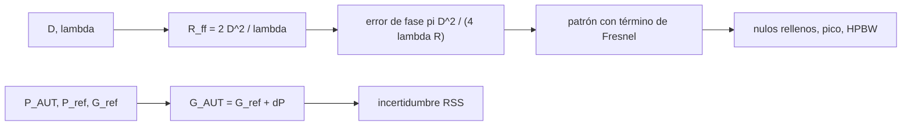

# B91-C05 — Medición y calibración de antenas

<!-- nav:top -->
[🏠 Programa](../../../../README.md) · [📚 Bloque B91](../../../tronco-comun/B91-antenas-y-propagacion-para-enlaces-espaciales.md) · [← Anterior: B91-C04 — Antenas desplegables y estructuras de gran apertura](../B91-C04-antenas-desplegables-y-estructuras-de-gran-apertura/CLASE.md) · [Siguiente: B91-C06 — Selección y compromiso de diseño de antenas →](../B91-C06-seleccion-y-compromiso-de-diseno-de-antenas/CLASE.md)
<!-- /nav -->

## 1. Ubicación, nivel y alcance

Clase 5 del bloque B91. Nivel N4. Un patrón de radiación solo se acepta tras medirlo, y la medición tiene sus propios errores. Aquí calculas la distancia mínima de campo lejano, el efecto de medir más cerca de lo debido y la incertidumbre de una medición de ganancia por sustitución. No se midió ninguna antena real: la antena bajo prueba (AUT) y el ruido son **sintéticos**. La ganancia de enlace está en [B89](../../../tronco-comun/B89-comunicaciones-y-navegacion-satelital.md); aquí se trata cómo se obtiene la ganancia que ese presupuesto usa.

## 2. Por qué esta clase existe

Una antena se acepta si su ganancia y su patrón medidos cumplen la especificación dentro de una incertidumbre conocida. La decisión central: **¿a qué distancia medir y con qué incertidumbre, para poder afirmar que la antena cumple?**

## 3. Lo que podrás hacer al terminar

1. Calcular la distancia de campo lejano `R = 2D²/λ`.
2. Calcular el error de fase en el borde de la apertura por medir a distancia finita.
3. Cuantificar el relleno de nulos, la pérdida de pico y el ensanchamiento del haz a distancias menores que `R`.
4. Aplicar el método de transferencia de ganancia (sustitución) con una antena de referencia.
5. Construir un presupuesto de incertidumbre combinada y expandida.
6. Rotular qué es medición real (ninguna) y qué es simulación sintética.

La evidencia es la **plan de medición con presupuesto de incertidumbre** del ejercicio 12 (sección 20).

## 4. Con qué llegas y cómo comprobarlo

1. ¿Qué es el campo lejano de una antena?
2. ¿Qué es una incertidumbre estándar y cómo se combinan varias?
3. ¿Qué es una semilla fija?
4. ¿Qué es una diferencia de camino?
5. ¿Qué es una antena de referencia calibrada?

<details>
<summary>Ver respuestas</summary>

1. La región donde el patrón angular ya no depende de la distancia y la onda es casi plana. 2. La desviación típica estimada de un resultado; las independientes se combinan en raíz de la suma de cuadrados. 3. Un valor inicial del generador aleatorio que hace reproducible el experimento. 4. La distancia extra que recorre una onda desde un punto de la apertura respecto de otro; produce un desfase. 5. Una antena cuya ganancia se conoce con su incertidumbre por un certificado.
</details>

Con cuatro o cinco aciertos, sigue; si no, repasa los prerrequisitos.

## 5. Un caso de contexto y casos de referencia

Una antena **sintética** de `D = 1,2 m` a `8,4 GHz` tiene `λ = 35,69 mm` y una distancia de campo lejano de `80,70 m`. Medirla a esa distancia produce un error de fase de `22,5°` en el borde, que rellena los nulos y apenas cambia el pico (`−0,060 dB`); a un cuarto de la distancia el error sube a `90°` y el pico cae `0,97 dB`. La ganancia medida por sustitución, con `0,274 dB` de incertidumbre típica combinada, es un ejemplo de presupuesto sintético. Es el **ejemplo conductor**; no hay ninguna medición real.

## 6. Vocabulario

La **distancia de campo lejano** `2D²/λ` es el criterio clásico para medir el patrón. El **error de fase en el borde** es `π D²/(4λR)`. El método de **transferencia de ganancia** compara la potencia recibida con la AUT y con una antena de referencia: `G_AUT = G_ref + (P_AUT − P_ref)`. La **incertidumbre combinada** es la raíz de la suma cuadrática de los términos independientes; la **expandida** la multiplica por un factor de cobertura `k` (aquí 2). El **patrón de un campo cercano** incluye el término de fase cuadrático (Fresnel).

## 7. Modelo mental



*Descripción textual:* de `D` y `λ` sale la distancia de campo lejano; a distancias menores aparece un error de fase que deforma el patrón; la ganancia se obtiene por comparación con una referencia y su incertidumbre, por suma cuadrática.

Analogía: fotografiar una torre desde muy cerca deforma la perspectiva; hay que alejarse para que los bordes se vean paralelos. Límite: el patrón calculado es el de una apertura lineal uniforme con aproximación de Fresnel, no el de una antena real con lóbulos laterales y acoplamientos.

## 8. La explicación, paso a paso

### 8.1 Campo lejano

`R_ff = 2D²/λ = 2 × 1,2²/0,03569 = 80,70 m`. A esa distancia la diferencia de camino entre el centro y el borde es `D²/(8R) = λ/16`, es decir un desfase de `22,5°` (el laboratorio lo verifica con `10⁻⁹`).

### 8.2 Medir más cerca

El laboratorio calcula el patrón numérico de una apertura lineal uniforme con el término de fase cuadrático. En el límite `R → ∞` coincide con `sinc²` (error máximo `9,3 × 10⁻⁴`). Con el HPBW teórico `0,886 λ/D = 1,510°`:

| `R/R_ff` | Fase en el borde (°) | Nivel en el nulo ideal (dB) | Pérdida de pico (dB) | Cambio del HPBW (%) |
|---|---|---|---|---|
| 10 | 2,25 | −41,86 | −0,001 | 0,00 |
| 4 | 5,63 | −33,99 | −0,004 | 0,00 |
| 2 | 11,25 | −27,99 | −0,015 | 0,15 |
| 1 | 22,50 | −22,00 | −0,060 | 0,30 |
| 0,5 | 45,00 | −16,08 | −0,240 | 1,37 |
| 0,25 | 90,00 | −10,48 | −0,972 | 6,23 |

El pico y el haz casi no cambian a `R_ff`, pero el nivel de los nulos sube de `−∞` a `−22 dB`: medir lóbulos laterales bajos exige más distancia que medir ganancia.

### 8.3 Transferencia de ganancia

Con `G_ref = 20,0 dBi` y ruido gaussiano de `0,05 dB` (30 repeticiones, semilla 91) se obtiene `G_AUT = 23,386 dBi` (el valor sintético verdadero es `23,4`), con desviación típica `0,052 dB` y error típico de la media `0,009 dB`.

### 8.4 Presupuesto de incertidumbre (sintético)

| Término | Incertidumbre típica (dB) |
|---|---|
| Ganancia de la referencia (certificado) | 0,200 |
| Desadaptación de impedancia | 0,100 |
| Alineación de polarización | 0,050 |
| Multitrayecto / reflexiones | 0,150 |
| Repetibilidad (tipo A) | 0,009 |
| **Combinada (k = 1)** | **0,274** |
| **Expandida (k = 2)** | **0,548** |

El término dominante es el certificado de la referencia; repetir más veces la medición no lo reduce.

### 8.5 Qué cambia y qué no

Alejarse mejora el patrón pero aumenta la pérdida de espacio libre y el multitrayecto; acercarse (campo cercano compacto, cámara) exige corregir matemáticamente. La repetibilidad baja con `√n`; la calibración de la referencia no.

## 9. Magnitudes, símbolos y unidades

| Símbolo | Qué es | Unidad | Valor / nota |
|---|---|---|---|
| `R_ff` | distancia de campo lejano | m | 80,70 (sintético) |
| `D` | dimensión de la AUT | m | 1,2 (sintético) |
| `λ` | longitud de onda | m | 0,03569 |
| `G_ref` | ganancia de la referencia | dBi | 20,0 (sintético) |
| `u_c` | incertidumbre combinada | dB | 0,274 |
| `k` | factor de cobertura | — | 2 |

## 10. Convenciones y referencias

Patrón en función de `u = sin θ`; apertura lineal uniforme de longitud `D`; aproximación de Fresnel para la fase `k x²/(2R)`. Todos los datos de medición son sintéticos, con semilla 91. Las relaciones (`2D²/λ`, sustitución, RSS) son estándar y no se consultaron en una fuente concreta; las recomendaciones IEEE sobre medición de antenas no se consultaron.

## 11. De dónde sale lo que afirmamos

| ID | Fuente | Localizador | Respalda | Estado |
|---|---|---|---|---|
| — | Relaciones estándar de medición de antenas (`2D²/λ`, transferencia de ganancia, RSS) | — | las verifica el laboratorio con el límite `sinc²` y con 22,5° exactos | No consultada en una fuente concreta |

Límites: no se consultó ninguna fuente externa en esta clase ni normas de medición (IEEE, ISO/IEC); no se midió ninguna antena; el patrón es el de una apertura lineal ideal.

## 12. Cómo ver el error de distancia finita

| Magnitud | Valor |
|---|---|
| `R_ff` | 80,70 m |
| Fase en el borde en `R_ff` | 22,5° |
| Pérdida de pico en `R_ff` | −0,060 dB |
| Nivel en el nulo ideal en `R_ff` | −22,0 dB |
| Incertidumbre expandida | 0,548 dB (k = 2) |

Descripción larga: a la distancia de campo lejano el pico apenas se altera, pero los nulos se rellenan hasta `−22 dB`; la incertidumbre de la ganancia la domina el certificado de la referencia.

## 13. Ejemplo trabajado: la distancia de campo lejano de una antena de 1,2 m

**Paso 1 · Longitud de onda.** `λ = 299 792 458/8,4 × 10⁹ = 0,03569 m`.

**Paso 2 · Distancia.** `R_ff = 2 × 1,44/0,03569 = 80,70 m`.

**Paso 3 · Fase en el borde.** `π D²/(4 λ R) = π × 1,44/(4 × 0,03569 × 80,70) = 0,3927 rad = 22,5°`.

**Paso 4 · Lectura.** Con ese error, el pico baja `0,06 dB` y el nulo sube a `−22 dB`.

## 14. Distintas formas de describir una medición de antena

**Por geometría:** `D`, `λ`, `R`. **Por patrón:** nivel en dB frente a ángulo. **Por ganancia:** `G_AUT` en dBi. **Por incertidumbre:** `u_c` y `U = k u_c`. **Por entorno:** cámara anecoica, campo abierto o campo cercano compacto.

## 15. Práctica guiada

**Ejercicio 1 · guiado con los pasos indicados.** Calcula `R_ff` para `D = 3 m` a 8,4 GHz. *Pasos:* `2D²/λ`.

<details><summary>Solución comentada</summary>

`2 × 9/0,03569 = 504,3 m`.
</details>

**Ejercicio 2 · guiado con una pista.** Calcula el error de fase en el borde a `R = R_ff`. *Pista:* es el mismo valor para cualquier `D`.

<details><summary>Solución comentada</summary>

`22,5°` (`λ/16`).
</details>

**Ejercicio 3 · guiado, casi autónomo.** ¿Cómo cambia `R_ff` si se duplica la frecuencia? *Casi autónomo:* `1/λ`.

<details><summary>Solución comentada</summary>

Se duplica: `R_ff ∝ f`.
</details>

## 16. Práctica autónoma, transferencia e integrador

**Ejercicio 4 · autónomo.** Calcula la incertidumbre combinada de `0,2` y `0,1 dB`.

<details><summary>Solución comentada</summary>

`√(0,04 + 0,01) = 0,224 dB`.
</details>

**Ejercicio 5 · autónomo.** Calcula el error típico de la media para `σ = 0,052 dB` y `n = 30`.

<details><summary>Solución comentada</summary>

`0,052/√30 = 0,0095 dB`.
</details>

**Ejercicio 6 · autónomo.** ¿Cuántas repeticiones harían falta para que el término de repetibilidad sea `0,001 dB`?

<details><summary>Solución comentada</summary>

`n = (0,052/0,001)² = 2704`; es inútil porque el certificado domina (0,2 dB).
</details>

**Ejercicio 7 · autónomo.** Calcula la pérdida de pico a `R = 0,5 R_ff` según la tabla.

<details><summary>Solución comentada</summary>

`−0,240 dB`.
</details>

**Ejercicio 8 · autónomo.** Calcula `λ/16` en mm para `f = 8,4 GHz`.

<details><summary>Solución comentada</summary>

`35,69/16 = 2,23 mm`: es la diferencia de camino en `R_ff`.
</details>

**Ejercicio 9 · transferencia.** **Transferencia.** Se quiere medir una antena de 10 m a 8,4 GHz en campo lejano. ¿Qué implica?

<details><summary>Solución comentada</summary>

`R_ff = 2 × 100/0,03569 = 5604 m`: casi 5,6 km, impracticable; se recurre al campo cercano o a una fuente celeste/satélite.
</details>

**Ejercicio 10 · transferencia.** **Transferencia.** El laboratorio informa 23,4 ± 0,1 dBi con `k = 2`. ¿Qué falta para creerlo?

<details><summary>Solución comentada</summary>

Su presupuesto de incertidumbre: certificado de la referencia, desadaptación, polarización, reflexiones y repetibilidad; con los datos sintéticos de esta clase el presupuesto da `±0,55 dB`, mucho mayor.
</details>

**Ejercicio 11 · transferencia.** **Transferencia.** Una antena cumple `≥ 23,0 dBi` y se midió 23,4 ± 0,55 dB. ¿Cumple?

<details><summary>Solución comentada</summary>

El intervalo `22,85–23,95` cruza el límite; no se puede afirmar con `k = 2`. Se reduce la incertidumbre (mejor referencia) o se acuerda una regla de decisión.
</details>

**Ejercicio 12 · integrador.** **Integrador.** Elabora tu *plan de medición con presupuesto de incertidumbre* para la AUT sintética: distancia, error de fase, método de ganancia y tabla de incertidumbre.

<details><summary>Solución comentada</summary>

Secciones 8.1–8.5 y la salida del laboratorio.
</details>

## 17. Laboratorio: campo lejano, distancia finita e incertidumbre

El script [medicion_antenas.py](medicion_antenas.py) calcula el patrón de una apertura lineal con y sin término de campo cercano, mide pico, nulo y HPBW y construye el presupuesto de incertidumbre de la ganancia por sustitución (**comprueba** el límite `sinc²` < 1e-3 y 22,5° exactos).

**Datos:** AUT, referencia y ruido **sintéticos**; ninguna medición real. **Predice antes de ejecutar:** ¿cuánto sube el nivel del nulo a `R_ff`? (de −∞ a ≈ −22 dB). **Ejecución del 2026-11-10 (Python 3.12.9):**

```text
Python 3.12.9 (biblioteca estandar)
AUT SINTETICA: D = 1.2 m, f = 8.4 GHz, lambda = 35.690 mm ; campo lejano R_ff = 2D^2/lambda = 80.70 m
Patron numerico (R infinito) frente a sinc^2: error maximo = 9.32e-04
HPBW teorico 0.886 lambda/D = 1.510 deg
Error de fase en el borde de la apertura (pi D^2/(4 lambda R)) y efecto sobre el patron
  R/R_ff   fase borde [deg]   nivel en nulo ideal [dB]   perdida de pico [dB]   dHPBW [%]
   10.00          2.25             -41.86                -0.001              0.00
    4.00          5.63             -33.99                -0.004              0.00
    2.00         11.25             -27.99                -0.015              0.15
    1.00         22.50             -22.00                -0.060              0.30
    0.50         45.00             -16.08                -0.240              1.37
    0.25         90.00             -10.48                -0.972              6.23
Con R = 2D^2/lambda la fase en el borde es 22.5 deg (criterio clasico): los nulos se rellenan, el pico casi no cambia.
Transferencia de ganancia (sustitucion), datos SINTETICOS con ruido gaussiano de 0.05 dB (semilla 91, 30 repeticiones):
   G_AUT media = 23.386 dBi (valor sintetico verdadero 23.4); desviacion tipica = 0.052 dB; error tipico de la media = 0.009 dB
Presupuesto de incertidumbre (dB, k = 1, terminos SINTETICOS independientes):
   ganancia de la referencia (certificado)    0.200
   desadaptacion de impedancia                0.100
   alineacion de polarizacion                 0.050
   multitrayecto / reflexiones                0.150
   repetibilidad (tipo A)                     0.009
   incertidumbre tipica combinada = 0.274 dB ; expandida (k = 2) = 0.548 dB
Pruebas superadas.
```

```bash
python programa/clases/B91/B91-C05-medicion-y-calibracion-de-antenas/medicion_antenas.py
```

**Límites:** apertura lineal uniforme con aproximación de Fresnel; sin cámara, sin soportes, sin acoplamientos; la incertidumbre es un presupuesto sintético.

## 18. Errores frecuentes y cómo corregirlos

**Medir a cualquier distancia y asumir que es campo lejano.** Ver 8.1.

**Esperar que repetir mejore la incertidumbre total.** Ver 8.4: domina el certificado.

**Confundir incertidumbre combinada con expandida.** Ver la sección 6.

**Presentar los datos sintéticos como una medición.** Ver la sección 11.

## 19. Cómo sabrás que vas bien

Tras la sección 8: ¿qué nivel de nulo esperabas a `R_ff` y cuál obtuviste? Si dudas, repasa el ejemplo 13. Tras el laboratorio: ¿qué comprueba? (ver la sección 17).

## 20. Qué entregas y cómo se evalúa

El producto es tu **plan de medición con presupuesto de incertidumbre** (ejercicio 12).

| Criterio | Inicial | En desarrollo | Logrado | Destacado |
|---|---|---|---|---|
| Conceptos | Los confunde | Parciales | Calcula `R_ff`, fase e incertidumbre | Explica los límites |
| Cálculo | Sin unidades | Con errores | Tablas completas con unidades | Calcula casos nuevos |
| Numérico | Sin comprobar | Un caso | Contraste con una segunda vía | Interpreta las diferencias |
| Fuentes | Sin fuente | Sin fecha | Fuentes con fecha y estado | Declara lo sintético y lo no consultado |
| Límites | No los nombra | Uno | Tres | Discute qué falta del modelo |

**Condiciones críticas (no se compensan con promedio):** rotular la medición como sintética; no presentar una simulación como observación; citar solo lo consultado (aquí, nada).

## 21. Ética, seguridad y límites

Clase educativa: los modelos son simplificados y sus datos son sintéticos, ilustrativos o publicados con fuente; ningún resultado sustituye a la norma del operador, a una medición en cámara ni a un diseño certificado. Lo simulado no se presenta como observado. Accesibilidad: tablas equivalentes a las gráficas, fórmulas en texto, ejercicios sin conexión.

## 22. Para cerrar y seguir

Medir a `2D²/λ` altera el pico en `0,06 dB` pero rellena los nulos hasta `−22 dB`, y la incertidumbre de la ganancia depende sobre todo del certificado de la referencia. Queda una pregunta: ¿cómo se decide entre tipos de antena cuando todos cumplen?

**Glosario español–inglés.** campo lejano · *far field*; transferencia de ganancia · *gain transfer*; incertidumbre expandida · *expanded uncertainty*; cámara anecoica · *anechoic chamber*; antena bajo prueba · *antenna under test (AUT)*.

**Continuidad.** [B91-C06](../B91-C06-seleccion-y-compromiso-de-diseno-de-antenas/CLASE.md) estudia la selección y el compromiso de diseño de antenas.

**Referencias:** ver sección 11.

<!-- nav:bottom -->
---

[← Anterior: B91-C04 — Antenas desplegables y estructuras de gran apertura](../B91-C04-antenas-desplegables-y-estructuras-de-gran-apertura/CLASE.md) · [📚 Bloque B91](../../../tronco-comun/B91-antenas-y-propagacion-para-enlaces-espaciales.md) · [Siguiente: B91-C06 — Selección y compromiso de diseño de antenas →](../B91-C06-seleccion-y-compromiso-de-diseno-de-antenas/CLASE.md)
<!-- /nav -->
