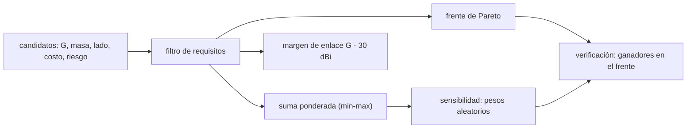

# B91-C06 — Selección y compromiso de diseño de antenas

<!-- nav:top -->
[🏠 Programa](../../../../README.md) · [📚 Bloque B91](../../../tronco-comun/B91-antenas-y-propagacion-para-enlaces-espaciales.md) · [← Anterior: B91-C05 — Medición y calibración de antenas](../B91-C05-medicion-y-calibracion-de-antenas/CLASE.md) · [Siguiente: B91-C07 — Atenuación atmosférica y efectos de la lluvia en enlaces →](../B91-C07-atenuacion-atmosferica-y-efectos-de-la-lluvia-en-enlaces/CLASE.md)
<!-- /nav -->

## 1. Ubicación, nivel y alcance

Clase 6 del bloque B91. Nivel N4. Con la teoría (C01–C05) ya puedes calcular ganancia, haz, polarización y precisión de una antena; ahora toca elegir. Aquí aplicas un filtro de requisitos, un frente de Pareto y una matriz de decisión ponderada, y pruebas cuánto depende la respuesta de los pesos. Los siete candidatos (parche, hélice, bocina, tres reflectores y un arreglo) y sus masas, costos y riesgos son **sintéticos**: no corresponden a productos reales. El presupuesto de enlace completo está en [B89](../../../tronco-comun/B89-comunicaciones-y-navegacion-satelital.md).

## 2. Por qué esta clase existe

Ninguna antena gana en todo: más ganancia suele costar masa, apertura o dinero. La decisión central: **¿qué antena cumple los requisitos y cuál conviene según cómo se pesen la masa, el costo y el riesgo, y cuánto cambia la respuesta si los pesos cambian?**

## 3. Lo que podrás hacer al terminar

1. Calcular la ganancia de candidatos por apertura (`η(πD/λ)²`) y por la estimación de una hélice.
2. Filtrar candidatos por requisitos de ganancia, tamaño y masa.
3. Obtener el frente de Pareto por dominancia de pares.
4. Aplicar una suma ponderada con normalización min–max.
5. Medir la sensibilidad del ganador a los pesos con una simulación de semilla fija.
6. Calcular el margen de enlace de cada candidato y rotular los datos como sintéticos.

La evidencia es la **memoria de selección de antena** del ejercicio 12 (sección 20).

## 4. Con qué llegas y cómo comprobarlo

1. ¿Qué es una solución dominada?
2. ¿Qué es una normalización min–max?
3. ¿Qué es un peso en una decisión multicriterio?
4. ¿Qué es un margen de enlace?
5. ¿Qué es un dato sintético?

<details>
<summary>Ver respuestas</summary>

1. Una que otra supera o iguala en todos los criterios y supera estrictamente en alguno. 2. `(x − mín)/(máx − mín)`, que lleva cada criterio al intervalo 0–1. 3. La importancia relativa de un criterio; los pesos suman 1. 4. La diferencia entre lo que se obtiene y lo mínimo que se necesita, en dB. 5. Uno generado para el ejemplo, no medido.
</details>

Con cuatro o cinco aciertos, sigue; si no, repasa los prerrequisitos.

## 5. Un caso de contexto y casos de referencia

Un enlace de bajada **sintético** a `8,4 GHz` exige `G ≥ 30 dBi`, lado `≤ 1,0 m` y masa `≤ 6 kg`. De siete candidatos cumplen tres reflectores: el de `0,6 m` (`32,24 dBi`, `1,8 kg`), el de `1,0 m` (`36,82 dBi`, `4,5 kg`) y el de `1,0 m` desplegable (`36,30 dBi`, `3,2 kg`, lado plegado `0,35 m`). Con los pesos base gana el de `0,6 m`; en 20 000 pesos aleatorios gana en el `78,2 %` de los casos. Es el **ejemplo conductor**; todo es calculado sobre datos sintéticos.

## 6. Vocabulario

Un **requisito** es una condición de cumplimiento (filtro). Una solución **domina** a otra si es mejor o igual en todos los criterios y mejor en alguno. El **frente de Pareto** es el conjunto de soluciones no dominadas. La **suma ponderada** puntúa cada candidato como `Σ wⱼ vⱼ`, con `vⱼ` normalizado y con signo según se maximice o minimice. La **sensibilidad** mide cuánto cambia el ganador al variar los pesos. El **margen de ganancia** es `G − G_requerida`.

## 7. Modelo mental



*Descripción textual:* los candidatos pasan primero el filtro; entre los que cumplen se halla el frente de Pareto y se puntúan con pesos; la sensibilidad prueba miles de pesos y la verificación comprueba que todo ganador pertenece al frente.

Analogía: elegir un auto; el filtro elimina los que no caben en el garaje, Pareto elimina los que son peores en todo, y los pesos reflejan si importa más el precio o la potencia. Límite: la suma ponderada con normalización min–max depende del conjunto de candidatos; añadir uno cambia la escala.

## 8. La explicación, paso a paso

### 8.1 Ganancia de los candidatos

Reflector, bocina y arreglo por apertura: `G = η(πD/λ)²` con `λ = 35,69 mm`. La hélice usa la estimación clásica `10,8 + 10 log(N C²S/λ³)` con `C = λ`, `S = 0,25 λ`, `N = 12`: `15,57 dBi`. El arreglo de `16 × 16` isótropos con eficiencia `0,7`: `22,53 dBi` (`10 log(256 × 0,7)`).

### 8.2 Requisitos y candidatos

| Candidato | `G` (dBi) | Masa (kg) | Lado (m) | Costo (rel.) | Riesgo | Cumple |
|---|---|---|---|---|---|---|
| parche 4×4 | 13,00 | 0,15 | 0,20 | 1,0 | 1 | no |
| hélice 12 vueltas | 15,57 | 0,40 | 0,45 | 1,5 | 1 | no |
| bocina corrugada | 26,22 | 1,20 | 0,45 | 3,0 | 1 | no |
| reflector 0,6 m | 32,24 | 1,80 | 0,60 | 4,0 | 2 | sí |
| reflector 1,0 m | 36,82 | 4,50 | 1,00 | 7,0 | 2 | sí |
| reflector 1,0 m desplegable | 36,30 | 3,20 | 0,35 | 12,0 | 4 | sí |
| arreglo 16×16 (barrido) | 22,53 | 5,50 | 0,25 | 30,0 | 3 | no |

### 8.3 Frente de Pareto y suma ponderada

Los tres que cumplen son no dominados: cada uno es mejor en algún criterio (el de 0,6 m en masa, costo y lado; el de 1,0 m en ganancia; el desplegable en lado plegado y masa relativa al de 1,0 m). Con pesos `0,35` ganancia, `0,25` masa, `0,15` lado, `0,15` costo y `0,10` riesgo:

| Candidato | Puntuación |
|---|---|
| reflector 0,6 m | 0,5923 |
| reflector 1,0 m desplegable | 0,5806 |
| reflector 1,0 m | 0,5437 |

### 8.4 Sensibilidad a los pesos

En 20 000 vectores de pesos aleatorios (semilla 91) gana el reflector de `0,6 m` en `15 644` casos (`78,2 %`), el de `1,0 m` en `2 415` (`12,1 %`) y el desplegable en `1 941` (`9,7 %`). Ningún ganador queda fuera del frente (`0` casos): es la comprobación de consistencia. La respuesta es robusta pero no única: depende de pesos.

### 8.5 Margen de ganancia

`+2,24 dB` (0,6 m), `+6,82 dB` (1,0 m) y `+6,30 dB` (desplegable). El de 0,6 m cumple con poco margen; si el presupuesto de enlace incluye otras pérdidas (C02, C04, C07), el margen podría agotarse.

### 8.6 Qué cambia y qué no

Si el requisito de ganancia baja a 25 dBi, entra la bocina. Si la masa máxima sube, el arreglo no entra por ganancia. Los resultados dependen de los requisitos y de los datos sintéticos.

## 9. Magnitudes, símbolos y unidades

| Símbolo | Qué es | Unidad | Valor / nota |
|---|---|---|---|
| `G` | ganancia | dBi | 13,0–36,8 |
| `m` | masa | kg | 0,15–5,5 |
| `L` | lado de la envolvente | m | 0,20–1,00 |
| `w` | peso del criterio | — | suma 1 |
| `M` | margen de ganancia | dB | `G − 30` |

## 10. Convenciones y referencias

Frecuencia 8,4 GHz; ganancia hacia la Tierra con apuntamiento perfecto; costos en unidades relativas; riesgo en escala 1–5 (sintética). Normalización min–max por criterio; maximizar la ganancia y minimizar el resto. La estimación de ganancia de la hélice es una relación clásica no consultada en una fuente concreta. Semilla 91 y 20 000 repeticiones.

## 11. De dónde sale lo que afirmamos

| ID | Fuente | Localizador | Respalda | Estado |
|---|---|---|---|---|
| — | Estimación de ganancia de una hélice y método de suma ponderada (relaciones estándar) | — | las verifica el laboratorio con el criterio de Pareto | No consultada en una fuente concreta |

Límites: no se consultó ninguna fuente externa en esta clase; los candidatos, masas, costos y riesgos son sintéticos y no describen productos; no se consultaron guías de selección de antenas de ECSS ni de agencias.

## 12. Cómo ver el compromiso

| Magnitud | Valor |
|---|---|
| Candidatos que cumplen | 3 de 7 |
| Frente de Pareto | los 3 reflectores |
| Ganador con pesos base | reflector 0,6 m (0,5923) |
| Ganador en 20 000 pesos | 0,6 m: 78,2 % |
| Ganadores fuera del frente | 0 |

Descripción larga: los tres reflectores forman el frente y el de 0,6 m gana con casi cuatro de cada cinco vectores de pesos, pero con poco margen de ganancia.

## 13. Ejemplo trabajado: la puntuación del reflector de 0,6 m

**Paso 1 · Valores.** Entre los que cumplen: `G` 32,24–36,82; masa 1,8–4,5; lado 0,35–1,00; costo 4–12; riesgo 2–4.

**Paso 2 · Normalizar el de 0,6 m.** Ganancia `0`; masa `1`; lado `0,615`; costo `1`; riesgo `1` (menor es mejor).

**Paso 3 · Ponderar.** `0,35 × 0 + 0,25 × 1 + 0,15 × 0,615 + 0,15 × 1 + 0,10 × 1 = 0,5923`.

**Paso 4 · Lectura.** Gana porque pesa más la masa, el costo y el riesgo que la ganancia, que es la que menos tiene.

## 14. Distintas formas de describir una selección

**Por requisitos:** filtro. **Por compromiso:** frente de Pareto. **Por preferencias:** suma ponderada. **Por robustez:** frecuencia de victoria. **Por margen:** `G − G_req`.

## 15. Práctica guiada

**Ejercicio 1 · guiado con los pasos indicados.** Calcula la ganancia de un reflector de 0,6 m con `η = 0,60` a 8,4 GHz. *Pasos:* `η(πD/λ)²`.

<details><summary>Solución comentada</summary>

`πD/λ = 52,81`; `² = 2789`; `× 0,6 = 1673`; `32,24 dBi`.
</details>

**Ejercicio 2 · guiado con una pista.** Calcula el margen de ganancia del reflector de 1,0 m. *Pista:* `G − 30`.

<details><summary>Solución comentada</summary>

`36,82 − 30 = +6,82 dB`.
</details>

**Ejercicio 3 · guiado, casi autónomo.** ¿Está el parche dominado por la hélice? *Casi autónomo:* compara los cinco criterios.

<details><summary>Solución comentada</summary>

No: el parche tiene menos masa, lado y costo; la hélice, más ganancia. Ninguno domina al otro.
</details>

## 16. Práctica autónoma, transferencia e integrador

**Ejercicio 4 · autónomo.** Calcula la ganancia de una bocina de 0,30 m con `η = 0,6`.

<details><summary>Solución comentada</summary>

`26,22 dBi` (laboratorio).
</details>

**Ejercicio 5 · autónomo.** ¿Qué diámetro mínimo con `η = 0,6` da 30 dBi a 8,4 GHz?

<details><summary>Solución comentada</summary>

`(πD/λ)² = 10³/0,6 = 1667`; `πD/λ = 40,8`; `D = 0,464 m`.
</details>

**Ejercicio 6 · autónomo.** Calcula la puntuación con pesos iguales `0,2` para el reflector de 1,0 m.

<details><summary>Solución comentada</summary>

Normalizados: `G = 1`; masa `0`; lado `0`; costo `0,625`; riesgo `1`; `0,2 × (1 + 0 + 0 + 0,625 + 1) = 0,525`.
</details>

**Ejercicio 7 · autónomo.** ¿Qué pasa con el frente si se añade un reflector de 1,0 m con 5 kg y 8 de costo, misma ganancia?

<details><summary>Solución comentada</summary>

Queda dominado por el reflector de 1,0 m existente (4,5 kg, 7): sale del frente.
</details>

**Ejercicio 8 · autónomo.** ¿Qué ganador esperas si los pesos son `1,0` para la ganancia?

<details><summary>Solución comentada</summary>

El reflector de 1,0 m (36,82 dBi).
</details>

**Ejercicio 9 · transferencia.** **Transferencia.** Un directivo pide «la mejor antena» sin pesos. ¿Qué respondes?

<details><summary>Solución comentada</summary>

Que no existe sin criterios: se entrega el frente de Pareto y se explicitan los pesos con su sensibilidad.
</details>

**Ejercicio 10 · transferencia.** **Transferencia.** Si el requisito de masa baja a 2 kg, ¿qué candidato queda y qué riesgo corres?

<details><summary>Solución comentada</summary>

Solo el reflector de 0,6 m (1,8 kg) con `+2,24 dB` de margen; poco margen para otras pérdidas.
</details>

**Ejercicio 11 · transferencia.** **Transferencia.** El análisis de sensibilidad muestra 78 % para un candidato. ¿Es suficiente para elegirlo?

<details><summary>Solución comentada</summary>

No por sí solo: depende de cómo se muestrean los pesos (distribución uniforme aquí) y de los datos sintéticos; hay que contrastar con los requisitos reales y el margen.
</details>

**Ejercicio 12 · integrador.** **Integrador.** Elabora tu *memoria de selección de antena*: requisitos, tabla de candidatos, frente de Pareto, puntuación, sensibilidad, margen y límites de los datos sintéticos.

<details><summary>Solución comentada</summary>

Secciones 8.1–8.6 y la salida del laboratorio.
</details>

## 17. Laboratorio: selección con Pareto y sensibilidad

El script [seleccion_antena.py](seleccion_antena.py) calcula las ganancias, filtra, obtiene el frente de Pareto por dominancia, puntúa con suma ponderada y repite la elección con 20 000 pesos aleatorios (**comprueba** que ningún ganador queda fuera del frente).

**Datos:** siete candidatos con masas, costos y riesgos **sintéticos**; ninguna fuente externa. **Predice antes de ejecutar:** ¿qué candidato gana con más frecuencia? (el reflector de 0,6 m). **Ejecución del 2026-11-10 (Python 3.12.9):**

```text
Python 3.12.9 (biblioteca estandar)
Requisito SINTETICO: G >= 30 dBi a 8.4 GHz (lambda = 35.69 mm), lado <= 1.0 m, masa <= 6 kg
 candidato                    G [dBi]  masa [kg]  lado [m]  costo   riesgo  cumple
 parche 4x4                    13.00      0.15     0.20     1.0      1   no
 helice 12 vueltas             15.57      0.40     0.45     1.5      1   no
 bocina corrugada              26.22      1.20     0.45     3.0      1   no
 reflector 0.6 m               32.24      1.80     0.60     4.0      2   si
 reflector 1.0 m               36.82      4.50     1.00     7.0      2   si
 reflector 1.0 m desplegable   36.30      3.20     0.35    12.0      4   si
 arreglo 16x16 (barrido)       22.53      5.50     0.25    30.0      3   no
Frente de Pareto entre los que cumplen: reflector 0.6 m, reflector 1.0 m, reflector 1.0 m desplegable
Suma ponderada (pesos 0.35 ganancia, 0.25 masa, 0.15 lado, 0.15 costo, 0.10 riesgo; normalizacion min-max):
   reflector 0.6 m             0.5923
   reflector 1.0 m desplegable 0.5806
   reflector 1.0 m             0.5437
Sensibilidad: ganador en 20 000 vectores de pesos aleatorios (semilla 91)
   reflector 0.6 m              15644  ( 78.2 %)
   reflector 1.0 m               2415  ( 12.1 %)
   reflector 1.0 m desplegable   1941  (  9.7 %)
Ganadores fuera del frente de Pareto: 0
Margen de enlace con cada candidato que cumple (SINTETICO: se necesitan 30 dBi; margen = G - 30):
   reflector 0.6 m             +2.24 dB
   reflector 1.0 m             +6.82 dB
   reflector 1.0 m desplegable +6.30 dB
Pruebas superadas.
```

```bash
python programa/clases/B91/B91-C06-seleccion-y-compromiso-de-diseno-de-antenas/seleccion_antena.py
```

**Límites:** datos sintéticos; pesos muestreados uniformemente; la normalización min–max depende del conjunto; no incluye costo de ciclo de vida.

## 18. Errores frecuentes y cómo corregirlos

**Elegir por un solo criterio.** Ver 8.3.

**Confundir el frente de Pareto con «el mejor».** Ver la sección 6.

**Ignorar el margen de enlace.** Ver 8.5.

**Presentar los candidatos sintéticos como productos.** Ver la sección 11.

## 19. Cómo sabrás que vas bien

Tras la sección 8: ¿qué ganador esperabas y cuál obtuviste? Si dudas, repasa el ejemplo 13. Tras el laboratorio: ¿qué comprueba? (ver la sección 17).

## 20. Qué entregas y cómo se evalúa

El producto es tu **memoria de selección de antena** (ejercicio 12).

| Criterio | Inicial | En desarrollo | Logrado | Destacado |
|---|---|---|---|---|
| Conceptos | Los confunde | Parciales | Aplica filtro, Pareto y pesos | Explica los límites |
| Cálculo | Sin unidades | Con errores | Tablas completas con unidades | Calcula casos nuevos |
| Numérico | Sin comprobar | Un caso | Contraste con una segunda vía | Interpreta las diferencias |
| Fuentes | Sin fuente | Sin fecha | Fuentes con fecha y estado | Declara lo sintético y lo no consultado |
| Límites | No los nombra | Uno | Tres | Discute qué falta del modelo |

**Condiciones críticas (no se compensan con promedio):** rotular los candidatos como sintéticos; no dar un ganador sin mostrar la sensibilidad; citar solo lo consultado (aquí, nada).

## 21. Ética, seguridad y límites

Clase educativa: los modelos son simplificados y sus datos son sintéticos, ilustrativos o publicados con fuente; ningún resultado sustituye a la norma del operador, a una medición en cámara ni a un diseño certificado. Lo simulado no se presenta como observado. Accesibilidad: tablas equivalentes a las gráficas, fórmulas en texto, ejercicios sin conexión.

## 22. Para cerrar y seguir

Tres de siete candidatos cumplen; el reflector de `0,6 m` gana en el `78 %` de los pesos pero con `+2,24 dB` de margen. Queda una pregunta: ¿cuánto de ese margen se come la atmósfera?

**Glosario español–inglés.** frente de Pareto · *Pareto front*; solución dominada · *dominated solution*; suma ponderada · *weighted sum*; sensibilidad · *sensitivity*; margen · *margin*.

**Continuidad.** [B91-C07](../B91-C07-atenuacion-atmosferica-y-efectos-de-la-lluvia-en-enlaces/CLASE.md) estudia la atenuación atmosférica y los efectos de la lluvia.

**Referencias:** ver sección 11.

<!-- nav:bottom -->
---

[← Anterior: B91-C05 — Medición y calibración de antenas](../B91-C05-medicion-y-calibracion-de-antenas/CLASE.md) · [📚 Bloque B91](../../../tronco-comun/B91-antenas-y-propagacion-para-enlaces-espaciales.md) · [Siguiente: B91-C07 — Atenuación atmosférica y efectos de la lluvia en enlaces →](../B91-C07-atenuacion-atmosferica-y-efectos-de-la-lluvia-en-enlaces/CLASE.md)
<!-- /nav -->
