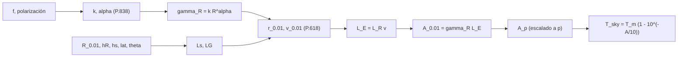

# B91-C07 — Atenuación atmosférica y efectos de la lluvia en enlaces

<!-- nav:top -->
[🏠 Programa](../../../../README.md) · [📚 Bloque B91](../../../tronco-comun/B91-antenas-y-propagacion-para-enlaces-espaciales.md) · [← Anterior: B91-C06 — Selección y compromiso de diseño de antenas](../B91-C06-seleccion-y-compromiso-de-diseno-de-antenas/CLASE.md) · [Siguiente: B91-C08 — Antenas de gran apertura y estaciones de espacio profundo →](../B91-C08-antenas-de-gran-apertura-y-estaciones-de-espacio-profundo/CLASE.md)
<!-- /nav -->

## 1. Ubicación, nivel y alcance

Clase 7 del bloque B91. Nivel N4. La pérdida de espacio libre ([B89](../../../tronco-comun/B89-comunicaciones-y-navegacion-satelital.md)) no incluye la atmósfera: la lluvia absorbe y dispersa la señal, y además añade ruido a la antena receptora. Aquí implementas el modelo de atenuación específica de la Rec. UIT-R P.838-3 y el procedimiento de trayecto oblicuo de la Rec. UIT-R P.618-14, y calculas cuánto empeora la relación G/T de una antena de 70 m con datos publicados de la DSN. La lluvia de la localidad (`R₀,₀₁`, altura de lluvia, latitud) es **sintética**.

## 2. Por qué esta clase existe

En bandas altas la lluvia puede quitar decenas de dB durante una fracción pequeña del año. La decisión central: **¿qué margen reservar para una disponibilidad dada, y a partir de qué frecuencia deja de ser razonable un enlace sin reserva ni diversidad?**

## 3. Lo que podrás hacer al terminar

1. Calcular los coeficientes `k` y `α` de la atenuación específica con las ecuaciones (2)–(5) de P.838-3.
2. Calcular la atenuación específica `γ_R = k R^α` en dB/km.
3. Aplicar el procedimiento de P.618-14 (longitud oblicua, factores de reducción horizontal y vertical, longitud efectiva).
4. Escalar la atenuación a otros porcentajes de tiempo `p`.
5. Calcular el ruido de cielo por lluvia y su efecto sobre `G/T`.
6. Rotular qué es consultado, qué es calculado y qué es sintético.

La evidencia es la **ficha de margen por lluvia de un enlace** del ejercicio 12 (sección 20).

## 4. Con qué llegas y cómo comprobarlo

1. ¿Qué es un decibelio por kilómetro?
2. ¿Qué es la tasa de lluvia y en qué unidad se mide?
3. ¿Qué es el ángulo de elevación?
4. ¿Qué es una temperatura de ruido?
5. ¿Qué significa «excedida el 0,01 % del tiempo»?

<details>
<summary>Ver respuestas</summary>

1. La atenuación en dB acumulada por cada kilómetro de trayecto. 2. La cantidad de lluvia por unidad de tiempo, en mm/h. 3. El ángulo del trayecto sobre el horizonte. 4. La temperatura equivalente de la potencia de ruido: `P = k_B T B`. 5. Ocurre en `0,01 %` de un año medio, unos `53` minutos.
</details>

Con cuatro o cinco aciertos, sigue; si no, repasa los prerrequisitos.

## 5. Un caso de contexto y casos de referencia

Con una lluvia **sintética** de `R₀,₀₁ = 42 mm/h`, altura de lluvia `3,5 km`, latitud `33,4°` y elevación `30°`, la atenuación excedida el `0,01 %` del año es de `3,30 dB` a `8,4 GHz`, `20,97 dB` a `20 GHz` y `43,9 dB` a `32 GHz`. En banda X, con `3 dB` de atenuación, la temperatura de ruido de cielo sube a `137 K` y la `G/T` de la antena de 70 m (calculada de valores publicados) cae de `62,33` a `52,68 dB/K`: en total, `12,65 dB` menos de `C/N₀`. Es el **ejemplo conductor**; la lluvia es sintética, los coeficientes y la ganancia son consultados.

## 6. Vocabulario

La **atenuación específica** `γ_R = k R^α` (dB/km) viene de la tasa de lluvia `R` (mm/h) y de coeficientes `k`, `α` que dependen de la frecuencia y la polarización. La **longitud efectiva** `L_E` es la longitud de trayecto lluvioso equivalente con lluvia uniforme. La **atenuación `A_p`** es la excedida el `p %` del año. La **temperatura de ruido de cielo** por una atenuación `A` es `T = T_m(1 − 10^{−A/10})`, con `T_m` la temperatura media física del medio. La **disponibilidad** es `100 − p` en %.

## 7. Modelo mental



*Descripción textual:* la tasa de lluvia y la frecuencia dan la atenuación específica; la geometría del trayecto da la longitud lluviosa y los factores de reducción dan la longitud efectiva; el producto es la atenuación del `0,01 %`, que se escala a otros porcentajes y se convierte en ruido de cielo.

Analogía: una niebla desigual; la lluvia intensa no cubre todo el trayecto, así que se descuenta con un factor de reducción. Límite: P.618 predice estadísticas de largo plazo y no la atenuación de un evento concreto; usa mapas de lluvia (P.837) y altura de lluvia (P.839) que aquí no se consultaron y se reemplazaron por valores sintéticos.

## 8. La explicación, paso a paso

### 8.1 Coeficientes `k` y `α` (P.838-3)

`log₁₀ k = Σⱼ aⱼ exp(−((log₁₀ f − bⱼ)/cⱼ)²) + m_k log₁₀ f + c_k` (4 términos) y `α = Σⱼ aⱼ exp(−((log₁₀ f − bⱼ)/cⱼ)²) + m_α log₁₀ f + c_α` (5 términos), con las constantes de las Tablas 1–4 de la Recomendación. Para polarización circular y trayecto oblicuo (ecuaciones 4 y 5), `k = [k_H + k_V + (k_H − k_V) cos²θ cos 2τ]/2`, con `τ = 45°`. Se verifica que `τ = 0°` reproduce `k_H` y `τ = 90°` reproduce `k_V` (identidad).

| `f` (GHz) | `k_H` | `k_V` | `α_H` | `α_V` | `k` (circular, 30°) | `α` |
|---|---|---|---|---|---|---|
| 2,2 | 0,000105 | 0,000118 | 1,0853 | 0,9725 | 0,000112 | 1,0257 |
| 8,4 | 0,005329 | 0,004593 | 1,3586 | 1,3426 | 0,004961 | 1,3512 |
| 20,0 | 0,091643 | 0,096111 | 1,0568 | 0,9847 | 0,093877 | 1,0199 |
| 32,0 | 0,277758 | 0,264577 | 0,9302 | 0,8981 | 0,271168 | 0,9145 |
| 40,0 | 0,443057 | 0,427375 | 0,8673 | 0,8421 | 0,435216 | 0,8549 |

Son valores **calculados**; el contraste con la Tabla 5 de la Recomendación no se hizo (no se leyó).

### 8.2 Atenuación en el trayecto oblicuo (P.618-14)

Pasos: `L_s = (h_R − h_s)/sin θ`; `L_G = L_s cos θ`; `γ_R`; `r₀,₀₁ = 1/(1 + 0,78√(L_G γ_R/f) − 0,38(1 − e^{−2L_G}))`; `v₀,₀₁` con `χ = 36° − |φ|` si `|φ| < 36°`; `L_E = L_R v₀,₀₁`; `A₀,₀₁ = γ_R L_E`. El escalado: `A_p = A₀,₀₁ (p/0,01)^{−(0,655 + 0,033 ln p − 0,045 ln A₀,₀₁ − β(1 − p) sin θ)}`.

| `f` (GHz) | `γ_R` (dB/km) | `L_E` (km) | `A₀,₀₁` (dB) | `A₁%` (dB) | `A₀,₁%` (dB) | `A₀,₀₀₁%` (dB) |
|---|---|---|---|---|---|---|
| 2,2 | 0,0052 | 4,443 | 0,023 | 0,001 | 0,004 | 0,089 |
| 8,4 | 0,7743 | 4,267 | 3,304 | 0,207 | 0,999 | 7,688 |
| 20,0 | 4,2469 | 4,938 | 20,971 | 1,930 | 7,681 | 40,293 |
| 32,0 | 8,2738 | 5,309 | 43,924 | 4,711 | 17,368 | 78,171 |
| 40,0 | 10,6275 | 5,506 | 58,515 | 6,660 | 23,835 | 101,089 |

(Los porcentajes `A₁%`, `A₀,₁%` y `A₀,₀₀₁%` están en las columnas `p = 1 %`, `0,1 %` y `0,001 %`.) La atenuación crece de forma muy rápida con la frecuencia y con la exigencia de disponibilidad. La `A₀,₀₁` coincide con la del escalado en `p = 0,01` (verificación). P.618 se aplica a elevaciones `≥ 5°` y hasta `55 GHz`.

### 8.3 Ruido de cielo y `G/T`

Con `T_m = 275 K` (ilustrativa) y la antena de 70 m en X rx (`G = 74,55 dBi`, `T_op = 16,69 K` en zenit con cielo claro al 25 %, publicados), `G/T_claro = 62,33 dB/K` (calculado):

| `A` (dB) | `T_sky,lluvia` (K) | `T_sys` (K) | `G/T` (dB/K) | Pérdida de `G/T` (dB) | Pérdida total de `C/N₀` (dB) |
|---|---|---|---|---|---|
| 0 | 0,00 | 16,69 | 62,33 | 0,00 | 0,00 |
| 0,5 | 29,91 | 46,60 | 57,87 | 4,46 | 4,96 |
| 1,0 | 56,56 | 73,25 | 55,90 | 6,42 | 7,42 |
| 3,0 | 137,17 | 153,86 | 52,68 | 9,65 | 12,65 |
| 6,0 | 205,92 | 222,61 | 51,07 | 11,25 | 17,25 |
| 10,0 | 247,50 | 264,19 | 50,33 | 11,99 | 21,99 |

Una antena con ruido muy bajo es muy sensible al ruido de la lluvia: `0,5 dB` de atenuación cuestan casi `5 dB` de `C/N₀`.

### 8.4 Qué cambia y qué no

La atenuación específica por lluvia no depende de la antena, pero el ruido que aporta sí pesa más cuanto menor es el `T_op`. En banda S la lluvia es despreciable; en Ka puede cortar el enlace.

## 9. Magnitudes, símbolos y unidades

| Símbolo | Qué es | Unidad | Valor / nota |
|---|---|---|---|
| `R` | tasa de lluvia | mm/h | 42 (sintético, `R₀,₀₁`) |
| `γ_R` | atenuación específica | dB/km | 0,774 (8,4 GHz) |
| `θ` | elevación | grados | 30 |
| `h_R` | altura de lluvia | km | 3,5 (sintética) |
| `A_p` | atenuación excedida `p %` | dB | 3,30 (X, 0,01 %) |
| `T_m` | temperatura media física | K | 275 (ilustrativa) |
| `T_op` | temperatura operacional | K | 16,69 (DSN) |

## 10. Convenciones y referencias

Trayecto Tierra–espacio, polarización circular (`τ = 45°`), elevación `30°`, latitud `33,4°`. Las ecuaciones y constantes son las de P.838-3 y P.618-14; la altura de lluvia y `R₀,₀₁` son sintéticos (no se consultaron P.837 ni P.839); los gases atmosféricos (P.676), las nubes y la centelleo no se modelan. La ganancia y `T_op` son de la DSN, antena de 70 m, DSS-14, X-only RCP.

## 11. De dónde sale lo que afirmamos

| ID | Fuente | Localizador | Respalda | Estado |
|---|---|---|---|---|
| S2 | UIT-R, Recomendación P.838-3 (2005) «Specific attenuation model for rain for use in prediction methods» — https://www.itu.int/dms_pubrec/itu-r/rec/p/R-REC-P.838-3-200503-I!!PDF-E.pdf (consultada 2026-11-10) | ecuaciones (1)–(5) y Tablas 1–4; la Tabla 5 (valores por frecuencia) no se leyó | ecuaciones (1)–(5) y constantes de las Tablas 1–4 | Consultada |
| S3 | UIT-R, Recomendación P.618-14 (2023) «Propagation data and prediction methods required for the design of Earth-space telecommunication systems» — https://www.itu.int/dms_pubrec/itu-r/rec/p/R-REC-P.618-14-202308-I!!PDF-E.pdf (consultada 2026-11-10) | pasos 2–10 del procedimiento de atenuación por lluvia; el resto de la Recomendación no se leyó | pasos 2–10 de la predicción de atenuación por lluvia y escalado a `p` | Consultada |
| S1 | NASA/JPL, DSN Telecommunications Link Design Handbook 810-005, módulo 101 rev. D «70-m Subnet Telecommunications Interfaces» (2011-04-21) — https://deepspace.jpl.nasa.gov/dsndocs/810-005/101/101D.pdf (consultada 2026-11-10) | documento completo (41 págs.) leído con PyMuPDF | ganancia X rx `74,55 dBi` (Tabla 2) y `T_op = 16,69 K` (Tabla 4) | Consultada |
| — | UIT-R P.837 (mapas de lluvia), P.839 (altura de lluvia), P.676 (gases) y Tabla 5 de P.838-3 | — | la lluvia local y la altura de lluvia son sintéticas; los valores de la Tabla 5 no se contrastaron | No consultada en una fuente concreta |

Límites: los coeficientes se calcularon con las ecuaciones de la Recomendación y no se compararon con su Tabla 5; no se modelan gases, nubes ni centelleo; la `T_m` es ilustrativa; la estadística de largo plazo no predice un evento concreto.

## 12. Cómo ver el margen por lluvia

| Magnitud | Valor |
|---|---|
| `A₀,₀₁` a 8,4 GHz | 3,30 dB |
| `A₀,₀₁` a 20 GHz | 20,97 dB |
| `A₀,₀₁` a 32 GHz | 43,92 dB |
| `G/T` cielo claro (70 m, X) | 62,33 dB/K |
| Pérdida de `C/N₀` con 3 dB de lluvia | 12,65 dB |

Descripción larga: la atenuación del `0,01 %` pasa de décimas de dB en banda S a decenas en Ka, y el ruido de cielo agrava la pérdida de una antena de bajo ruido.

## 13. Ejemplo trabajado: la atenuación en banda X con lluvia del 0,01 %

**Paso 1 · Coeficientes.** A 8,4 GHz circular: `k = 0,004961`, `α = 1,3512`.

**Paso 2 · Específica.** `γ_R = 0,004961 × 42^1,3512 = 0,7743 dB/km`.

**Paso 3 · Longitud efectiva.** `L_s = 3,4/sin 30° = 6,8 km`; con `r₀,₀₁` y `v₀,₀₁`, `L_E = 4,267 km`.

**Paso 4 · Atenuación.** `A₀,₀₁ = 0,7743 × 4,267 = 3,30 dB`.

## 14. Distintas formas de describir la atenuación de un enlace

**Por tasa de lluvia:** `R` (mm/h). **Por distancia:** `γ_R` (dB/km). **Por trayecto:** `L_E` (km) y `A_p` (dB). **Por ruido:** `T_sky` (K). **Por disponibilidad:** `100 − p` (%).

## 15. Práctica guiada

**Ejercicio 1 · guiado con los pasos indicados.** Calcula la longitud oblicua `L_s` con `h_R = 3,5 km`, `h_s = 0,1 km`, `θ = 30°`. *Pasos:* `(h_R − h_s)/sin θ`.

<details><summary>Solución comentada</summary>

`3,4/0,5 = 6,8 km`.
</details>

**Ejercicio 2 · guiado con una pista.** Calcula `γ_R` a 8,4 GHz con `R = 42 mm/h`. *Pista:* `k = 0,004961`, `α = 1,3512`.

<details><summary>Solución comentada</summary>

`42^1,3512 = e^{1,3512 × 3,7377} = e^{5,0505} = 156,0`; `0,004961 × 156,0 = 0,774 dB/km`.
</details>

**Ejercicio 3 · guiado, casi autónomo.** Calcula `T_sky` para `A = 3 dB` y `T_m = 275 K`. *Casi autónomo:* `T_m(1 − 10^{−0,3})`.

<details><summary>Solución comentada</summary>

`275 × (1 − 0,501) = 137,2 K`.
</details>

## 16. Práctica autónoma, transferencia e integrador

**Ejercicio 4 · autónomo.** Calcula `γ_R` a 20 GHz con `R = 42 mm/h` (circular, 30°).

<details><summary>Solución comentada</summary>

`0,093877 × 42^1,0199 = 0,093877 × 45,2 = 4,25 dB/km` (laboratorio: `4,2469`).
</details>

**Ejercicio 5 · autónomo.** ¿Cuántos minutos al año corresponden a `p = 0,01 %`?

<details><summary>Solución comentada</summary>

`0,0001 × 525 960 min = 52,6 min`.
</details>

**Ejercicio 6 · autónomo.** ¿Cuánto vale `A₀,₁%` a 8,4 GHz y cuánto `A₀,₀₁%`?

<details><summary>Solución comentada</summary>

`0,999 dB` y `3,304 dB`: la atenuación aumenta `3,3` veces al exigir mejor disponibilidad.
</details>

**Ejercicio 7 · autónomo.** ¿Qué frecuencia de la tabla tiene la mayor atenuación para `p = 1 %`?

<details><summary>Solución comentada</summary>

`40 GHz` con `6,66 dB`.
</details>

**Ejercicio 8 · autónomo.** Calcula la pérdida de `G/T` por `T_sky = 56,56 K` sobre `T_op = 16,69 K`.

<details><summary>Solución comentada</summary>

`10 log((16,69 + 56,56)/16,69) = 6,42 dB`.
</details>

**Ejercicio 9 · transferencia.** **Transferencia.** Un enlace de banda Ka (32 GHz) debe tener 99,99 % de disponibilidad con esta lluvia. ¿Qué le pasa al margen?

<details><summary>Solución comentada</summary>

Necesita `43,9 dB` de margen: inviable con potencia sola; se usan diversidad de sitio, codificación y modulación adaptativas, o una banda más baja.
</details>

**Ejercicio 10 · transferencia.** **Transferencia.** Un diseñador compara una antena de ruido muy bajo (16,7 K) con otra de 50 K bajo la misma lluvia de 1 dB. ¿Cuál pierde más `G/T`?

<details><summary>Solución comentada</summary>

La de 16,7 K: `6,42 dB` frente a `10 log((50+56,6)/50) = 3,3 dB`; la antena sensible sufre más en dB, aunque parta de mejor `G/T`.
</details>

**Ejercicio 11 · transferencia.** **Transferencia.** ¿Se puede usar este cálculo para predecir si lloverá el martes?

<details><summary>Solución comentada</summary>

No: es una estadística de largo plazo (porcentaje de un año medio); no predice eventos.
</details>

**Ejercicio 12 · integrador.** **Integrador.** Elabora tu *ficha de margen por lluvia de un enlace*: coeficientes, `γ_R`, `L_E`, `A_p` para tres `p`, ruido de cielo y pérdida de `C/N₀`, con lo sintético y lo consultado rotulado.

<details><summary>Solución comentada</summary>

Secciones 8.1–8.4 y la salida del laboratorio.
</details>

## 17. Laboratorio: lluvia por UIT-R y ruido de cielo

El script [lluvia_itu.py](lluvia_itu.py) calcula `k` y `α` con las ecuaciones de P.838-3, aplica el procedimiento de P.618-14, escala a otros `p` y estima el ruido de cielo y la pérdida de `G/T` (**comprueba** la identidad `τ = 0°/90°`, `A_p(0,01 %) = A₀,₀₁`, la monotonía de `A_p` y `A = 0` si `h_R − h_s ≤ 0`).

**Datos:** constantes de P.838-3 y pasos de P.618-14 (consultados); ganancia y `T_op` de la DSN (consultados); lluvia, altura de lluvia, latitud y `T_m` **sintéticos o ilustrativos**. **Predice antes de ejecutar:** ¿cuánto bajará `G/T` con 3 dB de lluvia en banda X? (≈ 9,7 dB). **Ejecución del 2026-11-10 (Python 3.12.9):**

```text
Python 3.12.9 (biblioteca estandar)
Comprobacion (a): tau = 0 -> k_H, alpha_H ; tau = 90 -> k_V, alpha_V (identidad de las ecuaciones 4 y 5).
Coeficientes calculados con las ecuaciones (2)-(3) y las Tablas 1-4 (el contraste con la Tabla 5 NO se hizo: no consultada)
  f [GHz]    k_H        k_V        alpha_H   alpha_V   k (circ, 30 grad)  alpha
     2.2    0.000105   0.000118    1.0853    0.9725     0.000112       1.0257
     8.4    0.005329   0.004593    1.3586    1.3426     0.004961       1.3512
    20.0    0.091643   0.096111    1.0568    0.9847     0.093877       1.0199
    32.0    0.277758   0.264577    0.9302    0.8981     0.271168       0.9145
    40.0    0.443057   0.427375    0.8673    0.8421     0.435216       0.8549
Entradas SINTETICAS: R_0.01 = 42.0 mm/h, h_R = 3.5 km, h_s = 0.1 km, latitud 33.4 grados, elevacion 30.0 grados, polarizacion circular
  f [GHz]  gamma_R [dB/km]  L_E [km]  A_0.01 [dB]  A_1% [dB]  A_0.1% [dB]  A_0.001% [dB]
     2.2       0.0052       4.443       0.023      0.001       0.004         0.089
     8.4       0.7743       4.267       3.304      0.207       0.999         7.688
    20.0       4.2469       4.938      20.971      1.930       7.681        40.293
    32.0       8.2738       5.309      43.924      4.711      17.368        78.171
    40.0      10.6275       5.506      58.515      6.660      23.835       101.089
Comprobaciones (b), (c) y (d) superadas.
Ruido de cielo por lluvia (T_m = 275 K ILUSTRATIVA) y efecto sobre G/T de la antena de 70 m en X (G = 74.55 dBi, T_op = 16.69 K, DSN, zenit 25 %)
  A [dB]   T_sky_lluvia [K]   T_sys [K]   G/T [dB/K]   perdida de G/T respecto de cielo claro [dB]  (la antena ve ademas la atenuacion A en la senal)
    0.0          0.00           16.69       62.33            0.00  (+ 0.0 dB en la senal -> 0.00 dB de perdida de C/N0)
    0.5         29.91           46.60       57.87            4.46  (+ 0.5 dB en la senal -> 4.96 dB de perdida de C/N0)
    1.0         56.56           73.25       55.90            6.42  (+ 1.0 dB en la senal -> 7.42 dB de perdida de C/N0)
    3.0        137.17          153.86       52.68            9.65  (+ 3.0 dB en la senal -> 12.65 dB de perdida de C/N0)
    6.0        205.92          222.61       51.07           11.25  (+ 6.0 dB en la senal -> 17.25 dB de perdida de C/N0)
   10.0        247.50          264.19       50.33           11.99  (+ 10.0 dB en la senal -> 21.99 dB de perdida de C/N0)
G/T con cielo claro = 62.33 dB/K (calculado de dos valores publicados; no es un valor publicado de G/T)
Pruebas superadas.
```

```bash
python programa/clases/B91/B91-C07-atenuacion-atmosferica-y-efectos-de-la-lluvia-en-enlaces/lluvia_itu.py
```

**Límites:** sin gases, nubes ni centelleo; sin mapas de lluvia; `T_m` constante; los coeficientes no se contrastaron con la Tabla 5.

## 18. Errores frecuentes y cómo corregirlos

**Sumar la atenuación específica por todo el trayecto sin factores de reducción.** Ver 8.2.

**Ignorar el ruido de cielo.** Ver 8.3.

**Usar P.618 para un evento concreto.** Ver la sección 7.

**Presentar la lluvia sintética como la de un sitio real.** Ver la sección 11.

## 19. Cómo sabrás que vas bien

Tras la sección 8: ¿qué atenuación esperabas a 8,4 GHz y cuál obtuviste? Si dudas, repasa el ejemplo 13. Tras el laboratorio: ¿qué comprueba? (ver la sección 17).

## 20. Qué entregas y cómo se evalúa

El producto es tu **ficha de margen por lluvia de un enlace** (ejercicio 12).

| Criterio | Inicial | En desarrollo | Logrado | Destacado |
|---|---|---|---|---|
| Conceptos | Los confunde | Parciales | Calcula `γ_R`, `A_p` y `T_sky` | Explica los límites |
| Cálculo | Sin unidades | Con errores | Tablas completas con unidades | Calcula casos nuevos |
| Numérico | Sin comprobar | Un caso | Contraste con una segunda vía | Interpreta las diferencias |
| Fuentes | Sin fuente | Sin fecha | Fuentes con fecha y estado | Declara lo sintético y lo no consultado |
| Límites | No los nombra | Uno | Tres | Discute qué falta del modelo |

**Condiciones críticas (no se compensan con promedio):** rotular la lluvia como sintética; no presentar un cálculo estadístico como predicción de un evento; citar solo lo consultado.

## 21. Ética, seguridad y límites

Clase educativa: los modelos son simplificados y sus datos son sintéticos, ilustrativos o publicados con fuente; ningún resultado sustituye a la norma del operador, a una medición en cámara ni a un diseño certificado. Lo simulado no se presenta como observado. Accesibilidad: tablas equivalentes a las gráficas, fórmulas en texto, ejercicios sin conexión.

## 22. Para cerrar y seguir

Con lluvia sintética del `0,01 %`, la banda X pierde `3,3 dB` y la Ka, `44 dB`; además `3 dB` de lluvia cuestan `12,65 dB` de `C/N₀` en la antena de 70 m. Queda una pregunta: ¿cómo se combinan estas antenas y estos márgenes en una estación de espacio profundo?

**Glosario español–inglés.** atenuación específica · *specific attenuation*; tasa de lluvia · *rain rate*; temperatura de ruido de cielo · *sky noise temperature*; disponibilidad · *availability*; longitud efectiva · *effective path length*.

**Continuidad.** [B91-C08](../B91-C08-antenas-de-gran-apertura-y-estaciones-de-espacio-profundo/CLASE.md) estudia las antenas de gran apertura y las estaciones de espacio profundo.

**Referencias:** ver sección 11.

<!-- nav:bottom -->
---

[← Anterior: B91-C06 — Selección y compromiso de diseño de antenas](../B91-C06-seleccion-y-compromiso-de-diseno-de-antenas/CLASE.md) · [📚 Bloque B91](../../../tronco-comun/B91-antenas-y-propagacion-para-enlaces-espaciales.md) · [Siguiente: B91-C08 — Antenas de gran apertura y estaciones de espacio profundo →](../B91-C08-antenas-de-gran-apertura-y-estaciones-de-espacio-profundo/CLASE.md)
<!-- /nav -->
