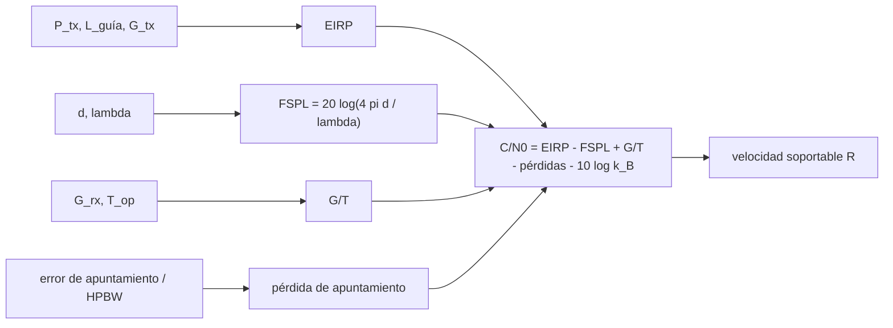

# B91-C08 — Antenas de gran apertura y estaciones de espacio profundo

<!-- nav:top -->
[🏠 Programa](../../../../README.md) · [📚 Bloque B91](../../../tronco-comun/B91-antenas-y-propagacion-para-enlaces-espaciales.md) · [← Anterior: B91-C07 — Atenuación atmosférica y efectos de la lluvia en enlaces](../B91-C07-atenuacion-atmosferica-y-efectos-de-la-lluvia-en-enlaces/CLASE.md) · [Siguiente: B92-C01 — Fuentes láser y amplificadores para enlaces espaciales →](../../../tronco-comun/B92-comunicaciones-opticas-espaciales-profundizacion.md#b92-c01)
<!-- /nav -->

## 1. Ubicación, nivel y alcance

Clase 8 del bloque B91. Nivel N4. Cierra el bloque con la antena más grande de la Red de Espacio Profundo (DSN) de la NASA: la de 70 m. Con los valores publicados de su ganancia, ancho de haz, ruido y pérdidas calculas su `G/T`, la pérdida por error de apuntamiento y un presupuesto de enlace de bajada para una sonda **sintética** a 2 ua. La teoría de la ganancia está en C01, la polarización en C02, la precisión de superficie en C04 y la lluvia en C07; las antenas de radiotelescopio, en [B46](../../../tronco-comun/B46-radioastronomia-e-interferometria.md); el presupuesto genérico de enlace, en [B89](../../../tronco-comun/B89-comunicaciones-y-navegacion-satelital.md).

## 2. Por qué esta clase existe

Un enlace a distancias de unidades astronómicas pierde unos 280 dB: solo se cierra con una estación enorme y de ruido muy bajo. La decisión central: **¿qué antena de estación (una de 70 m, una de 34 m o un arreglo de varias) permite la velocidad de datos pedida, y cuánto cuesta un error de apuntamiento?**

## 3. Lo que podrás hacer al terminar

1. Verificar la EIRP publicada de la antena de 70 m con `P_tx − L_guía + G`.
2. Calcular la pérdida por error de apuntamiento con la aproximación gaussiana de la DSN.
3. Calcular `G/T` de la estación a partir de la ganancia y la temperatura operacional publicadas.
4. Calcular el presupuesto de enlace de bajada: pérdida de espacio libre, `C/N₀` y velocidad soportable.
5. Comparar una antena de 70 m con una de 34 m escalada y con un arreglo de cuatro antenas.
6. Rotular qué es publicado (DSN), qué es calculado y qué es sintético (la sonda).

La evidencia es la **ficha de enlace de espacio profundo** del ejercicio 12 (sección 20).

## 4. Con qué llegas y cómo comprobarlo

1. ¿Qué es la EIRP?
2. ¿Qué es `G/T`?
3. ¿Qué es la pérdida de espacio libre?
4. ¿Qué es `C/N₀` y en qué unidad se mide?
5. ¿Qué es una unidad astronómica?

<details>
<summary>Ver respuestas</summary>

1. La potencia isótropa radiada equivalente: potencia transmitida más ganancia de la antena, menos pérdidas. 2. La figura de mérito de recepción: ganancia sobre temperatura de ruido del sistema, en dB/K. 3. `(4πd/λ)²`, la dilución geométrica de la señal con la distancia. 4. La relación entre la potencia de portadora y la densidad de potencia de ruido, en dB-Hz. 5. `149 597 870 700 m` (valor definido por la UAI en 2012).
</details>

Con cuatro o cinco aciertos, sigue; si no, repasa los prerrequisitos.

## 5. Un caso de contexto y casos de referencia

La antena de 70 m de la DSN (DSS-14) tiene en recepción de banda X una ganancia publicada de `74,55 dBi`, un ancho de haz de `0,032°` y una temperatura operacional de `16,69 K` en zenit con cielo claro al 25 %: `G/T = 62,33 dB/K` (calculado). Una sonda **sintética** de `20 W` y antena de `3 m` a `2,0 ua` produce `C/N₀ = 68,63 dB-Hz` y permitiría `2,3 Mbit/s` con un margen de `3 dB`. Es el **ejemplo conductor**; los datos de la antena son consultados, la sonda es sintética.

## 6. Vocabulario

La **EIRP** es `P_tx − L + G`. La **figura de mérito `G/T`** mide la sensibilidad de la estación. La **pérdida por apuntamiento** es la caída de ganancia al desviar el eje del haz de la fuente; con la aproximación gaussiana, `ΔG = 10 log exp(−2,773 θ²/HPBW²)`. La **pérdida de espacio libre** es `20 log(4πd/λ)`. El **arreglo de antenas** (*arraying*) combina señales de varias antenas. La **temperatura operacional** `T_op` incluye el receptor y el cielo.

## 7. Modelo mental



*Descripción textual:* la potencia y la ganancia de transmisión dan la EIRP; la distancia y la longitud de onda dan la pérdida de espacio libre; la ganancia y el ruido de la estación dan `G/T`; el apuntamiento y otras pérdidas se restan; el resultado es `C/N₀`, del que se obtiene la velocidad soportable.

Analogía: oír un susurro a 300 millones de kilómetros exige una oreja gigante (ganancia) en una sala muy silenciosa (poco ruido). Límite: se supone el enlace en el eje del haz, atmósfera de cielo claro, sin elevación baja, y una sola portadora; el modelo gaussiano subestima la pérdida lejos del eje (lo advierte el propio módulo 101).

## 8. La explicación, paso a paso

### 8.1 Verificación de la EIRP

El módulo 101 publica, para X-band de 7145 MHz con transmisor de `20 kW`, `73,23 dBi` de ganancia, `0,45 dB` de pérdida de guía de onda y una EIRP de `145,8 dBm`. Cálculo: `10 log(20 000 000 mW) = 73,01 dBm`; `73,01 − 0,45 + 73,23 = 145,79 dBm`. La diferencia con lo publicado es `−0,01 dB`: **los tres valores publicados son coherentes entre sí**.

### 8.2 Apuntamiento

La ecuación A9 del módulo da `ΔG(θ) = 10 log exp(−2,773 θ²/HPBW²)`. Con `HPBW = 0,032°`:

| Error `θ` (mdeg) | `θ/HPBW` | Pérdida (dB) |
|---|---|---|
| 2 | 0,062 | −0,047 |
| 4 | 0,125 | −0,188 |
| 8 | 0,250 | −0,753 |
| 16 | 0,500 | −3,011 |
| 24 | 0,750 | −6,774 |

A medio ancho de haz la pérdida es `3,01 dB` (comprobación de la ecuación). Un error de `4 mdeg` (la octava parte del haz) cuesta `0,19 dB`; el viento publicado resta `0,1`, `0,3` y `1,5 dB` a `32`, `48` y `72 km/h`.

### 8.3 `G/T`

`G/T = 74,55 − 10 log 16,69 = 62,33 dB/K`. La antena de **34 m escalada** por área (`10 log (34/70)² = −6,27 dB`, misma eficiencia y `T_op`; **no es un dato publicado**) tiene `68,28 dBi` y `56,05 dB/K`. Un arreglo ideal de `2 × 34 m` da `59,06 dB/K` y de `4 × 34 m`, `62,07 dB/K`, casi igual a la de 70 m (`−0,26 dB`: el área de cuatro antenas de 34 m es un 6 % menor que la de una de 70 m).

### 8.4 Presupuesto de enlace de bajada (sintético)

`f = 8,42 GHz`, `d = 2,0 ua = 299,2 Gm`: `FSPL = 280,47 dB`. Sonda: antena de `3,0 m` con `η = 0,55` (`45,86 dBi`), `20 W` (`13,01 dBW`), EIRP `58,87 dBW`. Pérdidas: polarización `0,1`, atmósfera `0,1` (ilustrativa), apuntamiento de la sonda `0,3` y apuntamiento de la estación (4 mdeg) `0,188 dB`.

`C/N₀ = 58,87 − 280,47 + 62,33 − 0,688 + 228,6 = 68,63 dB-Hz` (con `k_B = 1,380649 × 10⁻²³ J/K` exacto, igual a `−228,6 dBW/Hz/K` redondeado dentro de `0,01 dB`). Con `E_b/N₀` requerido `2,0 dB` y margen `3,0 dB`, `R = 10^((68,63 − 5)/10) = 2,31 Mbit/s`.

| Estación | `C/N₀` (dB-Hz) | `R` (kbit/s) |
|---|---|---|
| 70 m (publicado) | 68,63 | 2308,1 |
| 34 m (escalada) | 62,36 | 544,5 |
| 4 × 34 m (escalado) | 68,38 | 2178,1 |

### 8.5 Qué cambia y qué no

Doblar el área de la estación sube `G/T` `3 dB` y la velocidad al doble; cada `dB` de pérdida de apuntamiento cuesta lo mismo en velocidad. La distancia pesa más: pasar de 2 a 4 ua resta `6 dB` y divide la velocidad por 4.

## 9. Magnitudes, símbolos y unidades

| Símbolo | Qué es | Unidad | Valor / nota |
|---|---|---|---|
| `G` | ganancia | dBi | 74,55 (X rx); 73,23 (X tx) |
| `HPBW` | ancho de haz | grados | 0,032 (rx); 0,038 (tx) |
| `T_op` | temperatura operacional | K | 16,69 |
| `G/T` | figura de mérito | dB/K | 62,33 (calculada) |
| `EIRP` | potencia isótropa radiada | dBm | 145,8 (publicada) |
| `d` | distancia | ua | 2,0 (sintética) |
| `k_B` | constante de Boltzmann | J/K | 1,380649 × 10⁻²³ (exacta) |

## 10. Convenciones y referencias

Valores de la DSN: antena de 70 m, DSS-14, referidos a la apertura del alimentador, ganancia al ángulo de elevación de ganancia máxima, polarización adaptada y sin atmósfera; `T_op` en zenit con cielo claro al 25 % (CD = 0,25), configuración X-only con RCP. Constantes: `k_B` y `c` del SI, `1 ua = 149 597 870 700 m` (UAI 2012). Todo lo de la sonda es sintético. La antena de 34 m se escala por área y no se consultó su módulo.

## 11. De dónde sale lo que afirmamos

| ID | Fuente | Localizador | Respalda | Estado |
|---|---|---|---|---|
| S1 | NASA/JPL, DSN Telecommunications Link Design Handbook 810-005, módulo 101 rev. D «70-m Subnet Telecommunications Interfaces» (2011-04-21) — https://deepspace.jpl.nasa.gov/dsndocs/810-005/101/101D.pdf (consultada 2026-11-10) | documento completo (41 págs.) leído con PyMuPDF | Tabla 1 (ganancia, pérdida de guía, EIRP, HPBW tx), Tabla 2 (ganancia, HPBW rx), Tabla 3 (viento), Tabla 4 (`T_op`) y ecuación A9 (pérdida por apuntamiento) | Consultada |
| — | Módulos de la DSN para antenas de 34 m, valores de arreglos de antenas y pérdidas de combinación; constantes SI y UAI | — | la antena de 34 m y el arreglo se escalan por área sin pérdidas; las constantes son definiciones del SI y de la UAI | No consultada en una fuente concreta |

Límites: no se consultó el módulo de las antenas de 34 m ni de arreglos; la sonda, la distancia, la atmósfera y los requisitos de `E_b/N₀` son sintéticos o ilustrativos; no se consultó ninguna norma CCSDS de codificación.

## 12. Cómo ver el enlace de espacio profundo

| Magnitud | Valor |
|---|---|
| EIRP (calculada frente a publicada) | 145,79 frente a 145,8 dBm |
| `G/T` de 70 m | 62,33 dB/K |
| Pérdida con 4 mdeg de error | −0,188 dB |
| `C/N₀` con la antena de 70 m | 68,63 dB-Hz |
| Velocidad soportable (70 m) | 2308 kbit/s |

Descripción larga: la antena de 70 m cierra el enlace sintético a 2 ua con 2,3 Mbit/s; una de 34 m daría 4,2 veces menos y cuatro de 34 m casi lo mismo que una de 70 m.

## 13. Ejemplo trabajado: la EIRP de la antena de 70 m

**Paso 1 · Potencia.** `20 kW = 2 × 10⁷ mW`; `10 log = 73,01 dBm`.

**Paso 2 · Pérdida de guía.** `73,01 − 0,45 = 72,56 dBm`.

**Paso 3 · Ganancia.** `72,56 + 73,23 = 145,79 dBm`.

**Paso 4 · Contraste.** El módulo publica `145,8 dBm`: diferencia `−0,01 dB`.

## 14. Distintas formas de describir una estación de espacio profundo

**Por ganancia:** `G` (dBi). **Por haz:** HPBW (°). **Por sensibilidad:** `G/T` (dB/K). **Por transmisión:** EIRP (dBm). **Por enlace:** `C/N₀` (dB-Hz) y velocidad (bit/s).

## 15. Práctica guiada

**Ejercicio 1 · guiado con los pasos indicados.** Calcula `10 log(20 kW en mW)`. *Pasos:* `20 kW = 2 × 10⁷ mW`.

<details><summary>Solución comentada</summary>

`73,01 dBm`.
</details>

**Ejercicio 2 · guiado con una pista.** Calcula la pérdida por apuntamiento a `θ = HPBW/2`. *Pista:* `exp(−2,773/4)`.

<details><summary>Solución comentada</summary>

`10 log e^{−0,693} = −3,01 dB`.
</details>

**Ejercicio 3 · guiado, casi autónomo.** Calcula `G/T` con `G = 74,55 dBi` y `T = 16,69 K`. *Casi autónomo:* `10 log T`.

<details><summary>Solución comentada</summary>

`10 log 16,69 = 12,22`; `74,55 − 12,22 = 62,33 dB/K`.
</details>

## 16. Práctica autónoma, transferencia e integrador

**Ejercicio 4 · autónomo.** Calcula la pérdida de espacio libre a 8,42 GHz y 1 ua.

<details><summary>Solución comentada</summary>

`λ = 0,035605 m`; `4π × 1,496 × 10¹¹/0,035605 = 5,28 × 10¹³`; `20 log = 274,45 dB`.
</details>

**Ejercicio 5 · autónomo.** ¿Cuánto cambia la pérdida de espacio libre al pasar de 1 a 2 ua?

<details><summary>Solución comentada</summary>

`+6,02 dB`.
</details>

**Ejercicio 6 · autónomo.** Calcula la pérdida por un error de 8 mdeg con HPBW 0,032°.

<details><summary>Solución comentada</summary>

`θ/HPBW = 0,25`; `−0,753 dB`.
</details>

**Ejercicio 7 · autónomo.** Calcula la ganancia de una antena de 34 m escalada por área desde 70 m (74,55 dBi).

<details><summary>Solución comentada</summary>

`74,55 + 10 log (34/70)² = 74,55 − 6,27 = 68,28 dBi`.
</details>

**Ejercicio 8 · autónomo.** ¿Cuánto vale la ganancia de combinar 4 antenas idénticas coherentemente?

<details><summary>Solución comentada</summary>

`10 log 4 = +6,02 dB` en `G/T` sobre una sola.
</details>

**Ejercicio 9 · transferencia.** **Transferencia.** Un ingeniero dice «con 72 km/h de viento no se pierde nada porque el seguimiento lo corrige». ¿Qué responde la tabla de la DSN?

<details><summary>Solución comentada</summary>

El módulo publica `−1,5 dB` en X a 72 km/h incluso con seguimiento (CONSCAN); el viento sí cuesta.
</details>

**Ejercicio 10 · transferencia.** **Transferencia.** Se necesita el doble de velocidad con la misma sonda. ¿Qué cambia en la estación?

<details><summary>Solución comentada</summary>

`+3,01 dB` de `G/T`: duplicar el área o reducir `T_op` a la mitad (`16,69 → 8,3 K`).
</details>

**Ejercicio 11 · transferencia.** **Transferencia.** ¿Por qué la aproximación gaussiana de apuntamiento no vale para errores de 1 HPBW?

<details><summary>Solución comentada</summary>

El propio módulo advierte que subestima la pérdida lejos del eje (el patrón real tiene un nulo cerca de un HPBW); hay que usar el patrón exacto.
</details>

**Ejercicio 12 · integrador.** **Integrador.** Elabora tu *ficha de enlace de espacio profundo*: EIRP verificada, `G/T`, tabla de apuntamiento, presupuesto de enlace con las tres estaciones y qué es publicado, calculado y sintético.

<details><summary>Solución comentada</summary>

Secciones 8.1–8.5 y la salida del laboratorio.
</details>

## 17. Laboratorio: la antena de 70 m y un enlace a 2 ua

El script [enlace_dsn.py](enlace_dsn.py) verifica la EIRP publicada, tabula la pérdida por apuntamiento, calcula `G/T` y el presupuesto de enlace con las tres estaciones (**comprueba** EIRP con 0,05 dB, `ΔG(HPBW/2) = −3,01 dB` con 0,01 dB y `C/N₀` por dos vías).

**Datos:** ganancias, HPBW, pérdida de guía, EIRP, viento y `T_op` del módulo 101 (consultados); sonda, distancia, pérdidas y requisito **sintéticos**; 34 m y arreglo **escalados**. **Predice antes de ejecutar:** ¿cuánto valdrá la EIRP calculada? (≈ 145,8 dBm). **Ejecución del 2026-11-10 (Python 3.12.9):**

```text
Python 3.12.9 (biblioteca estandar)
(a) EIRP X = 10 log(20 kW en mW) - 0.45 dB + 73.23 dBi = 73.01 - 0.45 + 73.23 = 145.79 dBm (publicado 145.8 dBm, diferencia -0.01 dB)
(b) Apuntamiento rx (HPBW 0.032 deg): Delta G(HPBW/2) = -3.011 dB
   error theta [mdeg]   theta/HPBW   perdida [dB]
         2.0              0.062        -0.047
         4.0              0.125        -0.188
         8.0              0.250        -0.753
        16.0              0.500        -3.011
        24.0              0.750        -6.774
   Viento (Tabla 3, X): 32 km/h -> -0.1 dB ; 48 km/h -> -0.3 dB ; 72 km/h -> -1.5 dB
(c) G/T = 74.55 dBi - 10 log(16.69 K) = 62.33 dB/K ; via lineal (G/T en cociente): 62.33 dB/K
    Antena de 34 m ESCALADA por area desde 70 m (misma eficiencia y T_op, NO publicado): G = 68.28 dBi, G/T = 56.05 dB/K
    Arreglo ideal de 2 x 34 m (combinacion coherente sin perdidas): G/T = 59.06 dB/K  (70 m: 62.33)
    Arreglo ideal de 4 x 34 m (combinacion coherente sin perdidas): G/T = 62.07 dB/K  (70 m: 62.33)
Enlace SINTETICO de bajada: f = 8.42 GHz, d = 2.0 ua = 299.2 Gm; perdida de espacio libre = 280.47 dB
    G satelite = 45.86 dBi ; EIRP satelite = 58.87 dBW
    polarizacion                              0.100 dB
    atmosfera (cielo claro, ILUSTRATIVO)      0.100 dB
    apuntamiento satelite                     0.300 dB
    apuntamiento estacion (4 mdeg)            0.188 dB
    C/N0 = 68.63 dB-Hz (con k_B exacto) ; con -228.6 dBW/Hz/K redondeado: 68.63
    Eb/N0 requerido 2.0 dB + margen 3.0 dB -> velocidad soportable R = 10^(63.63/10) = 2308.1 kbit/s
    Velocidad soportable segun la antena de la estacion (mismo satelite):
      70 m (publicado)     C/N0 =  68.63 dB-Hz ; R =   2308.1 kbit/s
      34 m escalada        C/N0 =  62.36 dB-Hz ; R =    544.5 kbit/s
      4 x 34 m escalado    C/N0 =  68.38 dB-Hz ; R =   2178.1 kbit/s
Pruebas superadas.
```

```bash
python programa/clases/B91/B91-C08-antenas-de-gran-apertura-y-estaciones-de-espacio-profundo/enlace_dsn.py
```

**Límites:** gaussiana de apuntamiento; sin elevación baja ni atmósfera real; el arreglo ideal ignora pérdidas de combinación; sin codificación ni modulación reales.

## 18. Errores frecuentes y cómo corregirlos

**Usar la ganancia ideal de 70 m en lugar de la publicada.** Ver C01 y 8.3.

**Olvidar el ruido en `G/T`.** Ver 8.3.

**Aplicar la gaussiana de apuntamiento lejos del eje.** Ver 8.2.

**Presentar la sonda sintética como una misión real.** Ver la sección 11.

## 19. Cómo sabrás que vas bien

Tras la sección 8: ¿qué EIRP esperabas y cuál obtuviste? Si dudas, repasa el ejemplo 13. Tras el laboratorio: ¿qué comprueba? (ver la sección 17).

## 20. Qué entregas y cómo se evalúa

El producto es tu **ficha de enlace de espacio profundo** (ejercicio 12).

| Criterio | Inicial | En desarrollo | Logrado | Destacado |
|---|---|---|---|---|
| Conceptos | Los confunde | Parciales | Calcula `G/T`, apuntamiento y `C/N₀` | Explica los límites |
| Cálculo | Sin unidades | Con errores | Tablas completas con unidades | Calcula casos nuevos |
| Numérico | Sin comprobar | Un caso | Contraste con una segunda vía | Interpreta las diferencias |
| Fuentes | Sin fuente | Sin fecha | Fuentes con fecha y estado | Declara lo sintético y lo no consultado |
| Límites | No los nombra | Uno | Tres | Discute qué falta del modelo |

**Condiciones críticas (no se compensan con promedio):** rotular la sonda como sintética y la antena de 34 m como escalada; no presentar `G/T` calculada como publicada; citar solo lo consultado.

## 21. Ética, seguridad y límites

Clase educativa: los modelos son simplificados y sus datos son sintéticos, ilustrativos o publicados con fuente; ningún resultado sustituye a la norma del operador, a una medición en cámara ni a un diseño certificado. Lo simulado no se presenta como observado. Accesibilidad: tablas equivalentes a las gráficas, fórmulas en texto, ejercicios sin conexión.

## 22. Para cerrar y seguir

La antena de 70 m, con `62,33 dB/K`, cierra un enlace sintético a 2 ua con `2,3 Mbit/s`, y 4 mdeg de error de apuntamiento cuestan `0,19 dB`. Con esto el bloque completa el camino: del patrón de una antena a su selección, su propagación y su uso en una estación de espacio profundo.

**Glosario español–inglés.** figura de mérito · *figure of merit (G/T)*; pérdida de espacio libre · *free-space path loss*; error de apuntamiento · *pointing error*; potencia isótropa radiada equivalente · *EIRP*; arreglo de antenas · *antenna arraying*.

**Continuidad.** cierra el bloque B91; el siguiente bloque del área trata las comunicaciones ópticas espaciales.

**Referencias:** ver sección 11.

<!-- nav:bottom -->
---

[← Anterior: B91-C07 — Atenuación atmosférica y efectos de la lluvia en enlaces](../B91-C07-atenuacion-atmosferica-y-efectos-de-la-lluvia-en-enlaces/CLASE.md) · [📚 Bloque B91](../../../tronco-comun/B91-antenas-y-propagacion-para-enlaces-espaciales.md) · [Siguiente: B92-C01 — Fuentes láser y amplificadores para enlaces espaciales →](../../../tronco-comun/B92-comunicaciones-opticas-espaciales-profundizacion.md#b92-c01)
<!-- /nav -->
