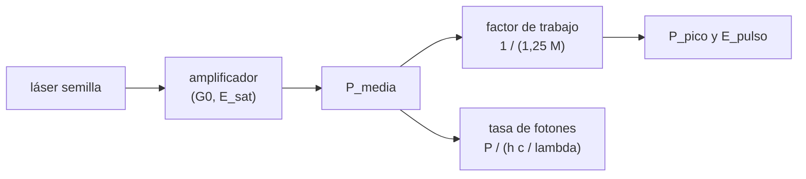

# B92-C01 — Fuentes láser y amplificadores para enlaces espaciales

<!-- nav:top -->
[🏠 Programa](../../../../README.md) · [📚 Bloque B92](../../../tronco-comun/B92-comunicaciones-opticas-espaciales-profundizacion.md) · [← Anterior: B91-C08 — Antenas de gran apertura y estaciones de espacio profundo](../../../tronco-comun/B91-antenas-y-propagacion-para-enlaces-espaciales.md#b91-c08) · [Siguiente: B92-C02 — Divergencia del haz y pérdidas por apuntamiento óptico →](../B92-C02-divergencia-del-haz-y-perdidas-por-apuntamiento-optico/CLASE.md)
<!-- /nav -->

## 1. Ubicación, nivel y alcance

Clase 1 del bloque B92. Nivel N3. Un terminal óptico espacial es, en su transmisor, un láser semilla y un amplificador de fibra o de estado sólido. Aquí conviertes la potencia media de un enlace en potencia de pico, energía por pulso y fotones por segundo, ubicas la longitud de onda en la rejilla del CCSDS y ves por qué un amplificador pulsado se satura. Parte de lo que [B89](../../../tronco-comun/B89-comunicaciones-y-navegacion-satelital.md) presenta sobre comunicaciones ópticas. El transmisor es sintético y no corresponde a ningún terminal real.

## 2. Por qué esta clase existe

Un enlace óptico se dimensiona con fotones, no con vatios. La decisión central: **¿cuánta potencia de pico y cuánta energía por pulso debe entregar la fuente para una potencia media dada, y hasta dónde sirve aumentar la ganancia del amplificador?**

## 3. Lo que podrás hacer al terminar

1. Ubicar una longitud de onda en la rejilla de frecuencias del CCSDS 141.0-B-1.
2. Calcular la energía de un fotón y la tasa de fotones de una potencia dada.
3. Calcular el factor de trabajo y la potencia de pico de un transmisor PPM con ranuras de guarda.
4. Calcular la energía por pulso para una ranura dada.
5. Aplicar el modelo de Frantz–Nodvik a un amplificador saturable y leer su ganancia efectiva.
6. Separar lo consultado (constantes, rejilla, guardas) de lo ilustrativo (potencias, energía de saturación).

La evidencia es la **ficha de transmisor óptico con su balance de potencia** del ejercicio 12 (sección 20).

## 4. Con qué llegas y cómo comprobarlo

1. ¿Qué energía tiene un fotón y de qué depende?
2. ¿Qué es un decibelio?
3. ¿Qué es la potencia media frente a la de pico?
4. ¿Qué es un dato sintético?
5. ¿Qué es una verificación por segunda vía?

<details>
<summary>Ver respuestas</summary>

1. `E = hν = hc/λ`: depende de la frecuencia. 2. Diez veces el logaritmo decimal de un cociente de potencias. 3. La media es la energía por unidad de tiempo; la de pico es la potencia durante el pulso. 4. Un dato generado para el ejemplo, no medido. 5. Calcular lo mismo con otro método y comparar.
</details>

Con cuatro o cinco aciertos, sigue; si no, repasa los prerrequisitos.

## 5. Un caso de contexto y casos de referencia

Un transmisor ilustrativo emite `4 W` de potencia media en `1552,52 nm` con PPM de orden 16 y ranuras de `1 ns`. Como tras cada símbolo de 16 ranuras hay 4 de guarda y solo una ranura lleva pulso, el factor de trabajo es `0,05` y la potencia de pico `80 W`, con `80 nJ` por pulso. Un amplificador de `30 dB` de pequeña señal y `20 µJ` de energía de saturación entrega solo `18,98 dB` si el pulso de entrada es de `1 µJ`. Es el **ejemplo conductor**. Todo es **ilustrativo**: ninguna cifra describe un terminal real.

## 6. Vocabulario

La **rejilla de frecuencias** del CCSDS 141.0-B-1 es `193,1 + n × 0,1 THz` con `n` de −18 a 28. La **energía del fotón** es `E = hc/λ`. El **factor de trabajo** es la fracción de ranuras con pulso: `1/(1,25 M)`. La **potencia de pico** es la media dividida por el factor de trabajo. La **energía de saturación** `E_sat` es la energía por pulso a la que la ganancia del amplificador cae de forma apreciable. La **ecuación de Frantz–Nodvik** da la energía de salida de un amplificador de pulsos.

## 7. Modelo mental: una pileta que se vacía



*Descripción textual:* la semilla pasa por el amplificador; la potencia media, con el factor de trabajo de PPM, da la potencia de pico y la energía por pulso; con la energía del fotón da la tasa de fotones.

Analogía: el amplificador es una pileta llena de energía almacenada; cada pulso se lleva una parte y, si el pulso ya es grande, apenas queda algo para amplificar. Límite: el modelo es de una sola pasada, sin ruido de emisión espontánea ni efectos no lineales.

## 8. La explicación, paso a paso

### 8.1 Rejilla y longitud de onda

El CCSDS 141.0-B-1 (sección 3.2) fija la frecuencia central en `193,1 + n × 0,1 THz`, con `n` entre −18 y 28: de `191,3 THz` (`1567,13 nm`) a `195,9 THz` (`1530,33 nm`). Con `λ = c/ν` y `c = 299 792 458 m/s`, el canal `n = 0` es `1552,52 nm`. La tolerancia del transmisor es ±10 GHz.

### 8.2 Fotones

`E = hc/λ = 1,2795 × 10⁻¹⁹ J` a `1552,52 nm`; un julio contiene `7,8156 × 10¹⁸` fotones. Cuatro vatios son `3,1262 × 10¹⁹ fotones/s`.

### 8.3 Potencia de pico en PPM

Con PPM de orden `M`, el CCSDS 142.0-B-1 (sección 3.13) añade `M/4` ranuras de guarda a cada símbolo de `M` ranuras. Solo una ranura de cada `1,25 M` lleva pulso: `P_pico = 1,25 M · P_media`. Para `4 W`: `20 W` con `M = 4`, `80 W` con `M = 16`, `320 W` con `M = 64` y `1280 W` con `M = 256`. La energía por pulso con ranura de 1 ns es `P_pico × 1 ns`: `80 nJ` con `M = 16`.

### 8.4 Amplificador saturable

La energía de salida de un pulso es `E_sal = E_sat ln(1 + G₀(e^{E_ent/E_sat} − 1))`. Con `G₀ = 30 dB` y `E_sat = 20 µJ`: un pulso de `0,001 µJ` sale con `29,89 dB`, uno de `1 µJ` con `18,98 dB` y uno de `50 µJ` con `5,72 dB`. La ganancia cae porque el pulso consume la inversión de población almacenada. La segunda vía integra la ecuación de saturación con Runge–Kutta de orden 4 y coincide a `4,97 × 10⁻¹³`.

### 8.5 Balance eléctrico

Con una eficiencia eléctrica a óptica ilustrativa del `10 %`, `4 W` ópticos exigen `40 W` eléctricos. El resto es calor que el control térmico del satélite debe evacuar.

## 9. Magnitudes, símbolos y unidades

| Símbolo | Qué es | Unidad | Valor / nota |
|---|---|---|---|
| `ν` | frecuencia óptica | THz | 193,1 + n × 0,1 |
| `λ` | longitud de onda en vacío | nm | 1552,52 (n = 0) |
| `E` | energía del fotón | J | 1,2795 × 10⁻¹⁹ |
| `M` | orden PPM | — | 16 (ilustrativo) |
| `P_pico` | potencia de pico | W | 80 |
| `E_sat` | energía de saturación | µJ | 20 (ilustrativo) |
| `G₀` | ganancia de pequeña señal | dB | 30 (ilustrativo) |

## 10. Convenciones y referencias

Frecuencias y longitudes de onda en el vacío. `h` y `c` exactas de CODATA 2022. Potencias y energías son ilustrativas. El amplificador es de una pasada, sin ruido de emisión espontánea. La tolerancia del laboratorio es `10⁻⁹` relativa para la rejilla y `10⁻⁶` para Frantz–Nodvik frente a la integración.

## 11. De dónde sale lo que afirmamos

| ID | Fuente | Localizador | Respalda | Estado |
|---|---|---|---|---|
| S1 | NIST, constante de Planck — https://physics.nist.gov/cgi-bin/cuu/Value?h (consultada 2026-11-10) | valor CODATA 2022 | `h = 6,626 070 15 × 10⁻³⁴ J s` | Consultada |
| S2 | NIST, velocidad de la luz — https://physics.nist.gov/cgi-bin/cuu/Value?c (consultada 2026-11-10) | valor CODATA 2022 | `c = 299 792 458 m/s` exacta | Consultada |
| S3 | CCSDS 141.0-B-1, *Optical Communications Physical Layer*, agosto de 2019 — https://ccsds.org/Pubs/141x0b1.pdf (leído con PyMuPDF el 2026-11-10) | secciones 3.2 a 3.5 | rejilla `193,1 + n × 0,1 THz`, `n` = −18 a 28; tolerancia ±10 GHz | Consultada |
| S4 | CCSDS 142.0-B-1, *Optical Communications Coding and Synchronization*, agosto de 2019 — https://ccsds.org/Pubs/142x0b1.pdf (leído con PyMuPDF el 2026-11-10) | sección 3.13 | `M/4` ranuras de guarda tras cada conjunto de `M` ranuras | Consultada |
| — | Ecuación de Frantz–Nodvik y potencias, energías y eficiencia ilustrativas | — | las verifica el laboratorio con una segunda vía | No consultada en una fuente concreta |

Límites: no se consultó ningún terminal real; las potencias del ejemplo no representan a ninguna misión.

## 12. Cómo ver la potencia de pico

| Magnitud | Valor |
|---|---|
| `λ` (n = 0) | 1552,52 nm |
| `E` del fotón | 1,2795 × 10⁻¹⁹ J |
| `P_pico` (M = 16, 4 W) | 80 W |
| ganancia con 1 µJ | 18,98 dB |
| diferencia con la integración | 5 × 10⁻¹³ |

Descripción larga: al subir el orden PPM la potencia de pico crece en proporción y el amplificador entra en saturación; la ganancia efectiva cae al crecer la energía del pulso.

## 13. Ejemplo trabajado: potencia de pico con M = 64

**Paso 1 · Factor de trabajo.** `1/(1,25 × 64) = 0,0125`.

**Paso 2 · Potencia de pico.** `4/0,0125 = 320 W`.

**Paso 3 · Energía por pulso.** `320 W × 1 ns = 320 nJ`.

**Paso 4 · Fotones por pulso.** `320 × 10⁻⁹/1,2795 × 10⁻¹⁹ = 2,50 × 10¹² fotones`.

## 14. Distintas formas de describir un transmisor

**Por potencia media:** `P`. **Por potencia de pico:** `P_pico`. **Por energía por pulso:** `E_pulso`. **Por fotones:** `P/E`. **Por ganancia:** `G₀` y `E_sat`.

## 15. Práctica guiada

**Ejercicio 1 · con los pasos indicados.** Calcula la longitud de onda del canal `n = 10`. *Pasos:* frecuencia `193,1 + 1,0 THz`; divide `c` por esa frecuencia.

<details><summary>Solución comentada</summary>

`ν = 194,1 THz`; `λ = 299 792 458/194,1 × 10¹² = 1544,53 nm`.
</details>

**Ejercicio 2 · con una pista.** Calcula la energía de un fotón a `1552,52 nm`. *Pista:* `hc = 1,98645 × 10⁻²⁵ J m`.

<details><summary>Solución comentada</summary>

`1,98645 × 10⁻²⁵/1552,52 × 10⁻⁹ = 1,2795 × 10⁻¹⁹ J`.
</details>

**Ejercicio 3 · casi autónomo.** Potencia de pico de un transmisor de `4 W` medios con `M = 16`.

<details><summary>Solución comentada</summary>

Con factor de trabajo `1/(1,25 × 16) = 0,05`: `80 W`.
</details>

## 16. Práctica autónoma, transferencia e integrador

**Ejercicio 4 · autónomo.** Energía por pulso con `M = 256` y ranura de 1 ns, `4 W` medios.

<details><summary>Solución comentada</summary>

`1280 W × 1 ns = 1280 nJ`.
</details>

**Ejercicio 5 · autónomo.** Potencia eléctrica para `2 W` ópticos con eficiencia del `8 %`.

<details><summary>Solución comentada</summary>

`2/0,08 = 25 W`.
</details>

**Ejercicio 6 · autónomo.** Fotones por segundo de `1 W` a `1552,52 nm`.

<details><summary>Solución comentada</summary>

`1/1,2795 × 10⁻¹⁹ = 7,8156 × 10¹⁸ fotones/s`.
</details>

**Ejercicio 7 · autónomo.** Energía de salida del amplificador para una entrada de `1 µJ`.

<details><summary>Solución comentada</summary>

`79,13 µJ` (laboratorio): ganancia `18,98 dB`.
</details>

**Ejercicio 8 · autónomo.** ¿Por qué la ganancia efectiva baja de `29,89 dB` a `5,72 dB` al subir la entrada?

<details><summary>Solución comentada</summary>

El pulso consume la inversión de población almacenada; cuando `E_ent` se acerca a `E_sat` o la supera, solo queda parte de esa energía para amplificar.
</details>

**Ejercicio 9 · transferencia.** **Transferencia.** Con ranuras de `0,125 ns` (la menor del CCSDS 141.0-B-1) y `M = 16`, ¿cambia la potencia de pico y la energía por pulso para `4 W` medios?

<details><summary>Solución comentada</summary>

La potencia de pico no cambia (`80 W`, depende solo del factor de trabajo); la energía por pulso baja a `80 W × 0,125 ns = 10 nJ`.
</details>

**Ejercicio 10 · transferencia.** **Transferencia.** La baliza del CCSDS puede usar `281,72 THz`. ¿Qué energía tiene su fotón?

<details><summary>Solución comentada</summary>

`λ = 1064,15 nm`; `E = 1,98645 × 10⁻²⁵/1064,15 × 10⁻⁹ = 1,867 × 10⁻¹⁹ J`, un 46 % más que a `1552,52 nm`.
</details>

**Ejercicio 11 · transferencia.** **Transferencia.** Un proveedor ofrece «láser de 4 W». ¿Qué tres preguntas le harías antes de aceptar el dato?

<details><summary>Solución comentada</summary>

¿Es potencia media o de pico? ¿Con qué orden PPM y factor de trabajo? ¿Qué energía de saturación y eficiencia eléctrica tiene el amplificador y a qué temperatura?
</details>

**Ejercicio 12 · integrador.** **Integrador.** Elabora tu *ficha de transmisor óptico con su balance de potencia*: canal de la rejilla y longitud de onda, energía del fotón, tabla de `P_pico` y `E_pulso` por orden PPM, ganancia del amplificador frente a la energía de entrada, potencia eléctrica y lista de qué es consultado e ilustrativo.

<details><summary>Solución comentada</summary>

Secciones 8.1–8.5 y la salida del laboratorio.
</details>

## 17. Laboratorio: transmisor PPM y amplificador saturable

El script [fuentes.py](fuentes.py) calcula la rejilla, la energía del fotón, la potencia de pico por orden PPM y la ganancia de Frantz–Nodvik, y la contrasta con una integración RK4 (**comprueba** los extremos de la rejilla, la ganancia de pequeña señal y diferencia < 1e-6).

**Datos:** `h`, `c` y la rejilla del CCSDS (consultados); potencias, `E_sat` y eficiencia **ilustrativas**. **Predice antes de ejecutar:** ¿qué potencia de pico tendrá `M = 64`? (320 W.) **Ejecución del 2026-11-10 (Python 3.12.9):**

```text
Python 3.12.9 (biblioteca estandar)
Rejilla CCSDS 141.0-B-1 (frecuencia central 193.1 + n*0.1 THz)
  n = -18: f =   191.3 THz  lambda =  1567.13 nm
  n =   0: f =   193.1 THz  lambda =  1552.52 nm
  n =  28: f =   195.9 THz  lambda =  1530.33 nm
Energia de un foton en n = 0: 1.2795e-19 J ; fotones por julio = 7.8156e+18
Potencia media ILUSTRATIVA 4.0 W -> 3.1262e+19 fotones/s
 M   duty     P_pico [W]  E_pulso [nJ] (ranura 1 ns)
   4  0.20000       20.00      20.000
  16  0.05000       80.00      80.000
  64  0.01250      320.00     320.000
 256  0.00313     1280.00    1280.000
Amplificador saturable (Frantz-Nodvik) ILUSTRATIVO: E_sat = 20 uJ, G0 = 30 dB
  E_ent =    0.0010 uJ  E_sal =     0.9758 uJ  ganancia =  29.89 dB
  E_ent =    0.1000 uJ  E_sal =    35.8769 uJ  ganancia =  25.55 dB
  E_ent =    1.0000 uJ  E_sal =    79.1289 uJ  ganancia =  18.98 dB
  E_ent =   10.0000 uJ  E_sal =   129.5309 uJ  ganancia =  11.12 dB
  E_ent =   50.0000 uJ  E_sal =   186.4439 uJ  ganancia =   5.72 dB
Ganancia de pequena senal recuperada: 29.9999 dB (esperado 30)
Diferencia relativa maxima Frantz-Nodvik frente a integracion RK4 = 4.97e-13
Potencia electrica para 4 W opticos con eficiencia 10%: 40.0 W
Pruebas superadas.
```

```bash
python programa/clases/B92/B92-C01-fuentes-laser-y-amplificadores-para-enlaces-espaciales/fuentes.py
```

**Límites:** amplificador de una pasada sin ruido ni no linealidades; la segunda vía integra la misma ecuación diferencial, por lo que valida el código y no la física del amplificador.

## 18. Errores frecuentes y cómo corregirlos

**Confundir potencia media con potencia de pico.** Se corrige con 8.3.

**Olvidar las ranuras de guarda.** Se corrige con 8.3: el factor de trabajo es `1/(1,25 M)`.

**Suponer ganancia constante en un amplificador de pulsos.** Se corrige con 8.4.

**Presentar el transmisor sintético como un terminal real.** Se corrige con la sección 10.

## 19. Cómo sabrás que vas bien

Tras la sección 8: ¿qué potencia de pico esperabas con `M = 16` y cuál obtuviste? Si dudas, repasa el ejemplo 13. Tras el laboratorio: ¿qué comprueba? (ver la sección 17).

## 20. Qué entregas y cómo se evalúa

El producto es tu **ficha de transmisor óptico con su balance de potencia** (ejercicio 12).

| Criterio | Inicial | En desarrollo | Logrado | Destacado |
|---|---|---|---|---|
| Conceptos | Los confunde | Parciales | Distingue media, pico y fotones | Explica la saturación |
| Cálculo | Sin unidades | Con errores | Tablas completas con unidades | Calcula casos nuevos |
| Numérico | Sin comprobar | Un caso | Contraste con una segunda vía | Interpreta las diferencias |
| Fuentes | Sin fuente | Sin fecha | Fuentes con fecha y estado | Declara lo ilustrativo y lo no consultado |
| Límites | No los nombra | Uno | Tres | Discute qué falta del modelo |

**Condiciones críticas (no se compensan con promedio):** rotular el transmisor como ilustrativo; no atribuir las cifras a un terminal real; citar solo lo consultado.

## 21. Ética, seguridad y límites

Clase educativa: los modelos son simplificados y sus datos son sintéticos o ilustrativos. Los láseres de comunicaciones pueden dañar la vista y afectar a la aviación; su operación real exige las evaluaciones y coordinaciones de seguridad de las autoridades, que esta clase no sustituye. Accesibilidad: tablas equivalentes a las gráficas, fórmulas en texto, ejercicios sin conexión.

## 22. Para cerrar y seguir

Cuatro vatios medios son `80 W` de pico con `M = 16`, y un amplificador de 30 dB entrega solo `18,98 dB` si el pulso es de `1 µJ`. Queda una pregunta: ¿cuánta de esa potencia llega realmente al receptor si el haz no apunta bien?

**Glosario español–inglés.** amplificador · *amplifier*; potencia de pico · *peak power*; factor de trabajo · *duty cycle*; energía de saturación · *saturation energy*; ranura · *slot*.

**Continuidad.** [B92-C02](../B92-C02-divergencia-del-haz-y-perdidas-por-apuntamiento-optico/CLASE.md) cuantifica la divergencia del haz y la pérdida por apuntamiento.

**Referencias:** ver sección 11.

<!-- nav:bottom -->
---

[← Anterior: B91-C08 — Antenas de gran apertura y estaciones de espacio profundo](../../../tronco-comun/B91-antenas-y-propagacion-para-enlaces-espaciales.md#b91-c08) · [📚 Bloque B92](../../../tronco-comun/B92-comunicaciones-opticas-espaciales-profundizacion.md) · [Siguiente: B92-C02 — Divergencia del haz y pérdidas por apuntamiento óptico →](../B92-C02-divergencia-del-haz-y-perdidas-por-apuntamiento-optico/CLASE.md)
<!-- /nav -->
