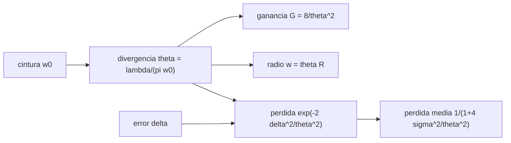

# B92-C02 — Divergencia del haz y pérdidas por apuntamiento óptico

<!-- nav:top -->
[🏠 Programa](../../../../README.md) · [📚 Bloque B92](../../../tronco-comun/B92-comunicaciones-opticas-espaciales-profundizacion.md) · [← Anterior: B92-C01 — Fuentes láser y amplificadores para enlaces espaciales](../B92-C01-fuentes-laser-y-amplificadores-para-enlaces-espaciales/CLASE.md) · [Siguiente: B92-C03 — Adquisición, apuntamiento y seguimiento ópticos →](../B92-C03-adquisicion-apuntamiento-y-seguimiento-opticos/CLASE.md)
<!-- /nav -->

## 1. Ubicación, nivel y alcance

Clase 2 del bloque B92. Nivel N3. El haz láser de un enlace óptico mide microrradianes de ancho: toda la potencia está en un cono muy estrecho y cualquier error de apuntamiento se paga en decibelios. Aquí calculas la divergencia de un haz gaussiano, su ganancia, el radio del haz a distancia y la pérdida por desapuntamiento fijo y aleatorio. Usas [C01](../B92-C01-fuentes-laser-y-amplificadores-para-enlaces-espaciales/CLASE.md) para la longitud de onda. El enlace es sintético.

## 2. Por qué esta clase existe

Una antena de radiofrecuencia tolera décimas de grado; un haz óptico, microrradianes. La decisión central: **¿qué divergencia conviene y qué apuntamiento hay que garantizar para que la ganancia ganada no se pierda?**

## 3. Lo que podrás hacer al terminar

1. Calcular la divergencia `θ = λ/(π w₀)` de un haz gaussiano.
2. Calcular la ganancia de transmisión `8/θ²` y el radio del haz a una distancia dada.
3. Calcular la fracción de potencia captada por un receptor.
4. Calcular la pérdida por un desapuntamiento fijo.
5. Calcular la pérdida media por un error aleatorio y comprobarla con Monte Carlo.
6. Ver que la ganancia efectiva tiene un techo fijado por el error de apuntamiento.

La evidencia es la **tabla de pérdida frente a error de apuntamiento** del ejercicio 12 (sección 20).

## 4. Con qué llegas y cómo comprobarlo

1. ¿Qué es un microrradián?
2. ¿Qué es la ganancia de una antena o un haz?
3. ¿Qué es una distribución gaussiana?
4. ¿Qué es una verificación por Monte Carlo?
5. ¿Cuánto es 1 dB en razón lineal?

<details>
<summary>Ver respuestas</summary>

1. Una millonésima de radián: un milímetro a un kilómetro. 2. El cociente entre la intensidad en el eje y la de una fuente isótropa de igual potencia. 3. Una campana de media cero y dispersión `σ`. 4. Estimar una cantidad promediando muchas muestras aleatorias con semilla fija. 5. `10^0,1 = 1,259`.
</details>

Con cuatro o cinco aciertos, sigue; si no, repasa los prerrequisitos.

## 5. Un caso de contexto y casos de referencia

Un haz de `1552,52 nm` con cintura de `4 cm` diverge `12,355 µrad` y tiene `107,19 dBi` de ganancia. A `45 000 km` mide `556 m` de radio y un receptor de `0,1 m` de radio capta solo `6,47 × 10⁻⁸` de la potencia. Un error fijo de `4 µrad` cuesta `0,91 dB`; uno aleatorio de `2 µrad` por eje cuesta `0,433 dB` de media. Es el **ejemplo conductor**. Todo es **ilustrativo**: ninguna cifra describe un terminal real. Como contexto publicado, LCRD usa un haz de comunicaciones de unos `20 µrad` y balizas de más de `200 µrad` (Israel et al., 2024).

## 6. Vocabulario

La **cintura** `w₀` es el radio del haz en su punto más estrecho (donde la intensidad cae a `1/e²`). La **divergencia** `θ` es el semiángulo del cono en el campo lejano. La **ganancia** de transmisión es `G = 8/θ²`. El **error de apuntamiento** `δ` es el ángulo entre el eje del haz y la dirección del receptor. La **distribución de Rayleigh** describe la magnitud de un error 2D con componentes gaussianas independientes de dispersión `σ`.

## 7. Modelo mental: una linterna con cono estrecho



*Descripción textual:* de la cintura sale la divergencia, de ella la ganancia y el radio del haz; con el error de apuntamiento sale la pérdida y, si el error es aleatorio, la pérdida media.

Analogía: una linterna con el cono más cerrado ilumina más fuerte el punto central, pero basta moverla un poco para dejar de iluminar el objetivo. Límite: el haz es gaussiano ideal, sin aberraciones ni obstrucción central.

## 8. La explicación, paso a paso

### 8.1 Divergencia y ganancia

Con `λ = 1552,52 nm` y `w₀ = 4 cm`, `θ = λ/(π w₀) = 12,355 µrad`. La ganancia en el eje es `G = 8/θ² = 5,24 × 10¹⁰`, es decir `107,19 dBi`. Reducir `θ` a la mitad (duplicar la cintura) suma `6,02 dB`.

### 8.2 Radio del haz y captación

A `R = 45 000 km`, `w = θ R = 556,0 m`. La fracción de potencia en un disco de radio `r` es `1 − exp(−2r²/w²)`; para `r = 0,1 m` vale `6,4706 × 10⁻⁸` (`−71,9 dB`) y coincide con la aproximación `2r²/w²`.

### 8.3 Desapuntamiento fijo

`L(δ) = exp(−2δ²/θ²)`: `0,9489` (0,23 dB) con `2 µrad`, `0,8109` (0,91 dB) con `4 µrad`, `0,6239` (2,05 dB) con `6 µrad` y `0,4323` (3,64 dB) con `8 µrad`. La pérdida crece con el cuadrado del error.

### 8.4 Desapuntamiento aleatorio

Si cada eje tiene error gaussiano de dispersión `σ`, el error total es de Rayleigh y `⟨L⟩ = 1/(1 + 4σ²/θ²)`. Con `σ = 2 µrad`, `⟨L⟩ = 0,90512` (0,433 dB). El Monte Carlo con semilla fija (200 000 muestras) da `0,90532`: diferencia `2,0 × 10⁻⁴`. Para limitar la pérdida media a `1 dB` hace falta `σ = 0,2544 θ = 3,143 µrad`.

### 8.5 El techo de la ganancia

La ganancia efectiva media es `G⟨L⟩ = 8/(θ² + 4σ²)`. Con `σ = 2 µrad`: `112,90 dBi` si `θ = 5 µrad`, `108,39 dBi` si `10 µrad`, `102,84 dBi` si `20 µrad`. Cuando `θ → 0` la ganancia tiende a `2/σ²` (`116,99 dBi`): estrechar el haz más allá de `σ` ya no sirve de media. Este análisis usa solo el promedio; la cola del desapuntamiento se trata en [C08](../B92-C08-margenes-y-disponibilidad-de-enlaces-opticos/CLASE.md).

## 9. Magnitudes, símbolos y unidades

| Símbolo | Qué es | Unidad | Valor / nota |
|---|---|---|---|
| `w₀` | cintura del haz | m | 0,04 (ilustrativo) |
| `θ` | divergencia (semiángulo 1/e²) | µrad | 12,355 |
| `G` | ganancia de transmisión | dBi | 107,19 |
| `R` | distancia | km | 45 000 (ilustrativo) |
| `δ` | error de apuntamiento | µrad | 0 a 8 |
| `σ` | dispersión por eje | µrad | 2 (ilustrativo) |
| `L` | pérdida (razón lineal) | — | 0,4323 a 1 |

## 10. Convenciones y referencias

`θ` es el semiángulo del cono donde la intensidad cae a `1/e²`. Campo lejano, haz gaussiano ideal, sin obstrucción. El error de apuntamiento es 2D con ejes independientes de igual `σ`. Longitud de onda de la rejilla del CCSDS (`193,1 THz`); distancia, cintura, receptor y `σ` son ilustrativos. Tolerancia del laboratorio: Monte Carlo frente a analítico `2 × 10⁻³`.

## 11. De dónde sale lo que afirmamos

| ID | Fuente | Localizador | Respalda | Estado |
|---|---|---|---|---|
| S1 | NIST, velocidad de la luz — https://physics.nist.gov/cgi-bin/cuu/Value?c (consultada 2026-11-10) | valor CODATA 2022 | `c = 299 792 458 m/s` | Consultada |
| S2 | CCSDS 141.0-B-1, agosto de 2019 — https://ccsds.org/Pubs/141x0b1.pdf (leído con PyMuPDF el 2026-11-10) | sección 3.2 | frecuencia central `193,1 THz` en la rejilla | Consultada |
| S3 | Israel et al., *NASA's LCRD experiment program: characterization and initial operations*, SPIE, 2024 — https://ntrs.nasa.gov/api/citations/20230018608/downloads/SPIE%20West%202024%20final.pdf (leído con PyMuPDF el 2026-11-10) | sección 3.1 | haz de comunicaciones de unos 20 µrad; balizas con más de 200 µrad cada una | Consultada |
| — | Haz gaussiano, ganancia `8/θ²`, pérdida `exp(−2δ²/θ²)` y distribución de Rayleigh | — | las verifica el laboratorio con Monte Carlo | No consultada en una fuente concreta |

Límites: la definición de divergencia de LCRD no se verificó; sus cifras son contexto y no entran en el cálculo.

## 12. Cómo ver la pérdida por apuntamiento

| Magnitud | Valor |
|---|---|
| `θ` | 12,355 µrad |
| `G` | 107,19 dBi |
| pérdida con `δ = 4 µrad` | 0,91 dB |
| pérdida media con `σ = 2 µrad` | 0,433 dB |
| techo `2/σ²` | 116,99 dBi |

Descripción larga: la pérdida crece con el cuadrado del cociente `δ/θ`; la ganancia efectiva media sigue a `8/θ²` mientras `θ ≫ σ` y se aplana en `2/σ²` cuando `θ` es del orden de `σ`.

## 13. Ejemplo trabajado: error de 6 µrad

**Paso 1 · Cociente.** `δ/θ = 6/12,355 = 0,4856`.

**Paso 2 · Exponente.** `2 × 0,4856² = 0,4716`.

**Paso 3 · Pérdida lineal.** `exp(−0,4716) = 0,6239`.

**Paso 4 · En decibelios.** `−10 log₁₀ 0,6239 = 2,05 dB`.

## 14. Distintas formas de describir un haz

**Por geometría:** `w₀`, `θ`. **Por ganancia:** `G` en dBi. **Por huella:** `w = θ R`. **Por apuntamiento:** `δ` o `σ`. **Por pérdida:** `L` o `⟨L⟩`.

## 15. Práctica guiada

**Ejercicio 1 · con los pasos indicados.** Divergencia con `w₀ = 5 cm` y `λ = 1552,52 nm`. *Pasos:* divide `λ` entre `π w₀`.

<details><summary>Solución comentada</summary>

`1552,52 × 10⁻⁹/(π × 0,05) = 9,884 µrad`.
</details>

**Ejercicio 2 · con una pista.** Ganancia para `θ = 12,355 µrad`. *Pista:* `G = 8/θ²`.

<details><summary>Solución comentada</summary>

`8/(12,355 × 10⁻⁶)² = 5,24 × 10¹⁰`, es decir `107,19 dBi`.
</details>

**Ejercicio 3 · casi autónomo.** Radio del haz a `45 000 km`.

<details><summary>Solución comentada</summary>

`12,355 × 10⁻⁶ × 45 × 10⁶ m = 556,0 m`.
</details>

## 16. Práctica autónoma, transferencia e integrador

**Ejercicio 4 · autónomo.** Pérdida con `δ = 4 µrad`.

<details><summary>Solución comentada</summary>

`0,8109`, es decir `0,91 dB`.
</details>

**Ejercicio 5 · autónomo.** Fracción de potencia captada por `r = 0,1 m` a `45 000 km`, en dB.

<details><summary>Solución comentada</summary>

`6,47 × 10⁻⁸`, es decir `−71,9 dB`.
</details>

**Ejercicio 6 · autónomo.** Pérdida media con `σ = 2 µrad` por eje, en dB.

<details><summary>Solución comentada</summary>

`⟨L⟩ = 0,9051`, es decir `0,433 dB`.
</details>

**Ejercicio 7 · autónomo.** `σ` por eje para `1 dB` de pérdida media.

<details><summary>Solución comentada</summary>

`σ = 0,2544 θ = 3,143 µrad`.
</details>

**Ejercicio 8 · autónomo.** Ganancia efectiva con `θ = 10 µrad` y `σ = 2 µrad`; compárala con el techo.

<details><summary>Solución comentada</summary>

`108,39 dBi`; el techo es `116,99 dBi`: faltan `8,6 dB`.
</details>

**Ejercicio 9 · transferencia.** **Transferencia.** Hipótesis: el haz de unos `20 µrad` de LCRD fuera un semiángulo `1/e²` y el error de apuntamiento fuera `10 µrad`. ¿Qué pérdida habría?

<details><summary>Solución comentada</summary>

`exp(−2 × 100/400) = 0,6065`, es decir `2,17 dB`. La definición de la divergencia de LCRD no se verificó, de modo que es solo un ejercicio hipotético.
</details>

**Ejercicio 10 · transferencia.** **Transferencia.** Un colega duplica la cintura para ganar `6 dB`. ¿Qué exige a cambio al apuntamiento?

<details><summary>Solución comentada</summary>

La divergencia baja a la mitad, de modo que el mismo `δ` produce más pérdida: la tolerancia de apuntamiento también se reduce a la mitad.
</details>

**Ejercicio 11 · transferencia.** **Transferencia.** Si la distancia se duplica con el mismo haz, ¿cuánto cae la potencia recibida?

<details><summary>Solución comentada</summary>

La huella crece al doble en radio y al cuádruple en área: `−6,02 dB`.
</details>

**Ejercicio 12 · integrador.** **Integrador.** Elabora tu *tabla de pérdida frente a error de apuntamiento*: `θ`, `G`, `w` a distancia, pérdida fija para cinco errores, pérdida media con Monte Carlo, `σ` para `1 dB` y lista de qué es consultado e ilustrativo.

<details><summary>Solución comentada</summary>

Secciones 8.1–8.5 y la salida del laboratorio.
</details>

## 17. Laboratorio: haz gaussiano y pérdida por apuntamiento

El script [haz.py](haz.py) calcula `θ`, `G`, `w`, la pérdida fija y media y la ganancia efectiva, y contrasta la pérdida media con un Monte Carlo (**comprueba** diferencia < 2e-3, aproximación de la fracción captada y la `σ` de 1 dB).

**Datos:** `c` y la rejilla (consultados); cintura, distancia, receptor y `σ` **ilustrativos**. **Predice antes de ejecutar:** ¿qué pérdida media da `σ = 2 µrad`? (0,433 dB.) **Ejecución del 2026-11-10 (Python 3.12.9):**

```text
Python 3.12.9 (biblioteca estandar)
lambda = 1552.52 nm ; w0 = 4 cm (ILUSTRATIVO) ; theta = 12.355 urad ; G = 107.19 dBi
A R = 45000 km (ILUSTRATIVO): radio del haz w = 556.0 m
Fraccion de potencia en un receptor de 0.1 m de radio: exacta 6.4706e-08 ; aproximada 2 r^2/w^2 6.4706e-08
Perdida por desapuntamiento fijo delta:
  delta =  0.0 urad  L = 1.0000  (-0.00 dB)
  delta =  2.0 urad  L = 0.9489  (0.23 dB)
  delta =  4.0 urad  L = 0.8109  (0.91 dB)
  delta =  6.0 urad  L = 0.6239  (2.05 dB)
  delta =  8.0 urad  L = 0.4323  (3.64 dB)
Perdida media con sigma = 2.0 urad por eje: analitica 0.90512 ; Monte Carlo 0.90532 ; diferencia 2.0e-04
  -> 0.433 dB de perdida media
Sigma por eje que da 1 dB de perdida media: 3.143 urad = 0.2544 theta
Ganancia efectiva G <L> = 8/(theta^2 + 4 sigma^2) con sigma = 2 urad:
  theta =   5.0 urad  G = 115.05 dBi  G_efectiva = 112.90 dBi
  theta =  10.0 urad  G = 109.03 dBi  G_efectiva = 108.39 dBi
  theta =  20.0 urad  G = 103.01 dBi  G_efectiva = 102.84 dBi
  theta =  40.0 urad  G =  96.99 dBi  G_efectiva =  96.95 dBi
Techo de la ganancia efectiva (theta -> 0): 2/sigma^2 = 116.99 dBi
Pruebas superadas.
```

```bash
python programa/clases/B92/B92-C02-divergencia-del-haz-y-perdidas-por-apuntamiento-optico/haz.py
```

**Límites:** haz gaussiano ideal, campo lejano y errores gaussianos independientes y estacionarios; la media oculta la cola que decide la disponibilidad.

## 18. Errores frecuentes y cómo corregirlos

**Confundir la divergencia total con el semiángulo.** Se corrige con la sección 10.

**Creer que más ganancia es siempre mejor.** Se corrige con 8.5.

**Usar el error medio como si fuera constante.** Se corrige con 8.4.

**Presentar el haz sintético como el de una misión.** Se corrige con la sección 10.

## 19. Cómo sabrás que vas bien

Tras la sección 8: ¿qué pérdida esperabas con `δ = 4 µrad` y cuál obtuviste? Si dudas, repasa el ejemplo 13. Tras el laboratorio: ¿qué comprueba? (ver la sección 17).

## 20. Qué entregas y cómo se evalúa

El producto es tu **tabla de pérdida frente a error de apuntamiento** (ejercicio 12).

| Criterio | Inicial | En desarrollo | Logrado | Destacado |
|---|---|---|---|---|
| Conceptos | Los confunde | Parciales | Relaciona `θ`, `G` y `L` | Explica el techo `2/σ²` |
| Cálculo | Sin unidades | Con errores | Tablas completas con unidades | Calcula casos nuevos |
| Numérico | Sin comprobar | Un caso | Contraste con Monte Carlo | Interpreta las diferencias |
| Fuentes | Sin fuente | Sin fecha | Fuentes con fecha y estado | Declara lo ilustrativo y lo no consultado |
| Límites | No los nombra | Uno | Tres | Discute qué falta del modelo |

**Condiciones críticas (no se compensan con promedio):** rotular el haz y el apuntamiento como ilustrativos; no atribuir las cifras a un terminal real; citar solo lo consultado.

## 21. Ética, seguridad y límites

Clase educativa: los modelos son simplificados y sus datos son sintéticos o ilustrativos. Un haz estrecho concentra la potencia: la operación real exige evaluaciones de seguridad ocular y de aviación que esta clase no sustituye. Accesibilidad: tablas equivalentes a las gráficas, fórmulas en texto, ejercicios sin conexión.

## 22. Para cerrar y seguir

Un haz de `12,355 µrad` da `107,19 dBi`, pero un error aleatorio de `2 µrad` por eje ya cuesta `0,433 dB` y fija un techo de ganancia efectiva. Queda una pregunta: ¿cómo se encuentra y se mantiene el receptor dentro de un haz tan estrecho?

**Glosario español–inglés.** divergencia · *beam divergence*; cintura · *beam waist*; error de apuntamiento · *pointing error*; ganancia · *gain*; campo lejano · *far field*.

**Continuidad.** [B92-C03](../B92-C03-adquisicion-apuntamiento-y-seguimiento-opticos/CLASE.md) trata la adquisición y el seguimiento.

**Referencias:** ver sección 11.

<!-- nav:bottom -->
---

[← Anterior: B92-C01 — Fuentes láser y amplificadores para enlaces espaciales](../B92-C01-fuentes-laser-y-amplificadores-para-enlaces-espaciales/CLASE.md) · [📚 Bloque B92](../../../tronco-comun/B92-comunicaciones-opticas-espaciales-profundizacion.md) · [Siguiente: B92-C03 — Adquisición, apuntamiento y seguimiento ópticos →](../B92-C03-adquisicion-apuntamiento-y-seguimiento-opticos/CLASE.md)
<!-- /nav -->
