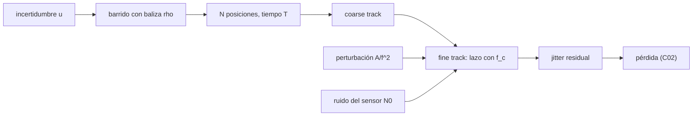

# B92-C03 — Adquisición, apuntamiento y seguimiento ópticos

<!-- nav:top -->
[🏠 Programa](../../../../README.md) · [📚 Bloque B92](../../../tronco-comun/B92-comunicaciones-opticas-espaciales-profundizacion.md) · [← Anterior: B92-C02 — Divergencia del haz y pérdidas por apuntamiento óptico](../B92-C02-divergencia-del-haz-y-perdidas-por-apuntamiento-optico/CLASE.md) · [Siguiente: B92-C04 — Atmósfera y nubes en enlaces ópticos con la Tierra →](../B92-C04-atmosfera-y-nubes-en-enlaces-opticos-con-la-tierra/CLASE.md)
<!-- /nav -->

## 1. Ubicación, nivel y alcance

Clase 3 del bloque B92. Nivel N3. Con un haz de microrradianes, el primer problema de un enlace óptico es encontrar al otro terminal y el segundo es no perderlo. Aquí calculas el tiempo de un barrido de adquisición y el jitter residual de un lazo de seguimiento con perturbación y ruido de sensor. Usas [C02](../B92-C02-divergencia-del-haz-y-perdidas-por-apuntamiento-optico/CLASE.md) para convertir el jitter en pérdida. [B47](../../../tronco-comun/B47-instrumentacion-y-observatorios-espaciales.md) y [B87](../../../tronco-comun/B87-sensores-y-control-de-actitud.md) tratan la estabilidad de apuntamiento sin la adquisición del enlace; aquí ocurre lo contrario. El enlace es sintético.

## 2. Por qué esta clase existe

Un satélite conoce su posición y su actitud con una incertidumbre mucho mayor que el haz de comunicaciones. La decisión central: **¿cómo se cubre la incertidumbre en un tiempo razonable y con qué ancho de banda se cierra el lazo para que el jitter no cueste potencia?**

## 3. Lo que podrás hacer al terminar

1. Calcular el número de posiciones y el tiempo de un barrido de adquisición.
2. Verificar la cobertura de un barrido con Monte Carlo.
3. Calcular la varianza residual de un lazo de primer orden con perturbación `A/f²`.
4. Añadir el ruido del sensor y encontrar el ancho de banda óptimo.
5. Convertir el jitter residual en pérdida de potencia con la fórmula de C02.
6. Separar lo consultado (contexto de LCRD) de lo ilustrativo (incertidumbre, perturbación, ruido).

La evidencia es la **ficha de adquisición y seguimiento** del ejercicio 12 (sección 20).

## 4. Con qué llegas y cómo comprobarlo

1. ¿Qué es un lazo de realimentación?
2. ¿Qué es una densidad espectral de potencia?
3. ¿Qué es el ancho de banda de un lazo?
4. ¿Qué es la velocidad de la luz y cuánto tarda en recorrer 45 000 km?
5. ¿Qué es una verificación por segunda vía?

<details>
<summary>Ver respuestas</summary>

1. Un sistema que mide su error y lo corrige. 2. La distribución de la potencia de una señal por frecuencia, en unidades²/Hz. 3. La frecuencia hasta la que el lazo corrige las perturbaciones. 4. `299 792 458 m/s`; unos `150 ms` de ida. 5. Calcular lo mismo con otro método y comparar.
</details>

Con cuatro o cinco aciertos, sigue; si no, repasa los prerrequisitos.

## 5. Un caso de contexto y casos de referencia

Un terminal conoce la posición del otro con `±500 µrad` y emite una baliza de `200 µrad` de radio. A `45 000 km` la ida y vuelta de la luz tarda `300,21 ms`; con un reposo de `310,21 ms` por posición, el barrido de `16` posiciones dura `4,96 s`. Una vez adquirido, un lazo de primer orden de `199 Hz` deja un jitter residual de `1,212 µrad` frente a los `9,995 µrad` de la perturbación sin control. Es el **ejemplo conductor**. Todo es **ilustrativo**. Como contexto publicado, el experimento LCRD adquiere con una baliza de cuatro haces de más de `200 µrad` y un detector de cuadrantes («coarse track»), y luego pasa a «fine track» con un haz de unos `20 µrad` (Israel et al., 2024).

## 6. Vocabulario

La **adquisición** es la etapa en que cada terminal localiza al otro. La **baliza** es un haz ancho que facilita esa búsqueda. El **seguimiento** (*tracking*) mantiene el apuntamiento con un lazo cerrado sobre un sensor (por ejemplo un detector de cuadrantes). El **jitter** es la desviación aleatoria rápida del eje. La **frecuencia de cruce** `f_c` es el ancho de banda del lazo. La **sensibilidad** `|S|² = f²/(f² + f_c²)` indica qué parte de la perturbación queda sin corregir.

## 7. Modelo mental: buscar con una linterna ancha y luego afinar



*Descripción textual:* la incertidumbre se cubre con un barrido de baliza; la adquisición gruesa lleva al seguimiento fino, donde el lazo rechaza la perturbación y deja pasar el ruido; el jitter residual se convierte en pérdida con C02.

Analogía: buscar a alguien en una sala oscura con una linterna ancha y luego enfocar la mirada. Límite: el lazo es de primer orden sin retardo ni saturación; un lazo real tiene retardo de procesamiento y de propagación.

## 8. La explicación, paso a paso

### 8.1 Cuántas posiciones

Con rejilla cuadrada y círculos de radio `ρ` de paso `ρ√2`, `N = ⌈2u/(ρ√2)⌉²`. Para `u = 500 µrad`: `ρ = 50 µrad` exige `225` posiciones (69,80 s); `100 µrad`, `64` (19,85 s); `200 µrad`, `16` (4,96 s); `400 µrad`, `4` (1,24 s). Aumentar la baliza acorta el barrido, pero a costa de potencia: a igual potencia, la irradiancia cae con `1/ρ²`.

### 8.2 Tiempo de reposo

En cada posición hay que esperar al menos la ida y vuelta de la luz, `2R/c = 300,21 ms` a `45 000 km`, más un margen ilustrativo de `10 ms`.

### 8.3 Cobertura

Un Monte Carlo con semilla fija (20 000 puntos) comprueba que la rejilla de `8 × 8` cubre el `100 %` del cuadrado de `±500 µrad` con `ρ = 100 µrad`, y que una de `6 × 6` deja solo un `95,01 %`. La condición es que la semidiagonal de la celda no supere a `ρ`.

### 8.4 Perturbación y lazo

Con perturbación `S_d(f) = A/f²` entre 1 y 1000 Hz y `A = 100 µrad²·Hz`, el jitter sin control es `9,995 µrad`. Un lazo de primer orden con frecuencia de cruce `f_c` la reduce a `σ_d² = (A/f_c)[atan(f₂/f_c) − atan(f₁/f_c)]`: `3,82 µrad` con 10 Hz, `1,21 µrad` con 100 Hz y `0,30 µrad` con 900 Hz. La integral numérica de Simpson en escala logarítmica coincide a `1,6 × 10⁻¹⁴`.

### 8.5 Ruido del sensor y ancho de banda óptimo

El ruido del sensor (`0,05 µrad/√Hz`) entra con `σ_n² = N₀² π f_c/2`: crece con `f_c`. El jitter total tiene un mínimo: `f_c = 199 Hz` con `1,2123 µrad`; con 900 Hz sube a `1,9045 µrad`. Con `θ = 12,355 µrad`, la pérdida media pasa de `1,41 dB` (10 Hz) a `0,18 dB` (300 Hz) y a `0,39 dB` (900 Hz).

## 9. Magnitudes, símbolos y unidades

| Símbolo | Qué es | Unidad | Valor / nota |
|---|---|---|---|
| `u` | incertidumbre (semiancho) | µrad | 500 (ilustrativo) |
| `ρ` | radio de la baliza | µrad | 50–400 |
| `N`, `T` | posiciones y tiempo de barrido | —, s | 16; 4,96 |
| `A` | densidad de perturbación | µrad²·Hz | 100 (ilustrativo) |
| `N₀` | ruido del sensor | µrad/√Hz | 0,05 (ilustrativo) |
| `f_c` | frecuencia de cruce | Hz | 199 (óptima) |
| `σ` | jitter residual por eje | µrad | 1,2123 |

## 10. Convenciones y referencias

Ángulos en microrradianes. Jitter por eje. Barrido en rejilla cuadrada sin solapamiento adicional ni fallo de detección. Lazo de primer orden, perturbación `A/f²` entre 1 y 1000 Hz. Incertidumbre, distancia, `A`, `N₀` y `θ` son ilustrativos. Tolerancia: integral numérica `10⁻⁸` relativa; cobertura exacta `1,0`.

## 11. De dónde sale lo que afirmamos

| ID | Fuente | Localizador | Respalda | Estado |
|---|---|---|---|---|
| S1 | NIST, velocidad de la luz — https://physics.nist.gov/cgi-bin/cuu/Value?c (consultada 2026-11-10) | valor CODATA 2022 | `c = 299 792 458 m/s` | Consultada |
| S2 | Israel et al., *NASA's LCRD experiment program: characterization and initial operations*, SPIE, 2024 — https://ntrs.nasa.gov/api/citations/20230018608/downloads/SPIE%20West%202024%20final.pdf (leído con PyMuPDF el 2026-11-10) | sección 3.1 | baliza de cuatro haces de más de 200 µrad, detector de cuadrantes («coarse track»), haz de unos 20 µrad en «fine track» | Consultada |
| — | Barrido en rejilla, lazo de primer orden y sensibilidad `f²/(f²+f_c²)` | — | las verifica el laboratorio con Monte Carlo e integración numérica | No consultada en una fuente concreta |

Límites: los parámetros del lazo y de la perturbación son sintéticos; no hay datos de un terminal real.

## 12. Cómo ver el barrido y el lazo

| Magnitud | Valor |
|---|---|
| `N` con `ρ = 200 µrad` | 16 |
| `T` | 4,96 s |
| `σ` sin control | 9,995 µrad |
| `f_c` óptima | 199 Hz |
| `σ` total en el óptimo | 1,2123 µrad |

Descripción larga: el tiempo de barrido cae con el cuadrado del radio de la baliza; el jitter total tiene un mínimo porque la perturbación se corrige mejor con más ancho de banda y el ruido del sensor empeora.

## 13. Ejemplo trabajado: barrido con baliza de 100 µrad

**Paso 1 · Paso de la rejilla.** `ρ√2 = 141,42 µrad`.

**Paso 2 · Posiciones por eje.** `2u/(ρ√2) = 1000/141,42 = 7,07` → `8`.

**Paso 3 · Total.** `N = 8² = 64`.

**Paso 4 · Tiempo.** `64 × 0,31021 s = 19,85 s`.

## 14. Distintas formas de describir la adquisición

**Por cobertura:** `u`, `ρ`, `N`. **Por tiempo:** `T = N(2R/c + t)`. **Por lazo:** `f_c`. **Por espectro:** `A`, `N₀`. **Por pérdida:** `σ` → `⟨L⟩`.

## 15. Práctica guiada

**Ejercicio 1 · con los pasos indicados.** `N` para `u = 500 µrad` y `ρ = 200 µrad`. *Pasos:* divide `2u` entre `ρ√2`, redondea hacia arriba y eleva al cuadrado.

<details><summary>Solución comentada</summary>

`1000/282,84 = 3,54 → 4`; `4² = 16`.
</details>

**Ejercicio 2 · con una pista.** Tiempo de barrido con `16` posiciones. *Pista:* reposo `0,31021 s`.

<details><summary>Solución comentada</summary>

`16 × 0,31021 = 4,96 s`.
</details>

**Ejercicio 3 · casi autónomo.** Ida y vuelta de la luz a `45 000 km`.

<details><summary>Solución comentada</summary>

`2 × 45 × 10⁶/299 792 458 = 0,30021 s`.
</details>

## 16. Práctica autónoma, transferencia e integrador

**Ejercicio 4 · autónomo.** Posiciones y tiempo con `ρ = 400 µrad`.

<details><summary>Solución comentada</summary>

`N = 4`, `T = 1,24 s`.
</details>

**Ejercicio 5 · autónomo.** Posiciones y tiempo con `ρ = 50 µrad`.

<details><summary>Solución comentada</summary>

`2u/(ρ√2) = 14,14 → 15`; `N = 225`; `T = 69,80 s`.
</details>

**Ejercicio 6 · autónomo.** Jitter de la perturbación sin control entre 1 y 1000 Hz.

<details><summary>Solución comentada</summary>

`√(100 × (1 − 0,001)) = 9,995 µrad`.
</details>

**Ejercicio 7 · autónomo.** Jitter total y pérdida con `f_c = 100 Hz` y `θ = 12,355 µrad`.

<details><summary>Solución comentada</summary>

`1,3616 µrad`; `⟨L⟩ = 1/(1 + 4 × 1,3616²/12,355²)`, es decir `0,2060 dB`.
</details>

**Ejercicio 8 · autónomo.** Ancho de banda óptimo y jitter total en el óptimo.

<details><summary>Solución comentada</summary>

`199,04 Hz` (búsqueda ternaria; la malla fina da `199,07 Hz`) y `1,2123 µrad`.
</details>

**Ejercicio 9 · transferencia.** **Transferencia.** Si la incertidumbre se duplica a `±1000 µrad` con `ρ = 200 µrad`, ¿cuánto crece el tiempo?

<details><summary>Solución comentada</summary>

`2000/282,84 = 7,07 → 8`; `N = 64`; `T = 19,85 s`: cuatro veces más, porque `N` crece con `u²`.
</details>

**Ejercicio 10 · transferencia.** **Transferencia.** Pasar de `ρ = 100` a `400 µrad` acorta el barrido de `19,85` a `1,24 s`. ¿Qué cuesta?

<details><summary>Solución comentada</summary>

A igual potencia, la irradiancia en el receptor baja `16` veces (`−12 dB`), de modo que hace falta más potencia de baliza o un detector más sensible.
</details>

**Ejercicio 11 · transferencia.** **Transferencia.** Un ingeniero sube la frecuencia de cruce de `300` a `900 Hz` para «seguir mejor». ¿Qué ocurre con el jitter total?

<details><summary>Solución comentada</summary>

Sube de `1,2663` a `1,9045 µrad`: el ruido del sensor domina; hay un óptimo y subir `f_c` más allá empeora.
</details>

**Ejercicio 12 · integrador.** **Integrador.** Elabora tu *ficha de adquisición y seguimiento*: tabla de `N` y `T` por radio de baliza, cobertura, jitter de perturbación, ruido y total para cinco anchos de banda, óptimo, pérdida asociada y lista de qué es consultado e ilustrativo.

<details><summary>Solución comentada</summary>

Secciones 8.1–8.5 y la salida del laboratorio.
</details>

## 17. Laboratorio: barrido de adquisición y lazo de seguimiento

El script [seguimiento.py](seguimiento.py) calcula `N` y `T` del barrido, verifica la cobertura por Monte Carlo, calcula el jitter residual del lazo con perturbación y ruido y busca `f_c` óptima (**comprueba** integral numérica < 1e-8, cobertura 1,0 y óptimo contra una malla fina).

**Datos:** `c` (consultada); contexto de LCRD (consultado, no entra en el cálculo); incertidumbre, `A`, `N₀`, distancia y `θ` **ilustrativos**. **Predice antes de ejecutar:** ¿cuántas posiciones con `ρ = 100 µrad`? (64.) **Ejecución del 2026-11-10 (Python 3.12.9):**

```text
Python 3.12.9 (biblioteca estandar)
Tiempo de ida y vuelta a 45000 km (ILUSTRATIVO) = 300.21 ms ; reposo por posicion = 310.21 ms
Barrido de +-500 urad con baliza de divergencia rho (circulos de radio rho):
  rho =    50 urad  N =  225  T =    69.80 s
  rho =   100 urad  N =   64  T =    19.85 s
  rho =   200 urad  N =   16  T =     4.96 s
  rho =   400 urad  N =    4  T =     1.24 s
Cobertura Monte Carlo (rho = 100 urad): rejilla 8x8 = 1.0000 ; rejilla 6x6 = 0.9501
Perturbacion en lazo abierto (sin control) entre 1 y 1000 Hz: sigma = 9.995 urad
Lazo de primer orden: fc, sigma_perturbacion, sigma_ruido, sigma_total [urad] ; perdida media con theta = 12.355 urad
  fc =   10.0 Hz   3.8225   0.1982   3.8276  perdida = 1.4111 dB
  fc =   30.0 Hz   2.2416   0.3432   2.2678  perdida = 0.5491 dB
  fc =  100.0 Hz   1.2088   0.6267   1.3616  perdida = 0.2060 dB
  fc =  300.0 Hz   0.6522   1.0854   1.2663  perdida = 0.1787 dB
  fc =  900.0 Hz   0.3049   1.8800   1.9045  perdida = 0.3943 dB
fc optimo (busqueda ternaria) = 199.04 Hz ; sigma_total = 1.2123 urad ; malla fina: 199.07 Hz
Diferencia relativa maxima integral numerica frente a analitica = 1.58e-14
Pruebas superadas.
```

```bash
python programa/clases/B92/B92-C03-adquisicion-apuntamiento-y-seguimiento-opticos/seguimiento.py
```

**Límites:** lazo de primer orden sin retardo, perturbación estacionaria, detección perfecta en cada posición; un terminal real pierde ganancia por retardo y por saturaciones.

## 18. Errores frecuentes y cómo corregirlos

**Ignorar la ida y vuelta de la luz en el tiempo de reposo.** Se corrige con 8.2.

**Creer que mayor ancho de banda siempre mejora el seguimiento.** Se corrige con 8.5.

**Medir la cobertura solo en los centros de la rejilla.** Se corrige con 8.3.

**Presentar la perturbación sintética como la de un satélite real.** Se corrige con la sección 10.

## 19. Cómo sabrás que vas bien

Tras la sección 8: ¿qué `N` esperabas con `ρ = 100 µrad` y cuál obtuviste? Si dudas, repasa el ejemplo 13. Tras el laboratorio: ¿qué comprueba? (ver la sección 17).

## 20. Qué entregas y cómo se evalúa

El producto es tu **ficha de adquisición y seguimiento** (ejercicio 12).

| Criterio | Inicial | En desarrollo | Logrado | Destacado |
|---|---|---|---|---|
| Conceptos | Los confunde | Parciales | Distingue adquisición y seguimiento | Explica el óptimo de `f_c` |
| Cálculo | Sin unidades | Con errores | Tablas completas con unidades | Calcula casos nuevos |
| Numérico | Sin comprobar | Un caso | Contraste con una segunda vía | Interpreta las diferencias |
| Fuentes | Sin fuente | Sin fecha | Fuentes con fecha y estado | Declara lo ilustrativo y lo no consultado |
| Límites | No los nombra | Uno | Tres | Discute qué falta del modelo |

**Condiciones críticas (no se compensan con promedio):** rotular perturbación y ruido como ilustrativos; no atribuir las cifras a un terminal real; citar solo lo consultado.

## 21. Ética, seguridad y límites

Clase educativa: los modelos son simplificados y sus datos son sintéticos o ilustrativos. Las balizas de adquisición emiten potencia hacia el cielo: su uso real exige coordinación con las autoridades de seguridad ocular y de aviación, que esta clase no sustituye. Accesibilidad: tablas equivalentes a las gráficas, fórmulas en texto, ejercicios sin conexión.

## 22. Para cerrar y seguir

Cubrir `±500 µrad` con una baliza de `200 µrad` cuesta `16` posiciones y `4,96 s`, y un lazo de `199 Hz` deja `1,21 µrad` de jitter. Queda una pregunta: ¿qué hace la atmósfera con un haz que ya apunta bien?

**Glosario español–inglés.** adquisición · *acquisition*; baliza · *beacon*; seguimiento · *tracking*; frecuencia de cruce · *crossover frequency*; detector de cuadrantes · *quadrant detector*.

**Continuidad.** [B92-C04](../B92-C04-atmosfera-y-nubes-en-enlaces-opticos-con-la-tierra/CLASE.md) estudia la atmósfera y las nubes.

**Referencias:** ver sección 11.

<!-- nav:bottom -->
---

[← Anterior: B92-C02 — Divergencia del haz y pérdidas por apuntamiento óptico](../B92-C02-divergencia-del-haz-y-perdidas-por-apuntamiento-optico/CLASE.md) · [📚 Bloque B92](../../../tronco-comun/B92-comunicaciones-opticas-espaciales-profundizacion.md) · [Siguiente: B92-C04 — Atmósfera y nubes en enlaces ópticos con la Tierra →](../B92-C04-atmosfera-y-nubes-en-enlaces-opticos-con-la-tierra/CLASE.md)
<!-- /nav -->
