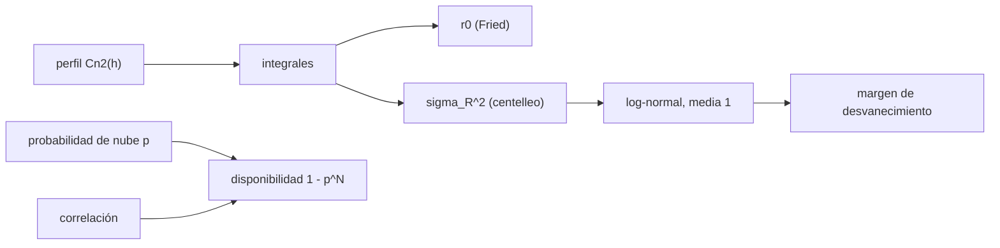

# B92-C04 — Atmósfera y nubes en enlaces ópticos con la Tierra

<!-- nav:top -->
[🏠 Programa](../../../../README.md) · [📚 Bloque B92](../../../tronco-comun/B92-comunicaciones-opticas-espaciales-profundizacion.md) · [← Anterior: B92-C03 — Adquisición, apuntamiento y seguimiento ópticos](../B92-C03-adquisicion-apuntamiento-y-seguimiento-opticos/CLASE.md) · [Siguiente: B92-C05 — Receptores y detectores para comunicaciones ópticas →](../B92-C05-receptores-y-detectores-para-comunicaciones-opticas/CLASE.md)
<!-- /nav -->

## 1. Ubicación, nivel y alcance

Clase 4 del bloque B92. Nivel N3. Un haz óptico que llega a la Tierra atraviesa unos 20 km de aire turbulento y, si hay nubes, se acaba. Aquí calculas el parámetro de Fried y el índice de centelleo de un perfil de turbulencia, conviertes el centelleo en margen de desvanecimiento y calculas cuánto mejora la disponibilidad por nubes con varias estaciones. [B42](../../../tronco-comun/B42-optica-fisica-y-optica-adaptativa.md) trata la turbulencia para telescopios; aquí se trata su efecto en un enlace de comunicaciones. Usas [C02](../B92-C02-divergencia-del-haz-y-perdidas-por-apuntamiento-optico/CLASE.md) para el apuntamiento. El perfil es ilustrativo.

## 2. Por qué esta clase existe

Un enlace espacial es perfecto hasta que llega a las últimas decenas de kilómetros. La decisión central: **¿cuánto margen exige la turbulencia y cuántas estaciones exige la nubosidad para cumplir una disponibilidad?**

## 3. Lo que podrás hacer al terminar

1. Calcular la integral de `Cn²` y el parámetro de Fried `r₀` de un perfil Hufnagel–Valley.
2. Escalar `r₀` con la longitud de onda y el ángulo cenital.
3. Calcular la varianza de Rytov del centelleo de un enlace descendente.
4. Convertir el índice de centelleo en margen de desvanecimiento para una probabilidad dada.
5. Calcular la disponibilidad por nubes con `N` estaciones, independientes y correlacionadas.
6. Separar lo consultado (valores de LCRD) de lo ilustrativo (perfil, nubes, correlación).

La evidencia es la **ficha atmosférica de un enlace descendente** del ejercicio 12 (sección 20).

## 4. Con qué llegas y cómo comprobarlo

1. ¿Qué es la turbulencia atmosférica óptica?
2. ¿Qué es una distribución log-normal?
3. ¿Qué es el ángulo cenital?
4. ¿Qué es la probabilidad de eventos independientes?
5. ¿Qué es una verificación por segunda vía?

<details>
<summary>Ver respuestas</summary>

1. Variaciones del índice de refracción del aire por temperatura y viento que deforman el frente de onda. 2. Una distribución cuyo logaritmo es gaussiano. 3. El ángulo entre la vertical y la línea de visión. 4. El producto de las probabilidades individuales. 5. Calcular lo mismo con otro método y comparar.
</details>

Con cuatro o cinco aciertos, sigue; si no, repasa los prerrequisitos.

## 5. Un caso de contexto y casos de referencia

Un perfil ilustrativo de Hufnagel–Valley 5/7 da un parámetro de Fried de `4,96 cm` a `500 nm` en el cenit, `19,28 cm` a `1550 nm` y un índice de Rytov de `0,0628`. Una apertura de `1 m` equivale a `D/r₀ = 5,19`. Para una probabilidad de desvanecimiento de `10⁻³` con `σ_I² = 0,1` hacen falta `4,35 dB` de margen. Con `p = 0,2` de nube por estación, una estación da `80 %`, dos `96 %`, tres `99,2 %`; con una correlación de `0,1` entre estaciones, tres dan solo `97,28 %`. Es el **ejemplo conductor**. Todo es **ilustrativo**. Como contexto publicado, LCRD reportó `r₀` de hasta `2 cm` a `500 nm` al mediodía, `4 cm` de longitud de coherencia en un enlace nocturno y `80 %` de disponibilidad por clima (Israel et al., 2024).

## 6. Vocabulario

La **constante de estructura** `Cn²` mide la intensidad de la turbulencia, en m^(−2/3). El **parámetro de Fried** `r₀` es el diámetro sobre el cual el frente de onda es casi plano. La **varianza de Rytov** `σ_R²` es el índice de centelleo en turbulencia débil. El **desvanecimiento** es la caída de irradiancia por centelleo. La **diversidad de estaciones** usa varias estaciones terrestres separadas para que no estén cubiertas a la vez.

## 7. Modelo mental: mirar el cielo a través de agua en movimiento



*Descripción textual:* el perfil de turbulencia da `r₀` y el centelleo; el centelleo se modela como log-normal y da un margen; las nubes y la correlación entre estaciones dan la disponibilidad.

Analogía: mirar una moneda al fondo de una pileta con ondas; a veces brilla y a veces se apaga, y un cielo cubierto equivale a tapar la pileta. Límite: el modelo es de turbulencia débil, onda plana y sin promediado de apertura; con `σ_R² > 1` no vale.

## 8. La explicación, paso a paso

### 8.1 Perfil de Hufnagel–Valley 5/7

`Cn²(h) = 0,00594 (w/27)² (10⁻⁵ h)¹⁰ e^{−h/1000} + 2,7 × 10⁻¹⁶ e^{−h/1500} + A e^{−h/100}` con `A = 1,7 × 10⁻¹⁴ m^(−2/3)` y viento `w = 21 m/s`. La integral numérica de Simpson hasta 60 km da `2,23539 × 10⁻¹² m^(1/3)`; la integral analítica de cada término (con la función gamma) da el mismo valor, a `2,5 × 10⁻¹²`.

### 8.2 Parámetro de Fried

`r₀ = (0,423 k² sec ζ ∫Cn² dh)^(−3/5)` con `k = 2π/λ`. A `500 nm` en el cenit, `r₀ = 4,96 cm`. Como `r₀ ∝ λ^(6/5)`, a `1550 nm` vale `19,28 cm` (el cociente `3,8872` coincide con `(1550/500)^1,2`). A `ζ = 30°` baja a `17,69 cm` y a `60°` a `12,72 cm`.

### 8.3 Centelleo

`σ_R² = 2,25 k^(7/6) sec^(11/6) ζ ∫Cn²(h) h^(5/6) dh` (enlace descendente, onda plana). A `1550 nm`: `0,0628` en el cenit, `0,0818` a `30°` y `0,2238` a `60°`; a `500 nm` en el cenit, `0,2351`. El centelleo crece fuerte con el ángulo cenital y con la frecuencia.

### 8.4 Margen de desvanecimiento

Con irradiancia log-normal de media 1, `ln I ~ N(−s²/2, s²)` y `s² = ln(1 + σ_I²)`. El umbral de probabilidad `p` es `exp(−s²/2 + s z_p)`. Para `σ_I² = 0,1`: `3,33 dB` con `p = 10⁻²` y `4,35 dB` con `10⁻³`. Para `σ_I² = 0,5`: `7,31 dB` y `9,43 dB`. Un Monte Carlo con semilla fija (200 000 muestras) da una frecuencia que difiere de `10⁻²` en `1,5 × 10⁻⁴`.

### 8.5 Extinción y nubes

Con profundidad óptica cenital ilustrativa `0,05`, la transmisión es `0,9512` en el cenit y `0,9048` a `60°`. Las nubes son más graves: bloquean el enlace. Con probabilidad de nube `p` por estación, la disponibilidad con `N` estaciones independientes es `1 − p^N`: `0,8`, `0,96`, `0,992` y `0,9984` para `N` de 1 a 4. Si hay una fracción `c = 0,1` de tiempo en que todas ven el mismo cielo, la probabilidad de que todas estén cubiertas es `c p + (1 − c) p^N`, y la disponibilidad se aplana: `0,944`, `0,9728` y `0,9786` para `N` = 2, 3 y 4, con Monte Carlo a `2,2 × 10⁻⁴`. El límite con `N → ∞` es `1 − c p = 0,98`. El estudio de LCRD concluye que harían falta más de dos estaciones para pasar de `99 %`; este ejercicio ilustra por qué.

## 9. Magnitudes, símbolos y unidades

| Símbolo | Qué es | Unidad | Valor / nota |
|---|---|---|---|
| `Cn²` | constante de estructura del índice | m^(−2/3) | perfil HV 5/7 (ilustrativo) |
| `r₀` | parámetro de Fried | cm | 4,96 (500 nm); 19,28 (1550 nm) |
| `D/r₀` | apertura sobre Fried | — | 5,19 (D = 1 m) |
| `σ_R²` | varianza de Rytov | — | 0,0628 (1550 nm, cenit) |
| `s²` | varianza del logaritmo de irradiancia | — | `ln(1 + σ_I²)` |
| `p` | probabilidad de nube | — | 0,2 (ilustrativo) |
| `c` | correlación entre estaciones | — | 0,1 (ilustrativo) |

## 10. Convenciones y referencias

Longitudes de onda en vacío; altura `h` sobre la estación, en m; ángulo cenital `ζ`. Perfil Hufnagel–Valley 5/7 con `A = 1,7 × 10⁻¹⁴` y `w = 21 m/s`, integrado hasta 60 km. Turbulencia débil, onda plana, sin promediado de apertura ni óptica adaptativa. Nubes tratadas como un evento binario. Todos los valores del perfil, la apertura, las nubes y la correlación son ilustrativos. Tolerancia: integrales `10⁻⁶` relativa; Monte Carlo `3 × 10⁻³`.

## 11. De dónde sale lo que afirmamos

| ID | Fuente | Localizador | Respalda | Estado |
|---|---|---|---|---|
| S1 | Israel et al., *NASA's LCRD experiment program: characterization and initial operations*, SPIE, 2024 — https://ntrs.nasa.gov/api/citations/20230018608/downloads/SPIE%20West%202024%20final.pdf (leído con PyMuPDF el 2026-11-10) | secciones 2.2, 3.2, 5.3 y 7 | disponibilidad por clima de 80 %; longitud de coherencia media de 4 cm en un enlace nocturno; Fried de hasta 2 cm a 500 nm al mediodía; telescopio de 1 m; hacen falta más de dos estaciones para pasar de 99 % | Consultada |
| S2 | CCSDS 141.0-B-1, agosto de 2019 — https://ccsds.org/Pubs/141x0b1.pdf (leído con PyMuPDF el 2026-11-10) | sección 3.2 | banda C de la rejilla (1530–1567 nm), de donde sale `1550 nm` como referencia | Consultada |
| — | Perfil Hufnagel–Valley 5/7, fórmulas de Fried y de Rytov, distribución log-normal | — | las verifica el laboratorio con integrales analíticas y Monte Carlo | No consultada en una fuente concreta |

Límites: los coeficientes de Hufnagel–Valley y las fórmulas no se consultaron en una fuente concreta; no hay medidas atmosféricas propias.

## 12. Cómo ver la turbulencia y la disponibilidad

| Magnitud | Valor |
|---|---|
| `r₀` (500 nm) | 4,96 cm |
| `r₀` (1550 nm) | 19,28 cm |
| `σ_R²` (1550 nm, cenit) | 0,0628 |
| margen (`σ_I² = 0,1`, `10⁻³`) | 4,35 dB |
| disponibilidad con 3 estaciones, `c = 0,1` | 0,9728 |

Descripción larga: `r₀` crece con `λ^(6/5)` y decrece con el ángulo cenital; el centelleo crece con el ángulo cenital; la disponibilidad con varias estaciones sube rápido si son independientes y se aplana si comparten el mismo cielo.

## 13. Ejemplo trabajado: Fried a 1550 nm a 60° del cenit

**Paso 1 · Fried en el cenit a 1550 nm.** `4,96 × 3,8872 = 19,28 cm`.

**Paso 2 · Factor de masa de aire.** `r₀ ∝ (sec ζ)^(−3/5)`: `2^(−0,6) = 0,6598`.

**Paso 3 · Fried a 60°.** `19,28 × 0,6598 = 12,72 cm`.

**Paso 4 · Cociente con la apertura.** `1 m/0,1272 m = 7,86`.

## 14. Distintas formas de describir el medio

**Por turbulencia:** `Cn²`, `r₀`. **Por centelleo:** `σ_R²`, `s²`. **Por margen:** dB para una `p`. **Por nubes:** `p`, `N`, `c`. **Por transmisión:** `e^{−τ sec ζ}`.

## 15. Práctica guiada

**Ejercicio 1 · con los pasos indicados.** Parámetro de Fried a `500 nm` en el cenit. *Pasos:* integral de `Cn²` (`2,2354 × 10⁻¹²`), `k²` y el exponente `−3/5`.

<details><summary>Solución comentada</summary>

`k = 1,2566 × 10⁷`; `0,423 k² I = 149,3`; `149,3^(−0,6) = 0,0496 m = 4,96 cm`.
</details>

**Ejercicio 2 · con una pista.** Fried a `1550 nm` en el cenit. *Pista:* `r₀ ∝ λ^(6/5)`.

<details><summary>Solución comentada</summary>

`4,96 × (3,1)^1,2 = 4,96 × 3,8872 = 19,28 cm`.
</details>

**Ejercicio 3 · casi autónomo.** `D/r₀` para una apertura de `1 m` a `1550 nm`.

<details><summary>Solución comentada</summary>

`1/0,1928 = 5,19`.
</details>

## 16. Práctica autónoma, transferencia e integrador

**Ejercicio 4 · autónomo.** `r₀` a `1550 nm` con `ζ = 60°`.

<details><summary>Solución comentada</summary>

`12,72 cm`.
</details>

**Ejercicio 5 · autónomo.** `σ_R²` a `1550 nm` en el cenit.

<details><summary>Solución comentada</summary>

`0,0628` (régimen de turbulencia débil).
</details>

**Ejercicio 6 · autónomo.** Margen para `p = 10⁻²` con `σ_I² = 0,1`.

<details><summary>Solución comentada</summary>

`3,33 dB`.
</details>

**Ejercicio 7 · autónomo.** Margen para `p = 10⁻³` con `σ_I² = 0,5`.

<details><summary>Solución comentada</summary>

`9,43 dB`.
</details>

**Ejercicio 8 · autónomo.** Disponibilidad con tres estaciones independientes y `p = 0,2`.

<details><summary>Solución comentada</summary>

`1 − 0,2³ = 0,992`.
</details>

**Ejercicio 9 · transferencia.** **Transferencia.** Con `c = 0,1`, ¿qué disponibilidad máxima se alcanza por más estaciones que se añadan?

<details><summary>Solución comentada</summary>

`1 − c p = 1 − 0,1 × 0,2 = 0,98`. Más estaciones en la misma zona de clima no sirven; hay que separarlas lo suficiente para bajar `c`.
</details>

**Ejercicio 10 · transferencia.** **Transferencia.** LCRD reportó `r₀ = 2 cm` a `500 nm` al mediodía. Con el escalado `λ^(6/5)` (no consultado), ¿cuánto sería a `1550 nm` y qué `D/r₀` da la apertura de `1 m`?

<details><summary>Solución comentada</summary>

`2 × 3,8872 = 7,77 cm`; `D/r₀ = 12,9`. Es un escalado del cenit; en esas condiciones hace falta óptica adaptativa, como la que usa el OGS-1.
</details>

**Ejercicio 11 · transferencia.** **Transferencia.** ¿Cuántos dB pierde el enlace por extinción clara a `60°` con `τ = 0,05`?

<details><summary>Solución comentada</summary>

`T = e^{−0,1} = 0,9048`; `−10 log₁₀ 0,9048 = 0,43 dB`.
</details>

**Ejercicio 12 · integrador.** **Integrador.** Elabora tu *ficha atmosférica de un enlace descendente*: integrales, `r₀` y `σ_R²` para cuatro casos, margen de desvanecimiento para dos probabilidades, disponibilidad por nubes con `N` de 1 a 4 (con y sin correlación) y lista de qué es consultado e ilustrativo.

<details><summary>Solución comentada</summary>

Secciones 8.1–8.5 y la salida del laboratorio.
</details>

## 17. Laboratorio: turbulencia, desvanecimiento y nubes

El script [atmosfera.py](atmosfera.py) integra el perfil, calcula `r₀` y `σ_R²`, convierte el centelleo en margen y calcula la disponibilidad por nubes con y sin correlación (**comprueba** integrales frente a las analíticas con la función gamma y Monte Carlo frente a analítico < 3e-3).

**Datos:** perfil, apertura, nubes y correlación **ilustrativos**; los valores de LCRD solo son contexto. **Predice antes de ejecutar:** ¿qué `D/r₀` tendrá `1 m` a `1550 nm`? (≈5,2.) **Ejecución del 2026-11-10 (Python 3.12.9):**

```text
Python 3.12.9 (biblioteca estandar)
Integral de Cn2 dh: numerica 2.23539e-12 ; analitica 2.23539e-12 m^(1/3) ; dif. 2.5e-12
Integral de Cn2 h^(5/6) dh: numerica 5.45379e-10 ; analitica 5.45379e-10 ; dif. 1.5e-07
Parametro de Fried a 500 nm, cenit (HV 5/7 ILUSTRATIVO): r0 = 4.96 cm
 lambda [nm]  zenit [deg]  r0 [cm]  D/r0 (D = 1 m)  sigma_R^2 (plana)
       500          0       4.96         20.16          0.2351
      1550          0      19.28          5.19          0.0628
      1550         30      17.69          5.65          0.0818
      1550         60      12.72          7.86          0.2238
Escalado r0 ~ lambda^(6/5): cociente 1550/500 nm = 3.8872 ; (1550/500)^1.2 = 3.8872
Desvanecimiento log-normal (media 1): margen para probabilidad de desvanecimiento p
  sigma_I^2 = 0.1  p = 1e-02  umbral = 0.4649  margen =  3.33 dB
  sigma_I^2 = 0.1  p = 1e-03  umbral = 0.3673  margen =  4.35 dB
  sigma_I^2 = 0.5  p = 1e-02  umbral = 0.1856  margen =  7.31 dB
  sigma_I^2 = 0.5  p = 1e-03  umbral = 0.1141  margen =  9.43 dB
  Monte Carlo (p = 1e-2, 200000 muestras): diferencia absoluta maxima 1.5e-04
Extincion clara (tau cenital 0.05, ILUSTRATIVO): T(0) = 0.9512 ; T(60 deg) = 0.9048
Disponibilidad por nubes con N estaciones (p nube = 0.2, ILUSTRATIVO; LCRD reporto 80 % de disponibilidad por clima):
  N = 1  independientes 0.8000  con correlacion 0.1: 0.8000  (Monte Carlo 0.7998)
  N = 2  independientes 0.9600  con correlacion 0.1: 0.9440  (Monte Carlo 0.9441)
  N = 3  independientes 0.9920  con correlacion 0.1: 0.9728  (Monte Carlo 0.9726)
  N = 4  independientes 0.9984  con correlacion 0.1: 0.9786  (Monte Carlo 0.9784)
Diferencia maxima Monte Carlo frente a analitico (nubes) = 2.2e-04
Pruebas superadas.
```

```bash
python programa/clases/B92/B92-C04-atmosfera-y-nubes-en-enlaces-opticos-con-la-tierra/atmosfera.py
```

**Límites:** turbulencia débil, onda plana, sin promediado de apertura, sin óptica adaptativa y con nubes como evento binario; la fórmula de Rytov no vale con `σ_R² > 1`.

## 18. Errores frecuentes y cómo corregirlos

**Aplicar el modelo de turbulencia débil con centelleo fuerte.** Se corrige con la sección 10.

**Suponer estaciones independientes sin comprobar la correlación.** Se corrige con 8.5.

**Usar `r₀` de 500 nm directamente a 1550 nm.** Se corrige con 8.2.

**Presentar el perfil ilustrativo como una medida.** Se corrige con la sección 10.

## 19. Cómo sabrás que vas bien

Tras la sección 8: ¿qué `r₀` esperabas a `1550 nm` y cuál obtuviste? Si dudas, repasa el ejemplo 13. Tras el laboratorio: ¿qué comprueba? (ver la sección 17).

## 20. Qué entregas y cómo se evalúa

El producto es tu **ficha atmosférica de un enlace descendente** (ejercicio 12).

| Criterio | Inicial | En desarrollo | Logrado | Destacado |
|---|---|---|---|---|
| Conceptos | Los confunde | Parciales | Distingue `r₀`, centelleo y nubes | Explica la correlación entre estaciones |
| Cálculo | Sin unidades | Con errores | Tablas completas con unidades | Calcula casos nuevos |
| Numérico | Sin comprobar | Un caso | Contraste con integrales analíticas | Interpreta las diferencias |
| Fuentes | Sin fuente | Sin fecha | Fuentes con fecha y estado | Declara lo ilustrativo y lo no consultado |
| Límites | No los nombra | Uno | Tres | Discute qué falta del modelo |

**Condiciones críticas (no se compensan con promedio):** rotular perfil y nubes como ilustrativos; no atribuir las cifras a un sitio real; citar solo lo consultado.

## 21. Ética, seguridad y límites

Clase educativa: los modelos son simplificados y sus datos son sintéticos o ilustrativos; no sustituyen a las mediciones de un sitio. Un haz hacia la Tierra exige coordinación con las autoridades de seguridad ocular y de aviación. Accesibilidad: tablas equivalentes a las gráficas, fórmulas en texto, ejercicios sin conexión.

## 22. Para cerrar y seguir

Un perfil estándar da `19,28 cm` de Fried a `1550 nm` y `4,35 dB` de margen para `10⁻³`; tres estaciones independientes dan `99,2 %` por nubes, pero con correlación solo `97,3 %`. Queda una pregunta: ¿con qué detector se cuentan los fotones que llegan?

**Glosario español–inglés.** parámetro de Fried · *Fried parameter*; centelleo · *scintillation*; desvanecimiento · *fading*; diversidad de estaciones · *site diversity*; turbulencia · *turbulence*.

**Continuidad.** [B92-C05](../B92-C05-receptores-y-detectores-para-comunicaciones-opticas/CLASE.md) trata los receptores y los detectores.

**Referencias:** ver sección 11.

<!-- nav:bottom -->
---

[← Anterior: B92-C03 — Adquisición, apuntamiento y seguimiento ópticos](../B92-C03-adquisicion-apuntamiento-y-seguimiento-opticos/CLASE.md) · [📚 Bloque B92](../../../tronco-comun/B92-comunicaciones-opticas-espaciales-profundizacion.md) · [Siguiente: B92-C05 — Receptores y detectores para comunicaciones ópticas →](../B92-C05-receptores-y-detectores-para-comunicaciones-opticas/CLASE.md)
<!-- /nav -->
