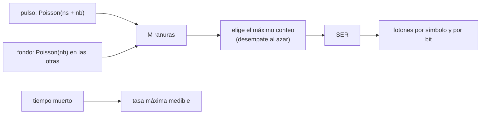

# B92-C05 — Receptores y detectores para comunicaciones ópticas

<!-- nav:top -->
[🏠 Programa](../../../../README.md) · [📚 Bloque B92](../../../tronco-comun/B92-comunicaciones-opticas-espaciales-profundizacion.md) · [← Anterior: B92-C04 — Atmósfera y nubes en enlaces ópticos con la Tierra](../B92-C04-atmosfera-y-nubes-en-enlaces-opticos-con-la-tierra/CLASE.md) · [Siguiente: B92-C06 — Modulación y codificación en enlaces ópticos →](../B92-C06-modulacion-y-codificacion-en-enlaces-opticos/CLASE.md)
<!-- /nav -->

## 1. Ubicación, nivel y alcance

Clase 5 del bloque B92. Nivel N3. A la distancia de un enlace espacial llegan pocos fotones por símbolo y el receptor los cuenta uno por uno. Aquí calculas el error de símbolo de un receptor PPM de conteo de fotones con fondo, cuántos fotones exige una tasa de error dada y cómo el tiempo muerto limita la tasa medible. Los detectores de imagen se tratan en [B44](../../../tronco-comun/B44-detectores-y-adquisicion-astronomica.md); aquí el criterio de elección es otro: velocidad, ruido de oscuridad y saturación. El receptor es sintético.

## 2. Por qué esta clase existe

Un detector de imagen integra luz durante milisegundos; uno de comunicaciones decide, en nanosegundos, en qué ranura llegó el pulso. La decisión central: **¿cuántos fotones hacen falta por símbolo y qué detector soporta la tasa de ranuras sin saturarse?**

## 3. Lo que podrás hacer al terminar

1. Calcular la tasa de error de símbolo de un receptor PPM de conteo de fotones con fondo.
2. Comprobar el caso sin fondo con la fórmula `(M−1)/M · e^{−n_s}`.
3. Hallar los fotones por símbolo y por bit para una tasa de error objetivo.
4. Convertir fotones detectados en fotones incidentes con la eficiencia de detección.
5. Calcular la tasa medida con tiempo muerto paralizable y no paralizable.
6. Separar lo consultado (ranuras, órdenes PPM) de lo ilustrativo (fondo, eficiencia, tiempo muerto).

La evidencia es la **curva de error frente a fotones por símbolo** del ejercicio 12 (sección 20).

## 4. Con qué llegas y cómo comprobarlo

1. ¿Qué es una distribución de Poisson?
2. ¿Qué es PPM?
3. ¿Qué es la eficiencia cuántica de un detector?
4. ¿Qué es el tiempo muerto?
5. ¿Qué es una verificación por segunda vía?

<details>
<summary>Ver respuestas</summary>

1. La que da la probabilidad de contar `k` eventos independientes con media `λ`. 2. Modulación por posición de pulso: un símbolo de `log₂ M` bits se envía como un pulso en una de `M` ranuras. 3. La fracción de fotones incidentes que produce una señal. 4. El tiempo tras un conteo durante el cual el detector no responde. 5. Calcular lo mismo con otro método y comparar.
</details>

Con cuatro o cinco aciertos, sigue; si no, repasa los prerrequisitos.

## 5. Un caso de contexto y casos de referencia

Un receptor PPM de orden 16 con `0,1` fotones de fondo por ranura necesita `8,743` fotones detectados por símbolo (`10,929` incidentes con eficiencia `0,8`) para un error de símbolo de `10⁻³`: `2,73` incidentes por bit. Con orden 256 bajan a `1,64` por bit. Un detector con `20 ns` de tiempo muerto no puede medir más de `50 Mcps`. Es el **ejemplo conductor**. Todo es **ilustrativo**. Como contexto publicado, el receptor de DSOC en Palomar es un receptor de conteo de fotones de nanohilos superconductores (NASA/JPL), sin más especificaciones en la página consultada.

## 6. Vocabulario

La **detección directa** convierte la intensidad en señal. El **conteo de fotones** registra eventos individuales. La **eficiencia de detección** `η` es la fracción de fotones que se cuenta. Los **conteos oscuros** y el **fondo** son eventos sin señal. El **tiempo muerto** `τ` es el intervalo ciego tras un conteo. Un detector **no paralizable** ignora los fotones que llegan durante `τ`; uno **paralizable** reinicia `τ` con cada fotón. La **tasa de error de símbolo** (*SER*) es la probabilidad de elegir una ranura equivocada.

## 7. Modelo mental: contar granizo en cubetas



*Descripción textual:* la ranura con pulso recibe señal y fondo, las otras solo fondo; el receptor elige la ranura de mayor conteo, de ahí sale el error de símbolo y los fotones necesarios; el tiempo muerto limita la tasa medible.

Analogía: se reparten granizos en `M` cubetas y se apuesta por la más llena; los granizos de fondo caen en todas. Límite: no se modelan el jitter temporal del detector, el cruce entre ranuras ni la codificación.

## 8. La explicación, paso a paso

### 8.1 Canal de Poisson

En la ranura con pulso el conteo es Poisson de media `n_s + n_b`; en las `M − 1` restantes, Poisson de media `n_b`. El receptor elige el máximo conteo y desempata al azar. La probabilidad de acierto es `Σ_k P(S = k) Σ_j C(M−1, j)/(j+1) · P(B = k)^j P(B < k)^{M−1−j}`.

### 8.2 Resultados con fondo

Con `M = 16` y `n_b = 0,1`: `n_s = 2` da `2,588 × 10⁻¹`; `4`, `5,540 × 10⁻²`; `6`, `1,062 × 10⁻²`; `8`, `1,912 × 10⁻³`; `10`, `3,306 × 10⁻⁴`. Un Monte Carlo con semilla fija (20 000 símbolos por punto) coincide dentro de `2,59` desviaciones estándar del propio Monte Carlo.

### 8.3 Caso sin fondo

Con `n_b = 0` solo hay error si no se detecta ningún fotón, y entonces se adivina: `SER = (M−1)/M · e^{−n_s}`. El cálculo exacto coincide con esa fórmula a `4,7 × 10⁻¹⁶` para `M` = 4, 16 y 64.

### 8.4 Fotones por bit

Para `SER = 10⁻³` y `n_b = 0,1`: `M = 4` exige `7,560` fotones detectados (`4,725` incidentes por bit); `M = 16`, `8,743` (`2,732` por bit); `M = 64`, `9,633` (`2,007`); `M = 256`, `10,492` (`1,639`). Los fotones por símbolo suben despacio con `M`, pero los bits por símbolo suben más rápido, de modo que bajan los fotones por bit. El precio es mayor ancho de banda y mayor potencia de pico (C01, C06).

### 8.5 Tiempo muerto

Con `τ = 20 ns`: una tasa incidente de `10 Mcps` se mide como `8,333 Mcps` (no paralizable) o `8,187` (paralizable); a `50 Mcps`, `25,0` o `18,4`; a `200 Mcps`, `40,0` o `3,66`. El detector paralizable se bloquea con tasas altas. Una simulación de eventos de Poisson coincide con la fórmula no paralizable a `2,5 × 10⁻³`. La tasa máxima medible es `1/τ = 50 Mcps`.

## 9. Magnitudes, símbolos y unidades

| Símbolo | Qué es | Unidad | Valor / nota |
|---|---|---|---|
| `M` | orden PPM | — | 4–256 |
| `n_s` | fotones de señal detectados por símbolo | — | 2–10 |
| `n_b` | fotones de fondo por ranura | — | 0,1 (ilustrativo) |
| `η` | eficiencia de detección | — | 0,8 (ilustrativo) |
| `τ` | tiempo muerto | ns | 20 (ilustrativo) |
| `R` | tasa incidente de fotones | Mcps | 10–200 |
| `SER` | error de símbolo | — | 10⁻³ (objetivo) |

## 10. Convenciones y referencias

Detección directa con conteo de fotones. Eficiencia aplicada a la señal; fondo contado por ranura. Decisión por máximo conteo con desempate aleatorio; sin jitter de temporización. Fondo, eficiencia y tiempo muerto son ilustrativos. Tolerancias: exacto frente a Monte Carlo, 4 desviaciones estándar del Monte Carlo; caso `n_b = 0`, `10⁻¹²`.

## 11. De dónde sale lo que afirmamos

| ID | Fuente | Localizador | Respalda | Estado |
|---|---|---|---|---|
| S1 | CCSDS 141.0-B-1, *Optical Communications Physical Layer*, agosto de 2019 — https://ccsds.org/Pubs/141x0b1.pdf (leído con PyMuPDF el 2026-11-10) | secciones 3.7 y 3.9 | modulación de intensidad todo o nada por ranura; ranuras de 0,125 a 512 ns | Consultada |
| S2 | CCSDS 142.0-B-1, *Optical Communications Coding and Synchronization*, agosto de 2019 — https://ccsds.org/Pubs/142x0b1.pdf (leído con PyMuPDF el 2026-11-10) | sección 3.8.5 | órdenes PPM `M` ∈ {4, 8, 16, 32, 64, 128, 256} | Consultada |
| S3 | NASA/JPL, *Deep Space Optical Communications (DSOC)* — https://www.jpl.nasa.gov/missions/deep-space-optical-communications-dsoc/ (consultada 2026-11-10) | descripción del receptor | receptor de conteo de fotones de nanohilos superconductores en Palomar; sin más especificaciones | Consultada |
| — | Estadística de Poisson, decisión por máximo conteo, tiempo muerto paralizable y no paralizable | — | las verifica el laboratorio con Monte Carlo y el caso analítico `n_b = 0` | No consultada en una fuente concreta |

Límites: no se consultó ninguna hoja de datos de un detector; eficiencia, fondo y tiempo muerto no representan a ningún producto.

## 12. Cómo ver el error de símbolo

| Magnitud | Valor |
|---|---|
| SER (`M = 16`, `n_s = 8`, `n_b = 0,1`) | 1,912 × 10⁻³ |
| `n_s` para 10⁻³ (`M = 16`) | 8,743 |
| incidentes por bit (`M = 16`) | 2,732 |
| incidentes por bit (`M = 256`) | 1,639 |
| tasa máxima medible | 50 Mcps |

Descripción larga: el error cae casi exponencialmente con `n_s`; subir `M` reduce los fotones por bit; el tiempo muerto fija un techo de conteo que obliga a usar varios elementos detectores.

## 13. Ejemplo trabajado: fotones incidentes por bit con M = 64

**Paso 1 · Fotones detectados.** `n_s = 9,633` para `SER = 10⁻³`.

**Paso 2 · Incidentes.** `9,633/0,8 = 12,041`.

**Paso 3 · Bits por símbolo.** `log₂ 64 = 6`.

**Paso 4 · Por bit.** `12,041/6 = 2,007`.

## 14. Distintas formas de describir un receptor

**Por error:** `SER(n_s, n_b, M)`. **Por fotones:** detectados, incidentes, por bit. **Por detector:** `η`, `n_b`, `τ`. **Por tasa:** `R` medida frente a incidente.

## 15. Práctica guiada

**Ejercicio 1 · con los pasos indicados.** `SER` sin fondo con `M = 16` y `n_s = 3`. *Pasos:* `(M−1)/M` por `e^{−n_s}`.

<details><summary>Solución comentada</summary>

`(15/16) × e^{−3} = 0,9375 × 0,04979 = 0,0467`.
</details>

**Ejercicio 2 · con una pista.** Fotones incidentes para `8,743` detectados con `η = 0,8`. *Pista:* divide entre `η`.

<details><summary>Solución comentada</summary>

`8,743/0,8 = 10,929`.
</details>

**Ejercicio 3 · casi autónomo.** Fotones incidentes por bit con `M = 16`.

<details><summary>Solución comentada</summary>

`10,929/4 = 2,732`.
</details>

## 16. Práctica autónoma, transferencia e integrador

**Ejercicio 4 · autónomo.** `SER` con `M = 16`, `n_s = 6`, `n_b = 0,1`.

<details><summary>Solución comentada</summary>

`1,062 × 10⁻²`.
</details>

**Ejercicio 5 · autónomo.** Fotones incidentes por bit con `M = 64`.

<details><summary>Solución comentada</summary>

`12,041/6 = 2,007`.
</details>

**Ejercicio 6 · autónomo.** Tasa medida (no paralizable) para `R = 50 Mcps` y `τ = 20 ns`.

<details><summary>Solución comentada</summary>

`50/(1 + 50 × 0,02) = 25,0 Mcps`.
</details>

**Ejercicio 7 · autónomo.** Tasa medida (paralizable) para `R = 200 Mcps`.

<details><summary>Solución comentada</summary>

`200 × e^{−4} = 3,66 Mcps`: el detector casi se bloquea.
</details>

**Ejercicio 8 · autónomo.** Tasa máxima medible con `τ = 20 ns`.

<details><summary>Solución comentada</summary>

`1/τ = 50 Mcps`.
</details>

**Ejercicio 9 · transferencia.** **Transferencia.** ¿Cuánto empeora el `SER` por el fondo de `0,1` con `M = 16` y `n_s = 8`?

<details><summary>Solución comentada</summary>

Sin fondo, `0,9375 × e^{−8} = 3,145 × 10⁻⁴`; con fondo, `1,912 × 10⁻³`: unas `6` veces peor.
</details>

**Ejercicio 10 · transferencia.** **Transferencia.** Un detector de `τ = 20 ns` recibe PPM-16 con ranuras de `1 ns` (símbolo de `20 ns` con guardas) y `8` fotones por símbolo. ¿Cuántos elementos detectores independientes hacen falta?

<details><summary>Solución comentada</summary>

Tasa media `8/20 ns = 4 × 10⁸ fotones/s`; con un máximo de `5 × 10⁷` por elemento, al menos `8` elementos (una matriz).
</details>

**Ejercicio 11 · transferencia.** **Transferencia.** ¿Por qué un detector de imagen con integración de milisegundos no sirve para PPM de ranuras de nanosegundos?

<details><summary>Solución comentada</summary>

Porque integra todas las ranuras juntas y no distingue en cuál llegó el pulso; hace falta resolución temporal de la ranura y conteo de eventos.
</details>

**Ejercicio 12 · integrador.** **Integrador.** Elabora tu *curva de error frente a fotones por símbolo*: `SER` para cinco `n_s` con `M = 16` (exacta y Monte Carlo), caso `n_b = 0`, fotones por bit para cuatro `M`, tasas con tiempo muerto y lista de qué es consultado e ilustrativo.

<details><summary>Solución comentada</summary>

Secciones 8.1–8.5 y la salida del laboratorio.
</details>

## 17. Laboratorio: receptor PPM de conteo de fotones

El script [receptor.py](receptor.py) calcula el error de símbolo exacto, lo contrasta con un Monte Carlo y con el caso analítico `n_b = 0`, halla los fotones por bit y simula el tiempo muerto (**comprueba** exacto frente a Monte Carlo < 4 desviaciones estándar, caso sin fondo < 1e-12 y fotones por bit decrecientes).

**Datos:** ranuras y órdenes PPM (consultados); fondo, eficiencia y tiempo muerto **ilustrativos**. **Predice antes de ejecutar:** ¿qué `n_s` hace falta con `M = 16` para `10⁻³`? (≈8,7.) **Ejecución del 2026-11-10 (Python 3.12.9):**

```text
Python 3.12.9 (biblioteca estandar)
Error de simbolo PPM, M = 16, nb = 0.1 fotones por ranura (ILUSTRATIVO)
  ns detectados   SER exacta   SER Monte Carlo
           2.0    2.588e-01    2.668e-01
           4.0    5.540e-02    5.920e-02
           6.0    1.062e-02    9.200e-03
           8.0    1.912e-03    2.150e-03
          10.0    3.306e-04    5.000e-04
Diferencia maxima exacta frente a Monte Carlo = 2.59 desviaciones estandar del Monte Carlo
Caso sin fondo (nb = 0): diferencia con (M-1)/M exp(-ns) = 4.7e-16
Fotones necesarios para SER = 1e-3 con nb = 0.1 (eficiencia 0.8, ILUSTRATIVA):
   M  bits/simbolo  ns detectados  ns incidentes  incidentes por bit
    4            2          7.560          9.450               4.725
   16            4          8.743         10.929               2.732
   64            6          9.633         12.041               2.007
  256            8         10.492         13.114               1.639
Tiempo muerto tau = 20 ns (ILUSTRATIVO)
  R [Mcps]  no paralizable  paralizable  simulacion (no paralizable)
        10           8.333        8.187  8.313
        50          25.000       18.394  25.064
       200          40.000        3.663  40.049
Tasa maxima medible (no paralizable) = 1/tau = 50 Mcps ; error relativo de la simulacion = 2.5e-03
Pruebas superadas.
```

```bash
python programa/clases/B92/B92-C05-receptores-y-detectores-para-comunicaciones-opticas/receptor.py
```

**Límites:** detector ideal sin jitter ni cruce entre ranuras, fondo constante y sin codificación; el Monte Carlo es estadístico y su diferencia con el cálculo exacto fluctúa con la semilla.

## 18. Errores frecuentes y cómo corregirlos

**Olvidar la eficiencia al pasar de detectados a incidentes.** Se corrige con 8.4.

**Ignorar el fondo.** Se corrige con 8.2 y 8.3.

**Suponer que el detector mide cualquier tasa.** Se corrige con 8.5.

**Presentar el detector sintético como un producto real.** Se corrige con la sección 10.

## 19. Cómo sabrás que vas bien

Tras la sección 8: ¿qué `n_s` esperabas para `10⁻³` con `M = 16` y cuál obtuviste? Si dudas, repasa el ejemplo 13. Tras el laboratorio: ¿qué comprueba? (ver la sección 17).

## 20. Qué entregas y cómo se evalúa

El producto es tu **curva de error frente a fotones por símbolo** (ejercicio 12).

| Criterio | Inicial | En desarrollo | Logrado | Destacado |
|---|---|---|---|---|
| Conceptos | Los confunde | Parciales | Distingue señal, fondo y saturación | Explica por qué bajan los fotones por bit |
| Cálculo | Sin unidades | Con errores | Tablas completas con unidades | Calcula casos nuevos |
| Numérico | Sin comprobar | Un caso | Contraste con Monte Carlo y caso analítico | Interpreta las diferencias |
| Fuentes | Sin fuente | Sin fecha | Fuentes con fecha y estado | Declara lo ilustrativo y lo no consultado |
| Límites | No los nombra | Uno | Tres | Discute qué falta del modelo |

**Condiciones críticas (no se compensan con promedio):** rotular fondo, eficiencia y tiempo muerto como ilustrativos; no atribuir las cifras a un detector real; citar solo lo consultado.

## 21. Ética, seguridad y límites

Clase educativa: los modelos son simplificados y sus datos son sintéticos o ilustrativos; no sustituyen a la caracterización de un detector. Los detectores superconductores suelen exigir criogenia; su manejo real requiere procedimientos que esta clase no cubre. Accesibilidad: tablas equivalentes a las gráficas, fórmulas en texto, ejercicios sin conexión.

## 22. Para cerrar y seguir

Con `0,1` fotones de fondo por ranura, PPM-16 necesita `8,743` fotones detectados por símbolo para `10⁻³`, y un detector de `20 ns` de tiempo muerto no pasa de `50 Mcps`. Queda una pregunta: ¿cómo se estructura el código que protege esos símbolos?

**Glosario español–inglés.** conteo de fotones · *photon counting*; tiempo muerto · *dead time*; eficiencia de detección · *detection efficiency*; conteos oscuros · *dark counts*; error de símbolo · *symbol error*.

**Continuidad.** [B92-C06](../B92-C06-modulacion-y-codificacion-en-enlaces-opticos/CLASE.md) trata la modulación y la codificación.

**Referencias:** ver sección 11.

<!-- nav:bottom -->
---

[← Anterior: B92-C04 — Atmósfera y nubes en enlaces ópticos con la Tierra](../B92-C04-atmosfera-y-nubes-en-enlaces-opticos-con-la-tierra/CLASE.md) · [📚 Bloque B92](../../../tronco-comun/B92-comunicaciones-opticas-espaciales-profundizacion.md) · [Siguiente: B92-C06 — Modulación y codificación en enlaces ópticos →](../B92-C06-modulacion-y-codificacion-en-enlaces-opticos/CLASE.md)
<!-- /nav -->
