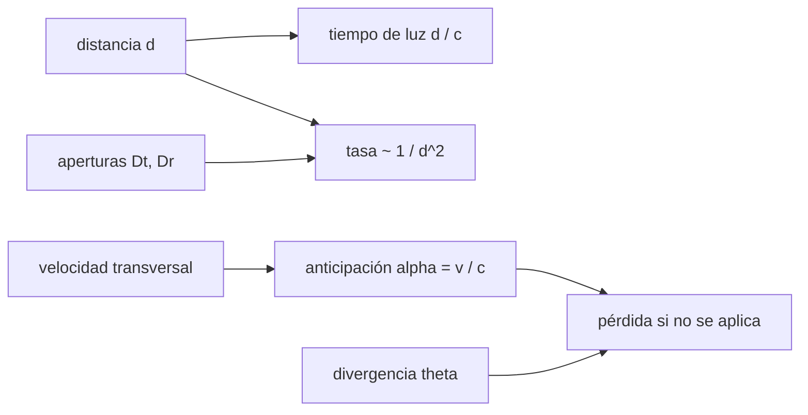

# B92-C07 — Enlaces ópticos de espacio profundo

<!-- nav:top -->
[🏠 Programa](../../../../README.md) · [📚 Bloque B92](../../../tronco-comun/B92-comunicaciones-opticas-espaciales-profundizacion.md) · [← Anterior: B92-C06 — Modulación y codificación en enlaces ópticos](../B92-C06-modulacion-y-codificacion-en-enlaces-opticos/CLASE.md) · [Siguiente: B92-C08 — Márgenes y disponibilidad de enlaces ópticos →](../B92-C08-margenes-y-disponibilidad-de-enlaces-opticos/CLASE.md)
<!-- /nav -->

## 1. Ubicación, nivel y alcance

Clase 7 del bloque B92. Nivel N3. A decenas o cientos de millones de kilómetros la potencia recibida cae con el cuadrado de la distancia, la luz tarda minutos en llegar y el receptor debe apuntar a donde estará el otro terminal, no a donde se ve. Aquí escalas la tasa de un enlace con la distancia, comparas el escalado con las cifras publicadas de DSOC, calculas el tiempo de luz y el ángulo de anticipación, y haces un balance de fotones de un terminal ilustrativo. Usas [C01](../B92-C01-fuentes-laser-y-amplificadores-para-enlaces-espaciales/CLASE.md) y [C02](../B92-C02-divergencia-del-haz-y-perdidas-por-apuntamiento-optico/CLASE.md). Las trayectorias interplanetarias se tratan en [B75](../../../tronco-comun/B75-trayectorias-y-misiones-interplanetarias.md). El terminal es sintético y **no es DSOC**.

## 2. Por qué esta clase existe

El espacio profundo exige otra forma de pensar: pocos fotones, latencia de minutos y apuntamiento predictivo. La decisión central: **¿cómo cambia la tasa con la distancia y qué hay que prever para que el haz llegue al receptor?**

## 3. Lo que podrás hacer al terminar

1. Calcular el tiempo de luz de ida y de ida y vuelta a una distancia dada.
2. Escalar la tasa de un enlace con la distancia y con las aperturas.
3. Comparar el escalado con las tasas publicadas de DSOC y decir qué comparación no es una validación.
4. Hacer el balance de potencia y fotones de un terminal ilustrativo.
5. Calcular el ángulo de anticipación y su relación con la divergencia del haz.
6. Separar lo consultado (cifras de DSOC) de lo ilustrativo (terminal, velocidades).

La evidencia es la **ficha de espacio profundo con los datos publicados de DSOC** del ejercicio 12 (sección 20).

## 4. Con qué llegas y cómo comprobarlo

1. ¿Qué es la ley del cuadrado inverso?
2. ¿Qué es la velocidad de la luz y cuánto tarda en recorrer 100 millones de km?
3. ¿Qué es la divergencia de un haz?
4. ¿Qué es una velocidad transversal?
5. ¿Qué es una verificación por segunda vía?

<details>
<summary>Ver respuestas</summary>

1. La intensidad cae con el cuadrado de la distancia. 2. `299 792 458 m/s`; unos `334 s`. 3. El ángulo con que se abre el haz. 4. La componente de la velocidad relativa perpendicular a la línea de visión. 5. Calcular lo mismo con otro método y comparar.
</details>

Con cuatro o cinco aciertos, sigue; si no, repasa los prerrequisitos.

## 5. Un caso de contexto y casos de referencia

NASA y JPL publicaron para DSOC una velocidad máxima de `267 Mbps` el 11 de diciembre de 2023 a unos `31 millones de km`, `25 Mbps` el 8 de abril de 2024 a `140 millones de millas` (`225,31 millones de km`) y `8,3 Mbps` el 24 de junio de 2024 a `249 millones de millas` (`400,73 millones de km`); el 3 de diciembre de 2024 se registró un enlace a `494 millones de km`. Escalar `267 Mbps` con `1/d²` da `5,055` y `1,598 Mbps` en las dos distancias intermedias: las tasas publicadas son `4,95` y `5,19` veces mayores. Es el **ejemplo conductor**. Las cifras de DSOC son **publicadas** (consultadas); el terminal del balance de fotones es **ilustrativo** y no representa a DSOC, cuya potencia, longitudes de onda y aperturas no figuraban en las páginas consultadas.

## 6. Vocabulario

El **tiempo de luz** `t = d/c` es lo que tarda una señal en recorrer una distancia. El **escalado de tasa** a igual margen sigue `R ∝ P D_t² D_r²/d²`. La **ganancia de transmisión** es `G_t = 8/θ²` (C02). El **ángulo de anticipación** (*point-ahead*) `α = v_⊥/c` es la diferencia entre la dirección a la posición actual del receptor y a la que tendrá cuando llegue la luz. La **latencia** es el tiempo de ida y vuelta.

## 7. Modelo mental: disparar a un blanco que se mueve



*Descripción textual:* la distancia fija el tiempo de luz y la caída de la tasa; la velocidad transversal fija el ángulo de anticipación, que comparado con la divergencia decide la pérdida si no se aplica; las aperturas escalan la tasa.

Analogía: un cazador apunta delante del pato porque el perdigón tarda en llegar; aquí el pato se mueve a decenas de km/s y el perdigón tarda minutos. Límite: el escalado `1/d²` supone el mismo margen, la misma configuración y que el enlace esté limitado por potencia.

## 8. La explicación, paso a paso

### 8.1 Tiempo de luz

`t = d/c`: `103,4 s` a `31 millones de km`; `751,5 s` (`12,5 min`) a `225,31 millones de km`; `1336,7 s` (`22,3 min`) a `400,73 millones de km`; `1647,8 s` (`27,5 min`) a `494 millones de km`, es decir `54,93 min` de ida y vuelta. No hay realimentación en tiempo real: el apuntamiento y la anticipación dependen de efemérides.

### 8.2 Escalado con la distancia

A igual potencia, aperturas y margen, `R ∝ 1/d²`: pasar de `31` a `494 millones de km` (factor `15,94`) divide la tasa por `254`: de `267` a `1,051 Mbps`. Las aperturas escalan `R ∝ D_t² D_r²`; duplicar el diámetro del receptor suma `6,02 dB`.

### 8.3 Qué significa la comparación con DSOC

Las tasas publicadas en abril y junio de 2024 (`25` y `8,3 Mbps`) son `4,95` y `5,19` veces mayores (`6,94` y `7,16 dB`) que el escalado desde `267 Mbps`. Esto **no es una validación ni una refutación**: la cifra de `267 Mbps` es una tasa máxima, no necesariamente un punto sin margen; las páginas aclaran que las otras cifras corresponden a datos distintos (de ingeniería y de telemetría del instrumento de vuelo) y la configuración, la geometría y el clima de cada pasada no se conocen. Una explicación posible es que en la primera pasada sobraba margen, pero no se puede comprobar con lo consultado.

### 8.4 Balance de fotones de un terminal ilustrativo

Con `4 W`, `θ = 12,355 µrad` (`G_t = 107,19 dBi`) y receptor de `5 m` de diámetro, `P_rx = P G_t A_r/(4π d²)`: `3,409 × 10⁻¹⁰ W` (`2,664 × 10⁹` fotones/s) a `31 millones de km`, `6,453 × 10⁻¹² W` (`5,044 × 10⁷`) a `225,3 millones` y `2,040 × 10⁻¹² W` (`1,595 × 10⁷`) a `400,7 millones`. A `1 Mbps` son `50,4` y `16,0` fotones por bit en las dos últimas; hay que compararlos con los `≈ 2` a `5` fotones incidentes por bit de C05, antes de cualquier pérdida adicional. La razón de fotones coincide con `(d₁/d₀)²` a `2,7 × 10⁻¹⁶`.

### 8.5 Ángulo de anticipación

`α = v_⊥/c`: `3,34 µrad` con `1 km/s`, `33,36 µrad` con `10 km/s`, `100,07 µrad` con `30 km/s` y `166,78 µrad` con `50 km/s`. Con `θ = 12,355 µrad`, `α/θ` vale `0,27`, `2,70`, `8,10` y `13,50`: a partir de unos `10 km/s` la anticipación supera al propio ancho del haz y, si no se aplica, la pérdida es total (`−63 dB` con `10 km/s`). Hay que apuntar a una posición calculada, no a la visible.

## 9. Magnitudes, símbolos y unidades

| Símbolo | Qué es | Unidad | Valor / nota |
|---|---|---|---|
| `d` | distancia | millones de km | 31; 225,31; 400,73; 494 |
| `t` | tiempo de luz | s | 103,4 a 1647,8 |
| `R` | tasa de información | Mbps | 267 (publicada); 1,051 (escalada) |
| `D_t`, `D_r` | diámetros de las aperturas | m | 5 m receptor (ilustrativo) |
| `v_⊥` | velocidad transversal relativa | km/s | 1–50 (ilustrativo) |
| `α` | ángulo de anticipación | µrad | 3,34–166,78 |
| `P_rx` | potencia recibida | W | 10⁻¹⁰ a 10⁻¹² (ilustrativo) |

## 10. Convenciones y referencias

Distancias en kilómetros, convertidas de millas con `1,609344 km/milla`; velocidades relativas transversales; ángulos en microrradianes. El escalado `1/d²` supone el mismo margen y configuración. Las cifras de DSOC son las publicadas por NASA y JPL; el terminal del balance de fotones es ilustrativo, sin pérdidas adicionales y sin atmósfera. Tolerancia: razón de fotones `10⁻¹²` relativa.

## 11. De dónde sale lo que afirmamos

| ID | Fuente | Localizador | Respalda | Estado |
|---|---|---|---|---|
| S1 | NASA, *Deep Space Optical Communications (DSOC)* — https://www.nasa.gov/mission/deep-space-optical-communications-dsoc/ (consultada 2026-11-10) | cronología de la demostración | 267 Mbps (11-dic-2023); 25 Mbps a 140 millones de millas (8-abr-2024); 8,3 Mbps a 249 millones de millas (24-jun-2024); no declara potencia ni aperturas | Consultada |
| S2 | NASA/JPL, *Deep Space Optical Communications (DSOC)* — https://www.jpl.nasa.gov/missions/deep-space-optical-communications-dsoc/ (consultada 2026-11-10) | resumen de resultados | 267 Mbps; más de 19 millones de millas (31 millones de km); 307 millones de millas (494 millones de km) el 3-dic-2024; receptor de nanohilos superconductores en Palomar; 13,6 terabits recibidos | Consultada |
| S3 | NIST, `c` y `h` (CODATA 2022) — https://physics.nist.gov/cgi-bin/cuu/Value?c y https://physics.nist.gov/cgi-bin/cuu/Value?h (consultadas 2026-11-10) | valores exactos | `c = 299 792 458 m/s`; `h = 6,626 070 15 × 10⁻³⁴ J s` | Consultada |
| — | Ley del cuadrado inverso, escalado con aperturas, ángulo de anticipación `v/c`; milla = 1,609344 km | — | las verifica el laboratorio con el balance de fotones | No consultada en una fuente concreta |

Límites: potencia, longitudes de onda y aperturas de DSOC no se consultaron y no se usan; el terminal del balance de fotones no es DSOC.

## 12. Cómo ver la distancia

| Magnitud | Valor |
|---|---|
| tiempo de luz a 494 millones de km | 1647,8 s (27,5 min) |
| tasa escalada a 494 millones de km | 1,051 Mbps |
| `α` con `v_⊥ = 10 km/s` | 33,36 µrad |
| `α/θ` con `10 km/s` | 2,70 |
| duplicar `D_r` | +6,02 dB |

Descripción larga: la tasa cae con el cuadrado de la distancia y el tiempo de luz crece con ella; el ángulo de anticipación crece con la velocidad transversal y supera al ancho del haz por encima de unos 10 km/s.

## 13. Ejemplo trabajado: tasa escalada a 225,31 millones de km

**Paso 1 · Distancia en km.** `140 × 1,609344 = 225,31 millones de km`.

**Paso 2 · Cociente.** `31/225,31 = 0,13759`; al cuadrado `0,018930`.

**Paso 3 · Tasa escalada.** `267 × 0,018930 = 5,055 Mbps`.

**Paso 4 · Cociente con la publicada.** `25/5,055 = 4,95` (`6,94 dB`).

## 14. Distintas formas de describir un enlace profundo

**Por latencia:** `t`. **Por tasa:** `R(d)`. **Por fotones:** fotones/s y por bit. **Por apuntamiento:** `α` y `α/θ`. **Por apertura:** `D_t`, `D_r`.

## 15. Práctica guiada

**Ejercicio 1 · con los pasos indicados.** Tiempo de luz a `31 millones de km`. *Pasos:* `d = 3,1 × 10¹⁰ m`; divide entre `c`.

<details><summary>Solución comentada</summary>

`3,1 × 10¹⁰/299 792 458 = 103,4 s`.
</details>

**Ejercicio 2 · con una pista.** Ida y vuelta a `494 millones de km`. *Pista:* la ida son `1647,8 s`.

<details><summary>Solución comentada</summary>

`2 × 1647,8 = 3295,6 s = 54,93 min`.
</details>

**Ejercicio 3 · casi autónomo.** Tasa escalada a `225,31 millones de km` desde `267 Mbps` a `31 millones`.

<details><summary>Solución comentada</summary>

`5,055 Mbps`.
</details>

## 16. Práctica autónoma, transferencia e integrador

**Ejercicio 4 · autónomo.** Cociente entre la tasa publicada de `25 Mbps` y la escalada, en dB.

<details><summary>Solución comentada</summary>

`25/5,055 = 4,95`; `6,94 dB`.
</details>

**Ejercicio 5 · autónomo.** Ángulo de anticipación con `v_⊥ = 10 km/s`.

<details><summary>Solución comentada</summary>

`10⁴/299 792 458 = 33,36 µrad`.
</details>

**Ejercicio 6 · autónomo.** `α/θ` con `10 km/s` y `θ = 12,355 µrad`.

<details><summary>Solución comentada</summary>

`33,36/12,355 = 2,70`.
</details>

**Ejercicio 7 · autónomo.** ¿Cuánto cambia la tasa al duplicar el diámetro del receptor?

<details><summary>Solución comentada</summary>

`×4`, es decir `+6,02 dB`.
</details>

**Ejercicio 8 · autónomo.** Fotones por bit a `1 Mbps` con `5,044 × 10⁷` fotones/s.

<details><summary>Solución comentada</summary>

`50,4` fotones por bit (terminal ilustrativo).
</details>

**Ejercicio 9 · transferencia.** **Transferencia.** ¿Por cuánto se divide la tasa al pasar de `31` a `494 millones de km`?

<details><summary>Solución comentada</summary>

`(494/31)² = 253,9`; `267/253,9 = 1,051 Mbps`.
</details>

**Ejercicio 10 · transferencia.** **Transferencia.** Un colega afirma que DSOC «tenía unos 7 dB de margen» porque las tasas publicadas superan al escalado. ¿Qué respondes?

<details><summary>Solución comentada</summary>

Es una hipótesis, no un resultado: los datos publicados corresponden a contenidos distintos, la configuración y el clima de cada pasada no se consultaron y el escalado supone el mismo margen. Para afirmarlo haría falta el balance completo de la misión.
</details>

**Ejercicio 11 · transferencia.** **Transferencia.** Con `55 min` de ida y vuelta, ¿puede un terminal corregir su apuntamiento con lo que recibe del otro?

<details><summary>Solución comentada</summary>

No en tiempo real: la información del otro lado tiene minutos de antigüedad. Se apunta con efemérides y se aplica la anticipación calculada; la realimentación solo corrige derivas lentas.
</details>

**Ejercicio 12 · integrador.** **Integrador.** Elabora tu *ficha de espacio profundo con los datos publicados de DSOC*: tabla de distancias, tiempos de luz, tasas publicadas y escaladas, balance de fotones del terminal ilustrativo, ángulos de anticipación y lista de qué es consultado, calculado e ilustrativo.

<details><summary>Solución comentada</summary>

Secciones 8.1–8.5 y la salida del laboratorio.
</details>

## 17. Laboratorio: espacio profundo con cifras publicadas de DSOC

El script [profundo.py](profundo.py) calcula tiempos de luz, escala la tasa desde la referencia publicada, compara con las tasas publicadas, hace el balance de fotones de un terminal ilustrativo y calcula el ángulo de anticipación (**comprueba** la razón de fotones frente a `(d₁/d₀)²` con 1e-12 y el tiempo de luz de `31 millones de km`).

**Datos:** tasas y distancias de DSOC (consultadas); terminal, apertura y velocidades **ilustrativos**. **Predice antes de ejecutar:** ¿qué tasa da el escalado a `225,31 millones de km`? (≈5 Mbps.) **Ejecución del 2026-11-10 (Python 3.12.9):**

```text
Python 3.12.9 (biblioteca estandar)
Referencia publicada (NASA/JPL): 267 Mbps a 31 millones de km
Distancias publicadas y escalado 1/d^2 desde la referencia (a igual margen y configuracion):
  fecha        d [Mkm]  luz ida [s]  luz ida y vuelta [min]  R escalada [Mbps]  R publicada [Mbps]  cociente  [dB]
  2023-12-11     31.00       103.4                  3.45           267.000              267.0      1.00   0.00
  2024-04-08    225.31       751.5                 25.05             5.055               25.0      4.95   6.94
  2024-06-24    400.73      1336.7                 44.56             1.598                8.3      5.19   7.16
  2024-12-03    494.00      1647.8                 54.93             1.051       no publicada
Balance de fotones de un terminal ILUSTRATIVO (no es DSOC): 4 W, theta = 12.355 urad, receptor de 5 m
  d [Mkm]   P_rx [W]     fotones/s     fotones por bit a 1 Mbps
     31.0   3.409e-10    2.664e+09       2664.10
    225.3   6.453e-12    5.044e+07         50.44
    400.7   2.040e-12    1.595e+07         15.95
Razon de fotones frente a (d1/d0)^2: diferencia relativa maxima = 2.7e-16
Angulo de anticipacion alpha = v_perp / c  (v en km/s):
  v [km/s]  alpha [urad]  alpha/theta  perdida si no se aplica [dB]
       1.0         3.34         0.27            -0.6
      10.0        33.36         2.70           -63.3
      30.0       100.07         8.10          -569.8
      50.0       166.78        13.50         -1582.9
Cambio de tasa al duplicar el diametro receptor (R ~ D_r^2): x4 = 6.02 dB
Pruebas superadas.
```

```bash
python programa/clases/B92/B92-C07-enlaces-opticos-de-espacio-profundo/profundo.py
```

**Límites:** el escalado supone el mismo margen y configuración; el balance de fotones no incluye pérdidas atmosféricas, de apuntamiento ni de recepción; los valores negativos de la última columna son pérdidas.

## 18. Errores frecuentes y cómo corregirlos

**Tomar la comparación con las tasas publicadas como validación.** Se corrige con 8.3.

**Olvidar que la luz tarda minutos en ida y vuelta.** Se corrige con 8.1.

**Apuntar a la posición visible y no a la anticipada.** Se corrige con 8.5.

**Presentar el terminal ilustrativo como DSOC.** Se corrige con la sección 10.

## 19. Cómo sabrás que vas bien

Tras la sección 8: ¿qué tasa esperabas a `225,31 millones de km` y cuál obtuviste? Si dudas, repasa el ejemplo 13. Tras el laboratorio: ¿qué comprueba? (ver la sección 17).

## 20. Qué entregas y cómo se evalúa

El producto es tu **ficha de espacio profundo con los datos publicados de DSOC** (ejercicio 12).

| Criterio | Inicial | En desarrollo | Logrado | Destacado |
|---|---|---|---|---|
| Conceptos | Los confunde | Parciales | Relaciona distancia, tasa, latencia y anticipación | Explica qué no prueba la comparación |
| Cálculo | Sin unidades | Con errores | Tablas completas con unidades | Calcula casos nuevos |
| Numérico | Sin comprobar | Un caso | Contraste con una segunda vía | Interpreta las diferencias |
| Fuentes | Sin fuente | Sin fecha | Fuentes con fecha y estado | Declara lo ilustrativo y lo no consultado |
| Límites | No los nombra | Uno | Tres | Discute qué falta del modelo |

**Condiciones críticas (no se compensan con promedio):** rotular el terminal como ilustrativo; no inferir potencia ni apertura de DSOC; citar solo lo consultado.

## 21. Ética, seguridad y límites

Clase educativa: los modelos son simplificados y las cifras de DSOC son las publicadas por NASA y JPL, sin acceso a los datos de la misión. Un haz hacia el cielo exige coordinación con las autoridades de seguridad de aviación y espacial. Accesibilidad: tablas equivalentes a las gráficas, fórmulas en texto, ejercicios sin conexión.

## 22. Para cerrar y seguir

A `494 millones de km` la luz tarda `27,5 min`, el escalado `1/d²` deja `1,05 Mbps` desde la referencia de `267 Mbps`, y con `10 km/s` de velocidad transversal el haz debe apuntar `33 µrad` por delante. Queda una pregunta: ¿cómo se suman todos estos efectos en un margen y una disponibilidad que se puedan prometer?

**Glosario español–inglés.** espacio profundo · *deep space*; tiempo de luz · *light time*; ángulo de anticipación · *point-ahead angle*; latencia · *latency*; velocidad transversal · *transverse velocity*.

**Continuidad.** [B92-C08](../B92-C08-margenes-y-disponibilidad-de-enlaces-opticos/CLASE.md) cierra el bloque con márgenes y disponibilidad.

**Referencias:** ver sección 11.

<!-- nav:bottom -->
---

[← Anterior: B92-C06 — Modulación y codificación en enlaces ópticos](../B92-C06-modulacion-y-codificacion-en-enlaces-opticos/CLASE.md) · [📚 Bloque B92](../../../tronco-comun/B92-comunicaciones-opticas-espaciales-profundizacion.md) · [Siguiente: B92-C08 — Márgenes y disponibilidad de enlaces ópticos →](../B92-C08-margenes-y-disponibilidad-de-enlaces-opticos/CLASE.md)
<!-- /nav -->
