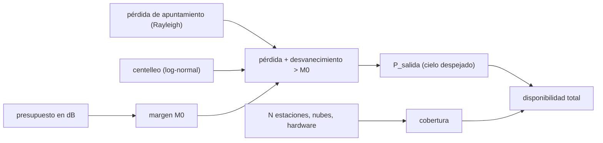

# B92-C08 — Márgenes y disponibilidad de enlaces ópticos

<!-- nav:top -->
[🏠 Programa](../../../../README.md) · [📚 Bloque B92](../../../tronco-comun/B92-comunicaciones-opticas-espaciales-profundizacion.md) · [← Anterior: B92-C07 — Enlaces ópticos de espacio profundo](../B92-C07-enlaces-opticos-de-espacio-profundo/CLASE.md) · [Siguiente: B93-C01 — Diseño de PCB espacial (conceptual) →](../../../tronco-comun/B93-electronica-embarcada-y-compatibilidad-electromagnetica.md#b93-c01)
<!-- /nav -->

## 1. Ubicación, nivel y alcance

Clase 8 y última del bloque B92. Nivel N3. Un enlace óptico se promete con un margen y una disponibilidad, no con una potencia. Aquí armas el presupuesto de un enlace ilustrativo, calculas la probabilidad de salida de servicio por apuntamiento y centelleo conjuntos con dos vías independientes, comparas con la disponibilidad publicada de LCRD y decides cuántas estaciones exige una meta de `99 %`. Reúne [C01](../B92-C01-fuentes-laser-y-amplificadores-para-enlaces-espaciales/CLASE.md) a [C07](../B92-C07-enlaces-opticos-de-espacio-profundo/CLASE.md). El enlace es sintético.

## 2. Por qué esta clase existe

El contrato de un servicio de comunicaciones dice «99 % de disponibilidad», no «4 W». La decisión central: **¿cuántos decibelios de margen y cuántas estaciones terrestres hacen falta para cumplir una disponibilidad objetivo, y qué parte de la salida de servicio es del enlace y qué parte del clima y del hardware?**

## 3. Lo que podrás hacer al terminar

1. Armar un presupuesto de enlace óptico en decibelios y calcular su margen.
2. Calcular la probabilidad de salida de servicio con pérdida de apuntamiento y desvanecimiento por centelleo conjuntos.
3. Verificarla con una integral numérica y con Monte Carlo.
4. Dimensionar el margen para una probabilidad de salida dada.
5. Calcular la disponibilidad total con `N` estaciones, hardware y clima.
6. Reconstruir las cifras de disponibilidad de LCRD y distinguir lo publicado de lo inferido.

La evidencia es el **presupuesto de margen y disponibilidad de un enlace** del ejercicio 12 (sección 20).

## 4. Con qué llegas y cómo comprobarlo

1. ¿Qué es un presupuesto de enlace?
2. ¿Qué es un margen y cómo se expresa?
3. ¿Qué es la disponibilidad?
4. ¿Qué es la probabilidad conjunta de eventos independientes?
5. ¿Qué es una verificación por segunda vía?

<details>
<summary>Ver respuestas</summary>

1. La suma, en dB, de ganancias y pérdidas entre el transmisor y el receptor. 2. La diferencia en dB entre la potencia recibida y la requerida. 3. La fracción del tiempo (o de las sesiones) en que el servicio se cumple. 4. El producto de las probabilidades. 5. Calcular lo mismo con otro método y comparar.
</details>

Con cuatro o cinco aciertos, sigue; si no, repasa los prerrequisitos.

## 5. Un caso de contexto y casos de referencia

Un enlace lunar ilustrativo (`0,5 W`, `θ = 12,355 µrad`, receptor de `0,4 m`, `100 Mbps` con `6` fotones incidentes por bit) recibe `2,959 × 10⁻¹⁰ W` y necesita `7,677 × 10⁻¹¹ W`: `5,86 dB` de margen sin apuntamiento ni centelleo. Con cielo despejado, la probabilidad de salida es `0,0003`. Con una probabilidad de nube de `0,2` por estación y hardware de `0,95`, hacen falta `4` estaciones para pasar de `99 %`. Es el **ejemplo conductor**. Todo es **ilustrativo**. Como contexto publicado, LCRD informó (hasta el 6 de diciembre de 2023) una disponibilidad de carga útil de `99,3 %`, de `57,8 %` y `40,5 %` para sus dos estaciones sin contar el clima, `80 %` por clima y `59 %` de sesiones exitosas (Israel et al., 2024).

## 6. Vocabulario

El **presupuesto de enlace** suma ganancias y pérdidas en decibelios. El **margen** es la potencia recibida menos la requerida. La **salida de servicio** (*outage*) es el evento en que las pérdidas aleatorias superan el margen. La **disponibilidad** es la probabilidad de que el servicio cumpla. La **cobertura** de `N` estaciones es `1 − (1 − a)^N` si son independientes. El **margen de diseño** es el que se reserva para una probabilidad de salida objetivo.

## 7. Modelo mental: una balanza con varios pesos aleatorios



*Descripción textual:* el presupuesto da el margen; el apuntamiento y el centelleo aleatorios compiten contra él y dan la probabilidad de salida con cielo despejado; las estaciones, las nubes y el hardware dan la cobertura; el producto es la disponibilidad total.

Analogía: el margen es el saldo de una cuenta; los gastos aleatorios son el apuntamiento y el centelleo, y el clima y el hardware deciden cuántas cuentas tienes abiertas. Límite: se suponen eventos independientes y estacionarios; en un servicio real hay correlaciones y estacionalidad.

## 8. La explicación, paso a paso

### 8.1 Presupuesto

Con `P = 0,5 W` (`−3,01 dBW`), `G_t = 8/θ² = +107,19 dBi`, dispersión `1/(4π d²)` a `384 400 km` (`−182,69 dB`), área del receptor de `0,4 m` de diámetro (`−9,01 dB`), óptica (`−3,00 dB`), acoplamiento de óptica adaptativa del `35 %` (`−4,56 dB`; el `35 %` es el valor de un enlace nocturno de LCRD, usado aquí como ilustración) y extinción (`−0,22 dB`), la potencia recibida es `−95,29 dBW` (`2,959 × 10⁻¹⁰ W`). Se requiere `100 Mbps × 6 × hc/λ = 7,677 × 10⁻¹¹ W` (`−101,15 dBW`). El margen sin apuntamiento ni centelleo es `M₀ = 5,86 dB`.

### 8.2 Salida de servicio con cielo despejado

La pérdida instantánea de apuntamiento es `8,686 r²/θ²` dB con `r` de Rayleigh (`σ = 2 µrad`, C02) y el desvanecimiento por centelleo es log-normal de media 1 (`σ_I² = 0,1`, C04). Hay salida si ambos superan `M₀`. La integral numérica de Simpson sobre `r`, con la cola log-normal exacta, da: `0,05124` con `M₀ = 3 dB`, `0,00022` con `6`, y prácticamente `0` con `9` y `12`. El Monte Carlo (200 000 muestras por punto, semilla fija) coincide a `6,5 × 10⁻⁴`.

### 8.3 Dimensionar el margen

Para una probabilidad de salida del `1 %` hacen falta `M₀ = 4,04 dB`; el presupuesto tiene `5,86 dB`, de modo que cumple y su probabilidad de salida es `0,0003`. Si el margen bajara a `3 dB` se perdería el `5,1 %` del tiempo.

### 8.4 Reconstrucción de las cifras de LCRD

Con las cifras publicadas: probabilidad de que al menos una de las dos estaciones esté disponible, sin clima, `1 − 0,422 × 0,595 = 0,7489`. Con clima común a ambas, `0,993 × 0,7489 × 0,80 = 0,5949`, que coincide con el `59 %` publicado; con clima independiente por estación daría `0,6321`. Es una inferencia propia: el artículo dice que el cálculo «se alinea» con el `59 %`, sin detallar la fórmula. Es una coincidencia numérica y no una explicación: las estaciones están en California y en Hawái, de modo que un clima común no es físicamente plausible; la fórmula real del artículo no se consultó.

### 8.5 Disponibilidad con N estaciones

Con hardware de `0,95` por estación y nube de `0,2` independiente, la disponibilidad por estación es `0,76` y la cobertura de `N` estaciones es `1 − 0,24^N`: `0,76`, `0,9424`, `0,98618`, `0,99668` y `0,9992` para `N` de 1 a 5. Multiplicada por `1 − P_salida`, la disponibilidad total supera `99 %` con `N = 4` (`0,99639`); con `N = 3` queda en `0,98589`. LCRD concluye que harían falta más de dos estaciones para pasar de `99 %`; es coherente, aunque sus hipótesis no son las del ejemplo.

### 8.6 Qué decide la disponibilidad

El margen óptico resuelve la cola del apuntamiento y del centelleo (`0,03 %` con `5,86 dB`), pero el servicio se pierde sobre todo por nubes y hardware. Añadir decibelios al enlace mejora poco la disponibilidad total una vez que la salida con cielo despejado es pequeña; añadir estaciones separadas la mejora mucho (C04).

## 9. Magnitudes, símbolos y unidades

| Símbolo | Qué es | Unidad | Valor / nota |
|---|---|---|---|
| `P_rx` | potencia recibida | W | 2,959 × 10⁻¹⁰ |
| `P_req` | potencia requerida | W | 7,677 × 10⁻¹¹ |
| `M₀` | margen sin apuntamiento ni centelleo | dB | 5,86 |
| `σ` | dispersión del apuntamiento por eje | µrad | 2 (ilustrativo) |
| `σ_I²` | índice de centelleo | — | 0,1 (ilustrativo) |
| `P_salida` | probabilidad de salida con cielo despejado | — | 0,0003 |
| `N` | número de estaciones | — | 4 para 99 % |

## 10. Convenciones y referencias

Presupuesto en decibelios, sin pérdidas de polarización ni de enlace de subida. Apuntamiento Rayleigh con `σ` por eje; centelleo log-normal de media 1; ambos independientes. Estaciones con nubes independientes y hardware independiente. Los valores del presupuesto y de las probabilidades son ilustrativos; las cifras de disponibilidad de LCRD son las publicadas y su cruce es una reconstrucción propia. Tolerancia: Monte Carlo frente a integral `2 × 10⁻³` absoluta.

## 11. De dónde sale lo que afirmamos

| ID | Fuente | Localizador | Respalda | Estado |
|---|---|---|---|---|
| S1 | Israel et al., *NASA's LCRD experiment program: characterization and initial operations*, SPIE, 2024 — https://ntrs.nasa.gov/api/citations/20230018608/downloads/SPIE%20West%202024%20final.pdf (leído con PyMuPDF el 2026-11-10) | secciones 2.2, 3.2 y 7 | carga útil 99,3 %; OGS-1 57,8 %; OGS-2 40,5 %; clima 80 %; sesiones exitosas 59 %; acoplamiento de 35 %; más de dos estaciones para pasar de 99 % | Consultada |
| S2 | NIST, `h` y `c` (CODATA 2022) — https://physics.nist.gov/cgi-bin/cuu/Value?h y https://physics.nist.gov/cgi-bin/cuu/Value?c (consultadas 2026-11-10) | valores exactos | `hc/λ` para la potencia requerida | Consultada |
| S3 | CCSDS 141.0-B-1, agosto de 2019 — https://ccsds.org/Pubs/141x0b1.pdf (leído con PyMuPDF el 2026-11-10) | sección 3.2 | frecuencia de `193,1 THz` | Consultada |
| — | Presupuesto de enlace, apuntamiento Rayleigh, desvanecimiento log-normal y composición de disponibilidades | — | las verifica el laboratorio con integral numérica y Monte Carlo | No consultada en una fuente concreta |

Límites: la fórmula con que LCRD obtiene su `59 %` no se consultó; la reconstrucción es una inferencia; ningún valor del presupuesto proviene de una misión.

## 12. Cómo ver el margen y la disponibilidad

| Magnitud | Valor |
|---|---|
| `M₀` | 5,86 dB |
| `P_salida` con `M₀ = 3 dB` | 0,05124 |
| `M₀` para 1 % de salida | 4,04 dB |
| reconstrucción LCRD (clima común) | 0,5949 |
| `N` para 99 % | 4 |

Descripción larga: la probabilidad de salida cae muy rápido al subir el margen; la disponibilidad total sigue la cobertura de estaciones y se satura cuando la salida óptica es pequeña.

## 13. Ejemplo trabajado: margen del presupuesto

**Paso 1 · Potencia recibida.** `−3,01 + 107,19 − 182,69 − 9,01 − 3,00 − 4,56 − 0,22 = −95,29 dBW`.

**Paso 2 · Potencia requerida.** `10⁸ × 6 × 1,2795 × 10⁻¹⁹ = 7,677 × 10⁻¹¹ W = −101,15 dBW`.

**Paso 3 · Margen.** `−95,29 − (−101,15) = 5,86 dB`.

**Paso 4 · Lectura.** `5,86 dB` supera los `4,04 dB` que exige un `1 %` de salida con cielo despejado.

## 14. Distintas formas de describir un compromiso de servicio

**Por margen:** `M₀` en dB. **Por probabilidad:** `P_salida`. **Por cobertura:** `1 − (1 − a)^N`. **Por disponibilidad total:** cobertura × `(1 − P_salida)`. **Por causa:** apuntamiento, centelleo, nubes, hardware.

## 15. Práctica guiada

**Ejercicio 1 · con los pasos indicados.** Potencia requerida para `100 Mbps` con `6` fotones por bit a `1552,52 nm`. *Pasos:* energía del fotón `1,2795 × 10⁻¹⁹ J`; multiplica por `6` y por la tasa.

<details><summary>Solución comentada</summary>

`10⁸ × 6 × 1,2795 × 10⁻¹⁹ = 7,677 × 10⁻¹¹ W`, es decir `−101,15 dBW`.
</details>

**Ejercicio 2 · con una pista.** Margen si la potencia recibida es `−95,29 dBW`. *Pista:* resta la requerida.

<details><summary>Solución comentada</summary>

`5,86 dB`.
</details>

**Ejercicio 3 · casi autónomo.** Cobertura con `N = 3` estaciones de disponibilidad `0,76` cada una.

<details><summary>Solución comentada</summary>

`1 − 0,24³ = 0,98618`.
</details>

## 16. Práctica autónoma, transferencia e integrador

**Ejercicio 4 · autónomo.** Probabilidad de salida con `M₀ = 3 dB`.

<details><summary>Solución comentada</summary>

`0,05124` (integral); el Monte Carlo da `0,05059`.
</details>

**Ejercicio 5 · autónomo.** Probabilidad de salida con `M₀ = 6 dB`.

<details><summary>Solución comentada</summary>

`2,2 × 10⁻⁴`.
</details>

**Ejercicio 6 · autónomo.** Margen para un `1 %` de salida.

<details><summary>Solución comentada</summary>

`4,04 dB`.
</details>

**Ejercicio 7 · autónomo.** Disponibilidad total con `N = 4`.

<details><summary>Solución comentada</summary>

`0,99668 × (1 − 0,0003) = 0,99639`.
</details>

**Ejercicio 8 · autónomo.** Probabilidad de que una de las dos estaciones de LCRD esté disponible sin clima.

<details><summary>Solución comentada</summary>

`1 − (1 − 0,578)(1 − 0,405) = 0,7489`.
</details>

**Ejercicio 9 · transferencia.** **Transferencia.** ¿Qué hipótesis sobre el clima reproduce mejor el `59 %` publicado?

<details><summary>Solución comentada</summary>

El producto con clima común da `0,5949`, frente a `0,6321` con clima independiente. Pero las estaciones están en California y Hawái, de modo que la coincidencia con `59 %` es numérica y no demuestra un clima común: la fórmula del artículo no se consultó.
</details>

**Ejercicio 10 · transferencia.** **Transferencia.** Un cliente pide `99,9 %` y sube el margen del enlace de `5,86` a `15 dB`. ¿Qué cambia?

<details><summary>Solución comentada</summary>

Casi nada: la salida con cielo despejado ya es `0,0003` y la disponibilidad total sigue limitada por nubes y hardware (`0,99639` con 4 estaciones). Con `N = 5` sube a `0,99891`; para `99,9 %` hacen falta más estaciones o mejor hardware.
</details>

**Ejercicio 11 · transferencia.** **Transferencia.** ¿Qué debe precisar un contrato que dice «99 % de disponibilidad»?

<details><summary>Solución comentada</summary>

Qué se mide (tiempo, sesiones o volumen de datos), el periodo, qué se excluye (mantenimiento, desastres naturales), cuántas estaciones cuentan y a qué tasa; LCRD separa la disponibilidad del hardware de la del clima y de la tasa de éxito de sesiones.
</details>

**Ejercicio 12 · integrador.** **Integrador.** Elabora tu *presupuesto de margen y disponibilidad de un enlace*: tabla del presupuesto en dB, margen, probabilidad de salida con dos vías, margen para `1 %`, disponibilidad para `N` de 1 a 5, reconstrucción de las cifras de LCRD y lista de qué es consultado, inferido e ilustrativo.

<details><summary>Solución comentada</summary>

Secciones 8.1–8.6 y la salida del laboratorio.
</details>

## 17. Laboratorio: presupuesto, salida de servicio y disponibilidad

El script [margenes.py](margenes.py) arma el presupuesto, calcula la probabilidad de salida por integral numérica y por Monte Carlo, halla el margen para `1 %`, reconstruye las cifras de LCRD y calcula la disponibilidad con `N` estaciones (**comprueba** Monte Carlo frente a integral < 2e-3, la reconstrucción cerca de `0,59` y que `N` para `99 %` existe).

**Datos:** cifras de LCRD y constantes (consultadas); presupuesto, `σ`, `σ_I²`, nubes y hardware **ilustrativos**. **Predice antes de ejecutar:** ¿cuántas estaciones para `99 %`? (4.) **Ejecución del 2026-11-10 (Python 3.12.9):**

```text
Python 3.12.9 (biblioteca estandar)
Presupuesto de enlace ILUSTRATIVO (Luna, 100 Mbps, 6 fotones incidentes por bit):
  Potencia transmitida 0.5 W                     -3.01 dBW
  Ganancia de transmision 8/theta^2            +107.19 dBi
  Dispersion 1/(4 pi d^2), d = 384400 km       -182.69 dB
  Area del receptor (0.4 m de diametro)          -9.01 dB
  Perdidas de optica                             -3.00 dB
  Acoplamiento de optica adaptativa 35 %         -4.56 dB
  Extincion clara (tau 0.05)                     -0.22 dB
  Potencia recibida (sin apuntamiento ni centelleo)     -95.29 dBW = 2.959e-10 W
  Potencia requerida (100 Mbps x 6 fotones/bit)        -101.15 dBW = 7.677e-11 W
  Margen M0 sin apuntamiento ni centelleo                +5.86 dB
Probabilidad de salida de servicio con cielo despejado (apuntamiento + centelleo):
  M0 [dB]   integral numerica   Monte Carlo (200000)
      3.0            0.05124        0.05059
      6.0            0.00022        0.00018
      9.0            0.00000        0.00001
     12.0            0.00000        0.00000
Diferencia absoluta maxima integral frente a Monte Carlo = 6.5e-04
Margen M0 para una salida de servicio de 1 %: 4.04 dB (el presupuesto tiene 5.86 dB)
Con el margen del presupuesto: salida de servicio con cielo despejado = 0.0003
Reconstruccion de la disponibilidad de LCRD (cifras publicadas; el cruce es una inferencia propia):
  Una de dos estaciones disponible (sin clima) = 0.7489
  Con clima comun a las dos estaciones: 0.5949 ; con clima independiente: 0.6321 ; publicado: 0.59
Disponibilidad total con N estaciones (hardware 0.95, nube 0.2 independiente, salida optica con M0 del presupuesto):
  N = 1  cobertura 0.76000  disponibilidad total 0.75978
  N = 2  cobertura 0.94240  disponibilidad total 0.94213
  N = 3  cobertura 0.98618  disponibilidad total 0.98589
  N = 4  cobertura 0.99668  disponibilidad total 0.99639
  N = 5  cobertura 0.99920  disponibilidad total 0.99891
Menor N con disponibilidad total >= 99 %: 4
Pruebas superadas.
```

```bash
python programa/clases/B92/B92-C08-margenes-y-disponibilidad-de-enlaces-opticos/margenes.py
```

**Límites:** eventos independientes y estacionarios, sin estacionalidad ni correlación entre estaciones, sin el enlace de subida ni la polarización; el Monte Carlo es estadístico.

## 18. Errores frecuentes y cómo corregirlos

**Confundir el margen con la disponibilidad.** Se corrige con 8.6.

**Sumar los decibelios de pérdidas aleatorias como si fueran fijas.** Se corrige con 8.2.

**Presentar la reconstrucción de LCRD como un dato publicado.** Se corrige con 8.4.

**Presentar el presupuesto sintético como el de una misión.** Se corrige con la sección 10.

## 19. Cómo sabrás que vas bien

Tras la sección 8: ¿qué margen esperabas y cuál obtuviste? Si dudas, repasa el ejemplo 13. Tras el laboratorio: ¿qué comprueba? (ver la sección 17).

## 20. Qué entregas y cómo se evalúa

El producto es tu **presupuesto de margen y disponibilidad de un enlace** (ejercicio 12).

| Criterio | Inicial | En desarrollo | Logrado | Destacado |
|---|---|---|---|---|
| Conceptos | Los confunde | Parciales | Distingue margen, salida y disponibilidad | Explica qué limita la disponibilidad |
| Cálculo | Sin unidades | Con errores | Presupuesto completo con unidades | Calcula casos nuevos |
| Numérico | Sin comprobar | Un caso | Contraste con una segunda vía | Interpreta las diferencias |
| Fuentes | Sin fuente | Sin fecha | Fuentes con fecha y estado | Distingue lo publicado, lo inferido y lo ilustrativo |
| Límites | No los nombra | Uno | Tres | Discute qué falta del modelo |

**Condiciones críticas (no se compensan con promedio):** rotular el presupuesto como ilustrativo; no presentar la reconstrucción de LCRD como dato publicado; citar solo lo consultado.

## 21. Ética, seguridad y límites

Clase educativa: los modelos son simplificados y sus datos son sintéticos o ilustrativos; una disponibilidad comprometida con un cliente requiere datos medidos del sitio y del terminal. La operación de láseres hacia el cielo exige coordinación con las autoridades de seguridad ocular y de aviación. Accesibilidad: tablas equivalentes a las gráficas, fórmulas en texto, ejercicios sin conexión.

## 22. Para cerrar y seguir

Un presupuesto de `5,86 dB` deja `0,03 %` de salida con cielo despejado, pero la disponibilidad total la fijan las nubes y el hardware: con estaciones independientes de `0,76`, cuatro llegan a `99,6 %`. Con esto se cierra el bloque: del fotón en el transmisor al compromiso de servicio.

**Glosario español–inglés.** presupuesto de enlace · *link budget*; margen · *margin*; salida de servicio · *outage*; disponibilidad · *availability*; diversidad de estaciones · *site diversity*.

**Continuidad.** Este es el cierre del bloque; la guía del bloque ([B92](../../../tronco-comun/B92-comunicaciones-opticas-espaciales-profundizacion.md)) reúne las ocho clases.

**Referencias:** ver sección 11.

<!-- nav:bottom -->
---

[← Anterior: B92-C07 — Enlaces ópticos de espacio profundo](../B92-C07-enlaces-opticos-de-espacio-profundo/CLASE.md) · [📚 Bloque B92](../../../tronco-comun/B92-comunicaciones-opticas-espaciales-profundizacion.md) · [Siguiente: B93-C01 — Diseño de PCB espacial (conceptual) →](../../../tronco-comun/B93-electronica-embarcada-y-compatibilidad-electromagnetica.md#b93-c01)
<!-- /nav -->
