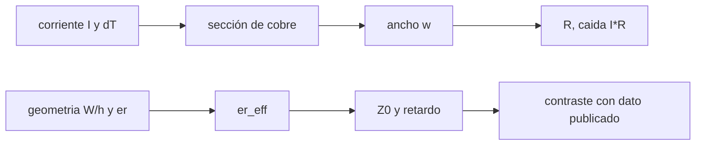

# B93-C01 — Diseño de PCB espacial (conceptual)

<!-- nav:top -->
[🏠 Programa](../../../../README.md) · [📚 Bloque B93](../../../tronco-comun/B93-electronica-embarcada-y-compatibilidad-electromagnetica.md) · [← Anterior: B92-C08 — Márgenes y disponibilidad de enlaces ópticos](../../B92/B92-C08-margenes-y-disponibilidad-de-enlaces-opticos/CLASE.md) · [Siguiente: B93-C02 — Selección de componentes y derating →](../B93-C02-seleccion-de-componentes-y-derating/CLASE.md)
<!-- /nav -->

## 1. Ubicación, nivel y alcance

Clase 1 del bloque B93. Nivel N3. Una placa de circuito impreso (PCB) es una estructura de cobre con tres funciones que se pueden calcular: conducir corriente sin calentarse de más, transportar señales con una impedancia controlada y retrasarlas un tiempo conocido. Aquí dimensionas esas tres cosas para una placa **sintética** con fórmulas simples y contrastas la impedancia con un valor publicado. No usas otras clases del bloque; la potencia del satélite se trata en B86 y la integración en B90. No hay ninguna placa real detrás de los números.

## 2. Por qué esta clase existe

El tronco no trataba el diseño de placas: B90 integra y B86 trata potencia, pero nadie calculaba una pista. La decisión central: **¿qué ancho de cobre y qué geometría de microtira necesita una placa para llevar una corriente y una señal dadas, y qué margen queda?**

## 3. Lo que podrás hacer al terminar

1. Calcular el ancho de una pista por corriente y por aumento de temperatura permitido.
2. Calcular la resistencia y la caída de tensión de una pista, y su cambio con la temperatura.
3. Calcular la permitividad efectiva, la impedancia y el retardo de una microtira.
4. Hallar el ancho de una microtira para una impedancia objetivo.
5. Contrastar el cálculo con un valor publicado y decir cuánto difiere.
6. Separar lo consultado de lo ilustrativo y de lo no consultado.

La evidencia es la **ficha de pista y microtira de una placa sintética** del ejercicio 12 (sección 20).

## 4. Con qué llegas y cómo comprobarlo

1. ¿Qué dice la ley de Ohm para un conductor?
2. ¿Qué es la resistividad y en qué unidades se mide?
3. ¿Qué es la permitividad relativa de un material?
4. ¿Qué es la impedancia característica de una línea?
5. ¿Qué es una verificación por segunda vía?

<details>
<summary>Ver respuestas</summary>

1. `V = I R`. 2. La propiedad del material que da `R = ρ L / A`; se mide en Ω·m. 3. El cociente entre la permitividad del material y la del vacío; no tiene unidades. 4. La relación `V/I` de una onda que viaja por la línea, en Ω (`Z0 = √(L/C)`). 5. Calcular lo mismo con otro método o contra un dato publicado.
</details>

Con cuatro o cinco aciertos, sigue; si no, repasa los prerrequisitos.

## 5. Un caso de contexto y casos de referencia

Una placa sintética de cobre de 35 µm (1 oz) lleva `2,0 A` por una pista externa de `100 mm` con un aumento de temperatura permitido de `10 K`. La fórmula empírica da un ancho de `0,781 mm`; a 85 °C la pista tiene `77,1 mΩ` y cae `154,2 mV`. Una microtira de ancho igual a la altura sobre un sustrato de `εr = 4,8` tiene `Z0 = 68,4 Ω`, y para `50 Ω` hace falta `W/h = 1,803`. Es el **ejemplo conductor**. Todo es **ilustrativo**: ninguna cifra describe una placa de vuelo.

## 6. Vocabulario

La **microtira** es una pista en la capa externa sobre un plano de masa con un dieléctrico entre ambos. Su **permitividad efectiva** `ε_eff` mezcla el dieléctrico y el aire de encima. La **impedancia característica** `Z0` y la **velocidad de fase** `v = c/√ε_eff` salen de ella. La **corriente admisible** de una pista depende de su sección y del aumento de temperatura `ΔT` aceptado. Una **onza de cobre** (1 oz) equivale aquí a 35 µm de espesor.

## 7. Modelo mental: una pista como un conductor y como una línea



*Descripción textual:* la corriente y el `ΔT` fijan la sección y el ancho, que dan la resistencia; la geometría y `εr` fijan `ε_eff`, de donde salen `Z0` y el retardo, que se contrastan con un valor publicado.

Analogía: la pista es una tubería que debe dejar pasar el caudal sin calentarse y, a la vez, un riel por el que viaja una onda a una velocidad fija. Límite: la fórmula de corriente es empírica y no incluye planos de cobre cercanos ni el vacío del espacio; la de `Z0` es una aproximación de la microtira ideal.

## 8. La explicación, paso a paso

### 8.1 Ancho por corriente

La relación empírica es `I = k ΔT^0,44 A^0,725`, con `A` en mil² (1 mil = 25,4 µm), `ΔT` en K y `k = 0,048` en capa externa o `0,024` en capa interna. Se invierte: `A = (I/(k ΔT^0,44))^(1/0,725)` y el ancho es `w = A/espesor`. Para `I = 2 A`, `ΔT = 10 K`, externa: `0,048 × 10^0,44 = 0,1322`; `A = (2/0,1322)^1,379 = 42,4 mil²`; con 35 µm (1,378 mil) resulta `w = 0,781 mm`. La capa interna admite menos corriente por el mismo `ΔT` (peor disipación): hace falta `2,033 mm`.

### 8.2 Resistencia y caída

`R = ρ(T) L/(w t)` con `ρ(T) = ρ20 (1 + α (T − 20))`, `ρ20 = 1,68 × 10⁻⁸ Ω·m`, `α = 0,00393 K⁻¹`. Para 100 mm y 0,781 mm: `R(20 °C) = 61,43 mΩ`, `R(85 °C) = 77,12 mΩ` y la caída a 2 A es `154,2 mV`. El cobre caliente cae más: `+25,5 %` entre 20 y 85 °C.

### 8.3 Microtira

Con la aproximación de Hammerstad: `ε_eff = (εr+1)/2 + (εr−1)/2 · (1+12 h/W)^(−1/2)`. Para `w/h ≥ 1`: `Z0 = 120π/[√ε_eff (w/h + 1,393 + 0,667 ln(w/h + 1,444))]`; para `w/h ≤ 1`: `Z0 = 60/√ε_eff · ln(8h/w + w/4h)`. Con `εr = 4,8` y `W = h`: `ε_eff = 3,427` y `Z0 = 68,4 Ω`.

### 8.4 Dos vías: dato publicado

Las notas de curso de la UCSB dan para microtira `W = h` sobre epoxi-vidrio `εr = 4,8`: `ε_eff = 3,4`, `v = 0,54 c`, `Z0 = 68 Ω`. El cálculo da `3,427`, `0,540 c` y `68,4 Ω`: difiere menos de 1 Ω. Es una comprobación contra un dato publicado, aunque con cifras redondeadas.

### 8.5 Ancho para 50 Ω y retardo

Resolviendo `Z0 = 50 Ω` por bisección se obtiene `W/h = 1,803`; con `h = 0,2 mm`, `W = 0,361 mm` y `ε_eff = 3,587`. El retardo es `√ε_eff/c = 6,32 ps/mm`: una pista de 100 mm tarda `0,632 ns`.

## 9. Magnitudes, símbolos y unidades

| Símbolo | Qué es | Unidad | Valor / nota |
|---|---|---|---|
| `I` | corriente | A | 2,0 (ilustrativo) |
| `ΔT` | aumento de temperatura permitido | K | 10 |
| `A` | sección de cobre | mil² | 42,4 |
| `w`, `t` | ancho y espesor | mm, µm | 0,781; 35 |
| `R` | resistencia de la pista | mΩ | 61,4 (20 °C) |
| `ε_eff` | permitividad efectiva | — | 3,427 |
| `Z0` | impedancia característica | Ω | 68,4 (`W = h`) |
| `c` | velocidad de la luz | m/s | 299 792 458 |

## 10. Convenciones y referencias

Sistema de unidades SI salvo el mil, que solo aparece dentro de la fórmula de corriente. Pista uniforme, cobre a temperatura uniforme, microtira sin pérdidas y sin espesor de pista en `Z0`. No hay sistema de referencia espacial. Todas las geometrías, corrientes y espesores son ilustrativos.

## 11. De dónde sale lo que afirmamos

| ID | Fuente | Localizador | Respalda | Estado |
|---|---|---|---|---|
| S1 | Long, notas de curso ECE 145A/218A «Transmission Lines — a review and explanation», UCSB, 2007 — https://web.ece.ucsb.edu/~long/ece145a/tlines1.pdf (consultada 2026-11-10) | tabla de parámetros de microtira con `W = h` | `εr = 4,8`, `ε_eff = 3,4`, `v = 0,54 c`, `Z0 = 68 Ω` | Consultada |
| S2 | Resultados de búsqueda que reproducen la fórmula empírica de corriente de la IPC-2221 (varios sitios de terceros, 2026-11-10) | fórmula y constantes | `I = k ΔT^0,44 A^0,725`, `k = 0,048` / `0,024` | Parcial: fuentes secundarias; la norma IPC-2221 no se consultó |
| — | Resistividad del cobre, aproximación de Hammerstad, ley de Ohm | — | sección 8.2 y 8.3 | No consultada en una fuente concreta |

Límites: no se leyó la IPC-2221 ni la IPC-2152; no se consultó ninguna norma de PCB de vuelo, de modo que cualquier regla específica del espacio (materiales, aislamiento, limpieza) queda **no consultada**.

## 12. Cómo ver una pista

| Magnitud | Valor |
|---|---|
| ancho para 2 A (externa) | 0,781 mm |
| ancho para 2 A (interna) | 2,033 mm |
| `R` a 85 °C | 77,12 mΩ |
| `Z0` con `W = h` | 68,4 Ω |
| retardo (50 Ω) | 6,32 ps/mm |

Descripción larga: el ancho crece más que proporcionalmente con la corriente (potencia 1,379), la resistencia crece con la temperatura y la microtira de 50 Ω es más estrecha que la de `W = h`.

## 13. Ejemplo trabajado: pista de 1 A

**Paso 1 · Constante.** `k ΔT^0,44 = 0,048 × 10^0,44 = 0,1322`.

**Paso 2 · Sección.** `A = (1/0,1322)^1,379 = 16,3 mil²`.

**Paso 3 · Ancho.** `w = 16,3 × (25,4 µm)²/35 µm = 0,300 mm`.

**Paso 4 · Comprobar.** El laboratorio da `0,300 mm` para 1 A.

## 14. Distintas formas de describir una pista

**Por corriente:** `I` y `ΔT`. **Por geometría:** `w`, `t`, `L`. **Por resistencia:** `R(T)`. **Por señal:** `Z0` y retardo. **Por margen:** corriente admisible menos corriente real.

## 15. Práctica guiada

**Ejercicio 1 · con los pasos indicados.** Calcula el ancho de una pista externa para 0,5 A con `ΔT = 10 K`. *Pasos:* constante, sección, ancho.

<details><summary>Solución comentada</summary>

`A = (0,5/0,1322)^1,379 = 6,2 mil²` y `w = 0,115 mm` (laboratorio).
</details>

**Ejercicio 2 · con una pista.** ¿Cuánto más ancha debe ser una pista interna que una externa para la misma corriente? *Pista:* el cociente de `k` entra elevado a `1/0,725`.

<details><summary>Solución comentada</summary>

`2^1,379 = 2,60`; `2,033/0,781 = 2,60`.
</details>

**Ejercicio 3 · casi autónomo.** Calcula `R(20 °C)` de la pista de 0,781 mm y 100 mm.

<details><summary>Solución comentada</summary>

`1,68×10⁻⁸ × 0,1/(0,781×10⁻³ × 35×10⁻⁶) = 61,4 mΩ`.
</details>

## 16. Práctica autónoma, transferencia e integrador

**Ejercicio 4 · autónomo.** Caída a 3 A a 85 °C en una pista de 100 mm dimensionada para 3 A (1,367 mm).

<details><summary>Solución comentada</summary>

`R = 77,12 × 0,781/1,367 = 44,06 mΩ`; caída `132 mV`.
</details>

**Ejercicio 5 · autónomo.** Si el cobre fuera de 70 µm con el mismo ancho, ¿cómo cambia la corriente admisible?

<details><summary>Solución comentada</summary>

La sección se duplica: `I ∝ A^0,725`, así que `2^0,725 = 1,653`; 2 A pasan a 3,31 A.
</details>

**Ejercicio 6 · autónomo.** ¿Qué ancho de pista da 50 Ω con `h = 0,1 mm` y `εr = 4,8`?

<details><summary>Solución comentada</summary>

`W/h` no cambia: `1,803 × 0,1 = 0,180 mm`.
</details>

**Ejercicio 7 · autónomo.** Tiempo de tránsito por 250 mm de microtira de 50 Ω.

<details><summary>Solución comentada</summary>

`6,32 ps/mm × 250 = 1,58 ns`.
</details>

**Ejercicio 8 · autónomo.** Coeficiente de reflexión si una pista de `W = h` (68,4 Ω) alimenta una carga de 50 Ω.

<details><summary>Solución comentada</summary>

`Γ = (68,4 − 50)/(68,4 + 50) = 0,155` (se desarrolla en C03).
</details>

**Ejercicio 9 · transferencia.** **Transferencia.** Un colega usa el ancho de este laboratorio para una pista en vacío. ¿Qué falta?

<details><summary>Solución comentada</summary>

La fórmula es empírica y su validez sin convección no se consultó; en vacío el calor sale por conducción al plano y a la carcasa, y hay que verificarlo con un análisis térmico propio.
</details>

**Ejercicio 10 · transferencia.** **Transferencia.** Un plano de cobre pegado a la pista, ¿hace la fórmula conservadora o optimista?

<details><summary>Solución comentada</summary>

Los resultados de búsqueda indican que la fórmula ignora los planos cercanos, que ayudan a disipar; sería conservadora, pero no se consultó la norma que lo cuantifica (IPC-2152).
</details>

**Ejercicio 11 · transferencia.** **Transferencia.** Con un sustrato de `εr` menor (2,2 en la tabla publicada), ¿sube o baja `Z0` para `W = h`?

<details><summary>Solución comentada</summary>

Sube: la tabla de la UCSB da 94,3 Ω para `εr = 2,2` frente a 68 Ω para 4,8; además la señal viaja más rápido.
</details>

**Ejercicio 12 · integrador.** **Integrador.** Elabora tu *ficha de pista y microtira de una placa sintética*: ancho por corriente (externa e interna), resistencia a dos temperaturas, `Z0` y retardo, contraste con el dato publicado y lista de qué es consultado, ilustrativo y no consultado.

<details><summary>Solución comentada</summary>

Secciones 8.1–8.5 y la salida del laboratorio.
</details>

## 17. Laboratorio: pista y microtira de una placa sintética

El script [pcb.py](pcb.py) calcula anchos por corriente, resistencia, `ε_eff`, `Z0` y retardo, y resuelve el ancho para 50 Ω (**comprueba** `Z0` y `ε_eff` frente al valor publicado, la inversión ancho↔corriente con 1e-9 y `Z0 = 50 Ω` con 1e-6).

**Datos:** `ε_eff`, `v` y `Z0` publicados (UCSB, consultados); corrientes, longitudes, espesor y `h` **ilustrativos**; fórmulas de IPC-2221, resistividad y Hammerstad **no consultadas** en una fuente concreta. **Predice antes de ejecutar:** ¿qué `Z0` saldrá con `W = h`? (cerca de 68 Ω.) **Ejecución del 2026-11-10 (Python 3.12.9):**

```text
Python 3.12.9 (biblioteca estandar)
Cobre ILUSTRATIVO de 35 um; dT = 10 K sobre el ambiente
 I [A]   ancho externa [mm]   ancho interna [mm]
  0.5          0.115            0.300
  1.0          0.300            0.781
  2.0          0.781            2.033
  3.0          1.367            3.556
Pista de 100 mm y 0.781 mm: R(20 C) = 61.43 mohm, R(85 C) = 77.12 mohm; caida a 2 A (85 C) = 154.2 mV
Microtira W = h, er = 4.8: er_eff = 3.427 (publicado 3.4), Z0 = 68.4 ohm (publicado 68), v = 0.540 c (publicado 0.54 c)
Para Z0 = 50 ohm: W/h = 1.803; con h = 0.2 mm, W = 0.361 mm; er_eff = 3.587
Retardo = 6.32 ps/mm; una pista de 100 mm tarda 0.632 ns
Pruebas superadas.
```

```bash
python programa/clases/B93/B93-C01-diseno-de-pcb-espacial-conceptual/pcb.py
```

**Límites:** la comparación con la UCSB usa cifras redondeadas y solo un caso (`W = h`); la fórmula de corriente es empírica, sin planos ni vacío; `Z0` ignora el espesor de la pista y las pérdidas.

## 18. Errores frecuentes y cómo corregirlos

**Usar el ancho de capa externa en una capa interna.** Se corrige con 8.1.

**Olvidar que la resistencia crece con la temperatura.** Se corrige con 8.2.

**Tomar un solo punto publicado como validación completa.** Se corrige con 8.4.

**Presentar la placa sintética como una placa de vuelo.** Se corrige con la sección 10.

## 19. Cómo sabrás que vas bien

Tras la sección 8: ¿qué ancho esperabas para 1 A y cuál obtuviste? Si dudas, repasa el ejemplo 13. Tras el laboratorio: ¿qué comprueba? (ver la sección 17).

## 20. Qué entregas y cómo se evalúa

El producto es tu **ficha de pista y microtira de una placa sintética** (ejercicio 12).

| Criterio | Inicial | En desarrollo | Logrado | Destacado |
|---|---|---|---|---|
| Conceptos | Los confunde | Parciales | Calcula ancho, `R` y `Z0` | Explica los límites de cada fórmula |
| Cálculo | Sin unidades | Con errores | Tablas completas con unidades | Calcula casos nuevos |
| Numérico | Sin comprobar | Un caso | Contraste con el dato publicado | Interpreta la diferencia |
| Fuentes | Sin fuente | Sin fecha | Fuentes con fecha y estado | Declara lo ilustrativo y lo no consultado |
| Límites | No los nombra | Uno | Tres | Discute qué falta (vacío, planos, pérdidas) |

**Condiciones críticas (no se compensan con promedio):** rotular la placa y sus datos como sintéticos; no presentar la fórmula empírica como norma consultada; citar solo lo consultado.

## 21. Ética, seguridad y límites

Clase educativa: los modelos son simplificados y sus datos son sintéticos o ilustrativos; ningún resultado sustituye la norma de diseño ni la calificación de una placa de vuelo. Accesibilidad: tablas equivalentes a las gráficas, fórmulas en texto, ejercicios sin conexión.

## 22. Para cerrar y seguir

Una pista de 0,781 mm lleva 2 A con 10 K de aumento y una microtira de 0,361 mm sobre 0,2 mm de dieléctrico da 50 Ω con 6,3 ps/mm de retardo. Queda una pregunta: ¿qué componentes se montan sobre esa placa y con qué holgura de carga?

**Glosario español–inglés.** microtira · *microstrip*; impedancia característica · *characteristic impedance*; permitividad efectiva · *effective permittivity*; aumento de temperatura · *temperature rise*; placa de circuito impreso · *printed circuit board*.

**Continuidad.** [B93-C02](../B93-C02-seleccion-de-componentes-y-derating/CLASE.md) estudia la selección de componentes y el derating.

**Referencias:** ver sección 11.

<!-- nav:bottom -->
---

[← Anterior: B92-C08 — Márgenes y disponibilidad de enlaces ópticos](../../B92/B92-C08-margenes-y-disponibilidad-de-enlaces-opticos/CLASE.md) · [📚 Bloque B93](../../../tronco-comun/B93-electronica-embarcada-y-compatibilidad-electromagnetica.md) · [Siguiente: B93-C02 — Selección de componentes y derating →](../B93-C02-seleccion-de-componentes-y-derating/CLASE.md)
<!-- /nav -->
