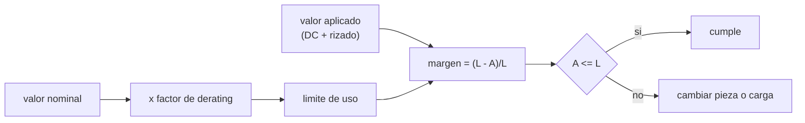

# B93-C02 — Selección de componentes y derating

<!-- nav:top -->
[🏠 Programa](../../../../README.md) · [📚 Bloque B93](../../../tronco-comun/B93-electronica-embarcada-y-compatibilidad-electromagnetica.md) · [← Anterior: B93-C01 — Diseño de PCB espacial (conceptual)](../B93-C01-diseno-de-pcb-espacial-conceptual/CLASE.md) · [Siguiente: B93-C03 — Integridad de señal en electrónica embarcada →](../B93-C03-integridad-de-senal-en-electronica-embarcada/CLASE.md)
<!-- /nav -->

## 1. Ubicación, nivel y alcance

Clase 2 del bloque B93. Nivel N3. Un componente de vuelo no se opera a su límite: se le asigna una carga menor que la nominal (derating) para que llegue al fin de vida con margen. Aquí aplicas los factores de una referencia pública de la NASA a una **lista de materiales sintética** y descubres qué piezas incumplen y por cuánto. Usas [C01](../B93-C01-diseno-de-pcb-espacial-conceptual/CLASE.md) solo para saber que la placa existe; los valores de tensión y potencia son inventados para el ejemplo.

## 2. Por qué esta clase existe

Nadie en el tronco trataba la selección de componentes calificados ni el derating. La decisión central: **¿cumple cada pieza de la lista con los factores de derating, con qué margen, y qué se cambia cuando no cumple?**

## 3. Lo que podrás hacer al terminar

1. Aplicar un factor de derating de tensión o de potencia y calcular el margen.
2. Sumar la tensión continua y el pico de rizado antes de comparar.
3. Interpolar linealmente el factor de un capacitor entre 70 °C y 110 °C.
4. Calcular la temperatura de unión de un microcircuito y su límite.
5. Detectar un incumplimiento que no se ve en el cociente (la regla de baja tensión de los cerámicos).
6. Separar lo consultado de lo sintético y de lo no consultado.

La evidencia es la **tabla de cumplimiento de derating de una lista de materiales sintética** del ejercicio 12 (sección 20).

## 4. Con qué llegas y cómo comprobarlo

1. ¿Qué es la potencia disipada por un resistor?
2. ¿Qué es una temperatura de unión?
3. ¿Qué es la resistencia térmica `θ_ja` y en qué unidades se mide?
4. ¿Qué es un margen porcentual?
5. ¿Qué es un dato sintético?

<details>
<summary>Ver respuestas</summary>

1. `P = V I`, en W. 2. La temperatura del semiconductor, mayor que la del ambiente. 3. El aumento de temperatura de la unión por cada vatio disipado, en K/W. 4. `(límite − valor)/límite × 100`. 5. Un dato inventado para el ejemplo, no medido.
</details>

Con cuatro o cinco aciertos, sigue; si no, repasa los prerrequisitos.

## 5. Un caso de contexto y casos de referencia

Una lista sintética de 11 comprobaciones a 70 °C de ambiente: 4 fallan. Un tántalo sólido de 35 V con `12,2 V` aplicados excede su límite de `10,5 V`; un resistor de `0,25 W` disipa `0,20 W` frente a `0,15 W` permitidos; un microcircuito digital de 5,0 V con máximo de 5,5 V supera el `0,9` (4,95 V); y un cerámico de 50 V en un riel de 5 V pasa el cociente pero incumple la regla de baja tensión. Es el **ejemplo conductor**. Todo es **ilustrativo**: ninguna pieza es real.

## 6. Vocabulario

El **derating** es operar un componente por debajo de su valor nominal; el **factor de derating** es la fracción del nominal que se permite (`0,6` = hasta el 60 %). El **margen** es lo que queda hasta el límite derateado. La **temperatura de unión** `Tj = Ta + θ_ja P` es la del semiconductor. EEE significa eléctrico, electrónico y electromecánico.

## 7. Modelo mental: el nominal es el techo, el derating baja el techo



*Descripción textual:* el nominal se multiplica por el factor y da el límite de uso; se compara con el valor aplicado y el margen decide si la pieza cumple o se cambia.

Analogía: el límite de carga de un ascensor se marca por debajo de lo que rompería los cables. Límite: el factor no sustituye a un análisis de radiación ni de vida; la propia referencia lo indica.

## 8. La explicación, paso a paso

### 8.1 Qué factores se usaron

De la Tabla 4 de EEE-INST-002 (2003): capacitor cerámico `0,60` en tensión; tántalo sólido `0,50` a 70 °C y `0,30` a 110 °C; tántalo húmedo `0,60` a 70 °C y `0,40` a 110 °C con reducción lineal; resistor de composición RCR `0,6` en potencia y `0,8` en tensión; microcircuito digital `0,9` en tensión de alimentación, `0,8` en potencia y `Tj` máxima de 110 °C o 40 °C bajo el máximo del fabricante, el menor. El factor de tensión de los capacitores se aplica a la suma de la tensión continua y el pico de rizado.

### 8.2 Resultados de la lista sintética

| Ref | Pieza | Aplicado | Límite | Margen | Resultado |
|---|---|---|---|---|---|
| C1 | cerámico 50 V | 5,1 V | 30,0 V | 83,0 % | cumple el factor; **falla la regla < 10 Vdc** |
| C2 | cerámico 100 V | 28,5 V | 60,0 V | 52,5 % | cumple |
| C3 | tántalo sólido 35 V | 12,2 V | 10,5 V | −16,2 % | **no cumple** |
| C4 | tántalo húmedo 60 V | 20,0 V | 30,0 V | 33,3 % | cumple (factor 0,500 a 90 °C) |
| R1 | RCR 0,25 W | 0,20 W | 0,15 W | −33,3 % | **no cumple** |
| R2 | RCR 0,25 W | 0,10 W | 0,15 W | 33,3 % | cumple |
| U1 | digital 5,0 V (máx. 5,5) | 5,0 V | 4,95 V | −1,0 % | **no cumple** |
| U2 | digital 3,3 V (máx. 3,6) | 3,3 V | 3,6 V | 8,3 % | cumple (exento por ser menor de 5 V) |
| U3 | lineal ±12 V (máx. 18) | 12,0 V | 14,4 V | 16,7 % | cumple |
| U1 | potencia (máx. 1,0 W) | 0,55 W | 0,80 W | 31,2 % | cumple |
| U1 | `Tj` | 89,25 °C | 110 °C | 18,9 % | cumple |

### 8.3 La regla que el cociente no ve

La nota 2 de la tabla de capacitores exige que, en aplicaciones menores de 10 Vdc, los cerámicos CCR, CKR y CDR tengan al menos 100 Vdc nominales. C1 (50 V en 5 V) pasa el cociente con 83 % de margen y **no cumple** la regla. Un cálculo de margen no basta: hay que leer las notas de la tabla.

### 8.4 Temperatura de unión

`Tj = 70 + 35 × 0,55 = 89,25 °C`. El límite es `min(110, 150 − 40) = 110 °C`. El ambiente máximo con esa disipación es `110 − 19,25 = 90,75 °C`; el laboratorio lo confirma con un barrido. La potencia máxima por límite térmico a 70 °C es `1,143 W`, mayor que el `0,80 W` del derating de potencia: aquí manda el derating.

### 8.5 Qué cambiar

C3: pasar a 50 V nominales (límite 15 V). R1: pasar a 0,5 W (límite 0,30 W). U1: bajar la alimentación o elegir un dispositivo de mayor tensión máxima. C1: elegir 100 V nominales.

## 9. Magnitudes, símbolos y unidades

| Símbolo | Qué es | Unidad | Valor / nota |
|---|---|---|---|
| `F` | factor de derating | — | 0,3 a 0,9 según tipo |
| `V_ap` | tensión aplicada (DC + pico de rizado) | V | 12,2 (C3) |
| `P` | potencia disipada | W | 0,20 (R1) |
| `θ_ja` | resistencia térmica unión-ambiente | K/W | 35 (ilustrativo) |
| `Tj` | temperatura de unión | °C | 89,25 |
| `Ta` | temperatura ambiente | °C | 70 |

## 10. Convenciones y referencias

Unidades SI y grados Celsius. Tensión pico de rizado sumada a la continua. Para el tántalo sólido por encima de 70 °C se usa el factor de 110 °C (conservador; la tabla no indica interpolación para ese tipo). Los resistores se evalúan solo a 70 °C (T1), sin la curva de reducción de potencia. Todos los valores de la lista son sintéticos.

## 11. De dónde sale lo que afirmamos

| ID | Fuente | Localizador | Respalda | Estado |
|---|---|---|---|---|
| S1 | NASA/TP-2003-212242, EEE-INST-002 «Instructions for EEE Parts Selection, Screening, Qualification, and Derating» (GSFC, mayo 2003) — PDF alojado en abbottaerospace.com (consultado 2026-11-10; 338 páginas leídas con PyMuPDF) | §6.5; Tabla 4 de C1 (capacitores), R2 (resistores) y M3 (microcircuitos monolíticos) | factores de la sección 8.1 y la regla de baja tensión | Consultada (copia de terceros; no se contrastó con el sitio de NASA) |
| S2 | ECSS-Q-ST-30-11C Rev.2 «Derating – EEE components» (23 de junio de 2021) — https://ecss.nl/standard/ecss-q-st-30-11c-rev-2-derating-eee-components/ (consultada 2026-11-10) | página de resumen | existencia, fecha y alcance de la norma | Parcial: solo el resumen; su PDF no se leyó |
| — | Resultados de búsqueda indican que EEE-INST-002 se está sustituyendo por EEE-INST-003 y NASA-STD-8739.11 | — | contexto, sección 21 | No verificado en una fuente primaria |
| — | `Tj = Ta + θ_ja P` | — | sección 8.4 | No consultada en una fuente concreta |

Límites: no se leyeron los factores de la ECSS-Q-ST-30-11C ni la NASA-STD-8739.11; los de este documento son de 2003.

## 12. Cómo ver la lista de materiales

| Magnitud | Valor |
|---|---|
| comprobaciones que fallan por margen | 3 (C3, R1, U1 tensión) |
| falla por regla | 1 (C1) |
| `Tj` de U1 | 89,25 °C |
| ambiente máximo de U1 | 90,75 °C |

Descripción larga: de 11 comprobaciones, 3 fallan por margen negativo y una más por la regla de baja tensión; el microcircuito está bien térmicamente pero fuera de rango en su tensión.

## 13. Ejemplo trabajado: el tántalo sólido C3

**Paso 1 · Factor.** A 85 °C se usa el de 110 °C: `0,30`.

**Paso 2 · Límite.** `0,30 × 35 V = 10,5 V`.

**Paso 3 · Aplicado.** `12 + 0,2 = 12,2 V`.

**Paso 4 · Margen.** `(10,5 − 12,2)/10,5 = −16,2 %`: no cumple.

## 14. Distintas formas de describir un derating

**Por factor:** `F`. **Por límite:** `F × nominal`. **Por margen:** `(L − A)/L`. **Por reglas de la tabla:** notas. **Por temperatura:** `Tj` frente a límite.

## 15. Práctica guiada

**Ejercicio 1 · con los pasos indicados.** Límite de C2 (cerámico 100 V, factor 0,60) y margen con 28,5 V. *Pasos:* multiplica, resta, divide.

<details><summary>Solución comentada</summary>

`60 V`; `(60 − 28,5)/60 = 52,5 %`.
</details>

**Ejercicio 2 · con una pista.** ¿Qué factor tiene el tántalo húmedo a 90 °C? *Pista:* baja de 0,60 a 0,40 entre 70 y 110 °C.

<details><summary>Solución comentada</summary>

`0,60 − 0,20 × 20/40 = 0,50`; límite `30 V`.
</details>

**Ejercicio 3 · casi autónomo.** ¿Cumple R2 (0,10 W en RCR de 0,25 W)?

<details><summary>Solución comentada</summary>

Límite `0,6 × 0,25 = 0,15 W`; margen `33,3 %`: cumple.
</details>

## 16. Práctica autónoma, transferencia e integrador

**Ejercicio 4 · autónomo.** `Tj` de U1 si la disipación es 0,70 W a 70 °C.

<details><summary>Solución comentada</summary>

`70 + 35 × 0,70 = 94,5 °C`; sigue bajo 110 °C, pero la potencia 0,70 W ya está cerca del 0,80 W del derating.
</details>

**Ejercicio 5 · autónomo.** Ambiente máximo de U1 con 0,55 W.

<details><summary>Solución comentada</summary>

`110 − 35 × 0,55 = 90,75 °C`.
</details>

**Ejercicio 6 · autónomo.** Tensión nominal mínima de un tántalo sólido para 12,2 V aplicados a 85 °C.

<details><summary>Solución comentada</summary>

`12,2/0,30 = 40,7 V`; el siguiente valor comercial razonable es 50 V (ilustrativo).
</details>

**Ejercicio 7 · autónomo.** Potencia nominal mínima de un RCR para disipar 0,20 W.

<details><summary>Solución comentada</summary>

`0,20/0,6 = 0,333 W`; sirve uno de 0,5 W.
</details>

**Ejercicio 8 · autónomo.** Tensión máxima de alimentación permitida a U1 digital si su máximo es 5,5 V.

<details><summary>Solución comentada</summary>

`0,9 × 5,5 = 4,95 V`; por eso 5,0 V incumple por un 1 %.
</details>

**Ejercicio 9 · transferencia.** **Transferencia.** El mismo componente se opera en una órbita con alta dosis de radiación. ¿Basta el derating térmico y eléctrico?

<details><summary>Solución comentada</summary>

No: la tabla remite a un ingeniero de radiación por la dosis total ionizante, los efectos de evento único y el daño por desplazamiento.
</details>

**Ejercicio 10 · transferencia.** **Transferencia.** Un proyecto pide cumplir la ECSS-Q-ST-30-11C. ¿Puedes usar esta lista de factores?

<details><summary>Solución comentada</summary>

No sin leer esa norma: solo se consultó su resumen. Los factores de 2003 son un ejemplo de método.
</details>

**Ejercicio 11 · transferencia.** **Transferencia.** ¿Por qué no basta que todos los márgenes sean positivos?

<details><summary>Solución comentada</summary>

Las notas añaden reglas (baja tensión, ESR mínima del tántalo, exenciones) que el cociente no capta; C1 es el ejemplo.
</details>

**Ejercicio 12 · integrador.** **Integrador.** Elabora tu *tabla de cumplimiento de derating de una lista de materiales sintética*: factor, límite, aplicado, margen y veredicto por pieza, `Tj`, las reglas de notas y la acción correctiva.

<details><summary>Solución comentada</summary>

Secciones 8.2–8.5 y la salida del laboratorio.
</details>

## 17. Laboratorio: derating de una lista de materiales sintética

El script [derating.py](derating.py) aplica los factores, calcula márgenes y `Tj`, y detecta el incumplimiento de la regla de baja tensión (**comprueba** que fallan exactamente C3, R1, U1 y la regla de C1, que el margen en el límite es 0 y que el ambiente máximo analítico coincide con un barrido en 1e-3 K).

**Datos:** factores de la Tabla 4 de EEE-INST-002 (consultados); valores de la lista, `θ_ja` y ambiente **sintéticos**; la norma ECSS **no consultada**. **Predice antes de ejecutar:** ¿cuántas piezas fallan? (cuatro incumplimientos.) **Ejecución del 2026-11-10 (Python 3.12.9):**

```text
Python 3.12.9 (biblioteca estandar)
Lista de materiales SINTETICA; ambiente 70 C, theta_ja = 35 K/W
ref  tipo                             aplic.   limite  margen %  veredicto
C1   ceramico CKR 50 V                5.100V  30.000V      83.0  cumple  [pasa el factor 0.60, pero ver la regla < 10 Vdc]
C2   ceramico CKR 100 V              28.500V  60.000V      52.5  cumple
C3   tantalo solido 35 V             12.200V  10.500V     -16.2  NO CUMPLE  [a 85 C se usa el factor de 110 C]
C4   tantalo humedo 60 V             20.000V  30.000V      33.3  cumple  [factor lineal a 90 C = 0.500]
R1   RCR 0.25 W                       0.200W   0.150W     -33.3  NO CUMPLE
R2   RCR 0.25 W                       0.100W   0.150W      33.3  cumple
U1   digital 5.0 V (max 5.5)          5.000V   4.950V      -1.0  NO CUMPLE
U2   digital 3.3 V (max 3.6)          3.300V   3.600V       8.3  cumple  [< 5 V: exento, condiciones recomendadas del fabricante]
U3   lineal +-12 V (max 18)          12.000V  14.400V      16.7  cumple
U1   digital, potencia (max 1.0 W)    0.550W   0.800W      31.2  cumple
U1   digital, Tj (max 150 C)         89.250C 110.000C      18.9  cumple
Regla de baja tension para C1: nominal 50 V frente a 100 V exigidos -> NO CUMPLE
Incumplimientos: C3/V, R1/W, U1/V, C1/regla
Tj de U1 = 89.25 C frente a un limite de 110 C; ambiente maximo admisible = 90.75 C (barrido: 90.750 C)
Potencia maxima por limite termico a 70 C = 1.143 W; por derating 0.8 = 0.800 W
Pruebas superadas.
```

```bash
python programa/clases/B93/B93-C02-seleccion-de-componentes-y-derating/derating.py
```

**Límites:** lista y `θ_ja` inventados; la comparación con el límite es una prueba lógica del código, no una validación de los factores; sin análisis de radiación ni de vida.

## 18. Errores frecuentes y cómo corregirlos

**Comparar con el nominal y no con el límite derateado.** Se corrige con 8.1.

**Olvidar el rizado en la tensión de un capacitor.** Se corrige con 8.1.

**Ignorar las notas de la tabla.** Se corrige con 8.3.

**Tomar una referencia de 2003 como la norma vigente del proyecto.** Se corrige con la sección 11.

## 19. Cómo sabrás que vas bien

Tras la sección 8: ¿cuántas piezas esperabas que fallaran? Si dudas, repasa el ejemplo 13. Tras el laboratorio: ¿qué comprueba? (ver la sección 17).

## 20. Qué entregas y cómo se evalúa

El producto es tu **tabla de cumplimiento de derating de una lista de materiales sintética** (ejercicio 12).

| Criterio | Inicial | En desarrollo | Logrado | Destacado |
|---|---|---|---|---|
| Conceptos | Los confunde | Parciales | Aplica factor, límite y margen | Cita las notas de la tabla |
| Cálculo | Sin unidades | Con errores | Tabla completa con unidades | Calcula casos nuevos |
| Numérico | Sin comprobar | Un caso | Contraste del límite térmico con un barrido | Interpreta el borde |
| Fuentes | Sin fuente | Sin fecha | Fuentes con fecha y estado | Declara lo ilustrativo y lo no consultado |
| Límites | No los nombra | Uno | Tres | Discute radiación, vida y norma vigente |

**Condiciones críticas (no se compensan con promedio):** rotular la lista como sintética; no presentar los factores de 2003 como la norma vigente de un proyecto; citar solo lo consultado.

## 21. Ética, seguridad y límites

Clase educativa: los factores son de una referencia de 2003 (resultados de búsqueda indican que se está sustituyendo, sin verificarlo en la fuente primaria) y la lista es inventada; ningún resultado sustituye la norma exigida por un cliente ni la calificación de piezas de vuelo. Accesibilidad: tablas equivalentes a las gráficas, fórmulas en texto, ejercicios sin conexión.

## 22. Para cerrar y seguir

De 11 comprobaciones sintéticas, 3 fallan por margen y una por regla; cambiarlas cuesta poco en papel y mucho después. Queda una pregunta: una vez elegidas las piezas, ¿cómo viajan las señales entre ellas?

**Glosario español–inglés.** derating · *derating*; factor de derating · *derating factor*; temperatura de unión · *junction temperature*; margen · *margin*; lista de materiales · *bill of materials*.

**Continuidad.** [B93-C03](../B93-C03-integridad-de-senal-en-electronica-embarcada/CLASE.md) estudia la integridad de señal.

**Referencias:** ver sección 11.

<!-- nav:bottom -->
---

[← Anterior: B93-C01 — Diseño de PCB espacial (conceptual)](../B93-C01-diseno-de-pcb-espacial-conceptual/CLASE.md) · [📚 Bloque B93](../../../tronco-comun/B93-electronica-embarcada-y-compatibilidad-electromagnetica.md) · [Siguiente: B93-C03 — Integridad de señal en electrónica embarcada →](../B93-C03-integridad-de-senal-en-electronica-embarcada/CLASE.md)
<!-- /nav -->
