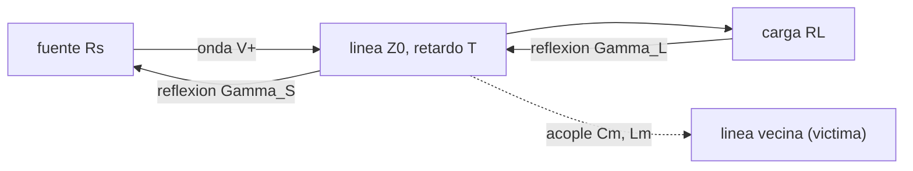

# B93-C03 — Integridad de señal en electrónica embarcada

<!-- nav:top -->
[🏠 Programa](../../../../README.md) · [📚 Bloque B93](../../../tronco-comun/B93-electronica-embarcada-y-compatibilidad-electromagnetica.md) · [← Anterior: B93-C02 — Selección de componentes y derating](../B93-C02-seleccion-de-componentes-y-derating/CLASE.md) · [Siguiente: B93-C04 — Análisis de confiabilidad de electrónica (MTBF y derating) →](../B93-C04-analisis-de-confiabilidad-de-electronica-mtbf-y-derating/CLASE.md)
<!-- /nav -->

## 1. Ubicación, nivel y alcance

Clase 3 del bloque B93. Nivel N3. Cuando el flanco de una señal es corto frente al tiempo que tarda en recorrer la pista, la pista deja de ser un cable y se comporta como una línea de transmisión: refleja la señal en los extremos mal adaptados y acopla parte de ella a la vecina. Aquí calculas reflexiones, la respuesta escalonada, la diafonía cercana y el margen de temporización de un enlace **sintético**. Usas [C01](../B93-C01-diseno-de-pcb-espacial-conceptual/CLASE.md) para la línea de 50 Ω (`ε_eff = 3,587`). Es el único punto del bloque que toca la compatibilidad electromagnética, y solo en el acoplamiento entre pistas: los ensayos de EMC de equipo y de sistema no se tratan.

## 2. Por qué esta clase existe

El tronco no incluía reflexiones, diafonía ni temporización de señales. La decisión central: **¿cuánto se deforma una señal por una terminación mal adaptada, cuánto se acopla a la pista vecina y cuánto margen de reloj queda?**

## 3. Lo que podrás hacer al terminar

1. Calcular el coeficiente de reflexión en la fuente y en la carga.
2. Construir el diagrama de rebotes y leer sobreimpulso y tiempo de establecimiento.
3. Contrastar el diagrama con una simulación temporal independiente.
4. Estimar la diafonía cercana y la longitud de saturación.
5. Calcular el margen de preparación (*setup*) de un enlace síncrono.
6. Separar lo consultado, lo ilustrativo y lo no consultado.

La evidencia es la **ficha de integridad de señal de un enlace sintético** del ejercicio 12 (sección 20).

## 4. Con qué llegas y cómo comprobarlo

1. ¿Qué es la impedancia característica de una línea?
2. ¿Qué es un divisor de tensión?
3. ¿Qué es el tiempo de subida de un flanco?
4. ¿Qué es el retardo de una línea y de qué depende?
5. ¿Qué es una verificación por segunda vía?

<details>
<summary>Ver respuestas</summary>

1. `Z0 = √(L/C)`, lo que ve una onda que avanza. 2. `Vout = Vin R2/(R1+R2)`. 3. El tiempo que tarda la señal en pasar del 10 % al 90 % de su excursión. 4. El tiempo de tránsito `l/v`; depende de la longitud y de `ε_eff`. 5. Calcular lo mismo con otro método.
</details>

Con cuatro o cinco aciertos, sigue; si no, repasa los prerrequisitos.

## 5. Un caso de contexto y casos de referencia

Una línea de `150 mm` y `50 Ω` (retardo `0,948 ns`) lleva un escalón de `3,3 V` a una carga casi abierta. Con una fuente de `20 Ω` el primer pico en la carga es `4,714 V` (`+42,9 %`) y la señal tarda `4,74 ns` en quedar dentro de ±10 %; con una fuente de `50 Ω` (terminación serie) llega limpia en `0,95 ns`. En un reloj de 100 MHz, el margen de preparación pasa de `4,05 ns` a `0,26 ns`. Es el **ejemplo conductor**. Todo es **ilustrativo**: ningún enlace es real.

## 6. Vocabulario

El **coeficiente de reflexión** `Γ = (R − Z0)/(R + Z0)` mide la fracción de onda que vuelve. El **diagrama de rebotes** suma en el tiempo las ondas que van y vienen. La **diafonía cercana** (*near-end crosstalk*) es la señal acoplada que aparece en el extremo de la línea víctima más próximo a la fuente. La **longitud de saturación** es `t_r v/2`. El **margen de preparación** es lo que sobra del período tras sumar `t_co`, el establecimiento y `t_su`.

## 7. Modelo mental: eco en un pasillo



*Descripción textual:* la onda sale de la fuente, llega a la carga y rebota; cada extremo refleja una fracción; mientras viaja acopla una parte a la línea vecina.

Analogía: un grito en un pasillo vuelve como eco si el extremo no absorbe el sonido; cada rebote es menor si cada extremo absorbe algo. Límite: línea sin pérdidas, resistiva y sin discontinuidades intermedias (vías, conectores).

## 8. La explicación, paso a paso

### 8.1 Reflexiones

Con `Z0 = 50 Ω`: `Γ_carga = (10⁶ − 50)/(10⁶ + 50) = +0,9999` (casi abierta) y `Γ_fuente = (20 − 50)/(20 + 50) = −0,4286`. La onda inicial es `V+ = Vs Z0/(Rs + Z0) = 3,3 × 50/70 = 2,357 V`. En la carga llega `V+(1 + Γ_L) = 4,714 V`.

### 8.2 Diagrama de rebotes

La tensión en la carga tras la llegada `k` (en `t = (2k+1)T`) es `V_L = V+(1+Γ_L) Σ (Γ_S Γ_L)^j`. Con `Rs = 20 Ω`: `4,714 → 2,694 → 3,560 → 3,189 …` y el valor final `3,2999 V = Vs RL/(Rs+RL)`, que el laboratorio comprueba con 1e-6. El pico es `+42,9 %`. Con `Rs = Z0`, `Γ_S = 0`: la carga recibe `3,300 V` de golpe y no hay rebotes.

### 8.3 Dos vías: simulación temporal

El laboratorio simula la línea con diferencias finitas (200 celdas, paso `dt = dx/v`). Las mesetas coinciden con el diagrama dentro de `0,0013 V`: `4,714/4,714`, `2,694/2,693`, `3,560/3,561`, `3,189/3,187 V`. La simulación es independiente del algoritmo de rebotes, pero comparte el modelo de línea ideal: valida el cálculo, no que la placa real se comporte así.

### 8.4 Diafonía cercana

En el modelo de acoplamiento de dos líneas, el coeficiente cercano es `K_b ≈ (C_m/C + L_m/L)/4`, referido a la onda incidente en la línea agresora; la forma exacta con impedancias de modo par e impar es `K_b = (Z_oe − Z_oo)/(2(Z_oe + Z_oo))`. Con `C_m/C = 0,08` y `L_m/L = 0,15` (ilustrativos): `0,0575` aproximado y `0,0576` exacto (diferencia `0,12 %`). Con la onda incidente de `1,65 V` (fuente de 50 Ω), la diafonía saturada es `95 mV`. Se satura cuando la longitud acoplada supera `t_r v/2 = 39,6 mm` (con `t_r = 0,5 ns`); con 20 mm vale `48,0 mV`. Alejar las pistas reduce `C_m` y `L_m`, y por tanto `K_b`; la forma de la relación con la separación no se consultó.

### 8.5 Margen de temporización

Con período `10 ns` (100 MHz), `t_co = 3 ns` y `t_su = 2 ns`: margen `= 10 − 3 − t_est − 2`. Con `Rs = 20 Ω`: `10 − 3 − 4,74 − 2 = 0,26 ns`. Con `Rs = 50 Ω`: `10 − 3 − 0,95 − 2 = 4,05 ns`. El tiempo de vuelo `0,948 ns` ya está incluido en el establecimiento. Una terminación bien elegida devuelve 3,8 ns al presupuesto.

## 9. Magnitudes, símbolos y unidades

| Símbolo | Qué es | Unidad | Valor / nota |
|---|---|---|---|
| `Z0` | impedancia característica | Ω | 50 |
| `T` | retardo de la línea | ns | 0,948 |
| `Γ` | coeficiente de reflexión | — | −0,4286 (fuente); +0,9999 (carga) |
| `V+` | onda incidente | V | 2,357 |
| `K_b` | coeficiente de diafonía cercana | — | 0,0576 |
| `t_r` | tiempo de subida | ns | 0,5 |
| `t_est` | establecimiento (±10 %) | ns | 4,74; 0,95 |

## 10. Convenciones y referencias

SI. Línea sin pérdidas de 150 mm con `ε_eff = 3,587` (de C01), fuente de 3,3 V, carga de 1 MΩ, banda de ±10 % de `Vs`. Tiempos medidos desde el inicio del escalón. Todo es sintético.

## 11. De dónde sale lo que afirmamos

| ID | Fuente | Localizador | Respalda | Estado |
|---|---|---|---|---|
| S1 | Long, notas de curso ECE 145A/218A «Transmission Lines — a review and explanation», UCSB, 2007 — https://web.ece.ucsb.edu/~long/ece145a/tlines1.pdf (consultada 2026-11-10) | definición de `Γ`, `Z0 = √(L/C)`, `v = 1/√(LC)`, retardo; tabla de microtira | secciones 8.1 y 8.2; `ε_eff = 3,4` de la microtira de referencia | Consultada |
| S2 | ECSS-E-ST-20-07C Rev.1 «Electromagnetic compatibility» (7 de febrero de 2012; superada por la Rev.2 de enero de 2022) — https://ecss.nl/standard/ecss-e-st-20-07c-rev-1-electromagnetic-compatibility/ (consultada 2026-11-10) | página de resumen | existencia y alcance a nivel de sistema y equipo; no se desarrolla | Parcial: solo el resumen |
| — | Modelo de acoplamiento `K_b` y longitud de saturación | — | sección 8.4 | No consultada en una fuente concreta |

Límites: no se leyó ningún documento de diafonía ni de EMC; las cifras de acoplamiento son inventadas.

## 12. Cómo ver una reflexión

| Magnitud | Valor |
|---|---|
| primera llegada (Rs = 20 Ω) | 4,714 V |
| pico | +42,9 % |
| establecimiento | 4,74 ns (20 Ω); 0,95 ns (50 Ω) |
| diferencia rebotes–FDTD | 0,0013 V |
| diafonía saturada | 95 mV |
| margen de preparación | 0,26 ns; 4,05 ns |

Descripción larga: la fuente débil provoca un sobreimpulso del 43 % y un establecimiento cinco veces más lento que la terminación serie.

## 13. Ejemplo trabajado: la terminación serie

**Paso 1 · Reflexión en la fuente.** `Γ_S = (50 − 50)/(50 + 50) = 0`.

**Paso 2 · Onda inicial.** `V+ = 3,3 × 50/100 = 1,65 V`.

**Paso 3 · Llegada.** `V_L = 1,65 × (1 + 0,9999) = 3,300 V`.

**Paso 4 · Sin rebotes.** La onda que vuelve se absorbe en la fuente; no hay más llegadas.

## 14. Distintas formas de describir un enlace

**Por reflexión:** `Γ_S`, `Γ_L`. **Por tiempo:** `T`, `t_est`. **Por amplitud:** pico, final. **Por acoplamiento:** `K_b`. **Por margen:** período menos presupuesto.

## 15. Práctica guiada

**Ejercicio 1 · con los pasos indicados.** `Γ_S` para `Rs = 20 Ω` y `Z0 = 50 Ω`. *Pasos:* resta y suma.

<details><summary>Solución comentada</summary>

`(20 − 50)/70 = −0,4286`.
</details>

**Ejercicio 2 · con una pista.** Primera llegada en la carga abierta con `Rs = 20 Ω`. *Pista:* `V+ (1 + Γ_L)`.

<details><summary>Solución comentada</summary>

`2,357 × 1,9999 = 4,714 V`.
</details>

**Ejercicio 3 · casi autónomo.** Segunda llegada (`t = 3T`).

<details><summary>Solución comentada</summary>

`4,714 × (1 + Γ_S Γ_L ...)`: `V_L = 4,714 + 2,357 × Γ_S × Γ_L × (1 + Γ_L) = 4,714 − 2,020 = 2,694 V`.
</details>

## 16. Práctica autónoma, transferencia e integrador

**Ejercicio 4 · autónomo.** Valor final con `Rs = 20 Ω` y `RL = 1 MΩ`.

<details><summary>Solución comentada</summary>

`3,3 × 10⁶/(10⁶ + 20) = 3,2999 V`.
</details>

**Ejercicio 5 · autónomo.** Retardo de 250 mm con `ε_eff = 3,587`.

<details><summary>Solución comentada</summary>

`0,250 × √3,587/c = 1,58 ns`.
</details>

**Ejercicio 6 · autónomo.** Longitud de saturación si `t_r = 1 ns`.

<details><summary>Solución comentada</summary>

`t_r v/2 = 1 ns × 158 mm/ns/2 = 79 mm`.
</details>

**Ejercicio 7 · autónomo.** Diafonía saturada si `K_b` se duplica a 0,115.

<details><summary>Solución comentada</summary>

`2 × 95 = 190 mV`: crece en proporción.
</details>

**Ejercicio 8 · autónomo.** Margen de preparación si el reloj sube a 200 MHz (período 5 ns) con `t_est = 0,95 ns`.

<details><summary>Solución comentada</summary>

`5 − 3 − 0,95 − 2 = −0,95 ns`: no cumple; hay que reducir `t_co` o `t_su`, o bajar la frecuencia.
</details>

**Ejercicio 9 · transferencia.** **Transferencia.** Una pista de 20 mm con flancos de 0,5 ns, ¿necesita tratarse como línea?

<details><summary>Solución comentada</summary>

Su retardo es 0,13 ns, un cuarto del flanco: ya es relevante; la regla práctica de cuándo hacerlo no se consultó.
</details>

**Ejercicio 10 · transferencia.** **Transferencia.** ¿Qué no captura el laboratorio?

<details><summary>Solución comentada</summary>

Pérdidas, vías, conectores, capacidad de entrada de la carga, diafonía lejana y radiación (EMC de equipo).
</details>

**Ejercicio 11 · transferencia.** **Transferencia.** ¿Por qué la coincidencia entre rebotes y FDTD no prueba que la placa real se comporte así?

<details><summary>Solución comentada</summary>

Ambos usan la misma línea ideal; solo prueba que el cálculo está bien implementado.
</details>

**Ejercicio 12 · integrador.** **Integrador.** Elabora tu *ficha de integridad de señal de un enlace sintético*: `Γ`, rebotes, establecimiento, diafonía saturada, margen de temporización con dos terminaciones, contraste rebotes–FDTD y lista de qué es consultado, ilustrativo y no consultado.

<details><summary>Solución comentada</summary>

Secciones 8.1–8.5 y la salida del laboratorio.
</details>

## 17. Laboratorio: reflexiones, acoplamiento y temporización

El script [senal.py](senal.py) calcula el diagrama de rebotes, lo contrasta con una simulación FDTD, estima la diafonía y el margen de reloj (**comprueba** el valor final con 1e-6, FDTD frente a rebotes dentro de 0,04 V y `K_b` aproximado frente al exacto dentro de 3 %).

**Datos:** `Γ`, `Z0`, `v` y retardo (UCSB, consultados); línea, fuente, acoplamientos y reloj **sintéticos**; modelo de acoplamiento **no consultado**. **Predice antes de ejecutar:** ¿qué sobreimpulso habrá con `Rs = 20 Ω`? (cerca del 43 %.) **Ejecución del 2026-11-10 (Python 3.12.9):**

```text
Python 3.12.9 (biblioteca estandar)
Linea SINTETICA: Z0 = 50 ohm, 150 mm, er_eff = 3.587; v = 0.528 c; retardo T = 0.948 ns; Vs = 3.3 V
Rs = 20 ohm (sin adaptar): Gamma_fuente = -0.4286, Gamma_carga = +0.99990; 1a llegada = 4.714 V; pico = 4.714 V (+42.9 %); final = 3.2999 V; establecimiento (+-10 %) = 4.74 ns
Rs = 50 ohm (terminacion serie): Gamma_fuente = +0.0000, Gamma_carga = +0.99990; 1a llegada = 3.300 V; pico = 3.300 V (-0.0 %); final = 3.2998 V; establecimiento (+-10 %) = 0.95 ns
Meseta de la carga, Rs = 20 ohm: diagrama de rebotes frente a FDTD
  t =  1.90 ns   rebotes  4.714 V   FDTD  4.714 V
  t =  3.79 ns   rebotes  2.694 V   FDTD  2.693 V
  t =  5.69 ns   rebotes  3.560 V   FDTD  3.561 V
  t =  7.58 ns   rebotes  3.189 V   FDTD  3.187 V
Diferencia maxima en las mesetas = 0.0013 V
Acoplamiento ILUSTRATIVO Cm/C = 0.08, Lm/L = 0.15: Kb aproximado = 0.0575, exacto = 0.0576 (dif. 0.12 %)
Longitud de saturacion = tr v / 2 = 39.6 mm; onda incidente = 1.65 V; diafonia cercana saturada = 95 mV
  longitud acoplada    20 mm -> NE =   48.0 mV
  longitud acoplada    40 mm -> NE =   95.0 mV
  longitud acoplada   150 mm -> NE =   95.0 mV
Margen de preparacion (reloj 100 MHz, tco 3 ns, tsu 2 ns) con Rs = 20 ohm: 0.26 ns
Margen de preparacion (reloj 100 MHz, tco 3 ns, tsu 2 ns) con Rs = 50 ohm: 4.05 ns
Pruebas superadas.
```

```bash
python programa/clases/B93/B93-C03-integridad-de-senal-en-electronica-embarcada/senal.py
```

**Límites:** línea ideal sin pérdidas ni vías; las razones de acoplamiento son inventadas y la exactitud de `K_b` frente a una placa real no se evaluó; el FDTD usa condiciones de contorno de primer orden; el establecimiento es conservador (llegadas discretas).

## 18. Errores frecuentes y cómo corregirlos

**Tratar una pista rápida como un cable.** Se corrige con 8.1.

**Olvidar que el retardo ya está en el establecimiento.** Se corrige con 8.5.

**Tomar el acuerdo entre dos cálculos del mismo modelo como prueba del hardware.** Se corrige con 8.3.

**Presentar el enlace sintético como una medición.** Se corrige con la sección 10.

## 19. Cómo sabrás que vas bien

Tras la sección 8: ¿qué pico esperabas y cuál obtuviste? Si dudas, repasa el ejemplo 13. Tras el laboratorio: ¿qué comprueba? (ver la sección 17).

## 20. Qué entregas y cómo se evalúa

El producto es tu **ficha de integridad de señal de un enlace sintético** (ejercicio 12).

| Criterio | Inicial | En desarrollo | Logrado | Destacado |
|---|---|---|---|---|
| Conceptos | Los confunde | Parciales | Calcula `Γ`, rebotes y margen | Explica los límites de la línea ideal |
| Cálculo | Sin unidades | Con errores | Tablas completas con unidades | Calcula terminaciones nuevas |
| Numérico | Sin comprobar | Un caso | Contraste con la simulación temporal | Interpreta la diferencia |
| Fuentes | Sin fuente | Sin fecha | Fuentes con fecha y estado | Declara lo ilustrativo y lo no consultado |
| Límites | No los nombra | Uno | Tres | Discute pérdidas, vías, EMC de equipo |

**Condiciones críticas (no se compensan con promedio):** rotular el enlace y el acoplamiento como sintéticos; no presentar una simulación como medición; citar solo lo consultado.

## 21. Ética, seguridad y límites

Clase educativa: los modelos son simplificados y sus datos son sintéticos o ilustrativos; ningún resultado sustituye la verificación de integridad de señal ni los ensayos de EMC de un equipo de vuelo. Accesibilidad: tablas equivalentes a las gráficas, fórmulas en texto, ejercicios sin conexión.

## 22. Para cerrar y seguir

Una fuente de 20 Ω sobre una línea de 50 Ω hace sobreimpulso del 43 % y deja 0,26 ns de margen; con terminación serie quedan 4,05 ns. Queda una pregunta: ¿cuántas fallas por unidad de tiempo cabe esperar de todas las piezas juntas?

**Glosario español–inglés.** coeficiente de reflexión · *reflection coefficient*; diafonía · *crosstalk*; terminación serie · *series termination*; tiempo de subida · *rise time*; margen de preparación · *setup margin*.

**Continuidad.** [B93-C04](../B93-C04-analisis-de-confiabilidad-de-electronica-mtbf-y-derating/CLASE.md) calcula la confiabilidad de la electrónica.

**Referencias:** ver sección 11.

<!-- nav:bottom -->
---

[← Anterior: B93-C02 — Selección de componentes y derating](../B93-C02-seleccion-de-componentes-y-derating/CLASE.md) · [📚 Bloque B93](../../../tronco-comun/B93-electronica-embarcada-y-compatibilidad-electromagnetica.md) · [Siguiente: B93-C04 — Análisis de confiabilidad de electrónica (MTBF y derating) →](../B93-C04-analisis-de-confiabilidad-de-electronica-mtbf-y-derating/CLASE.md)
<!-- /nav -->
