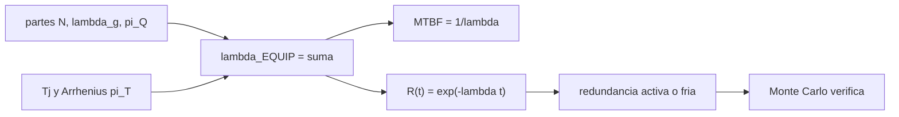

# B93-C04 — Análisis de confiabilidad de electrónica (MTBF y derating)

<!-- nav:top -->
[🏠 Programa](../../../../README.md) · [📚 Bloque B93](../../../tronco-comun/B93-electronica-embarcada-y-compatibilidad-electromagnetica.md) · [← Anterior: B93-C03 — Integridad de señal en electrónica embarcada](../B93-C03-integridad-de-senal-en-electronica-embarcada/CLASE.md) · [Siguiente: B94-C01 — Códigos Reed-Solomon y LDPC →](../../../tronco-comun/B94-modulacion-codificacion-y-protocolos-de-enlace.md#b94-c01)
<!-- /nav -->

## 1. Ubicación, nivel y alcance

Clase 4 del bloque B93. Nivel N3. La confiabilidad de una unidad electrónica se estima sumando las tasas de falla de sus piezas y corrigiéndolas por temperatura, calidad y entorno. Aquí aplicas el método de conteo de partes del manual MIL-HDBK-217F a una **unidad sintética**, conviertes la tasa en MTBF y en probabilidad de sobrevivir a una misión, y mides lo que ganan una temperatura de unión menor (el derating de [C02](../B93-C02-seleccion-de-componentes-y-derating/CLASE.md)) y la redundancia. Los tratamientos de confiabilidad de sistemas de otros bloques (B83-C16, B86-C11) no calculaban MTBF; aquí se calcula. La unidad y casi todas las tasas son inventadas.

## 2. Por qué esta clase existe

Cuantificar la confiabilidad de la electrónica no estaba en el tronco. La decisión central: **¿qué tasa de fallas y qué MTBF tiene la suma de las piezas, qué probabilidad de supervivencia da para una misión, y cuánto la mejoran el derating y la redundancia?**

## 3. Lo que podrás hacer al terminar

1. Sumar tasas de falla con el método de conteo de partes.
2. Calcular el factor de temperatura de Arrhenius y contrastarlo con la tabla publicada.
3. Convertir una tasa en MTBF y en confiabilidad de misión.
4. Cuantificar cuánto baja la tasa al bajar la temperatura de unión.
5. Calcular la confiabilidad con redundancia activa y fría, y verificarla con Monte Carlo.
6. Separar lo consultado, lo ilustrativo y lo no consultado, y reconocer los límites de un modelo de tasa constante.

La evidencia es el **informe de confiabilidad de una unidad sintética** del ejercicio 12 (sección 20).

## 4. Con qué llegas y cómo comprobarlo

1. ¿Qué es una tasa de falla y en qué unidades se expresa?
2. ¿Qué es la distribución exponencial?
3. ¿Qué es una unidad de "fallas por 10⁶ horas"?
4. ¿Qué es un intervalo de confianza o una incertidumbre?
5. ¿Qué es una simulación de Monte Carlo?

<details>
<summary>Ver respuestas</summary>

1. El número esperado de fallas por unidad de tiempo, aquí en 1/h. 2. La distribución del tiempo hasta el fallo cuando la tasa es constante: `R(t) = e^(−λt)`. 3. Un `λ` de 1 equivale a `10⁻⁶ h⁻¹`. 4. Un rango dentro del cual cae el valor con una probabilidad dada. 5. Un cálculo basado en muestras aleatorias con semilla fija, que estima una probabilidad.
</details>

Con cuatro o cinco aciertos, sigue; si no, repasa los prerrequisitos.

## 5. Un caso de contexto y casos de referencia

Una unidad sintética de 219 partes suma `λ = 1,3586` fallas por 10⁶ h: `MTBF = 736 044 h` (84 años). Para una misión de 5 años (`43 830 h`) la probabilidad de supervivencia es `0,94219`; con dos unidades en paralelo activas sube a `0,996658` y con una unidad en reserva fría y conmutador perfecto a `0,998296`. Es el **ejemplo conductor**. Todo es **ilustrativo** salvo los datos del LED: ninguna cifra describe una unidad real.

## 6. Vocabulario

La **tasa de falla** `λ` es la probabilidad de fallar por unidad de tiempo; el **MTBF** es `1/λ` con tasa constante. El **método de conteo de partes** suma `N_i λ_g,i π_Q,i`. El **factor de temperatura** `π_T` sigue la ley de Arrhenius. La **redundancia activa** mantiene dos unidades en marcha; la **fría** enciende la reserva al fallar la primera.

## 7. Modelo mental: una cadena de eslabones



*Descripción textual:* las partes y la temperatura dan la tasa total; la tasa da el MTBF y la confiabilidad de misión; la redundancia la mejora y Monte Carlo la verifica.

Analogía: una cadena es tan fuerte como la suma de las probabilidades de que cada eslabón falle. Límite: tasa constante, fallas independientes, sin mortalidad infantil ni desgaste.

## 8. La explicación, paso a paso

### 8.1 Conteo de partes

El Apéndice A del manual da `λ_EQUIP = Σ N_i (λ_g π_Q)_i` en fallas por 10⁶ h, con las tasas genéricas tomadas de tablas por tipo de parte y entorno. Las del laboratorio son ilustrativas salvo la del LED. Suma de la lista sintética: `0,560 + 0,180 + 0,090 + 0,144 + 0,084 + 0,200 + 0,100 + 0,0006 = 1,3586`.

### 8.2 El factor de Arrhenius

El manual da para un LED `π_T = exp(−2790 (1/(Tj + 273) − 1/298))`. El laboratorio lo calcula y lo compara con la tabla del manual de 25 a 115 °C: diferencia máxima `0,047` (la tabla está redondeada a un decimal; por eso `π_T(110) = 7,99` frente a `8,0`). `2790 K` equivale a `0,240 eV`.

### 8.3 Efecto del derating

Para el LED con `λ_b = 0,00023`, calidad JANTX y entorno de vuelo (`π_E = 0,50`): `λ = 0,000308` a 60 °C, `0,000552` a 85 °C y `0,000919` a 110 °C. Bajar `Tj` de 110 a 85 °C divide la tasa por `1,66` (−40 %). Usar un LED plástico en vez de JANTX la multiplica por `8,0`. El derating térmico de C02 no es solo un margen de seguridad: baja directamente `λ`.

### 8.4 MTBF y confiabilidad de misión

`MTBF = 1/λ = 736 044 h`. Con `t = 43 830 h`: `R = e^(−1,3586×10⁻⁶ × 43 830) = 0,94219`. Un MTBF de 84 años **no** significa que la unidad dure 84 años: significa que, con tasa constante, el 5,8 % falla en los primeros 5.

### 8.5 Redundancia

Activa 1 de 2: `R = 2e^(−λt) − e^(−2λt) = 0,996658`, `MTTF = 1,5/λ`. Fría con conmutador perfecto: `R = e^(−λt)(1 + λt) = 0,998296`, `MTTF = 2/λ`. El conmutador perfecto es una hipótesis optimista; uno real tiene su propia tasa.

### 8.6 Segunda vía: Monte Carlo

Como `1 − R` es pequeño, se acelera la tasa 20 veces (27,172 fallas por 10⁶ h) y se simulan 400 000 muestras con semilla 20261110. Fórmula frente a simulación: una unidad `0,30393/0,30352` (`z = −0,56`), activa `0,51548/0,51490` (`z = −0,73`) y fría `0,66590/0,66565` (`z = −0,32`). Todas dentro de 1 σ binomial.

## 9. Magnitudes, símbolos y unidades

| Símbolo | Qué es | Unidad | Valor / nota |
|---|---|---|---|
| `λ` | tasa de falla | fallas/10⁶ h | 1,3586 |
| `MTBF` | tiempo medio entre fallas | h | 736 044 |
| `π_T`, `π_Q`, `π_E` | factores de temperatura, calidad y entorno | — | 2,68; 1,0; 0,50 |
| `Tj` | temperatura de unión | °C | 60 a 110 |
| `t` | duración de la misión | h | 43 830 |
| `R(t)` | confiabilidad | — | 0,94219 |

## 10. Convenciones y referencias

Horas con 8766 h por año. Tasa constante, fallas independientes, partes en su entorno de vuelo (se usan tasas ya referidas a él), conmutador perfecto. La lista, las cantidades y las tasas genéricas son sintéticas, salvo `λ_b`, `π_T`, `π_Q` y `π_E` del LED, leídos de un escaneo con OCR ruidoso (el entorno de vuelo espacial se identifica por su posición en la fila).

## 11. De dónde sale lo que afirmamos

| ID | Fuente | Localizador | Respalda | Estado |
|---|---|---|---|---|
| S1 | MIL-HDBK-217F «Reliability Prediction of Electronic Equipment» (2 de diciembre de 1991) — copia universitaria https://www.dinfo.unifi.it/upload/sub/laboratori/labmaq/labme_1/mil_hdbk_217f.pdf (consultada 2026-11-10; 205 páginas leídas con PyMuPDF) | Apéndice A (ecuación 1); §6.11 (LED: `λ_b`, `π_T`, `π_Q`, `π_E`) | secciones 8.1–8.3 | Consultada (copia de terceros; texto con OCR ruidoso; no se contrastó con una edición oficial ni con las Notificaciones 1 y 2) |
| S2 | Página de EverySpec sobre MIL-HDBK-217F (consultada 2026-11-10) | fecha, avisos 1 (1992) y 2 (1995) | existencia de las notificaciones | Parcial: solo la ficha |
| — | `R = e^(−λt)`, redundancia activa y fría, constante de Boltzmann | — | secciones 8.4–8.6 | No consultada en una fuente concreta; verificada con Monte Carlo (salvo la constante) |

Límites: el método de conteo de partes es de 1991; resultados de búsqueda indican que fue sustituido en la práctica por otros modelos, pero no se consultó ninguno. No se leyó ninguna norma ECSS de confiabilidad.

## 12. Cómo ver una tasa

| Magnitud | Valor |
|---|---|
| `λ_EQUIP` | 1,3586 fallas/10⁶ h |
| MTBF | 736 044 h |
| `R` de misión | 0,94219 |
| `R` activa / fría | 0,996658 / 0,998296 |
| efecto de `Tj` 110→85 °C | −40 % en `λ` |

Descripción larga: las piezas más débiles (circuitos digitales y conectores) dominan la suma; la redundancia convierte 5,8 % de riesgo en 0,3 % (activa) o 0,17 % (fría).

## 13. Ejemplo trabajado: el LED a 85 °C

**Paso 1 · Base.** `λ_b = 0,00023`.

**Paso 2 · Temperatura.** `π_T(85) = exp(−2790 (1/358 − 1/298)) = 4,80`.

**Paso 3 · Calidad y entorno.** `π_Q = 1,0` (JANTX), `π_E = 0,50`.

**Paso 4 · Tasa.** `λ = 0,00023 × 4,80 × 1,0 × 0,50 = 0,000552` fallas/10⁶ h.

## 14. Distintas formas de describir la confiabilidad

**Por tasa:** `λ`. **Por tiempo:** MTBF. **Por probabilidad:** `R(t)`. **Por arquitectura:** serie, activa, fría. **Por causa:** contribución de cada parte.

## 15. Práctica guiada

**Ejercicio 1 · con los pasos indicados.** MTBF de una unidad con `λ = 2 fallas/10⁶ h`. *Pasos:* convierte y divide.

<details><summary>Solución comentada</summary>

`1/(2×10⁻⁶) = 500 000 h`.
</details>

**Ejercicio 2 · con una pista.** `R` para 10 000 h con esa tasa. *Pista:* `e^(−λt)`.

<details><summary>Solución comentada</summary>

`e^(−0,02) = 0,9802`.
</details>

**Ejercicio 3 · casi autónomo.** Contribución porcentual de los circuitos digitales a `λ`.

<details><summary>Solución comentada</summary>

`0,560/1,3586 = 41,2 %`.
</details>

## 16. Práctica autónoma, transferencia e integrador

**Ejercicio 4 · autónomo.** `π_T` a 100 °C con la fórmula.

<details><summary>Solución comentada</summary>

`exp(−2790 (1/373 − 1/298)) = 6,6` (tabla: 6,6).
</details>

**Ejercicio 5 · autónomo.** Reduce un 10 % la tasa de los conectores; ¿cuánto baja `λ_EQUIP`?

<details><summary>Solución comentada</summary>

`0,020/1,3586 = 1,5 %`.
</details>

**Ejercicio 6 · autónomo.** Número de unidades de 1,3586 fallas/10⁶ h en serie necesarias para que el MTBF baje a 100 000 h.

<details><summary>Solución comentada</summary>

`λ_total = 10 fallas/10⁶ h`; `10/1,3586 = 7,4`, es decir 8 unidades.
</details>

**Ejercicio 7 · autónomo.** MTTF de una unidad en redundancia activa 1 de 2.

<details><summary>Solución comentada</summary>

`1,5 × 736 044 = 1 104 066 h` (laboratorio: 1 104 065 h por redondeo).
</details>

**Ejercicio 8 · autónomo.** Confiabilidad de misión a 10 años (87 660 h) de una unidad.

<details><summary>Solución comentada</summary>

`e^(−1,3586×10⁻⁶ × 87 660) = 0,8877`.
</details>

**Ejercicio 9 · transferencia.** **Transferencia.** ¿Por qué un MTBF de 84 años no garantiza 84 años de vida?

<details><summary>Solución comentada</summary>

Con tasa constante la probabilidad de sobrevivir hasta el MTBF es `e⁻¹ = 37 %`; además el modelo ignora el desgaste.
</details>

**Ejercicio 10 · transferencia.** **Transferencia.** El conmutador de la reserva fría tiene su propia tasa. ¿Qué pasa con la ganancia?

<details><summary>Solución comentada</summary>

Baja: el conmutador se suma en serie y puede dominar; la ganancia del 0,998296 es un techo.
</details>

**Ejercicio 11 · transferencia.** **Transferencia.** ¿Qué limita usar un manual de 1991 para una unidad de hoy?

<details><summary>Solución comentada</summary>

Las tasas genéricas reflejan tecnologías de entonces; no cubre bien dispositivos modernos. No se consultó un modelo más reciente.
</details>

**Ejercicio 12 · integrador.** **Integrador.** Elabora tu *informe de confiabilidad de una unidad sintética*: tabla de partes, `λ`, MTBF, `R` de misión, efecto de `Tj`, redundancia con contraste Monte Carlo y lista de qué es consultado, ilustrativo y no consultado.

<details><summary>Solución comentada</summary>

Secciones 8.1–8.6 y la salida del laboratorio.
</details>

## 17. Laboratorio: conteo de partes, MTBF y redundancia

El script [mtbf.py](mtbf.py) calcula `π_T`, la tasa del LED a tres temperaturas, la suma de una lista de partes, el MTBF, la confiabilidad de misión y la de dos redundancias, y las verifica con Monte Carlo (**comprueba** `π_T` frente a la tabla dentro de 0,06 y cada fórmula frente a la simulación dentro de 4 σ).

**Datos:** `λ_b`, `π_T`, `π_Q` y `π_E` del LED del manual (consultados); lista, cantidades, tasas y misión **sintéticas**; fórmulas de confiabilidad **no consultadas**. **Predice antes de ejecutar:** ¿cuánto baja la tasa del LED de 110 a 85 °C? (cerca del 40 %.) **Ejecución del 2026-11-10 (Python 3.12.9):**

```text
Python 3.12.9 (biblioteca estandar)
pi_T de Arrhenius frente a la tabla del manual (25..115 C): diferencia maxima = 0.047 (redondeada a 1 decimal: 0.0)
Energia equivalente de 2790 K = 0.240 eV
LED, JANTX, entorno SF (pi_E = 0.50): tasa por 1e6 h segun la temperatura de union
  Tj =  60 C: pi_T = 2.68; lambda = 0.000308
  Tj =  85 C: pi_T = 4.80; lambda = 0.000552
  Tj = 110 C: pi_T = 7.99; lambda = 0.000919
Bajar Tj de 110 a 85 C divide la tasa por 1.66 (reduccion del 40 %); plastico en vez de JANTX la multiplica por 8.0
parte                             N  lambda_g  N*lambda*piQ
CI digital                       14   0.04000       0.56000
CI lineal                         6   0.03000       0.18000
capacitor ceramico               60   0.00150       0.09000
capacitor de tantalo             12   0.01200       0.14400
resistor de pelicula            120   0.00070       0.08400
conector (contactos)              4   0.05000       0.20000
juntas soldadas (lote)            1   0.10000       0.10000
LED indicador (Tj 60 C, SF)       2   0.00031       0.00062
lambda_EQUIP = 1.3586 fallas/1e6 h; MTBF = 736,044 h = 84.0 anios
Mision de 43,830 h: R(una unidad) = 0.94219; activa 1 de 2 = 0.996658; fria con conmutador perfecto = 0.998296
MTTF: una = 736,044 h; activa = 1,104,065 h (1.5x); fria = 1,472,087 h (2x)
Monte Carlo (semilla 20261110, n = 400000) con tasa acelerada x20 (lambda = 27.172 fallas/1e6 h):
  uno    : formula = 0.30393  Monte Carlo = 0.30352  z = -0.56
  activa : formula = 0.51548  Monte Carlo = 0.51490  z = -0.73
  fria   : formula = 0.66590  Monte Carlo = 0.66565  z = -0.32
Pruebas superadas.
```

```bash
python programa/clases/B93/B93-C04-analisis-de-confiabilidad-de-electronica-mtbf-y-derating/mtbf.py
```

**Límites:** tasas constantes e independientes; la lista es inventada (el único dato del manual es el LED); `π_E` se leyó de un escaneo ruidoso; el Monte Carlo acelera la tasa para tener señal y valida las fórmulas, no el hardware.

## 18. Errores frecuentes y cómo corregirlos

**Leer el MTBF como una vida útil.** Se corrige con 8.4.

**Usar tasas de otra temperatura o entorno.** Se corrige con 8.2–8.3.

**Sumar redundancia sin contar el conmutador.** Se corrige con 8.5.

**Presentar la lista sintética como una predicción de una unidad real.** Se corrige con la sección 10.

## 19. Cómo sabrás que vas bien

Tras la sección 8: ¿qué `R` de misión esperabas y cuál obtuviste? Si dudas, repasa el ejemplo 13. Tras el laboratorio: ¿qué comprueba? (ver la sección 17).

## 20. Qué entregas y cómo se evalúa

El producto es tu **informe de confiabilidad de una unidad sintética** (ejercicio 12).

| Criterio | Inicial | En desarrollo | Logrado | Destacado |
|---|---|---|---|---|
| Conceptos | Los confunde | Parciales | Calcula `λ`, MTBF y `R` | Explica los límites de la tasa constante |
| Cálculo | Sin unidades | Con errores | Tablas completas con unidades | Calcula casos nuevos |
| Numérico | Sin comprobar | Un caso | Contraste Monte Carlo | Interpreta las diferencias |
| Fuentes | Sin fuente | Sin fecha | Fuentes con fecha y estado | Declara lo ilustrativo y lo no consultado |
| Límites | No los nombra | Uno | Tres | Discute el conmutador, el desgaste y la edad del manual |

**Condiciones críticas (no se compensan con promedio):** rotular la lista y las tasas como sintéticas; no leer el MTBF como vida útil; citar solo lo consultado.

## 21. Ética, seguridad y límites

Clase educativa: los modelos son simplificados y sus datos son sintéticos o ilustrativos; ningún resultado sustituye un análisis de confiabilidad según la norma del proyecto ni un ensayo de vida. Accesibilidad: tablas equivalentes a las gráficas, fórmulas en texto, ejercicios sin conexión.

## 22. Para cerrar y seguir

Una unidad de 219 partes con `λ = 1,36` fallas por 10⁶ h tiene un 94,2 % de probabilidad de sobrevivir 5 años, y 99,7 % con redundancia activa. Con esto el bloque cierra el ciclo de la placa, las piezas, las señales y la confiabilidad; queda abierta la compatibilidad electromagnética de equipo y de sistema.

**Glosario español–inglés.** tasa de falla · *failure rate*; MTBF · *mean time between failures*; conteo de partes · *parts count*; redundancia fría · *cold standby*; confiabilidad · *reliability*.

**Continuidad.** Esta es la última clase del bloque; la guía del bloque la integra con las anteriores.

**Referencias:** ver sección 11.

<!-- nav:bottom -->
---

[← Anterior: B93-C03 — Integridad de señal en electrónica embarcada](../B93-C03-integridad-de-senal-en-electronica-embarcada/CLASE.md) · [📚 Bloque B93](../../../tronco-comun/B93-electronica-embarcada-y-compatibilidad-electromagnetica.md) · [Siguiente: B94-C01 — Códigos Reed-Solomon y LDPC →](../../../tronco-comun/B94-modulacion-codificacion-y-protocolos-de-enlace.md#b94-c01)
<!-- /nav -->
