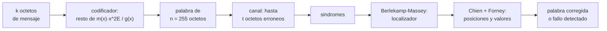

# B94-C01 — Códigos Reed-Solomon y LDPC

<!-- nav:top -->
[🏠 Programa](../../../../README.md) · [📚 Bloque B94](../../../tronco-comun/B94-modulacion-codificacion-y-protocolos-de-enlace.md) · [← Anterior: B93-C04 — Análisis de confiabilidad de electrónica (MTBF y derating)](../../B93/B93-C04-analisis-de-confiabilidad-de-electronica-mtbf-y-derating/CLASE.md) · [Siguiente: B94-C02 — Entrelazado y concatenación de códigos →](../B94-C02-entrelazado-y-concatenacion-de-codigos/CLASE.md)
<!-- /nav -->

## 1. Ubicación, nivel y alcance

Clase 1 del bloque B94. Nivel N3. Un código de bloque añade redundancia para que el receptor corrija errores sin pedir retransmisión, algo imprescindible cuando la ida y vuelta tarda minutos. Aquí implementas un código Reed-Solomon sobre GF(2⁸) con los parámetros del estándar CCSDS, mides hasta dónde corrige y qué pasa al pasarse, y pruebas un código LDPC de juguete con un decodificador por inversión de bits. La corrección de errores en general se estudia en B89-C09 (no se redacta aquí); esta clase se centra en los dos códigos de bloque usados en misiones. El canal y los mensajes son sintéticos.

## 2. Por qué esta clase existe

Un enlace profundo opera con relaciones señal-ruido bajas y no puede reenviar cada trama. La decisión central: **¿cuántos símbolos erróneos tolera una palabra de código, cuánta redundancia cuesta y qué ocurre cuando se supera esa capacidad?**

## 3. Lo que podrás hacer al terminar

1. Calcular la tasa y la capacidad `E` de un código RS(255, 255 − 2E).
2. Construir GF(2⁸) a partir de un polinomio generador de campo y comprobar que `α` es primitivo.
3. Codificar sistemáticamente y verificar la palabra con síndromes nulos.
4. Explicar los pasos de decodificación: síndromes, Berlekamp-Massey, Chien y Forney.
5. Distinguir corrección, fallo detectado y miscorrección cuando hay más de `E` errores.
6. Describir un LDPC por su matriz de paridad y su decodificador iterativo, y separar el código de juguete del del estándar.

La evidencia es la **ficha de capacidad de corrección de un código de bloque** del ejercicio 12 (sección 20).

## 4. Con qué llegas y cómo comprobarlo

1. ¿Qué es un campo finito GF(2⁸)?
2. ¿Qué es la tasa de un código?
3. ¿Qué es un código sistemático?
4. ¿Qué es un síndrome?
5. ¿Qué es un dato sintético?

<details>
<summary>Ver respuestas</summary>

1. Un conjunto de 256 elementos (octetos) con suma (XOR) y producto que cumplen las leyes de un campo. 2. El cociente `k/n` entre símbolos de información y símbolos totales. 3. Uno en que el mensaje aparece sin cambios en la palabra de código y la paridad se añade al final. 4. El resultado de evaluar la palabra recibida en las raíces del generador; es cero si y solo si la palabra es de código. 5. Un dato generado para el ejemplo, no medido.
</details>

Con cuatro o cinco aciertos, sigue; si no, repasa los prerrequisitos.

## 5. Un caso de contexto y casos de referencia

Una trama de 223 octetos se protege con RS(255, 223): se añaden 32 octetos de paridad (tasa 0,8745). El decodificador corrige hasta 16 octetos erróneos por palabra, sin importar cuántos bits de cada octeto estén mal. En el laboratorio, 200 de 200 palabras con 16 errores se recuperan y 0 de 200 con 17. Es el **ejemplo conductor**. Los errores son **sintéticos**: ninguna cifra describe un enlace real.

## 6. Vocabulario

Un **código RS(n, k)** sobre GF(2⁸) tiene `n = 255` símbolos de 8 bits y `k` de información. Su **capacidad** es `E = (n − k)/2` símbolos. El **polinomio generador** es `g(x) = ∏ (x − α^(11 j))` para `j = 128 − E, …, 127 + E`. Un **síndrome** `S_i` es la palabra evaluada en una raíz. El **localizador de errores** `Λ(x)` tiene por raíces los inversos de las posiciones erróneas. Un código **LDPC** (*low-density parity-check*) se define por una matriz de paridad `H` con pocos unos; una palabra es válida si `H·c = 0`.

## 7. Modelo mental: un sudoku con pistas redundantes



*Descripción textual:* el mensaje se codifica; el canal corrompe algunos octetos; los síndromes resumen el error; Berlekamp-Massey halla el localizador; Chien y Forney dan posiciones y valores; si hay más de `E` errores, el decodificador debe declarar fallo.

Analogía: un sudoku con filas y columnas redundantes permite reconstruir casillas borradas, pero solo hasta cierto número; más allá, hay varias soluciones posibles. Límite: el sudoku no dice cuándo se equivoca, y un decodificador real tampoco siempre puede avisar (hay miscorrecciones).

## 8. La explicación, paso a paso

### 8.1 El campo y el generador

El campo se construye con `F(x) = x⁸ + x⁷ + x² + x + 1` (CCSDS 131.0-B-5, 4.3.3). El laboratorio comprueba que `α` y `α¹¹` generan los 255 elementos no nulos, y que `g(x)` tiene grado `2E`: 32 para `E = 16` y 16 para `E = 8`. Aquí se usa la base convencional; el estándar añade una transformación de base dual, así que los octetos no coinciden con los del estándar.

### 8.2 Tasa y capacidad

| Código | `k` | Paridad | Tasa `k/n` | Corrige |
|---|---|---|---|---|
| RS(255, 223), `E = 16` | 223 | 32 | 0,874510 | 16 símbolos |
| RS(255, 239), `E = 8` | 239 | 16 | 0,937255 | 8 símbolos |

La relación es `n − k = 2E`: cada símbolo corregido cuesta dos de paridad (uno para localizarlo y otro para hallar su valor).

### 8.3 Decodificación

Con `r(x)` recibida, `S_i = r(β^(112+i))` para `i = 0…31`, con `β = α¹¹`. Si todos son cero, la palabra es válida. Si no, Berlekamp-Massey construye `Λ(x)` de grado `L`. Si `L > E` o si el número de raíces hallado (búsqueda de Chien) no es `L`, el decodificador declara fallo. Si no, Forney calcula el valor de cada error, se restan, y se comprueba que los síndromes finales sean nulos.

### 8.4 Qué pasa al superar la capacidad

| Errores `t` | Corregidas | Fallo detectado | Miscorrección |
|---|---|---|---|
| 0, 1, 8, 16 | 200 de 200 | 0 | 0 |
| 17, 20, 32 | 0 | 200 | 0 |

Con `t > E` no hay garantía. Caer en otra palabra de código válida es posible aunque poco frecuente (no se calculó su probabilidad aquí), y en 600 pruebas no hubo ninguna miscorrección; pero no es cero, y por eso la trama lleva además un CRC (ver [B94-C03](../B94-C03-tramas-de-transferencia-de-telemetria-y-telecomando/CLASE.md)).

### 8.5 Un LDPC de juguete

La matriz de Gallager (3,6) con `n = 120` tiene 60 ecuaciones y cada bit en 3 de ellas. El decodificador por inversión de bits invierte, en cada iteración, los bits que más ecuaciones incumplen. Con probabilidad de error de canal `p = 0,005`, 394 de 400 tramas quedan sin error; con `p = 0,04`, 252 de 400, y las iteraciones medias suben de 1,27 a 18,89. El código del estándar es el (8160, 7136), de tasa 223/255 y obtenido de un (8176, 7156) por expurgación, acortamiento y extensión; no se implementa aquí.

## 9. Magnitudes, símbolos y unidades

| Símbolo | Qué es | Unidad | Valor / nota |
|---|---|---|---|
| `n`, `k` | longitud y dimensión del código | símbolos de 8 bits | 255; 223 |
| `E` | capacidad de corrección | símbolos | 16 (u 8) |
| `α` | elemento primitivo de GF(2⁸) | — | raíz de `F(x)` |
| `S_i` | síndrome | octeto | 32 valores |
| `Λ(x)` | polinomio localizador | — | grado `L ≤ E` |
| `p` | probabilidad de inversión de bit del canal | adimensional | 0,005–0,04 (sintético) |

## 10. Convenciones y referencias

Palabra de código como lista de 255 octetos, primer elemento = mayor grado. Posición `p` = potencia de `x` (0 a 254). Campo definido por `F(x)` de CCSDS 131.0-B-5 (consultado el 2026-11-10); base convencional, sin la transformación de base dual. Los errores sustituyen un octeto por otro valor distinto de cero (XOR). Datos sintéticos con `random.Random(94001)`, `94002` y `94003`.

## 11. De dónde sale lo que afirmamos

| ID | Fuente | Localizador | Respalda | Estado |
|---|---|---|---|---|
| S1 | CCSDS 131.0-B-5, *TM Synchronization and Channel Coding*, Blue Book, septiembre de 2023 — https://ccsds.org/Pubs/131x0b5.pdf (consultada 2026-11-10; texto completo extraído con PyMuPDF) | secciones 4.1, 4.3.3–4.3.5 y 7.2–7.3 | `E = 16` u `8`; `F(x)`, `g(x)`, (255,223) y (255,239), código sistemático; (8160,7136) obtenido de un (8176,7156) | Consultada |
| — | Berlekamp-Massey, Chien, Forney y decodificación por inversión de bits | — | los verifica el laboratorio (síndromes nulos y cota `t ≤ E`) | No consultada en una fuente concreta |
| — | CCSDS 130.1-G (guía de codificación de canal) | — | — | No consultada |

Límites: base no dual, LDPC de juguete, canal sintético; no se infiere ninguna tasa de error de un enlace real.

## 12. Cómo ver la capacidad de un código

| Magnitud | Valor |
|---|---|
| Paridad de RS(255, 223) | 32 octetos |
| Tasa | 0,874510 |
| Corregidas con `t = 16` | 200 de 200 |
| Corregidas con `t = 17` | 0 de 200 |
| LDPC sin error, `p = 0,005` | 394 de 400 |

Descripción larga: la corrección es todo o nada alrededor de `E`; el LDPC degrada con suavidad al subir el ruido y gasta más iteraciones.

## 13. Ejemplo trabajado: capacidad de RS(255, 239)

**Paso 1 · Paridad.** `n − k = 255 − 239 = 16` octetos.

**Paso 2 · Capacidad.** `E = 16/2 = 8` símbolos.

**Paso 3 · Tasa.** `239/255 = 0,937255`.

**Paso 4 · Grado del generador.** `2E = 16`; el laboratorio lo confirma (`grado g = 16`).

## 14. Distintas formas de describir un código

**Por parámetros:** `(n, k, E)`. **Por álgebra:** `g(x)` y sus raíces. **Por matriz:** `H` con `H·c = 0`. **Por tasa:** `k/n`. **Por comportamiento:** curva de tramas correctas frente al ruido.

## 15. Práctica guiada

**Ejercicio 1 · con los pasos indicados.** Calcula la tasa y `E` de un RS(255, 191). *Pasos:* resta, divide por 2, divide `k` por `n`.

<details><summary>Solución comentada</summary>

`n − k = 64`, `E = 32`, tasa `191/255 = 0,749`.
</details>

**Ejercicio 2 · con una pista.** Una palabra RS(255, 223) llega con 10 octetos erróneos, de los cuales algunos solo tienen un bit mal. ¿Se corrige? *Pista:* la capacidad cuenta símbolos.

<details><summary>Solución comentada</summary>

Sí: `10 ≤ 16`. Da igual cuántos bits de cada octeto estén mal.
</details>

**Ejercicio 3 · casi autónomo.** ¿Por qué cada símbolo corregido cuesta dos de paridad?

<details><summary>Solución comentada</summary>

Hay que hallar la posición y el valor del error: dos incógnitas por error, y `2E` síndromes dan `2E` ecuaciones.
</details>

## 16. Práctica autónoma, transferencia e integrador

**Ejercicio 4 · autónomo.** ¿Cuántos bits de paridad añade RS(255, 223) a una trama de 223 octetos?

<details><summary>Solución comentada</summary>

`32 × 8 = 256` bits.
</details>

**Ejercicio 5 · autónomo.** ¿Cuántos bits erróneos consecutivos (ráfaga alineada a octetos) corrige como mínimo RS(255, 223) en una palabra?

<details><summary>Solución comentada</summary>

16 octetos consecutivos = 128 bits.
</details>

**Ejercicio 6 · autónomo.** Para enviar 10 palabras de información de 223 octetos, ¿cuántos octetos se transmiten con RS(255, 223)?

<details><summary>Solución comentada</summary>

`10 × 255 = 2550` octetos; la sobrecarga es `10 × 32 = 320` octetos (12,5 %).
</details>

**Ejercicio 7 · autónomo.** ¿Cómo cambia la tasa si la paridad se reduce a la mitad (`E = 8`)?

<details><summary>Solución comentada</summary>

Sube de 0,8745 a 0,9373, a costa de corregir la mitad de símbolos.
</details>

**Ejercicio 8 · autónomo.** Con `t = 17`, el laboratorio dio 200 fallos detectados y 0 miscorrecciones. ¿Se puede asegurar que nunca habrá miscorrección?

<details><summary>Solución comentada</summary>

No: es una muestra finita de 200 palabras; solo indica que es poco frecuente.
</details>

**Ejercicio 9 · transferencia.** **Transferencia.** Un colega propone sustituir RS por un código de paridad simple para ahorrar redundancia. ¿Qué pierde?

<details><summary>Solución comentada</summary>

Detecta errores pero no los corrige; en un enlace con retardo de minutos, retransmitir cuesta mucho más que la paridad.
</details>

**Ejercicio 10 · transferencia.** **Transferencia.** El LDPC pasa de 394 a 252 tramas correctas al cuadruplicar `p`. ¿Qué diferencia de comportamiento muestra frente a RS?

<details><summary>Solución comentada</summary>

Degradación gradual frente a la corrección «todo o nada» de RS; depende además del número de iteraciones.
</details>

**Ejercicio 11 · transferencia.** **Transferencia.** ¿Por qué no se puede afirmar que el laboratorio reproduce los octetos de la norma?

<details><summary>Solución comentada</summary>

Usa base convencional y no la transformación de base dual del estándar; reproduce la estructura, no los octetos.
</details>

**Ejercicio 12 · integrador.** **Integrador.** Elabora tu *ficha de capacidad de corrección de un código de bloque*: parámetros `(n, k, E)`, tasa, tabla de corrección/fallo/miscorrección para `t` alrededor de `E`, el contraste con el LDPC y la lista de qué es consultado, sintético y no consultado.

<details><summary>Solución comentada</summary>

Secciones 8.2–8.5 y la salida del laboratorio.
</details>

## 17. Laboratorio: RS(255, 223) y un LDPC de juguete

El script [reed_solomon_ldpc.py](reed_solomon_ldpc.py) construye GF(2⁸), codifica, decodifica y mide corrección; además prueba un LDPC de Gallager (**comprueba** sindromes nulos, `t ≤ 16` siempre corregido y `t > 16` nunca recuperado).

**Datos:** polinomios y parámetros del CCSDS 131.0-B-5 (consultado); mensajes, errores y canal **sintéticos**. **Predice antes de ejecutar:** ¿cuántas palabras con 16 errores se corregirán? (todas.) **Ejecución del 2026-11-10 (Python 3.12.9):**

```text
Python 3.12.9 (biblioteca estandar)
Campo GF(2^8), F(x)=x^8+x^7+x^2+x+1: alfa y alfa^11 son primitivos (orden 255)
RS(255,223) E=16: grado g = 32, simbolos de paridad = 32, tasa = 0.874510, sindromes nulos = True
RS(255,239) E=8: grado g = 16, simbolos de paridad = 16, tasa = 0.937255, sindromes nulos = True
RS(255,223), 200 palabras por fila, errores de simbolo en posiciones aleatorias:
 t errores  corregidas  fallo detectado  miscorreccion
    0         200             0               0
    1         200             0               0
    8         200             0               0
   16         200             0               0
   17           0           200               0
   20           0           200               0
   32           0           200               0
Con t <= E = 16 siempre se corrige; con t > 16 nunca se recupera la palabra (cota teorica).
LDPC de JUGUETE Gallager (3,6): n = 120, 60 ecuaciones, tasa de diseno >= 0.50
  p canal   tramas sin error tras decodificar (de 400)   iteraciones medias
   0.005      394                                   1.27
   0.010      387                                   2.34
   0.020      359                                   6.10
   0.040      252                                   18.89
Pruebas superadas.
```

```bash
python programa/clases/B94/B94-C01-codigos-reed-solomon-y-ldpc/reed_solomon_ldpc.py
```

**Límites:** base no dual, LDPC de juguete con decodificador simple, canal binario simétrico y errores de símbolo uniformes; tarda unos 45 s en un portátil.

## 18. Errores frecuentes y cómo corregirlos

**Contar bits erróneos en lugar de símbolos.** Se corrige con 8.2 y el ejercicio 2.

**Creer que más de `E` errores siempre se detectan.** Se corrige con 8.4.

**Presentar el LDPC de juguete como el del estándar.** Se corrige con 8.5 y la sección 10.

**Tomar el laboratorio como un banco de pruebas conforme.** Se corrige con 8.1.

## 19. Cómo sabrás que vas bien

Tras la sección 8: ¿cuántos octetos corrige RS(255, 239) y por qué? Si dudas, repasa el ejemplo 13. Tras el laboratorio: ¿qué comprueba? (ver la sección 17).

## 20. Qué entregas y cómo se evalúa

El producto es tu **ficha de capacidad de corrección de un código de bloque** (ejercicio 12).

| Criterio | Inicial | En desarrollo | Logrado | Destacado |
|---|---|---|---|---|
| Conceptos | Los confunde | Parciales | Distingue símbolo, tasa y capacidad | Explica los límites |
| Cálculo | Sin unidades | Con errores | Tablas completas con unidades | Calcula casos nuevos |
| Numérico | Sin comprobar | Un caso | Contraste con síndromes y cota `E` | Interpreta fallos y miscorrecciones |
| Fuentes | Sin fuente | Sin fecha | Fuentes con fecha y estado | Declara lo sintético y lo no consultado |
| Límites | No los nombra | Uno | Tres | Discute qué falta del modelo |

**Condiciones críticas (no se compensan con promedio):** rotular los datos como sintéticos; no presentar el LDPC de juguete como el del estándar; citar solo lo consultado.

## 21. Ética, seguridad y límites

Clase educativa: los códigos son implementaciones de aprendizaje, no certificables, y sus datos son sintéticos; ningún resultado describe un enlace real. Accesibilidad: tablas equivalentes a las gráficas, fórmulas en texto, ejercicios sin conexión.

## 22. Para cerrar y seguir

RS(255, 223) añade 32 octetos y corrige 16; con 17 el decodificador falla. Queda una pregunta: ¿qué pasa si los errores llegan en ráfagas que superan los 16 octetos de una palabra?

**Glosario español–inglés.** código Reed-Solomon · *Reed-Solomon code*; síndrome · *syndrome*; tasa de código · *code rate*; palabra de código · *codeword*; matriz de paridad · *parity-check matrix*.

**Continuidad.** [B94-C02](../B94-C02-entrelazado-y-concatenacion-de-codigos/CLASE.md) estudia el entrelazado y la concatenación contra ráfagas.

**Referencias:** ver sección 11.

<!-- nav:bottom -->
---

[← Anterior: B93-C04 — Análisis de confiabilidad de electrónica (MTBF y derating)](../../B93/B93-C04-analisis-de-confiabilidad-de-electronica-mtbf-y-derating/CLASE.md) · [📚 Bloque B94](../../../tronco-comun/B94-modulacion-codificacion-y-protocolos-de-enlace.md) · [Siguiente: B94-C02 — Entrelazado y concatenación de códigos →](../B94-C02-entrelazado-y-concatenacion-de-codigos/CLASE.md)
<!-- /nav -->
