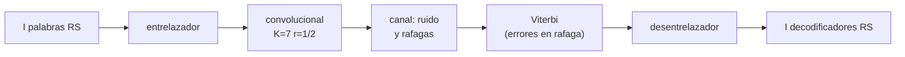

# B94-C02 — Entrelazado y concatenación de códigos

<!-- nav:top -->
[🏠 Programa](../../../../README.md) · [📚 Bloque B94](../../../tronco-comun/B94-modulacion-codificacion-y-protocolos-de-enlace.md) · [← Anterior: B94-C01 — Códigos Reed-Solomon y LDPC](../B94-C01-codigos-reed-solomon-y-ldpc/CLASE.md) · [Siguiente: B94-C03 — Tramas de transferencia de telemetría y telecomando →](../B94-C03-tramas-de-transferencia-de-telemetria-y-telecomando/CLASE.md)
<!-- /nav -->

## 1. Ubicación, nivel y alcance

Clase 2 del bloque B94. Nivel N3. Un código de bloque corrige un número fijo de símbolos por palabra; si los errores llegan juntos, en ráfaga, una sola palabra puede quedar saturada mientras las vecinas están sanas. Aquí repartes la ráfaga entre palabras con un entrelazado de profundidad `I` y concatenas un código convolucional interno (decodificado con Viterbi, que produce ráfagas) con el Reed-Solomon externo de [B94-C01](../B94-C01-codigos-reed-solomon-y-ldpc/CLASE.md). La corrección de errores en general es de B89-C09 y no se redacta aquí. El canal es sintético y de decisión dura.

## 2. Por qué esta clase existe

El decodificador de Viterbi falla en ráfagas y los desvanecimientos también. La decisión central: **¿qué profundidad de entrelazado hace falta para que una ráfaga de `B` octetos no sature ninguna palabra, y qué ganancia da frente a no entrelazar?**

## 3. Lo que podrás hacer al terminar

1. Entrelazar y desentrelazar `I` palabras RS octeto a octeto.
2. Predecir la ráfaga máxima corregible: `E·I` octetos.
3. Explicar por qué una ráfaga de `E·I + 1` octetos hace fallar exactamente una palabra.
4. Describir el codificador convolucional K = 7 y la decodificación de Viterbi de decisión dura.
5. Medir la ganancia del entrelazado cuando el decodificador interno produce ráfagas.
6. Separar lo consultado (parámetros del estándar) de lo sintético (canal y ráfagas).

La evidencia es la **tabla de resistencia a ráfagas por profundidad** del ejercicio 12 (sección 20).

## 4. Con qué llegas y cómo comprobarlo

1. ¿Qué corrige RS(255, 223) por palabra?
2. ¿Qué es una ráfaga de errores?
3. ¿Qué es un código convolucional?
4. ¿Qué es la decisión dura?
5. ¿Qué es una semilla fija?

<details>
<summary>Ver respuestas</summary>

1. Hasta 16 símbolos (octetos) erróneos. 2. Errores consecutivos o muy próximos, no independientes. 3. Uno cuya salida depende de los bits actuales y de un registro de los anteriores. 4. Decidir cada símbolo recibido como 0 o 1 antes de decodificar, sin conservar la fiabilidad. 5. Un valor inicial del generador aleatorio que hace reproducible el experimento.
</details>

Con cuatro o cinco aciertos, sigue; si no, repasa los prerrequisitos.

## 5. Un caso de contexto y casos de referencia

Una ráfaga de 80 octetos consecutivos cae en un bloque de cinco palabras RS(255, 223) entrelazadas (`I = 5`): cada palabra recibe 16 octetos y todas se corrigen. Con 81 octetos, una palabra recibe 17 y falla; las otras cuatro se salvan. Sin entrelazar (`I = 1`) una ráfaga de 17 octetos ya basta. Es el **ejemplo conductor**; la ráfaga es **sintética**.

## 6. Vocabulario

El **entrelazado** de profundidad `I` reparte los octetos de `I` palabras: el octeto `j` del flujo es el símbolo `j // I` de la palabra `j % I`. La **concatenación** usa un código interno (aquí convolucional) y uno externo (RS). Un **código convolucional** de tasa 1/2 y longitud de restricción `K = 7` emite dos bits por cada bit de entrada con los polinomios `G1 = 171` y `G2 = 133` (octal). El **algoritmo de Viterbi** halla la secuencia de máxima verosimilitud; en **decisión dura** usa la distancia de Hamming.

## 7. Modelo mental: repartir una cartera de billetes



*Descripción textual:* las palabras se entrelazan, se codifican en convolucional, cruzan el canal; Viterbi entrega octetos con errores agrupados; el desentrelazador los reparte entre las palabras y cada decodificador RS corrige su parte.

Analogía: repartir un montón de billetes marcados en varias carteras en lugar de llevarlos todos en una: si te roban una, pierdes pocos de cada tipo. Límite: el entrelazado no reduce el número total de errores, solo su distribución, y añade retardo y memoria (`I` palabras).

## 8. La explicación, paso a paso

### 8.1 Ráfaga máxima corregible

Una ráfaga de `B` octetos consecutivos toca cada palabra como mucho `⌈B/I⌉` veces. Se corrige todo si `⌈B/I⌉ ≤ E`, es decir, `B ≤ E·I`. Con `E = 16`:

| `I` | Umbral `E·I` (octetos) | Con `B = E·I` | Con `B = E·I + 1` |
|---|---|---|---|
| 1 | 16 | 10 de 10 | 0 de 10 |
| 2 | 32 | 20 de 20 | 10 de 20 |
| 3 | 48 | 30 de 30 | 20 de 30 |
| 4 | 64 | 40 de 40 | 30 de 40 |
| 5 | 80 | 50 de 50 | 40 de 50 |
| 8 | 128 | 80 de 80 | 70 de 80 |

Con `B = E·I + 1`, una sola palabra de cada bloque recibe 17 octetos y falla; las otras `I − 1` se salvan. Por eso la columna final es `(I − 1)/I` de las palabras (10 inicios por caso).

### 8.2 El código convolucional interno

El registro guarda los 6 bits anteriores; cada bit de entrada produce dos bits con `G1 = 171` y `G2 = 133`, invirtiendo la salida de `G2` (CCSDS 131.0-B-5, sección 3). Se añaden 6 ceros de cola para volver al estado cero. Viterbi mantiene 64 estados y, para cada uno, el camino de menor distancia de Hamming.

### 8.3 Por qué Viterbi hace ráfagas

Cuando el decodificador elige un camino equivocado, no corrige un bit suelto sino un tramo: los errores salen agrupados. Con `p = 0,07` en el canal, el laboratorio da 47,8 octetos erróneos por bloque de 5 palabras. Sin entrelazar, una palabra puede acumular más de 16 y fallar; con `I = 5`, esa ráfaga se reparte.

### 8.4 Resultado de la concatenación

| `p` de canal | Octetos erróneos por bloque | Palabras recuperadas, `I = 1` | Palabras recuperadas, `I = 5` |
|---|---|---|---|
| 0,05 | 7,8 | 30 de 30 | 30 de 30 |
| 0,07 | 47,8 | 27 de 30 | 30 de 30 |
| 0,09 | 172,7 | 0 de 30 | 0 de 30 |

A `p = 0,05` no hace falta entrelazar; a `p = 0,09` el número total de errores supera la capacidad (80 octetos por bloque) y el entrelazado ya no ayuda; la ventana útil está en medio (`p = 0,07`), donde pasa de 27 a 30. Son 6 bloques por `p`: una muestra pequeña que ilustra el mecanismo, no estima una tasa.

### 8.5 Costes

Entrelazar `I` palabras exige guardar `I × 255` octetos y retrasa la entrega de la primera palabra hasta recibir el bloque. La sincronización del bloque la resuelve el marcador de sincronía (ASM) tratado en [B94-C03](../B94-C03-tramas-de-transferencia-de-telemetria-y-telecomando/CLASE.md).

## 9. Magnitudes, símbolos y unidades

| Símbolo | Qué es | Unidad | Valor / nota |
|---|---|---|---|
| `I` | profundidad de entrelazado | palabras | 1, 2, 3, 4, 5, 8 (permitidas) |
| `E` | capacidad RS | octetos | 16 |
| `B` | longitud de la ráfaga | octetos | 16–128 |
| `K` | longitud de restricción | bits | 7 |
| `p` | probabilidad de inversión de bit del canal | adimensional | 0,05–0,09 (sintético) |

## 10. Convenciones y referencias

Palabras de 255 octetos. Entrelazado octeto a octeto. Convolucional de tasa 1/2, `K = 7`, `G1 = 171`, `G2 = 133` con inversión de `G2`; el orden de bits del registro es propio del laboratorio. Canal binario simétrico de decisión dura. Datos con `random.Random(94004)` y `94005`.

## 11. De dónde sale lo que afirmamos

| ID | Fuente | Localizador | Respalda | Estado |
|---|---|---|---|---|
| S1 | CCSDS 131.0-B-5, *TM Synchronization and Channel Coding*, septiembre de 2023 — https://ccsds.org/Pubs/131x0b5.pdf (consultada 2026-11-10; texto extraído con PyMuPDF) | secciones 3 y 4.3.5 | `I` ∈ {1, 2, 3, 4, 5, 8}; convolucional r = 1/2, K = 7, G1 = 171, G2 = 133 con inversión de G2; RS(255,223) | Consultada |
| — | Algoritmo de Viterbi y umbral `E·I` | — | los verifica el laboratorio (conteo exacto de palabras) | No consultada en una fuente concreta |

Límites: decisión dura y canal sintético; el rendimiento real depende del canal de ruido gaussiano y de la decisión blanda, que no se simulan.

## 12. Cómo ver la resistencia a ráfagas

| Magnitud | Valor |
|---|---|
| Umbral con `I = 5` | 80 octetos |
| Palabras salvadas con 81 octetos, `I = 5` | 40 de 50 |
| Concatenación, `p = 0,07`, `I = 1` | 27 de 30 |
| Concatenación, `p = 0,07`, `I = 5` | 30 de 30 |

Descripción larga: el umbral crece linealmente con `I`; más allá de él solo falla una palabra por bloque, y el entrelazado ayuda en una franja de ruido, no en todas.

## 13. Ejemplo trabajado: ráfaga de 50 octetos con `I = 4`

**Paso 1 · Reparto.** `⌈50/4⌉ = 13` octetos como máximo por palabra.

**Paso 2 · Comparación.** `13 ≤ 16`: se corrigen todas.

**Paso 3 · Umbral.** `E·I = 64`; la ráfaga de 50 queda por debajo.

**Paso 4 · Sin entrelazar.** Con `I = 1`, 50 > 16: la palabra falla.

## 14. Distintas formas de describir un enlace con ráfagas

**Por ráfaga:** longitud `B`. **Por profundidad:** `I`. **Por memoria:** `255·I` octetos. **Por retardo:** tiempo de recibir el bloque. **Por resultado:** palabras recuperadas.

## 15. Práctica guiada

**Ejercicio 1 · con los pasos indicados.** ¿Qué ráfaga máxima corrige `I = 3`? *Pasos:* multiplica `E` por `I`.

<details><summary>Solución comentada</summary>

`16 × 3 = 48` octetos.
</details>

**Ejercicio 2 · con una pista.** Una ráfaga de 100 octetos, ¿qué `I` mínimo de la lista permitida la absorbe? *Pista:* `E·I ≥ 100`.

<details><summary>Solución comentada</summary>

`I ≥ 6,25`; el siguiente valor permitido es `I = 8` (umbral 128).
</details>

**Ejercicio 3 · casi autónomo.** ¿Por qué con `E·I + 1` falla exactamente una palabra?

<details><summary>Solución comentada</summary>

El reparto circular deja a una sola palabra con un octeto más que las demás: 17 frente a 16.
</details>

## 16. Práctica autónoma, transferencia e integrador

**Ejercicio 4 · autónomo.** Memoria de entrelazado para `I = 5`.

<details><summary>Solución comentada</summary>

`5 × 255 = 1275` octetos.
</details>

**Ejercicio 5 · autónomo.** ¿Cuántos bits corrige en ráfaga `I = 8`?

<details><summary>Solución comentada</summary>

`128 octetos × 8 = 1024` bits.
</details>

**Ejercicio 6 · autónomo.** Con la tasa de 1/2 del convolucional, ¿cuántos bits de canal produce un bloque de 5 palabras (más 6 de cola)?

<details><summary>Solución comentada</summary>

`(5 × 255 × 8 + 6) × 2 = 20 412` bits.
</details>

**Ejercicio 7 · autónomo.** ¿Cuál es la tasa global de la concatenación convolucional + RS(255, 223)?

<details><summary>Solución comentada</summary>

`(1/2) × (223/255) = 0,4373`.
</details>

**Ejercicio 8 · autónomo.** A `p = 0,09` el entrelazado no ayudó. ¿Por qué?

<details><summary>Solución comentada</summary>

172,7 octetos erróneos por bloque superan los 80 que corrige el bloque en el mejor reparto: faltan símbolos de paridad, no reparto.
</details>

**Ejercicio 9 · transferencia.** **Transferencia.** Un desvanecimiento dura 0,1 s a 2 Mbit/s de canal. ¿Cuántos octetos afecta y qué `I` hace falta?

<details><summary>Solución comentada</summary>

`0,1 × 2×10⁶/8 = 25 000` octetos; no se cubre con `I ≤ 8` (umbral 128): requiere otra técnica (por ejemplo, entrelazado más largo o retransmisión).
</details>

**Ejercicio 10 · transferencia.** **Transferencia.** Una misión con restricción de memoria a bordo, ¿por qué podría preferir `I = 2` a `I = 8`?

<details><summary>Solución comentada</summary>

Menos memoria (510 frente a 2040 octetos) y menos retardo, a cambio de menos tolerancia a ráfagas.
</details>

**Ejercicio 11 · transferencia.** **Transferencia.** ¿Puede el entrelazado compensar un exceso de ruido uniforme?

<details><summary>Solución comentada</summary>

No: solo redistribuye errores; si el total supera la capacidad, falla (ejercicio 8).
</details>

**Ejercicio 12 · integrador.** **Integrador.** Elabora tu *tabla de resistencia a ráfagas por profundidad*: umbral, palabras recuperadas con `E·I` y `E·I + 1`, memoria y retardo por `I`, y el resultado de la concatenación; separa lo consultado de lo sintético.

<details><summary>Solución comentada</summary>

Secciones 8.1–8.5 y la salida del laboratorio.
</details>

## 17. Laboratorio: ráfagas, entrelazado y concatenación

El script [entrelazado_concatenacion.py](entrelazado_concatenacion.py) incluye el RS de la clase anterior, entrelaza, inyecta ráfagas, implementa el convolucional K = 7 con Viterbi y mide la concatenación (**comprueba** que `E·I` siempre se corrige y `E·I + 1` deja alguna palabra sin recuperar).

**Datos:** parámetros del CCSDS 131.0-B-5 (consultado); mensajes, ráfagas y errores **sintéticos**. **Predice antes de ejecutar:** ¿cuántas palabras de 10 fallan con `I = 1` y `B = 17`? (todas.) **Ejecución del 2026-11-10 (Python 3.12.9):**

```text
Python 3.12.9 (biblioteca estandar)
A) Rafaga de B octetos consecutivos (valores aleatorios) en un bloque de I palabras RS(255,223); 10 inicios por caso
   I   umbral E*I   B=E*I: palabras recuperadas   B=E*I+1: palabras recuperadas
   1      16         10 de  10                    0 de  10
   2      32         20 de  20                   10 de  20
   3      48         30 de  30                   20 de  30
   4      64         40 de  40                   30 de  40
   5      80         50 de  50                   40 de  50
   8     128         80 de  80                   70 de  80
B) Concatenacion: RS(255,223) externo + convolucional K=7 r=1/2 (Viterbi duro) interno, canal binario simetrico
   bloque = 5 palabras RS; el mismo patron de errores de canal se aplica a I=1 y a I=5; 6 bloques por p
   p canal  octetos erroneos tras Viterbi (por bloque)  palabras recuperadas I=1   palabras recuperadas I=5
    0.05                 7.8                           30 de 30                 30 de 30
    0.07                47.8                           27 de 30                 30 de 30
    0.09               172.7                            0 de 30                  0 de 30
Pruebas superadas.
```

```bash
python programa/clases/B94/B94-C02-entrelazado-y-concatenacion-de-codigos/entrelazado_concatenacion.py
```

**Límites:** decisión dura, canal binario simétrico, 6 bloques por `p` (muestra pequeña); tarda cerca de 80 s.

## 18. Errores frecuentes y cómo corregirlos

**Creer que el entrelazado reduce los errores.** Solo los reparte; se corrige con 8.4.

**Olvidar su coste en memoria y retardo.** Se corrige con 8.5.

**Contar bits en lugar de octetos al comparar con `E`.** Se corrige con 8.1.

**Tomar los 6 bloques como una tasa de error.** Se corrige con 8.4.

## 19. Cómo sabrás que vas bien

Tras la sección 8: ¿qué ráfaga absorbe `I = 5` y cuántas palabras fallan con una más? Si dudas, repasa el ejemplo 13. Tras el laboratorio: ¿qué comprueba? (ver la sección 17).

## 20. Qué entregas y cómo se evalúa

El producto es tu **tabla de resistencia a ráfagas por profundidad** (ejercicio 12).

| Criterio | Inicial | En desarrollo | Logrado | Destacado |
|---|---|---|---|---|
| Conceptos | Los confunde | Parciales | Explica reparto y umbral `E·I` | Explica los límites |
| Cálculo | Sin unidades | Con errores | Tablas completas con unidades | Calcula casos nuevos |
| Numérico | Sin comprobar | Un caso | Contraste con el umbral exacto | Interpreta la franja útil |
| Fuentes | Sin fuente | Sin fecha | Fuentes con fecha y estado | Declara lo sintético y lo no consultado |
| Límites | No los nombra | Uno | Tres | Discute qué falta del modelo |

**Condiciones críticas (no se compensan con promedio):** rotular las ráfagas y el canal como sintéticos; no tomar la muestra de 6 bloques como tasa; citar solo lo consultado.

## 21. Ética, seguridad y límites

Clase educativa: los modelos son simplificados y sus datos son sintéticos; ningún resultado describe un enlace real ni sustituye a la validación del canal con decisión blanda. Accesibilidad: tablas equivalentes a las gráficas, fórmulas en texto, ejercicios sin conexión.

## 22. Para cerrar y seguir

Con `I = 5`, una ráfaga de 80 octetos se corrige y con 81 falla una palabra de cinco. Queda una pregunta: ¿en qué estructura se empaquetan esos octetos para enviarlos y reconocerlos en el receptor?

**Glosario español–inglés.** entrelazado · *interleaving*; concatenación · *concatenation*; ráfaga de errores · *burst error*; decisión dura · *hard decision*; longitud de restricción · *constraint length*.

**Continuidad.** [B94-C03](../B94-C03-tramas-de-transferencia-de-telemetria-y-telecomando/CLASE.md) estudia las tramas de transferencia.

**Referencias:** ver sección 11.

<!-- nav:bottom -->
---

[← Anterior: B94-C01 — Códigos Reed-Solomon y LDPC](../B94-C01-codigos-reed-solomon-y-ldpc/CLASE.md) · [📚 Bloque B94](../../../tronco-comun/B94-modulacion-codificacion-y-protocolos-de-enlace.md) · [Siguiente: B94-C03 — Tramas de transferencia de telemetría y telecomando →](../B94-C03-tramas-de-transferencia-de-telemetria-y-telecomando/CLASE.md)
<!-- /nav -->
