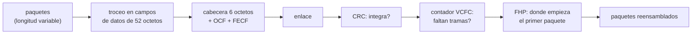

# B94-C03 — Tramas de transferencia de telemetría y telecomando

<!-- nav:top -->
[🏠 Programa](../../../../README.md) · [📚 Bloque B94](../../../tronco-comun/B94-modulacion-codificacion-y-protocolos-de-enlace.md) · [← Anterior: B94-C02 — Entrelazado y concatenación de códigos](../B94-C02-entrelazado-y-concatenacion-de-codigos/CLASE.md) · [Siguiente: B94-C04 — Redes con retardo y desconexión: enrutamiento y almacenamiento →](../B94-C04-redes-con-retardo-y-desconexion-enrutamiento-y-almacenamiento/CLASE.md)
<!-- /nav -->

## 1. Ubicación, nivel y alcance

Clase 3 del bloque B94. Nivel N3. Los códigos de las clases anteriores protegen octetos; la trama de transferencia los empaqueta con una cabecera que identifica nave y canal, cuenta tramas, señala dónde empieza el primer paquete y añade un CRC. Aquí armas y lees una trama de telemetría según los campos del estándar CCSDS 132.0-B-3, detectas pérdidas con los contadores y reensamblas paquetes con el puntero de primera cabecera. Telemetría y telecomando como servicios se tratan en B89-C11 y C12; esta clase añade la estructura de la trama. **El telecomando (TC) no se implementa**: su documento no se pudo consultar. Los paquetes y datos son sintéticos.

## 2. Por qué esta clase existe

Un receptor que recibe un flujo de octetos con pérdidas necesita saber qué trama es, si llegó íntegra, si faltan tramas y dónde retomar los paquetes. La decisión central: **¿qué campos de la trama permiten detectar errores y pérdidas y resincronizar sin retransmitir?**

## 3. Lo que podrás hacer al terminar

1. Disponer los 48 bits de la cabecera primaria de telemetría y leerlos de vuelta.
2. Calcular el CRC-16 de la trama y verificarlo con una segunda implementación.
3. Detectar tramas perdidas con el contador de canal virtual (módulo 256).
4. Resincronizar paquetes con el puntero de primera cabecera.
5. Contrastar la detección de errores del CRC con su cota teórica `2⁻¹⁶`.
6. Separar lo consultado (campos de TM) de lo no consultado (TC) y de lo sintético (paquetes).

La evidencia es la **trama TM armada y leída con su informe de contadores** del ejercicio 12 (sección 20).

## 4. Con qué llegas y cómo comprobarlo

1. ¿Qué es un octeto y cómo se numeran sus bits?
2. ¿Qué es un CRC?
3. ¿Qué es un contador módulo 256?
4. ¿Qué es un paquete frente a una trama?
5. ¿Qué es un dato sintético?

<details>
<summary>Ver respuestas</summary>

1. Ocho bits; el bit 0 de la cabecera es el más significativo del primer octeto. 2. Un resto de división polinómica del mensaje, usado para detectar errores. 3. Uno que vuelve a 0 tras 255. 4. El paquete es la unidad de datos de aplicación; la trama es la unidad de transferencia de longitud fija que los transporta. 5. Un dato generado para el ejemplo, no medido.
</details>

Con cuatro o cinco aciertos, sigue; si no, repasa los prerrequisitos.

## 5. Un caso de contexto y casos de referencia

Una trama sintética de 64 octetos lleva SCID `0x2A5`, canal virtual 1, contadores 255 y 7 y puntero 10. Su cabecera es `2a53ff07180a`. Con 3 tramas perdidas de 31, el contador detecta los 3 huecos y el receptor recupera 50 de 60 paquetes. Es el **ejemplo conductor**; los 60 paquetes son **sintéticos**.

## 6. Vocabulario

La **trama de transferencia de telemetría** tiene una cabecera primaria de 6 octetos, un campo de datos, un campo de control operacional (OCF, opcional) y un campo de control de errores de trama (FECF, opcional, 2 octetos). El **SCID** identifica la nave; el **VCID**, el canal virtual. El **contador de canal maestro** (MCFC) cuenta todas las tramas; el de **canal virtual** (VCFC), las del canal. El **puntero de primera cabecera** (FHP) da el desplazamiento del primer paquete que comienza en la trama: `11111111111` si ninguno empieza y `11111111110` si el campo es de relleno. El **FECF** es un CRC de 16 bits con polinomio `X¹⁶ + X¹² + X⁵ + 1` y registro inicial a unos.

## 7. Modelo mental: contenedores numerados en una cinta



*Descripción textual:* los paquetes se cortan en campos de datos de longitud fija; cada uno recibe cabecera y CRC; el receptor comprueba el CRC, mira el contador por si faltan tramas y usa el puntero para retomar paquetes completos.

Analogía: contenedores numerados en una cinta transportadora: el número detecta que falta uno, la etiqueta de «primer paquete aquí» permite empezar a desembalar tras el hueco. Límite: un paquete cortado por una trama perdida se pierde entero; la trama no lo repara.

## 8. La explicación, paso a paso

### 8.1 La cabecera primaria

| Campo | Bits | Notas |
|---|---|---|
| Versión | 2 (bits 0–1) | `00` |
| SCID | 10 | 0x2A5 en el ejemplo |
| VCID | 3 | 1 |
| Bandera OCF | 1 | 1 = presente |
| MCFC | 8 | 255 |
| VCFC | 8 | 7 |
| Estado del campo de datos | 16 (bits 32–47) | secundaria 1, sincronía 1, orden de paquetes 1, longitud de segmento 2, FHP 11 |

Así, `w0 = 0x2A5·16 + 1·2 + 1 = 0x2A53`; el estado es `3·2048 + 10 = 0x180A` (longitud de segmento `11`, FHP = 10), y la cabecera completa `2a53ff07180a` coincide con la salida del laboratorio.

### 8.2 El FECF

El CRC se calcula sobre toda la trama salvo el propio FECF, con registro inicial a unos. Al recalcularlo sobre trama + FECF el resultado debe ser cero, y así lo comprueba el receptor. El laboratorio implementa el CRC bit a bit y por tabla (dos vías) y ambos dan `0x29B1` para `123456789`.

### 8.3 Qué detecta el CRC

| Prueba | Resultado |
|---|---|
| Errores de 1 bit | 500 de 500 detectados |
| Errores de 2 bits | 500 de 500 |
| Ráfagas de 1 a 16 bits | 800 de 800 |
| Tramas aleatorias que lo pasan por azar | 6 de 400 000 (esperado 6,10 ± 2,47) |

Un CRC de 16 bits detecta toda ráfaga de hasta 16 bits y deja escapar en torno a `2⁻¹⁶` de los patrones aleatorios. Por eso el FECF no sustituye a la corrección: la complementa (ver [B94-C01](../B94-C01-codigos-reed-solomon-y-ldpc/CLASE.md)).

### 8.4 Contadores y resincronización

El VCFC avanza de uno en uno módulo 256 (en el ejemplo parte de 250 y da la vuelta). Si llega un valor distinto del esperado, la diferencia módulo 256 es el número de tramas perdidas y el receptor descarta lo acumulado y busca el FHP de la siguiente trama que lo tenga válido. Resultados del laboratorio: 31 tramas sin pérdida recuperan 60 de 60 paquetes; con 3 tramas perdidas se detectan 3 huecos y se recuperan 50 de 60; con 1 trama corrupta (rechazada por el CRC y contada como hueco) se recuperan 57 de 60.

### 8.5 Y el telecomando

El telecomando usa su propio formato de trama (CCSDS 232.0-B) y un protocolo de retransmisión con ventana deslizante. **No se consultó**; se menciona solo para que sepas que la trama TC no es una copia de la TM y que la fiabilidad del telecomando descansa en confirmaciones, no solo en corrección hacia delante.

## 9. Magnitudes, símbolos y unidades

| Símbolo | Qué es | Unidad | Valor / nota |
|---|---|---|---|
| `SCID` | identificador de nave | — (10 bits) | 0x2A5 (sintético) |
| `VCID` | identificador de canal virtual | — (3 bits) | 1 |
| `MCFC`, `VCFC` | contadores de tramas | tramas, módulo 256 | 255; 7 |
| `FHP` | puntero de primera cabecera | octetos | 10 |
| `L` | longitud de trama | octetos | 64 (sintético) |
| FECF | CRC-16 | 16 bits | `0x29B1` para `123456789` |

## 10. Convenciones y referencias

Bit 0 = bit más significativo del primer octeto; orden de red (big endian). Trama de 64 octetos = 6 de cabecera + 52 de datos + 4 de OCF + 2 de FECF (longitud elegida para el laboratorio). Paquetes sintéticos con prefijo de longitud de 2 octetos; **no son** paquetes del estándar de paquetes espaciales (no consultado). Semilla `94006`.

## 11. De dónde sale lo que afirmamos

| ID | Fuente | Localizador | Respalda | Estado |
|---|---|---|---|---|
| S1 | CCSDS 132.0-B-3, *TM Space Data Link Protocol*, Blue Book, octubre de 2021 — https://ccsds.org/Pubs/132x0b3.pdf (consultada 2026-11-10; texto extraído con PyMuPDF) | 4.1.2 (cabecera), 4.1.2.7 (estado y FHP), 4.1.6 (FECF) | campos y anchos de la cabecera; FHP `11111111111` y `11111111110`; polinomio y presetting del FECF | Consultada |
| — | CCSDS 232.0-B (TC Space Data Link Protocol) | — | — | No consultada (la descarga devolvió 404) |
| — | CCSDS 133.0-B (Space Packet Protocol) | — | — | No consultada |
| — | Valor de comprobación `0x29B1` del CRC de `123456789` | — | dos implementaciones del laboratorio coinciden | No consultada en una fuente concreta |

Límites: trama de longitud elegida, paquetes sintéticos y sin telecomando; no se prueba conformidad (ver B94-C06).

## 12. Cómo ver una trama

| Magnitud | Valor |
|---|---|
| Cabecera del ejemplo | `2a53ff07180a` |
| Detección de ráfagas ≤ 16 bits | 800 de 800 |
| Paquetes recuperados, 3 tramas perdidas | 50 de 60 |
| Paquetes recuperados, 1 trama corrupta | 57 de 60 |

Descripción larga: el CRC detecta, el contador localiza el hueco y el puntero retoma; lo que cae en las tramas perdidas se pierde.

## 13. Ejemplo trabajado: leer una cabecera

**Paso 1 · Octetos.** `2a 53 ff 07 18 0a`.

**Paso 2 · Primeros 16 bits.** `0x2A53 = 0010 1010 0101 0011`: versión `00`, SCID `10 1010 0101 = 0x2A5`, VCID `001`, OCF `1`.

**Paso 3 · Contadores.** `0xFF = 255` y `0x07 = 7`.

**Paso 4 · Estado.** `0x180A = 0001 1000 0000 1010`: secundaria 0, sincronía 0, orden 0, segmento `11`, FHP `000 0000 1010 = 10`.

## 14. Distintas formas de describir una trama

**Por campos:** cabecera, datos, OCF, FECF. **Por identidad:** SCID y VCID. **Por orden:** contadores. **Por contenido:** FHP y paquetes. **Por integridad:** FECF.

## 15. Práctica guiada

**Ejercicio 1 · con los pasos indicados.** ¿Cuántos octetos de datos tiene una trama de 64 con OCF y FECF? *Pasos:* resta cabecera, OCF y FECF.

<details><summary>Solución comentada</summary>

`64 − 6 − 4 − 2 = 52`.
</details>

**Ejercicio 2 · con una pista.** Llega la trama con VCFC 9 tras la 5. ¿Cuántas se perdieron? *Pista:* esperado = 6.

<details><summary>Solución comentada</summary>

`9 − 6 = 3` tramas (6, 7 y 8).
</details>

**Ejercicio 3 · casi autónomo.** ¿Qué significa `FHP = 11111111111`?

<details><summary>Solución comentada</summary>

Que ningún paquete empieza en esta trama: el campo continúa un paquete anterior.
</details>

## 16. Práctica autónoma, transferencia e integrador

**Ejercicio 4 · autónomo.** VCFC esperado 2 y llega 1 (módulo 256): ¿huecos?

<details><summary>Solución comentada</summary>

`(1 − 2) mod 256 = 255`: parece un salto casi completo; suele indicar repetición o desorden, no pérdida.
</details>

**Ejercicio 5 · autónomo.** Calcula `0x2A5 << 4` y súmale VCID = 3 desplazado 1 bit y OCF = 0.

<details><summary>Solución comentada</summary>

`0x2A50 + 6 = 0x2A56`.
</details>

**Ejercicio 6 · autónomo.** ¿Qué fracción de los 2 octetos de FECF es sobrecarga en una trama de 64?

<details><summary>Solución comentada</summary>

`2/64 = 3,1 %`.
</details>

**Ejercicio 7 · autónomo.** El CRC dejó pasar 6 de 400 000 tramas aleatorias. ¿Es coherente con `2⁻¹⁶`?

<details><summary>Solución comentada</summary>

Esperado `400 000/65 536 = 6,10`; con σ ≈ 2,47, 6 es coherente.
</details>

**Ejercicio 8 · autónomo.** ¿Por qué un paquete que se extiende sobre una trama perdida se pierde entero?

<details><summary>Solución comentada</summary>

Faltan octetos de su medio y la trama no incorpora redundancia entre tramas.
</details>

**Ejercicio 9 · transferencia.** **Transferencia.** Un receptor ve MCFC consecutivo pero VCFC con saltos en el canal 1. ¿Qué puede estar pasando?

<details><summary>Solución comentada</summary>

Las tramas perdidas pertenecen al canal 1 o hay un canal 2 intercalado; el contador de canal virtual solo cuenta las suyas, así que un salto en el VCFC con MCFC continuo sugiere que otro canal ocupa esas tramas o un fallo de multiplexación.
</details>

**Ejercicio 10 · transferencia.** **Transferencia.** ¿Basta el FECF para entregar datos correctos?

<details><summary>Solución comentada</summary>

No: detecta casi todos los errores, no los corrige, y deja pasar en torno a `2⁻¹⁶` de patrones aleatorios.
</details>

**Ejercicio 11 · transferencia.** **Transferencia.** ¿Por qué no se extrapola esta clase a la trama de telecomando?

<details><summary>Solución comentada</summary>

La fuente del TC no se consultó y su protocolo de retransmisión difiere.
</details>

**Ejercicio 12 · integrador.** **Integrador.** Elabora tu *trama TM armada y leída con su informe de contadores*: la cabecera en bits y en hexadecimal, el FECF por dos vías, el reensamblado con y sin pérdidas y la lista de qué es consultado, sintético y no consultado.

<details><summary>Solución comentada</summary>

Secciones 8.1–8.5 y la salida del laboratorio.
</details>

## 17. Laboratorio: armar, dañar y reensamblar tramas

El script [trama_tm.py](trama_tm.py) arma tramas, calcula el CRC por dos vías, prueba errores, pierde tramas y reensambla (**comprueba** CRC `0x29B1`, detección de 1 y 2 bits y ráfagas ≤ 16 bits, y paquetes recuperados).

**Datos:** campos del CCSDS 132.0-B-3 (consultado); paquetes, longitud y valores **sintéticos**. **Predice antes de ejecutar:** ¿cuántos huecos detecta el contador con 3 tramas perdidas? (3.) **Ejecución del 2026-11-10 (Python 3.12.9):**

```text
Python 3.12.9 (biblioteca estandar)
CRC-16 (poly 0x1021, inicial 0xFFFF) de '123456789': bit a bit = tabla = 0x29B1
Trama de 64 octetos: cabecera = 2a53ff07180a  campos = version 0, SCID 0x2A5, VCID 1, OCF 1, MCFC 255, VCFC 7, FHP 10
Errores de 1 bit detectados: 500 de 500; de 2 bits: 500 de 500
Rafagas de 1 a 16 bits detectadas: 800 de 800
Tramas aleatorias que pasan el CRC por azar: 6 de 400000 (esperado 6.10 +- 2.47)
Sin perdidas: 31 tramas, 60 de 60 paquetes recuperados, huecos 0; contador inicial 250 con vuelta modulo 256
Con 3 tramas perdidas (indices [5, 6, 20]): huecos detectados por el contador = 3, paquetes recuperados = 50 de 60
Con 1 trama corrupta: rechazadas por CRC = 1, huecos = 1, paquetes recuperados = 57 de 60
Pruebas superadas.
```

```bash
python programa/clases/B94/B94-C03-tramas-de-transferencia-de-telemetria-y-telecomando/trama_tm.py
```

**Límites:** un solo canal virtual de datos, sin telecomando, sin cabecera secundaria, paquetes sintéticos; tarda cerca de 1 minuto.

## 18. Errores frecuentes y cómo corregirlos

**Leer los bits desde el menos significativo.** Se corrige con la sección 10.

**Creer que el CRC corrige errores.** Se corrige con 8.3.

**Confundir MCFC y VCFC.** Se corrige con la sección 6 y el ejercicio 9.

**Extrapolar la telemetría al telecomando.** Se corrige con 8.5.

## 19. Cómo sabrás que vas bien

Tras la sección 8: ¿qué dice el puntero `11111111111`? Si dudas, repasa el ejemplo 13. Tras el laboratorio: ¿qué comprueba? (ver la sección 17).

## 20. Qué entregas y cómo se evalúa

El producto es tu **trama TM armada y leída con su informe de contadores** (ejercicio 12).

| Criterio | Inicial | En desarrollo | Logrado | Destacado |
|---|---|---|---|---|
| Conceptos | Los confunde | Parciales | Distingue trama, paquete y contadores | Explica los límites |
| Cálculo | Sin unidades | Con errores | Cabecera correcta en bits y hex | Calcula casos nuevos |
| Numérico | Sin comprobar | Un caso | CRC por dos vías | Interpreta la tasa de escape |
| Fuentes | Sin fuente | Sin fecha | Fuentes con fecha y estado | Declara lo sintético y lo no consultado |
| Límites | No los nombra | Uno | Tres | Discute qué falta del modelo |

**Condiciones críticas (no se compensan con promedio):** rotular los paquetes como sintéticos; no afirmar nada sobre el telecomando; citar solo lo consultado.

## 21. Ética, seguridad y límites

Clase educativa: los datos son sintéticos y la trama no es una implementación conforme; ningún resultado describe una misión real. Accesibilidad: tablas equivalentes a las gráficas, fórmulas en texto, ejercicios sin conexión.

## 22. Para cerrar y seguir

Una trama de 64 octetos lleva 52 de datos, un CRC que detecta ráfagas de hasta 16 bits y contadores que localizan lo perdido. Queda una pregunta: ¿qué se hace con los datos perdidos cuando el enlace se corta durante horas y no hay camino directo?

**Glosario español–inglés.** trama de transferencia · *transfer frame*; puntero de primera cabecera · *first header pointer*; canal virtual · *virtual channel*; campo de control de errores de trama · *frame error control field*; telecomando · *telecommand*.

**Continuidad.** [B94-C04](../B94-C04-redes-con-retardo-y-desconexion-enrutamiento-y-almacenamiento/CLASE.md) estudia las redes con retardo y desconexión.

**Referencias:** ver sección 11.

<!-- nav:bottom -->
---

[← Anterior: B94-C02 — Entrelazado y concatenación de códigos](../B94-C02-entrelazado-y-concatenacion-de-codigos/CLASE.md) · [📚 Bloque B94](../../../tronco-comun/B94-modulacion-codificacion-y-protocolos-de-enlace.md) · [Siguiente: B94-C04 — Redes con retardo y desconexión: enrutamiento y almacenamiento →](../B94-C04-redes-con-retardo-y-desconexion-enrutamiento-y-almacenamiento/CLASE.md)
<!-- /nav -->
