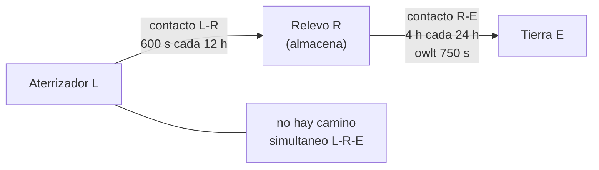

# B94-C04 — Redes con retardo y desconexión: enrutamiento y almacenamiento

<!-- nav:top -->
[🏠 Programa](../../../../README.md) · [📚 Bloque B94](../../../tronco-comun/B94-modulacion-codificacion-y-protocolos-de-enlace.md) · [← Anterior: B94-C03 — Tramas de transferencia de telemetría y telecomando](../B94-C03-tramas-de-transferencia-de-telemetria-y-telecomando/CLASE.md) · [Siguiente: B94-C05 — Calidad de servicio y prioridades en redes espaciales →](../B94-C05-calidad-de-servicio-y-prioridades-en-redes-espaciales/CLASE.md)
<!-- /nav -->

## 1. Ubicación, nivel y alcance

Clase 4 del bloque B94. Nivel N3. Con retardos de minutos y contactos que se abren y cierran según la órbita, no existe un camino extremo a extremo disponible a la vez. La red tolerante a retardo y desconexión almacena el paquete en cada nodo hasta el siguiente contacto. Aquí calculas, con un plan de contactos sintético Marte–relevo–Tierra, la llegada más temprana de un paquete, el almacenamiento necesario y el efecto de la vida útil. B89-C13 nombra los protocolos; esta clase trata el almacenamiento y reenvío. El plan, los volúmenes y las distancias son sintéticos.

## 2. Por qué esta clase existe

Un protocolo como TCP necesita confirmaciones en tiempo real; con 25 min de ida y vuelta o sin enlace durante horas, se hunde. La decisión central: **¿cuándo llega un paquete, cuánto almacenamiento exige y cuándo hay que descartarlo?**

## 3. Lo que podrás hacer al terminar

1. Calcular el retardo unidireccional de un enlace a partir de su distancia.
2. Explicar por qué el rendimiento de un protocolo con confirmaciones cae con el retardo.
3. Describir un plan de contactos y calcular la llegada más temprana con volumen residual.
4. Calcular la espera almacenada en un nodo y su pico de ocupación.
5. Relacionar la vida útil del paquete con la fracción entregada.
6. Separar lo consultado (qué es el protocolo de paquetes) de lo sintético (plan de contactos).

La evidencia es la **ficha de ruta y almacenamiento en una red Tierra–relevo–Marte sintética** del ejercicio 12 (sección 20).

## 4. Con qué llegas y cómo comprobarlo

1. ¿Qué es un retardo unidireccional?
2. ¿Qué es un contacto en una red intermitente?
3. ¿Qué es un camino de menor tiempo?
4. ¿Qué es un volumen de contacto?
5. ¿Qué es un dato sintético?

<details>
<summary>Ver respuestas</summary>

1. El tiempo que tarda una señal en recorrer el enlace en un sentido (distancia/velocidad de la luz). 2. Un intervalo en que dos nodos pueden comunicarse, con su tasa. 3. La ruta con la llegada más temprana al destino. 4. Tasa por duración del contacto, en octetos. 5. Un dato generado para el ejemplo, no medido.
</details>

Con cuatro o cinco aciertos, sigue; si no, repasa los prerrequisitos.

## 5. Un caso de contexto y casos de referencia

Un paquete de 15 MB se crea en el aterrizador en `t = 0`. Espera el primer paso del relevo (`t = 1000 s`), se transmite en 240 s, queda almacenado 18 760 s (5,21 h) en el relevo hasta la ventana con la Tierra y llega a `t = 20 810 s` (5,78 h). Ninguna ventana aterrizador-relevo coincide con una ventana relevo-Tierra, así que un camino extremo a extremo nunca existe. Es el **ejemplo conductor**; todo es **sintético**.

## 6. Vocabulario

Un **contacto** `(de, a, inicio, fin, tasa, retardo)` es una oportunidad de transmisión. El **plan de contactos** es la lista de contactos futuros. El **almacenamiento y reenvío** (*store-and-forward*) guarda el paquete hasta el siguiente contacto. Un **paquete** (*bundle*) es la unidad del protocolo de paquetes. La **vida útil** (*lifetime*) es el tiempo tras la creación pasado el cual los nodos pueden descartarlo. La **transferencia de custodia** traslada la responsabilidad de entrega a un nodo. El **volumen** de un contacto es `tasa × duración`.

## 7. Modelo mental: correo por mensajeros que solo se cruzan a ratos



*Descripción textual:* el aterrizador solo habla con el relevo en pasos breves; el relevo solo habla con la Tierra en ventanas distintas; el relevo almacena el paquete entre ambas.

Analogía: mensajeros que solo se encuentran en estaciones y a ciertas horas: cada uno guarda la carta hasta ver al siguiente. Límite: el relevo tiene memoria finita y una carta puede caducar antes de llegar.

## 8. La explicación, paso a paso

### 8.1 Retardo y rendimiento

El retardo unidireccional es `d/c`, con `c = 299 792,458 km/s`. Para 1,5 UA (`1 UA = 149 597 870,7 km`) son 748,5 s: unos 12,5 min por sentido y 1497 s de ida y vuelta. Un protocolo que espera confirmación por cada ventana de `w` tramas de 1 MB rinde `w × 1 MB / RTT`:

| Ventana `w` | Rendimiento (B/s) | Fracción de 250 000 B/s |
|---|---|---|
| 1 | 666,7 | 0,27 % |
| 8 | 5333,3 | 2,1 % |
| 64 | 42 666,7 | 17,1 % |

Con `RTT = 1500 s` (ilustrativo), hace falta una ventana de unas 375 MB en vuelo para llenar el enlace; en una red intermitente ni eso es posible.

### 8.2 Llegada más temprana con volumen residual

Para un paquete de tamaño `s`, en un contacto `c` con tasa `r`, si llega al nodo en `t`, empieza a transmitir en `max(t, ini_c, ocupado_c)` y termina en `inicio + s/r`; solo vale si termina antes de `fin_c`. Llega al siguiente nodo `owlt` después. Se relajan los tiempos de llegada por nodo (como Dijkstra) con espera ilimitada, porque almacenar no cuesta tiempo. Este laboratorio es una implementación propia; no sigue la especificación de enrutamiento de CCSDS (no consultada). Segunda vía: la enumeración de todas las secuencias de uno y dos contactos da el mismo `20 810,00 s`.

### 8.3 Almacenamiento y vida útil

Doce paquetes de 15 MB, uno cada 3 h; un paso de 600 s a 62 500 B/s lleva 37,5 MB, o sea 2 paquetes:

| Vida útil (h) | Entregados | Latencia mediana (h) | Pico en el aterrizador | Pico en el relevo |
|---|---|---|---|---|
| 12 | 3 de 12 | 8,80 | 2 | 2 |
| 24 | 7 de 12 | 20,80 | 3 | 4 |
| 48 | 11 de 12 | 29,83 | 6 | 4 |
| 96 | 12 de 12 | 32,81 | 7 | 4 |
| 240 | 12 de 12 | 32,81 | 7 | 4 |

Se generan 4 paquetes cada 12 h y el paso lleva 2: hay acumulación. Con 12 h de vida solo sobreviven los primeros; con 96 h, todos, pero el aterrizador llega a guardar 7 paquetes (105 MB). La vida útil y la memoria son dos caras de la misma decisión. En el laboratorio los paquetes que no llegan se descartan sin consumir volumen y no cuentan en los picos (simplificación).

### 8.4 Conservación del volumen

Ningún contacto se usa por encima de su volumen: la mayor fracción es 0,800 (2 paquetes de 15 MB sobre 37,5 MB). Es una comprobación de que el planificador no regala capacidad.

## 9. Magnitudes, símbolos y unidades

| Símbolo | Qué es | Unidad | Valor / nota |
|---|---|---|---|
| `owlt` | retardo unidireccional | s | 750 (sintético) |
| `RTT` | ida y vuelta | s | 1500 |
| `r` | tasa de un contacto | B/s | 62 500; 250 000 |
| `s` | tamaño del paquete | B | 15×10⁶ |
| `V` | volumen de contacto | B | 37,5×10⁶ en un paso |
| vida útil | límite de edad del paquete | h | 12–240 |

## 10. Convenciones y referencias

Tiempo `t` en segundos desde una época arbitraria. Paquetes sin fragmentar. Sin pérdidas ni retransmisión dentro de un contacto. `c` y la UA son valores definidos, no consultados en esta sesión. Plan de contactos, volúmenes y distancias sintéticos.

## 11. De dónde sale lo que afirmamos

| ID | Fuente | Localizador | Respalda | Estado |
|---|---|---|---|---|
| S1 | CCSDS 734.2-B-1, *CCSDS Bundle Protocol Specification*, Blue Book, septiembre de 2015 — https://ccsds.org/Pubs/734x2b1.pdf (consultada 2026-11-10; texto extraído con PyMuPDF) | resumen del protocolo (sección 1), 4.3.7 (vida útil) | red de almacenamiento y reenvío, conectividad intermitente y programada, transferencia de custodia, vida útil | Consultada |
| — | Enrutamiento por grafo de contactos (CCSDS 734.3 u otros) | — | — | No consultada |
| — | `c` y 1 UA | — | constantes definidas | No consultadas en esta sesión |

Límites: plan sintético, sin fragmentación, sin pérdidas, sin custodia efectiva ni confirmaciones; no representa ninguna misión.

## 12. Cómo ver una ruta con almacenamiento

| Magnitud | Valor |
|---|---|
| Llegada del primer paquete | 20 810 s (5,78 h) |
| Espera en el relevo | 18 760 s (5,21 h) |
| Contactos simultáneos L-R y R-E | 0 |
| Entregados con 24 h de vida | 7 de 12 |

Descripción larga: la latencia es casi toda espera almacenada, no propagación; la vida útil decide cuántos paquetes sobreviven a la acumulación.

## 13. Ejemplo trabajado: tiempo de transmisión en un paso

**Paso 1 · Tamaño y tasa.** `15×10⁶ / 62 500 = 240 s`.

**Paso 2 · Paso disponible.** 600 s de duración.

**Paso 3 · Cuántos caben.** `⌊600/240⌋ = 2` paquetes (480 s).

**Paso 4 · Volumen usado.** `2 × 15 = 30` MB de 37,5 MB: fracción 0,8.

## 14. Distintas formas de describir una red intermitente

**Por contactos:** lista con inicio, fin y tasa. **Por grafo en el tiempo:** nodos y aristas con ventanas. **Por volumen:** MB por contacto. **Por latencia:** llegada menos creación. **Por memoria:** pico de almacenamiento.

## 15. Práctica guiada

**Ejercicio 1 · con los pasos indicados.** Retardo unidireccional a 2,5 UA. *Pasos:* `d = 2,5 × 149 597 870,7 km`, divide por `c`.

<details><summary>Solución comentada</summary>

`≈ 1247,5 s` (20,8 min).
</details>

**Ejercicio 2 · con una pista.** ¿Cuánto tarda un paquete de 30 MB en un contacto de 250 000 B/s? *Pista:* `tamaño/tasa`.

<details><summary>Solución comentada</summary>

`120 s`.
</details>

**Ejercicio 3 · casi autónomo.** ¿Por qué se puede esperar sin coste de tiempo en el algoritmo?

<details><summary>Solución comentada</summary>

Almacenar permite salir del nodo más tarde sin perder opciones: una llegada más temprana nunca perjudica.
</details>

## 16. Práctica autónoma, transferencia e integrador

**Ejercicio 4 · autónomo.** Volumen de la ventana relevo-Tierra: 14 400 s a 250 000 B/s.

<details><summary>Solución comentada</summary>

`3,6×10⁹ B` = 3,6 GB.
</details>

**Ejercicio 5 · autónomo.** ¿Cuántos paquetes de 15 MB caben en esa ventana?

<details><summary>Solución comentada</summary>

`3,6×10⁹/15×10⁶ = 240`.
</details>

**Ejercicio 6 · autónomo.** Si el plan generara 4 paquetes cada 12 h y el paso admitiera 2, ¿cuántos se acumulan en 36 h?

<details><summary>Solución comentada</summary>

Entran 12 y salen 6 (tres pasos de 2): 6 acumulados.
</details>

**Ejercicio 7 · autónomo.** Con vida útil de 12 h, ¿por qué solo 3 de 12 llegan?

<details><summary>Solución comentada</summary>

Salvo los primeros, el resto espera pasos posteriores y su edad supera 12 h antes de llegar a la Tierra.
</details>

**Ejercicio 8 · autónomo.** ¿Qué pasa con la latencia mediana al alargar la vida útil de 48 a 96 h, y por qué?

<details><summary>Solución comentada</summary>

Sube de 29,83 a 32,81 h: se entregan más paquetes, pero los que antes caducaban son los más viejos y tardan más.
</details>

**Ejercicio 9 · transferencia.** **Transferencia.** Un responsable propone una ventana TCP gigante para evitar el almacenamiento. ¿Qué responde?

<details><summary>Solución comentada</summary>

La ventana no crea contactos simultáneos; con 0 solapes no hay camino extremo a extremo (sección 5).
</details>

**Ejercicio 10 · transferencia.** **Transferencia.** El relevo tiene 100 MB de memoria. ¿Cabe el pico de 4 paquetes? ¿Y el de 7 en el aterrizador si tiene 100 MB?

<details><summary>Solución comentada</summary>

4 × 15 = 60 MB caben; 7 × 15 = 105 MB no caben: hay que limitar la generación o priorizar (ver B94-C05).
</details>

**Ejercicio 11 · transferencia.** **Transferencia.** ¿Qué papel tendría la transferencia de custodia en esta red?

<details><summary>Solución comentada</summary>

Liberar la memoria del aterrizador cuando el relevo acepta la custodia; el laboratorio no la implementa.
</details>

**Ejercicio 12 · integrador.** **Integrador.** Elabora tu *ficha de ruta y almacenamiento en una red Tierra–relevo–Marte sintética*: plan de contactos, ruta y latencia de un paquete, comprobación con la enumeración, tabla de vida útil y picos, y lista de qué es consultado, sintético y no consultado.

<details><summary>Solución comentada</summary>

Secciones 8.1–8.4 y la salida del laboratorio.
</details>

## 17. Laboratorio: llegada más temprana con almacenamiento

El script [dtn_contactos.py](dtn_contactos.py) construye el plan, calcula la llegada más temprana con volumen residual, la contrasta con una enumeración exhaustiva y mide entrega y almacenamiento según la vida útil (**comprueba** igualdad de tiempos, ausencia de solapes y volumen ≤ 100 %).

**Datos:** descripción del protocolo de paquetes (consultada); plan, tamaños y distancias **sintéticos**. **Predice antes de ejecutar:** ¿llegará el primer paquete antes de 6 h? (sí, 5,78 h.) **Ejecución del 2026-11-10 (Python 3.12.9):**

```text
Python 3.12.9 (biblioteca estandar)
Retardo unidireccional por distancia (ILUSTRATIVO), owlt = d / c:
  0.5 UA ->   249.5 s (  4.2 min); ida y vuelta   499.0 s
  1.0 UA ->   499.0 s (  8.3 min); ida y vuelta   998.0 s
  1.5 UA ->   748.5 s ( 12.5 min); ida y vuelta  1497.0 s
  2.5 UA ->  1247.5 s ( 20.8 min); ida y vuelta  2495.0 s
  parada y espera con ventana  1 tramas de 1 MB y RTT 1500 s:     666.7 B/s de 250000 B/s
  parada y espera con ventana  8 tramas de 1 MB y RTT 1500 s:    5333.3 B/s de 250000 B/s
  parada y espera con ventana 64 tramas de 1 MB y RTT 1500 s:   42666.7 B/s de 250000 B/s
Paquete de 15 MB creado en t = 0: llega a la Tierra en t = 20810.00 s (5.78 h); fuerza bruta = 20810.00 s
   contacto LR0 (L->R): transmite de 1000.0 a 1240.0 s
   contacto RE0 (R->E): transmite de 20000.0 a 20060.0 s
   espera almacenado en el relevo = 18760.0 s (5.21 h)
Pares de contactos L->R y R->E simultaneos (necesarios para un camino extremo a extremo): 0
12 paquetes de 15 MB, uno cada 10800 s en el aterrizador; un paso de 600 s admite 2 paquetes (37.5 MB):
 vida util [h]  entregados  latencia mediana [h]  pico almacen. aterrizador  pico almacen. relevo
      12            3 de 12            8.80                  2 paquetes                 2 paquetes
      24            7 de 12           20.80                  3 paquetes                 4 paquetes
      48           11 de 12           29.83                  6 paquetes                 4 paquetes
      96           12 de 12           32.81                  7 paquetes                 4 paquetes
     240           12 de 12           32.81                  7 paquetes                 4 paquetes
Mayor fraccion del volumen de un contacto usada = 0.800 (debe ser <= 1)
Pruebas superadas.
```

```bash
python programa/clases/B94/B94-C04-redes-con-retardo-y-desconexion-enrutamiento-y-almacenamiento/dtn_contactos.py
```

**Límites:** plan sintético, sin fragmentación ni pérdidas, descartes sin consumo de volumen, algoritmo propio (no el de CCSDS).

## 18. Errores frecuentes y cómo corregirlos

**Esperar un camino extremo a extremo.** Se corrige con la sección 5.

**Ignorar la memoria de los nodos.** Se corrige con 8.3.

**Tomar la latencia por la propagación.** Se corrige con la sección 12: domina la espera almacenada.

**Presentar el plan como una misión real.** Se corrige con la sección 10.

## 19. Cómo sabrás que vas bien

Tras la sección 8: ¿qué parte de las 5,78 h es propagación? Si dudas, repasa el ejemplo 13. Tras el laboratorio: ¿qué comprueba? (ver la sección 17).

## 20. Qué entregas y cómo se evalúa

El producto es tu **ficha de ruta y almacenamiento en una red Tierra–relevo–Marte sintética** (ejercicio 12).

| Criterio | Inicial | En desarrollo | Logrado | Destacado |
|---|---|---|---|---|
| Conceptos | Los confunde | Parciales | Explica almacenamiento y contactos | Explica los límites |
| Cálculo | Sin unidades | Con errores | Tablas completas con unidades | Calcula casos nuevos |
| Numérico | Sin comprobar | Un caso | Contraste con la enumeración | Interpreta picos y vida útil |
| Fuentes | Sin fuente | Sin fecha | Fuentes con fecha y estado | Declara lo sintético y lo no consultado |
| Límites | No los nombra | Uno | Tres | Discute qué falta del modelo |

**Condiciones críticas (no se compensan con promedio):** rotular el plan como sintético; no presentar el algoritmo propio como el de CCSDS; citar solo lo consultado.

## 21. Ética, seguridad y límites

Clase educativa: el plan de contactos y los volúmenes son sintéticos; ningún resultado describe una misión ni sustituye una simulación de red validada. Accesibilidad: tablas equivalentes a las gráficas, fórmulas en texto, ejercicios sin conexión.

## 22. Para cerrar y seguir

Un paquete de 15 MB tarda 5,78 h en llegar, casi todo almacenado en el relevo, y con la vida útil corta se pierden muchos. Queda una pregunta: cuando la capacidad no alcanza para todos, ¿qué tráfico pasa primero?

**Glosario español–inglés.** almacenamiento y reenvío · *store-and-forward*; plan de contactos · *contact plan*; vida útil · *lifetime*; transferencia de custodia · *custody transfer*; retardo unidireccional · *one-way light time*.

**Continuidad.** [B94-C05](../B94-C05-calidad-de-servicio-y-prioridades-en-redes-espaciales/CLASE.md) estudia la calidad de servicio y las prioridades.

**Referencias:** ver sección 11.

<!-- nav:bottom -->
---

[← Anterior: B94-C03 — Tramas de transferencia de telemetría y telecomando](../B94-C03-tramas-de-transferencia-de-telemetria-y-telecomando/CLASE.md) · [📚 Bloque B94](../../../tronco-comun/B94-modulacion-codificacion-y-protocolos-de-enlace.md) · [Siguiente: B94-C05 — Calidad de servicio y prioridades en redes espaciales →](../B94-C05-calidad-de-servicio-y-prioridades-en-redes-espaciales/CLASE.md)
<!-- /nav -->
