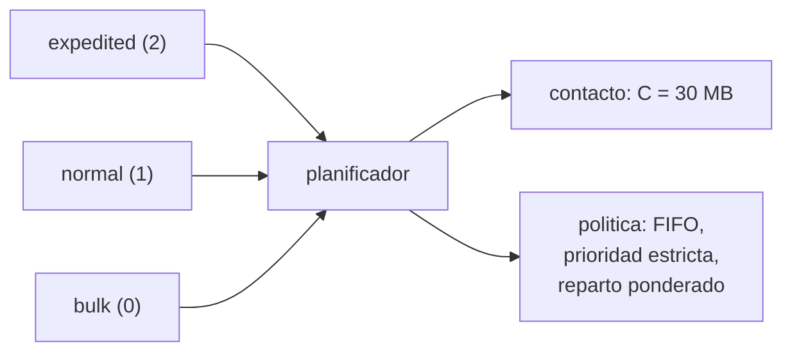

# B94-C05 — Calidad de servicio y prioridades en redes espaciales

<!-- nav:top -->
[🏠 Programa](../../../../README.md) · [📚 Bloque B94](../../../tronco-comun/B94-modulacion-codificacion-y-protocolos-de-enlace.md) · [← Anterior: B94-C04 — Redes con retardo y desconexión: enrutamiento y almacenamiento](../B94-C04-redes-con-retardo-y-desconexion-enrutamiento-y-almacenamiento/CLASE.md) · [Siguiente: B94-C06 — Validación y conformidad de protocolos de enlace →](../B94-C06-validacion-y-conformidad-de-protocolos-de-enlace/CLASE.md)
<!-- /nav -->

## 1. Ubicación, nivel y alcance

Clase 5 del bloque B94. Nivel N3. Un contacto con un relevo es escaso: caben, por ejemplo, 30 MB, y compiten comandos urgentes, telemetría normal y grandes volúmenes de ciencia. Aquí comparas tres disciplinas de cola (FIFO, prioridad estricta y reparto ponderado) con tres clases de servicio, mides retardo, entrega y cola, y ves cuándo una prioridad deja sin servicio a otra clase. Usas las tres clases de servicio del protocolo de paquetes consultado en [B94-C04](../B94-C04-redes-con-retardo-y-desconexion-enrutamiento-y-almacenamiento/CLASE.md). El tráfico y la capacidad son sintéticos.

## 2. Por qué esta clase existe

Si la demanda supera a la capacidad, alguien espera. La decisión central: **¿qué política de cola garantiza lo urgente sin dejar sin servicio a las demás clases, y a qué coste?**

## 3. Lo que podrás hacer al terminar

1. Nombrar las clases de servicio `bulk`, `normal` y `expedited` y su prioridad (0, 1, 2).
2. Describir FIFO, prioridad estricta y reparto ponderado.
3. Medir retardo, fracción entregada y cola por clase.
4. Reconocer la inanición bajo prioridad estricta en sobrecarga.
5. Verificar la conservación (llegado = entregado + en cola) y la no ociosidad.
6. Separar lo consultado (clases de servicio) de lo propio y sintético (disciplinas, tráfico).

La evidencia es la **tabla de latencia por clase de servicio** del ejercicio 12 (sección 20).

## 4. Con qué llegas y cómo comprobarlo

1. ¿Qué es la capacidad de un contacto?
2. ¿Qué es una cola FIFO?
3. ¿Qué es un retardo medio?
4. ¿Qué es la carga ofrecida?
5. ¿Qué es un dato sintético?

<details>
<summary>Ver respuestas</summary>

1. Tasa por duración: los octetos que caben en el contacto. 2. Una cola en que se sirve primero lo que llegó primero. 3. El promedio del tiempo entre la llegada y el fin del servicio. 4. Los octetos que llegan por contacto, comparados con la capacidad. 5. Un dato generado para el ejemplo, no medido.
</details>

Con cuatro o cinco aciertos, sigue; si no, repasa los prerrequisitos.

## 5. Un caso de contexto y casos de referencia

Un contacto lleva 30 MB. Llegan 45 MB por contacto (carga 1,5): 30 % expedited, 50 % normal, 20 % bulk. Con prioridad estricta, lo expedited se entrega al 100 % sin retardo y lo bulk al 0 %; con FIFO, las tres clases esperan lo mismo (unos 335 contactos) y reciben cerca de dos tercios. Es el **ejemplo conductor**; todo es **sintético**.

## 6. Vocabulario

La **clase de servicio** del protocolo de paquetes es `bulk`, `normal` o `expedited`, con prioridad 0, 1 y 2. **FIFO** sirve por orden de llegada. **Prioridad estricta** sirve siempre la clase más alta que tenga datos. El **reparto ponderado** asigna a cada clase una fracción de la capacidad proporcional a su peso (aquí 4 : 2 : 1) y reparte lo que sobra. La **inanición** es la espera indefinida de una clase. Una disciplina **no ociosa** nunca deja capacidad sin usar si hay cola.

## 7. Modelo mental: tres ventanillas con una sola cinta



*Descripción textual:* tres colas alimentan un planificador que decide, con una política, qué parte del contacto de 30 MB va a cada clase.

Analogía: un peaje con carril rápido: si hay demasiados con prioridad, el carril lento no avanza. Límite: aquí la capacidad es el único recurso y el servicio es fluido; una implementación real tiene paquetes indivisibles, memoria y pérdidas.

## 8. La explicación, paso a paso

### 8.1 Con capacidad de sobra

A carga 0,8 las tres disciplinas entregan el 100 % y los retardos son pequeños (de 0 a 0,25 contactos): la política importa poco. Entregado total: 47 964,4 MB, igual en las tres.

### 8.2 Sobrecarga moderada (carga 1,2)

| Disciplina | Clase | Retardo medio (contactos) | Entregado (%) | En cola (MB) |
|---|---|---|---|---|
| FIFO | E / N / B | 169,15 / 169,53 / 170,28 | 83,3 / 83,2 / 82,7 | 3610 / 6097 / 2496 |
| Prioridad | E / N / B | 0,00 / 0,33 / 873,11 | 100 / 100 / 15,5 | 0 / 10 / 12 193 |
| Ponderado | E / N / B | 0,00 / 295,70 / 109,74 | 100 / 70,8 / 88,8 | 0 / 10 584 / 1618 |

FIFO reparte el daño por igual y ni siquiera protege lo urgente. La prioridad estricta protege E y N pero deja a B con 15,5 %. El reparto ponderado protege E, pero perjudica a N: su peso (2/7 de 30 MB ≈ 8,6 MB) es menor que su demanda (18 MB); los pesos deben acompasarse con la demanda.

### 8.3 Sobrecarga fuerte (carga 1,5)

| Disciplina | Clase | Retardo medio (contactos) | Entregado (%) |
|---|---|---|---|
| FIFO | E / N / B | 337,76 / 339,19 / 332,12 | 66,8 / 66,4 / 66,3 |
| Prioridad | E / N / B | 0,00 / 267,77 / sin paquetes completos | 100 / 73,3 / **0,0** |
| Ponderado | E / N / B | 0,00 / 513,12 / 408,74 | 100 / 48,8 / 60,8 |

La carga E + N (36 MB) supera los 30 MB del contacto, y la prioridad estricta no deja nada a B: inanición total. El reparto ponderado garantiza a B al menos `30/7 ≈ 4,3` MB por contacto y por eso entrega el 60,8 %.

### 8.4 Sesgo del retardo medio

El retardo medio solo cuenta paquetes completados. Por eso el 873 de B con prioridad (a 1,2) describe al 15,5 % que sí salió, no al resto. Hay que mirar siempre junto con la fracción entregada y la cola final.

### 8.5 Conservación y no ociosidad

El laboratorio comprueba, para cada disciplina y clase, que `llegado = entregado + en cola` (error < 10⁻⁶ MB) y que el total entregado es idéntico en las tres disciplinas: 60 000 MB cuando hay sobrecarga (2000 contactos × 30 MB). Cambiar la política reparte el servicio, no lo crea.

## 9. Magnitudes, símbolos y unidades

| Símbolo | Qué es | Unidad | Valor / nota |
|---|---|---|---|
| `C` | capacidad por contacto | MB | 30 (sintético) |
| `ρ` | carga ofrecida / `C` | adimensional | 0,8; 1,2; 1,5 |
| `w` | peso del reparto | adimensional | 4; 2; 1 |
| retardo | contacto de salida − contacto de llegada | contactos | ver tablas |
| cola | MB pendientes al final | MB | ver tablas |

## 10. Convenciones y referencias

Clases E, N, B = `expedited`, `normal`, `bulk`. Modelo fluido con fragmentación; llegadas de Poisson por contacto con semilla `94007`; 2000 contactos. No se modelan pérdidas, memoria finita ni ordinales dentro de `expedited`.

## 11. De dónde sale lo que afirmamos

| ID | Fuente | Localizador | Respalda | Estado |
|---|---|---|---|---|
| S1 | CCSDS 734.2-B-1, *CCSDS Bundle Protocol Specification*, Blue Book, septiembre de 2015 — https://ccsds.org/Pubs/734x2b1.pdf (consultada 2026-11-10; texto extraído con PyMuPDF) | 4.3.5 (clase de servicio) y anexo de clase de servicio ampliada | tres clases (bulk, normal, expedited), prioridad 0 a 2 y ordinal dentro de expedited | Consultada |
| — | Disciplinas de cola (FIFO, prioridad estricta, reparto ponderado) | — | las verifica el laboratorio por conservación y no ociosidad | No consultadas en una fuente concreta |

Límites: servicio fluido, tráfico sintético; no se afirma cómo se planifica en ninguna misión.

## 12. Cómo ver el reparto de un enlace

| Magnitud | Valor |
|---|---|
| Carga 1,5, prioridad: B entregado | 0 % |
| Carga 1,5, ponderado: B entregado | 60,8 % |
| Carga 1,2, FIFO: E entregado | 83,3 % |
| Total entregado con sobrecarga | 60 000 MB |

Descripción larga: la prioridad protege a la clase alta a costa de la baja; el reparto ponderado protege un mínimo para cada una; FIFO reparte por igual el perjuicio.

## 13. Ejemplo trabajado: cuota mínima de bulk

**Paso 1 · Pesos.** `4 + 2 + 1 = 7`.

**Paso 2 · Cuota de B.** `30 × 1/7 = 4,29` MB por contacto.

**Paso 3 · Demanda de B a carga 1,5.** `0,2 × 45 = 9` MB.

**Paso 4 · Entrega esperada.** `4,29/9 = 48 %` como mínimo; el laboratorio da 60,8 % porque B también recibe lo que sobra de otras clases.

## 14. Distintas formas de describir una política

**Por regla:** orden o pesos. **Por garantía:** mínimo de capacidad. **Por resultado:** retardo y entrega por clase. **Por riesgo:** inanición. **Por conservación:** total entregado.

## 15. Práctica guiada

**Ejercicio 1 · con los pasos indicados.** Cuota de E con pesos 4 : 2 : 1 y `C = 30`. *Pasos:* `4/7 × 30`.

<details><summary>Solución comentada</summary>

`17,14` MB.
</details>

**Ejercicio 2 · con una pista.** A carga 1,2, ¿cuánto demanda N? *Pista:* `0,5 × 36`.

<details><summary>Solución comentada</summary>

18 MB por contacto, frente a su cuota ponderada de 8,57 MB.
</details>

**Ejercicio 3 · casi autónomo.** ¿Por qué FIFO no protege lo urgente?

<details><summary>Solución comentada</summary>

No mira la clase: todo espera lo mismo, y con sobrecarga la cola crece para todas.
</details>

## 16. Práctica autónoma, transferencia e integrador

**Ejercicio 4 · autónomo.** Demanda de E a carga 1,5.

<details><summary>Solución comentada</summary>

`0,3 × 45 = 13,5` MB por contacto.
</details>

**Ejercicio 5 · autónomo.** ¿A partir de qué carga `ρ` la prioridad estricta deja sin servicio a B, con repartos 30/50/20?

<details><summary>Solución comentada</summary>

Cuando `(0,3 + 0,5) ρ C ≥ C`: `ρ ≥ 1,25`.
</details>

**Ejercicio 6 · autónomo.** ¿Cuánto se entrega en total en 2000 contactos de 30 MB si siempre hay cola?

<details><summary>Solución comentada</summary>

60 000 MB.
</details>

**Ejercicio 7 · autónomo.** El laboratorio da `llegado − entregado − cola < 10⁻⁶`. ¿Qué detecta esta prueba?

<details><summary>Solución comentada</summary>

Que no se crean ni se pierden MB dentro del simulador.
</details>

**Ejercicio 8 · autónomo.** ¿Qué pesos darían a N una cuota de 18 MB con `C = 30` y E y B en proporción 2 : 1 del resto?

<details><summary>Solución comentada</summary>

N = 18/30 = 60 %; el 40 % restante en 2 : 1 da E 26,7 % y B 13,3 %: pesos 4 : 9 : 2 (relación 26,7 : 60 : 13,3).
</details>

**Ejercicio 9 · transferencia.** **Transferencia.** Un equipo de ciencia pide la máxima prioridad para sus datos voluminosos. ¿Qué le respondes?

<details><summary>Solución comentada</summary>

La prioridad alta es para pocos datos críticos; si el volumen supera la capacidad, desplaza a todo lo demás (inanición, 8.3).
</details>

**Ejercicio 10 · transferencia.** **Transferencia.** ¿Por qué una cuota mínima para `bulk` es una decisión de ingeniería de misión y no solo de la cola?

<details><summary>Solución comentada</summary>

Decide qué ciencia o qué telemetría de salud se sacrifica en una sobrecarga; requiere acuerdo entre operaciones y ciencia.
</details>

**Ejercicio 11 · transferencia.** **Transferencia.** ¿Qué cambiaría si los paquetes no pudieran fragmentarse?

<details><summary>Solución comentada</summary>

Quedaría capacidad ociosa al final de cada contacto, el total entregado bajaría y las comparaciones entre políticas se complicarían.
</details>

**Ejercicio 12 · integrador.** **Integrador.** Elabora tu *tabla de latencia por clase de servicio*: retardo medio, fracción entregada y cola por clase, política y carga; incluye la conservación y la lista de qué es consultado, propio y sintético.

<details><summary>Solución comentada</summary>

Secciones 8.1–8.5 y la salida del laboratorio.
</details>

## 17. Laboratorio: tres disciplinas, tres cargas

El script [calidad_servicio.py](calidad_servicio.py) simula 2000 contactos con llegadas de Poisson por clase y compara FIFO, prioridad estricta y reparto ponderado (**comprueba** conservación y total entregado idéntico).

**Datos:** clases de servicio del CCSDS 734.2-B-1 (consultado); tráfico y capacidad **sintéticos**. **Predice antes de ejecutar:** ¿cuánto entregará B con prioridad estricta a carga 1,5? (nada.) **Ejecución del 2026-11-10 (Python 3.12.9):**

```text
Python 3.12.9 (biblioteca estandar)
Capacidad por contacto C = 30.0 MB; reparto de carga E/N/B = {'E': 0.3, 'N': 0.5, 'B': 0.2}; pesos = {'E': 4.0, 'N': 2.0, 'B': 1.0}; 2000 contactos (SINTETICO)

Carga ofrecida = 0.8 C  (24.0 MB por contacto)
 disciplina   clase  retardo medio [contactos]  entregado [%]  en cola al final [MB]
 FIFO           E             0.00               100.0              0.0
 FIFO           N             0.01               100.0              0.0
 FIFO           B             0.23               100.0              0.0
 PRIO           E             0.00               100.0              0.0
 PRIO           N             0.00               100.0              0.0
 PRIO           B             0.25               100.0              0.0
 WFQ            E             0.00               100.0              0.0
 WFQ            N             0.02               100.0              0.0
 WFQ            B             0.21               100.0              0.0
 total entregado (igual en las tres disciplinas) = 47964.4 MB; maximo posible 60000 MB

Carga ofrecida = 1.2 C  (36.0 MB por contacto)
 disciplina   clase  retardo medio [contactos]  entregado [%]  en cola al final [MB]
 FIFO           E           169.15                83.3           3609.8
 FIFO           N           169.53                83.2           6097.0
 FIFO           B           170.28                82.7           2496.0
 PRIO           E             0.00               100.0              0.0
 PRIO           N             0.33               100.0             10.0
 PRIO           B           873.11                15.5          12192.8
 WFQ            E             0.00               100.0              0.0
 WFQ            N           295.70                70.8          10584.4
 WFQ            B           109.74                88.8           1618.4
 total entregado (igual en las tres disciplinas) = 60000.0 MB; maximo posible 60000 MB

Carga ofrecida = 1.5 C  (45.0 MB por contacto)
 disciplina   clase  retardo medio [contactos]  entregado [%]  en cola al final [MB]
 FIFO           E           337.76                66.8           8925.6
 FIFO           N           339.19                66.4          15181.6
 FIFO           B           332.12                66.3           6108.0
 PRIO           E             0.00               100.0              0.0
 PRIO           N           267.77                73.3          12075.2
 PRIO           B              nan                 0.0          18140.0
 WFQ            E             0.00               100.0              0.0
 WFQ            N           513.12                48.8          23106.8
 WFQ            B           408.74                60.8          7108.4
 total entregado (igual en las tres disciplinas) = 60000.0 MB; maximo posible 60000 MB

Pruebas superadas.
```

```bash
python programa/clases/B94/B94-C05-calidad-de-servicio-y-prioridades-en-redes-espaciales/calidad_servicio.py
```

**Límites:** servicio fluido con fragmentación, sin pérdidas ni memoria finita, una sola ruta; `nan` significa que ningún paquete de esa clase llegó a completarse.

## 18. Errores frecuentes y cómo corregirlos

**Leer el retardo medio sin la fracción entregada.** Se corrige con 8.4.

**Pensar que la prioridad crea capacidad.** Se corrige con 8.5.

**Pesos que no siguen a la demanda.** Se corrige con 8.2 y el ejercicio 8.

**Presentar el tráfico sintético como el de una misión.** Se corrige con la sección 10.

## 19. Cómo sabrás que vas bien

Tras la sección 8: ¿qué pasa con B a carga 1,5 bajo prioridad estricta y por qué? Si dudas, repasa el ejemplo 13. Tras el laboratorio: ¿qué comprueba? (ver la sección 17).

## 20. Qué entregas y cómo se evalúa

El producto es tu **tabla de latencia por clase de servicio** (ejercicio 12).

| Criterio | Inicial | En desarrollo | Logrado | Destacado |
|---|---|---|---|---|
| Conceptos | Los confunde | Parciales | Distingue política, clase y carga | Explica los límites |
| Cálculo | Sin unidades | Con errores | Tablas completas con unidades | Calcula casos nuevos |
| Numérico | Sin comprobar | Un caso | Conservación comprobada | Interpreta el sesgo del retardo |
| Fuentes | Sin fuente | Sin fecha | Fuentes con fecha y estado | Declara lo sintético y lo no consultado |
| Límites | No los nombra | Uno | Tres | Discute qué falta del modelo |

**Condiciones críticas (no se compensan con promedio):** rotular el tráfico como sintético; no presentar el retardo sin la fracción entregada; citar solo lo consultado.

## 21. Ética, seguridad y límites

Clase educativa: el tráfico y la capacidad son sintéticos; ninguna política se recomienda para una misión real sin un análisis de operaciones. Accesibilidad: tablas equivalentes a las gráficas, fórmulas en texto, ejercicios sin conexión.

## 22. Para cerrar y seguir

Con sobrecarga, la prioridad estricta protege lo urgente y deja sin servicio a lo voluminoso; el reparto ponderado garantiza un mínimo a cada clase. Queda una pregunta: ¿cómo se prueba que una implementación de todo esto cumple el protocolo?

**Glosario español–inglés.** clase de servicio · *class of service*; prioridad estricta · *strict priority*; inanición · *starvation*; reparto ponderado · *weighted fair queueing*; carga ofrecida · *offered load*.

**Continuidad.** [B94-C06](../B94-C06-validacion-y-conformidad-de-protocolos-de-enlace/CLASE.md) estudia la validación y conformidad de protocolos.

**Referencias:** ver sección 11.

<!-- nav:bottom -->
---

[← Anterior: B94-C04 — Redes con retardo y desconexión: enrutamiento y almacenamiento](../B94-C04-redes-con-retardo-y-desconexion-enrutamiento-y-almacenamiento/CLASE.md) · [📚 Bloque B94](../../../tronco-comun/B94-modulacion-codificacion-y-protocolos-de-enlace.md) · [Siguiente: B94-C06 — Validación y conformidad de protocolos de enlace →](../B94-C06-validacion-y-conformidad-de-protocolos-de-enlace/CLASE.md)
<!-- /nav -->
