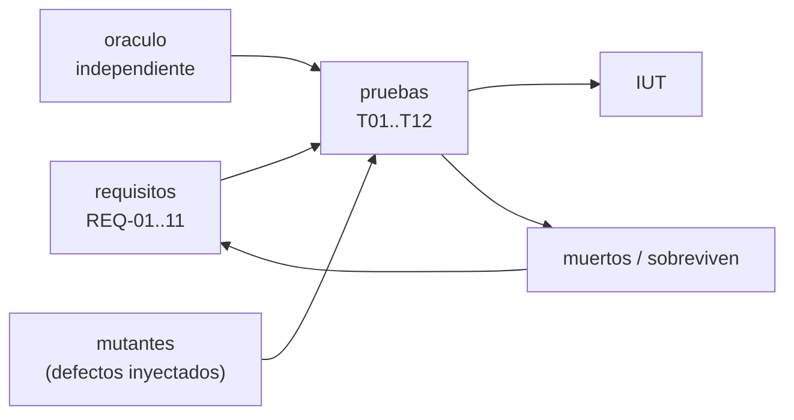

# B94-C06 — Validación y conformidad de protocolos de enlace

<!-- nav:top -->
[🏠 Programa](../../../../README.md) · [📚 Bloque B94](../../../tronco-comun/B94-modulacion-codificacion-y-protocolos-de-enlace.md) · [← Anterior: B94-C05 — Calidad de servicio y prioridades en redes espaciales](../B94-C05-calidad-de-servicio-y-prioridades-en-redes-espaciales/CLASE.md) · [Siguiente: B95-C01 — Unidad CubeSat, dimensiones y formatos →](../../../tronco-comun/B95-plataformas-de-satelites-pequenos-y-cubesat.md#b95-c01)
<!-- /nav -->

## 1. Ubicación, nivel y alcance

Clase 6 del bloque B94. Nivel N3. Dos implementaciones del mismo protocolo solo interoperan si cada una cumple los requisitos del estándar, y eso se demuestra con pruebas, no con confianza. Aquí tomas el codificador de tramas de [B94-C03](../B94-C03-tramas-de-transferencia-de-telemetria-y-telecomando/CLASE.md), escribes una suite de pruebas con un oráculo independiente, casos negativos y trazabilidad a requisitos, descubres defectos reales de tu propia implementación y mides la calidad de la suite con mutantes. Las pruebas generales de sistemas se tratan en B90 (no se redactan aquí). **Esto no es una suite de conformidad oficial.** Los datos son sintéticos.

## 2. Por qué esta clase existe

Una implementación que «funciona con la mía» puede fallar con otra. La decisión central: **¿qué pruebas demuestran que cada requisito se cumple y cómo sabes que tu suite detectaría un defecto?**

## 3. Lo que podrás hacer al terminar

1. Extraer requisitos verificables de un estándar y asignarles identificadores.
2. Construir un oráculo independiente de la implementación.
3. Escribir pruebas positivas y negativas (rechazo de entradas inválidas).
4. Trazar requisitos a pruebas y detectar requisitos con poca cobertura.
5. Medir la suite con mutantes y reconocer a los supervivientes.
6. Separar lo consultado (requisitos de TM) de lo propio (empaquetado sintético).

La evidencia es la **matriz de trazabilidad requisito–prueba con puntuación de mutantes** del ejercicio 12 (sección 20).

## 4. Con qué llegas y cómo comprobarlo

1. ¿Qué es un requisito verificable?
2. ¿Qué es una prueba negativa?
3. ¿Qué es un oráculo de pruebas?
4. ¿Qué es un valor de comprobación de un CRC?
5. ¿Qué es un dato sintético?

<details>
<summary>Ver respuestas</summary>

1. Una afirmación del estándar («shall») que se puede comprobar con un resultado observable. 2. Una prueba que presenta entradas inválidas y espera que se rechacen. 3. Una fuente independiente del resultado esperado. 4. El CRC de una cadena de referencia, para validar la implementación. 5. Un dato generado para el ejemplo, no medido.
</details>

Con cuatro o cinco aciertos, sigue; si no, repasa los prerrequisitos.

## 5. Un caso de contexto y casos de referencia

La implementación de la clase C03 pasaba sus propias pruebas, pero la suite de esta clase muestra que acepta tramas de versión distinta de `00` y de longitud distinta de la fija: fallan `T06` y `T07`. Tras corregirla pasan las 12 pruebas. Luego, de 14 defectos inyectados, la suite detecta 13; el superviviente es un relleno con `0xFF` que ningún requisito consultado fija. Es el **ejemplo conductor**; implementación, tramas y defectos son **sintéticos** y la suite es didáctica.

## 6. Vocabulario

La **conformidad** es el cumplimiento de los requisitos de un estándar. La **implementación bajo prueba** (IUT) es lo que se verifica. Un **vector de prueba** es una entrada con su resultado esperado. Un **oráculo** produce ese resultado de forma independiente. La **trazabilidad** relaciona cada requisito con las pruebas que lo cubren. Un **mutante** es una copia de la IUT con un defecto inyectado; está **muerto** si alguna prueba falla y **sobrevive** si todas pasan. La **puntuación de mutantes** es la fracción de muertos. La **interoperabilidad** es que dos implementaciones distintas intercambien datos.

## 7. Modelo mental: un examen con trampas



*Descripción textual:* los requisitos generan pruebas; el oráculo da los resultados esperados; las pruebas se ejecutan contra la IUT y contra mutantes; los supervivientes señalan requisitos sin prueba y retroalimentan la lista.

Analogía: para saber si un examen es bueno, introduces respuestas erróneas conocidas y ves si el examen las detecta. Límite: que la suite mate todos los mutantes no prueba que la IUT sea conforme, solo que la suite es sensible a esos defectos.

## 8. La explicación, paso a paso

### 8.1 Requisitos

Se extraen de lo consultado en CCSDS 132.0-B-3. Los requisitos 1 a 10 son del estándar; el 11 es del laboratorio:

| ID | Requisito |
|---|---|
| REQ-01 | versión `00` en los bits 0–1 |
| REQ-02 | SCID de 10 bits (bits 2–11) |
| REQ-03 | VCID de 3 bits (bits 12–14) |
| REQ-04 | bandera OCF (bit 15) = 1 si hay OCF |
| REQ-05 | contador de canal maestro de 8 bits, módulo 256 |
| REQ-06 | contador de canal virtual de 8 bits, módulo 256 |
| REQ-07 | FHP de 11 bits; `11111111111` si ningún paquete empieza |
| REQ-08 | FECF con `X¹⁶ + X¹² + X⁵ + 1` y registro inicial a unos |
| REQ-09 | FECF en los dos últimos octetos y verificado por el receptor |
| REQ-10 | rechazar tramas corruptas, de versión no válida o de longitud no fija |
| REQ-11 | (propio) reensamblado de paquetes sintéticos |

Esta lista es una selección y no agota los requisitos del estándar. Que una trama de versión distinta o de longitud distinta se rechace es la lectura que hace el laboratorio de los campos y la longitud fija; lo recoge como requisito propio de robustez (REQ-10).

### 8.2 Oráculo y pruebas

El oráculo construye la cabecera concatenando cadenas de bits (`'00' + SCID en 10 bits + …`) y calcula el FECF con una implementación distinta (por tabla), sin reutilizar la de la IUT. Las 12 pruebas:

| Prueba | Qué comprueba | Requisitos |
|---|---|---|
| T01 | cabecera y FECF de 4 vectores (incluye SCID `0x3FF`, contadores 0 y 255, FHP `0x7FF`) | 01–08 |
| T02 | CRC de `123456789` = `0x29B1` | 08 |
| T03 | CRC sobre trama + FECF = 0 | 08, 09 |
| T04 | ida y vuelta de campos | 01, 02, 03, 05, 06 |
| T05 | un bit corrupto se rechaza (60 casos) | 10 |
| T06 | versión distinta de `00`, con CRC válido, se rechaza | 01, 10 |
| T07 | longitud distinta de 64, con CRC válido, se rechaza | 10 |
| T08 | contadores módulo 256 al dar la vuelta | 05, 06 |
| T09 | FHP con y sin paquete que empiece | 07 |
| T10 | reensamblado sin pérdidas | 11 |
| T11 | huecos detectados y paquetes válidos tras ellos | 06, 11 |
| T12 | bandera OCF y octetos de OCF | 04 |

### 8.3 Defectos reales de la IUT

Contra la implementación de C03: fallan `T06` y `T07`. Esa implementación comprobaba el CRC, pero no la versión ni la longitud; las pruebas positivas de C03 no lo notaban. Tras añadir ambas comprobaciones, pasan 12 de 12. Es el valor de las pruebas negativas: probar lo que **no** debe aceptarse.

### 8.4 Trazabilidad

| Requisito | Pruebas | Nº |
|---|---|---|
| REQ-01 | T01, T04, T06 | 3 |
| REQ-02 | T01, T04 | 2 |
| REQ-03 | T01, T04 | 2 |
| REQ-04 | T01, T12 | 2 |
| REQ-05 | T01, T04, T08 | 3 |
| REQ-06 | T01, T04, T08, T11 | 4 |
| REQ-07 | T01, T09 | 2 |
| REQ-08 | T01, T02, T03 | 3 |
| REQ-09 | T03 | **1** |
| REQ-10 | T05, T06, T07 | 3 |
| REQ-11 | T10, T11 | 2 |

Todos los requisitos tienen al menos una prueba; `REQ-09` solo una: es el candidato a reforzar.

### 8.5 Mutantes

Cada mutante introduce un defecto en la IUT corregida:

| Mutante | Defecto | Resultado |
|---|---|---|
| `init0` | registro inicial del FECF a ceros | muerto (T01, T02, T03) |
| `poly` | polinomio `0x8005` | muerto (T01, T02, T03) |
| `scid_shift` | SCID desplazado 3 bits | muerto (T01, T04) |
| `vcid_mask` | VCID de 2 bits | muerto (T01, T04) |
| `ocf0` | bandera OCF siempre 0 | muerto (T01, T04, T12) |
| `nowrap` | contador satura en 255 | muerto (T08) |
| `pktorder` | bandera de orden de paquetes a 1 | muerto (T01) |
| `little` | primera palabra en little endian | muerto (T01, T04, T08–T12) |
| `crc_nohdr` | FECF sin cubrir la cabecera | muerto (T01, T03, T05) |
| `nocrc` | no verifica el FECF | muerto (T05) |
| `noversion` | no comprueba la versión | muerto (T06) |
| `nolength` | no comprueba la longitud | muerto (T07) |
| `fhp_ninguno` | «ninguno» = `0x7FE` | muerto (T09) |
| `pad_ff` | relleno `0xFF` | **sobrevive** |

Puntuación: 13 de 14 (92,9 %). Sin las pruebas negativas T05–T07 sería 10 de 14 (71,4 %): `nocrc`, `noversion` y `nolength` solo los matan ellas, mientras que el resto cae también con las positivas. El superviviente `pad_ff` es informativo: el relleno de las tramas finales no es requisito del estándar consultado ni de la IUT, pero un receptor real podría malinterpretarlo; añadir un requisito y una prueba lo mataría.

## 9. Magnitudes, símbolos y unidades

| Símbolo | Qué es | Unidad | Valor / nota |
|---|---|---|---|
| REQ-nn | requisito | — | 11 |
| Tnn | prueba | — | 12 |
| mutantes | defectos inyectados | número | 14 |
| puntuación | muertos / total | % | 92,9; 71,4 |
| trama | longitud fija | octetos | 64 (sintético) |

## 10. Convenciones y referencias

Una prueba falla si devuelve falso o lanza una excepción. El oráculo no importa código de la IUT. Datos con semillas `94008` a `94011`. Los defectos de los mutantes son los listados; no se pretende exhaustividad.

## 11. De dónde sale lo que afirmamos

| ID | Fuente | Localizador | Respalda | Estado |
|---|---|---|---|---|
| S1 | CCSDS 132.0-B-3, *TM Space Data Link Protocol*, Blue Book, octubre de 2021 — https://ccsds.org/Pubs/132x0b3.pdf (consultada 2026-11-10; texto extraído con PyMuPDF) | 4.1.2, 4.1.2.7, 4.1.6 | REQ-01 a REQ-09 | Consultada |
| — | Metodología de pruebas con mutantes y de trazabilidad | — | las ejecuta el laboratorio | No consultada en una fuente concreta |
| — | Procedimientos de conformidad e interoperabilidad de CCSDS (p. ej. libros de pruebas) | — | — | No consultados |
| — | CCSDS 232.0-B (telecomando) | — | — | No consultada |

Límites: suite didáctica, sin cobertura del TC ni de todos los «shall», mutantes elegidos por el autor, oráculo escrito por la misma persona que la IUT.

## 12. Cómo ver la calidad de una suite

| Magnitud | Valor |
|---|---|
| Pruebas que fallan en la IUT de C03 | 2 (T06, T07) |
| Pruebas tras corregirla | 12 de 12 |
| Mutantes muertos | 13 de 14 |
| Requisito con una sola prueba | REQ-09 |

Descripción larga: pasar pruebas no basta; hay que ver qué defectos detecta la suite, y los supervivientes y los requisitos con una sola prueba son la lista de trabajo.

## 13. Ejemplo trabajado: qué mata el mutante `nowrap`

**Paso 1 · Defecto.** El contador maestro satura en 255 en vez de dar la vuelta.

**Paso 2 · Prueba que lo ve.** `T08` envía desde el contador 250 y espera `250, 251, …, 255, 0, 1, …`.

**Paso 3 · Resultado.** El mutante produce `255, 255, …`: falla en el séptimo elemento.

**Paso 4 · Lección.** Las pruebas de una sola trama (T01, T04) no ven este defecto; hace falta una secuencia.

## 14. Distintas formas de describir la verificación

**Por requisito:** matriz de trazabilidad. **Por entrada:** vectores válidos e inválidos. **Por defecto:** mutantes. **Por independencia:** oráculo. **Por cobertura:** pruebas por requisito.

## 15. Práctica guiada

**Ejercicio 1 · con los pasos indicados.** Calcula la cabecera de SCID `0x155`, VCID 5, contadores 1 y 2, FHP 51 con OCF. *Pasos:* arma la cadena de bits y pásala a hexadecimal.

<details><summary>Solución comentada</summary>

`00 0101010101 101 1 00000001 00000010 000 11 00000110011` → `0x155B`, `0x01`, `0x02`, `0x1833`; es decir, `155b01021833`.
</details>

**Ejercicio 2 · con una pista.** ¿Qué requisito tiene solo una prueba y qué prueba añadirías? *Pista:* mira la tabla 8.4.

<details><summary>Solución comentada</summary>

REQ-09. Añadir una prueba que ponga el FECF en una posición distinta y compruebe el rechazo.
</details>

**Ejercicio 3 · casi autónomo.** ¿Por qué T06 usa un CRC válido sobre la trama con versión incorrecta?

<details><summary>Solución comentada</summary>

Para aislar el defecto: si el CRC fuera inválido, la trama se rechazaría por el CRC y no se probaría la comprobación de versión.
</details>

## 16. Práctica autónoma, transferencia e integrador

**Ejercicio 4 · autónomo.** Puntuación si la suite matara 11 de 14.

<details><summary>Solución comentada</summary>

`11/14 = 78,6 %`.
</details>

**Ejercicio 5 · autónomo.** ¿Qué defecto sería un mutante equivalente (imposible de matar)?

<details><summary>Solución comentada</summary>

Uno que no cambia el comportamiento observable, por ejemplo reordenar dos instrucciones independientes: sobrevive sin ser un hueco de la suite.
</details>

**Ejercicio 6 · autónomo.** Diseña un mutante que mate T10 pero no T01.

<details><summary>Solución comentada</summary>

Uno que corrompa el reensamblado sin tocar la cabecera, por ejemplo que ignore el FHP al resincronizar.
</details>

**Ejercicio 7 · autónomo.** ¿Por qué el oráculo no debe llamar a la función de la IUT?

<details><summary>Solución comentada</summary>

Si la IUT está mal, el oráculo heredaría el error y la prueba pasaría.
</details>

**Ejercicio 8 · autónomo.** Escribe el requisito que mataría a `pad_ff`.

<details><summary>Solución comentada</summary>

«Los octetos de relleno del campo de datos de la última trama valen `0x00`», con una prueba que lo compruebe; sería un requisito de la convención del laboratorio, no del estándar.
</details>

**Ejercicio 9 · transferencia.** **Transferencia.** Dos equipos implementan el protocolo por separado y ambos pasan su propia suite, pero no interoperan. ¿Qué hacer?

<details><summary>Solución comentada</summary>

Intercambiar vectores de prueba generados por un oráculo común y probar cada implementación contra la del otro; revisar las interpretaciones divergentes de los requisitos.
</details>

**Ejercicio 10 · transferencia.** **Transferencia.** ¿Basta una puntuación de mutantes del 100 % para declarar conformidad?

<details><summary>Solución comentada</summary>

No: solo mide la sensibilidad a los defectos inyectados; la conformidad exige cubrir los requisitos del estándar y, normalmente, un laboratorio acreditado.
</details>

**Ejercicio 11 · transferencia.** **Transferencia.** ¿Qué aporta aquí la prueba negativa que no aportan las positivas?

<details><summary>Solución comentada</summary>

Detecta receptores demasiado permisivos (sección 8.3), que aceptan lo que deberían rechazar.
</details>

**Ejercicio 12 · integrador.** **Integrador.** Elabora tu *matriz de trazabilidad requisito–prueba con puntuación de mutantes*: requisitos con su origen (consultado o propio), pruebas, cobertura por requisito, mutantes con su resultado y la lista de qué es consultado, propio y no consultado.

<details><summary>Solución comentada</summary>

Secciones 8.1–8.5 y la salida del laboratorio.
</details>

## 17. Laboratorio: suite de conformidad y mutantes

El script [conformidad.py](conformidad.py) define la IUT y sus 14 mutantes, un oráculo independiente y 12 pruebas, y calcula la trazabilidad y la puntuación (**comprueba** que la IUT sin corregir falla exactamente T06 y T07, que la corregida pasa todo y que la suite no mata al 100 % de los mutantes).

**Datos:** campos del CCSDS 132.0-B-3 (consultado); tramas, paquetes y defectos **sintéticos**. **Predice antes de ejecutar:** ¿qué pruebas fallan en la implementación de C03? (T06 y T07.) **Ejecución del 2026-11-10 (Python 3.12.9):**

```text
Python 3.12.9 (biblioteca estandar)
1) Suite contra la implementacion de B94-C03 sin corregir (IUT v1):
   fallan: T06, T07
2) Suite contra el IUT corregido (v2):
   superadas 12 de 12
3) Trazabilidad requisito -> pruebas:
   REQ-01 version '00' en bits 0-1: T01, T04, T06 (3)
   REQ-02 SCID de 10 bits (bits 2-11): T01, T04 (2)
   REQ-03 VCID de 3 bits (bits 12-14): T01, T04 (2)
   REQ-04 bandera OCF (bit 15) = 1 si hay OCF: T01, T12 (2)
   REQ-05 contador de canal maestro de 8 bits, modulo 256: T01, T04, T08 (3)
   REQ-06 contador de canal virtual de 8 bits, modulo 256: T01, T04, T08, T11 (4)
   REQ-07 FHP de 11 bits; 11111111111 si ningun paquete empieza: T01, T09 (2)
   REQ-08 FECF: X^16+X^12+X^5+1, registro inicial a unos: T01, T02, T03 (3)
   REQ-09 FECF en los dos ultimos octetos; el receptor lo verifica: T03 (1)
   REQ-10 rechazar tramas corruptas, de version no valida o de longitud no fija: T05, T06, T07 (3)
   REQ-11 (propio, no del estandar) reensamblado de paquetes sinteticos: T10, T11 (2)
4) Mutantes (cada uno con un defecto, sobre el IUT v2):
   init0        FECF con registro inicial a ceros                       -> MUERTO por T01,T02,T03
   poly         FECF con polinomio 0x8005                               -> MUERTO por T01,T02,T03
   scid_shift   SCID desplazado 3 bits en vez de 4                      -> MUERTO por T01,T04
   vcid_mask    VCID limitado a 2 bits                                  -> MUERTO por T01,T04
   ocf0         bandera OCF siempre 0                                   -> MUERTO por T01,T04,T12
   nowrap       contador maestro satura en 255                          -> MUERTO por T08
   pktorder     bandera de orden de paquetes a 1                        -> MUERTO por T01
   little       primera palabra en little endian                        -> MUERTO por T01,T04,T08,T09,T10,T11,T12
   crc_nohdr    FECF sin cubrir la cabecera                             -> MUERTO por T01,T03,T05
   nocrc        el receptor no verifica el FECF                         -> MUERTO por T05
   noversion    el receptor no comprueba la version                     -> MUERTO por T06
   nolength     el receptor no comprueba la longitud                    -> MUERTO por T07
   fhp_ninguno  FHP 'ninguno' = 0x7FE (codigo de datos ociosos)         -> MUERTO por T09
   pad_ff       relleno con 0xFF en vez de 0x00                         -> SOBREVIVE
Puntuacion de mutantes con la suite completa: 13 de 14 = 92.9 %
Puntuacion solo con pruebas positivas (sin T05-T07): 10 de 14 = 71.4 %
Pruebas superadas.
```

```bash
python programa/clases/B94/B94-C06-validacion-y-conformidad-de-protocolos-de-enlace/conformidad.py
```

**Límites:** el autor de la IUT, del oráculo y de los mutantes es el mismo; suite parcial; sin telecomando.

## 18. Errores frecuentes y cómo corregirlos

**Probar solo lo que debe funcionar.** Se corrige con 8.3.

**Usar la IUT como oráculo.** Se corrige con 8.2 y el ejercicio 7.

**Creer que 13 de 14 es conformidad.** Se corrige con el ejercicio 10.

**Ignorar los requisitos con una sola prueba.** Se corrige con 8.4.

## 19. Cómo sabrás que vas bien

Tras la sección 8: ¿qué mutante sobrevive y por qué? Si dudas, repasa el ejemplo 13. Tras el laboratorio: ¿qué comprueba? (ver la sección 17).

## 20. Qué entregas y cómo se evalúa

El producto es tu **matriz de trazabilidad requisito–prueba con puntuación de mutantes** (ejercicio 12).

| Criterio | Inicial | En desarrollo | Logrado | Destacado |
|---|---|---|---|---|
| Conceptos | Los confunde | Parciales | Distingue requisito, prueba y mutante | Explica los límites |
| Cálculo | Sin unidades | Con errores | Matriz y puntuación completas | Calcula casos nuevos |
| Numérico | Sin comprobar | Un caso | Oráculo independiente | Interpreta supervivientes |
| Fuentes | Sin fuente | Sin fecha | Fuentes con fecha y estado | Declara lo propio y lo no consultado |
| Límites | No los nombra | Uno | Tres | Discute qué falta de la suite |

**Condiciones críticas (no se compensan con promedio):** rotular lo propio frente a lo del estándar; no declarar conformidad de la implementación; citar solo lo consultado.

## 21. Ética, seguridad y límites

Clase educativa: ni la IUT ni la suite certifican nada; la conformidad de un equipo de vuelo se demuestra con las pruebas y los laboratorios que exija su programa. Accesibilidad: tablas equivalentes a las gráficas, fórmulas en texto, ejercicios sin conexión.

## 22. Para cerrar y seguir

Una suite de 12 pruebas encontró dos defectos reales en una implementación que «funcionaba» y mató 13 de 14 defectos inyectados; el que sobrevive indica un requisito sin escribir. Con esto se cierra el bloque: de los códigos de corrección a la verificación de que la trama los cumple. Queda una pregunta: ¿cómo se comporta el enlace completo cuando varias de estas capas se prueban juntas en una cadena de extremo a extremo?

**Glosario español–inglés.** conformidad · *conformance*; implementación bajo prueba · *implementation under test*; mutante · *mutant*; trazabilidad · *traceability*; interoperabilidad · *interoperability*.

**Continuidad.** El bloque cierra aquí; el siguiente de la secuencia es [B95](../../../tronco-comun/B95-plataformas-de-satelites-pequenos-y-cubesat.md).

**Referencias:** ver sección 11.

<!-- nav:bottom -->
---

[← Anterior: B94-C05 — Calidad de servicio y prioridades en redes espaciales](../B94-C05-calidad-de-servicio-y-prioridades-en-redes-espaciales/CLASE.md) · [📚 Bloque B94](../../../tronco-comun/B94-modulacion-codificacion-y-protocolos-de-enlace.md) · [Siguiente: B95-C01 — Unidad CubeSat, dimensiones y formatos →](../../../tronco-comun/B95-plataformas-de-satelites-pequenos-y-cubesat.md#b95-c01)
<!-- /nav -->
