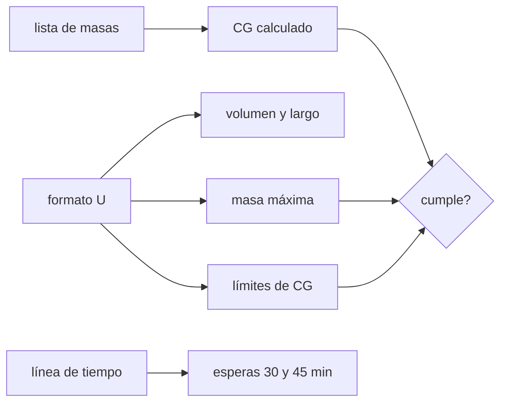

# B95-C01 — Unidad CubeSat, dimensiones y formatos

<!-- nav:top -->
[🏠 Programa](../../../../README.md) · [📚 Bloque B95](../../../tronco-comun/B95-plataformas-de-satelites-pequenos-y-cubesat.md) · [← Anterior: B94-C06 — Validación y conformidad de protocolos de enlace](../../../tronco-comun/B94-modulacion-codificacion-y-protocolos-de-enlace.md#b94-c06) · [Siguiente: B95-C02 — Componentes comerciales en vuelo: selección y riesgo →](../B95-C02-componentes-comerciales-en-vuelo-seleccion-y-riesgo/CLASE.md)
<!-- /nav -->

## 1. Ubicación, nivel y alcance

Clase 1 del bloque B95. Nivel N4. El formato por unidades «U» fija volumen, masa y centro de gravedad que acepta un dispensador de lanzamiento. Aquí verificas una configuración de 1U a 3U contra el CubeSat Design Specification (CDS) Rev. 14.1, calculas su centro de gravedad y compruebas los tiempos de espera del despliegue. Usas [B83](../../../tronco-comun/B83-ingenieria-de-sistemas-y-diseno-de-misiones.md) solo para la idea de requisito y margen. El 3U de la clase es **sintético**: no corresponde a ningún satélite real.

## 2. Por qué esta clase existe

Un CubeSat que no cumple el estándar no entra en el dispensador, aunque funcione perfectamente. La decisión central: **¿esta configuración cabe, pesa y se equilibra dentro de lo que el estándar permite, y cuándo puede encenderse, desplegar y transmitir?**

## 3. Lo que podrás hacer al terminar

1. Leer la tabla de masas máximas y de centro de gravedad del CDS para 1U, 1,5U, 2U y 3U.
2. Calcular el volumen de la envolvente y la densidad media máxima admitida.
3. Calcular el centro de gravedad de una lista de masas puntuales respecto del centro geométrico.
4. Comprobar masa y centro de gravedad con margen y detectar un incumplimiento.
5. Verificar una línea de tiempo contra las esperas de 30 y 45 minutos.
6. Separar lo consultado (estándar) de lo ilustrativo (masas y tiempos del ejemplo) y de lo no consultado (6U y 12U en dibujos).

La evidencia es la **ficha de cumplimiento de una configuración de 3U** del ejercicio 12 (sección 20).

## 4. Con qué llegas y cómo comprobarlo

1. ¿Qué es el centro de gravedad de un conjunto de masas?
2. ¿Qué es un margen de diseño?
3. ¿Qué es un sistema de referencia con origen en el centro geométrico?
4. ¿Qué es un dato sintético?
5. ¿Qué es una verificación por segunda vía?

<details>
<summary>Ver respuestas</summary>

1. El promedio de las posiciones ponderado por las masas. 2. La diferencia entre el límite y el valor calculado. 3. Ejes con el origen en el centro de la caja; cada posición se mide desde él. 4. Un dato generado para el ejemplo, no medido. 5. Calcular lo mismo con otro método y comparar.
</details>

Con cuatro o cinco aciertos, sigue; si no, repasa los prerrequisitos.

## 5. Un caso de contexto y casos de referencia

Un 3U sintético suma `5,000 kg` (límite `6,00 kg`) y tiene el centro de gravedad en `(0,094; 0,115; 2,025) cm`, dentro de `±2 / ±2 / ±7 cm`. Es el **ejemplo conductor**. Todas las masas y posiciones son **ilustrativas**; los límites vienen del CDS. Caso de referencia: el 1U admite `2,00 kg` en `1,135 L`, es decir hasta `1,762 kg/L`, y el 3U la misma densidad media porque su masa y su largo triplican.

## 6. Vocabulario

La **unidad U** es el módulo de `100 × 100 × 113,5 mm` (1U). El **centro de gravedad** (CG) es el promedio de las posiciones ponderado por la masa. El **dispensador** es el contenedor que expulsa al CubeSat. El **interruptor de despliegue** corta la energía mientras el CubeSat está dentro. Un **inhibidor** es un dispositivo físico entre una fuente de energía y un peligro. El **margen** es límite menos valor.

## 7. Modelo mental: una caja de zapatos con reglas de peso



*Descripción textual:* el formato fija volumen, masa máxima y límites de CG; la lista de masas da el CG calculado, que se compara con el límite; la línea de tiempo se compara con las esperas.

Analogía: una caja de zapatos entra en el casillero solo si pesa lo permitido y no se inclina al apoyarla. Límite: el CDS fija valores típicos y un dispensador concreto o el proveedor de lanzamiento pueden exigir menos o evaluar más caso por caso.

## 8. La explicación, paso a paso

### 8.1 Formatos y volumen

Las longitudes de la envolvente (historial de cambios del CDS) son `113,5; 170,2; 227,0 y 340,5 mm` para 1U, 1,5U, 2U y 3U, con sección de `100 × 100 mm`. Volumen 1U: `10 × 10 × 11,35 = 1135 cm³ = 1,135 L`. Las longitudes de 2U y 3U son `2 × 113,5` y `3 × 113,5` con diferencia `0,000 mm`; la de 1,5U difiere `0,05 mm` de `1,5 × 113,5` porque el estándar publica `170,2`.

### 8.2 Masa y centro de gravedad

| Formato | Largo (mm) | Volumen (L) | Masa máx. (kg) | Densidad máx. (kg/L) | Límite CG (cm) |
|---|---|---|---|---|---|
| 1U | 113,5 | 1,135 | 2,00 | 1,762 | ±2 / ±2 / ±2 |
| 1,5U | 170,2 | 1,702 | 3,00 | 1,763 | ±2 / ±2 / ±3 |
| 2U | 227,0 | 2,270 | 4,00 | 1,762 | ±2 / ±2 / ±4,5 |
| 3U | 340,5 | 3,405 | 6,00 | 1,762 | ±2 / ±2 / ±7 |

Las masas son valores típicos máximos: masas mayores pueden evaluarse caso por caso y el dispensador puede admitir menos.

### 8.3 El 3U sintético

Con siete masas puntuales (estructura, baterías, OBC y EPS, carga útil, ADCS, radio y antena, paneles) el laboratorio da masa `5,000 kg` (margen `1,000 kg`) y `CG = (0,094; 0,115; 2,025) cm`. Dos vías de cálculo (promedio ponderado y momentos acumulados) coinciden dentro de `1e-9`.

### 8.4 Sensibilidad y tiempos

Mover la carga útil `2 cm` en `+Z` lleva `CG_z` a `2,585 cm` (`ΔCG = m·Δz/M = 1,40 × 2/5,00 = 0,56 cm`), aún dentro de `±7 cm`. Las reglas 2.4.4 y 2.4.5 exigen esperar al menos `30 min` antes de desplegar y `45 min` antes de transmitir; la línea de tiempo `0, 31, 46 min` cumple. Además, el CDS pide un interruptor de despliegue, una clavija de retirar antes del vuelo, tres inhibidores independientes de RF y tres de liberación de desplegables.

## 9. Magnitudes, símbolos y unidades

| Símbolo | Qué es | Unidad | Valor / nota |
|---|---|---|---|
| `M` | masa total | kg | 5,000 (ilustrativo) |
| `m_i` | masa del elemento `i` | kg | ver laboratorio |
| `r_i` | posición del elemento `i` | cm | desde el centro geométrico |
| `CG` | centro de gravedad | cm | (0,094; 0,115; 2,025) |
| `ρ` | densidad media | kg/L | 1,762 máxima |
| `t` | tiempo tras el interruptor | min | ≥ 30 y ≥ 45 |

## 10. Convenciones y referencias

Sistema de referencia: origen en el centro geométrico y ejes del apartado 2.2.1 del CDS. Unidades SI; milímetros para longitudes de envolvente y centímetros para el CG. Datos de masa, posición y tiempo ilustrativos. CDS Rev. 14.1 en la copia alojada por la NASA; 6U y 12U solo se usan en la tabla de masas y CG del estándar y no se calculan.

## 11. De dónde sale lo que afirmamos

| ID | Fuente | Localizador | Respalda | Estado |
|---|---|---|---|---|
| S1 | Cal Poly CubeSat Program, CubeSat Design Specification (1U–12U) Rev. 14.1 — https://www.nasa.gov/wp-content/uploads/2018/01/cubesatdesignspecificationrev14_12022-02-09.pdf (consultada 2026-11-10; texto extraído con PyMuPDF) | 2.2.10 Tabla 1, 2.2.11 Tabla 2, 2.3, 2.4.4–2.4.5, historial de cambios | Masas máximas, límites de CG, longitudes 113,5/170,2/227,0/340,5 mm, esperas de 30 y 45 min, inhibidores | Consultada |
| S2 | Mismo CDS, Apéndice B (dibujos) | dibujos | Dimensiones completas de 6U y 12U | No consultada (imágenes) |
| — | Centro de gravedad como promedio ponderado | — | lo verifica el laboratorio con dos vías | No consultada en una fuente concreta |

Límites: el estándar es de la comunidad CubeSat y cada dispensador o proveedor puede imponer más; los datos del 3U son sintéticos y no se infiere nada de un satélite real.

## 12. Cómo ver el cumplimiento

| Magnitud | Valor |
|---|---|
| masa del 3U sintético | 5,000 kg (margen 1,000 kg) |
| `CG_z` | 2,025 cm (límite 7) |
| `CG_z` con la carga +2 cm | 2,585 cm |
| espera de despliegue | ≥ 30 min |

Descripción larga: la masa y el CG quedan dentro de los límites; el margen de masa es `1 kg` y el CG está lejos del límite en `Z`.

## 13. Ejemplo trabajado: el CG en Z

**Paso 1 · Momentos.** `Σ m_i z_i` con las siete masas del laboratorio.

**Paso 2 · Masa.** `M = 5,000 kg`.

**Paso 3 · Cociente.** `CG_z = Σ m_i z_i / M = 2,025 cm`.

**Paso 4 · Margen.** `7 − 2,025 = 4,975 cm` hasta el límite.

## 14. Distintas formas de describir la configuración

**Por formato:** 1U a 3U. **Por masa:** `M` y su margen. **Por equilibrio:** `CG` y su margen. **Por tiempo:** esperas de 30 y 45 min. **Por seguridad:** inhibidores y clavija de retirar.

## 15. Práctica guiada

**Ejercicio 1 · con los pasos indicados.** Calcula el volumen de un 1U en litros. *Pasos:* multiplica `10 × 10 × 11,35 cm`.

<details><summary>Solución comentada</summary>

`1135 cm³ = 1,135 L`.
</details>

**Ejercicio 2 · con una pista.** ¿Qué margen de masa tiene el 3U sintético? *Pista:* límite de 3U `6,00 kg`.

<details><summary>Solución comentada</summary>

`6,00 − 5,000 = 1,000 kg`.
</details>

**Ejercicio 3 · casi autónomo.** ¿Cumple `CG_z = 2,025 cm` en un 2U?

<details><summary>Solución comentada</summary>

Sí: el límite en Z de 2U es `±4,5 cm`; margen `2,475 cm`.
</details>

## 16. Práctica autónoma, transferencia e integrador

**Ejercicio 4 · autónomo.** Densidad máxima media de un 2U.

<details><summary>Solución comentada</summary>

`4,00 / 2,270 = 1,762 kg/L`.
</details>

**Ejercicio 5 · autónomo.** ¿Cuánto se corre el CG si la carga útil (`1,40 kg`) se mueve `2 cm`?

<details><summary>Solución comentada</summary>

`1,40 × 2 / 5,000 = 0,56 cm`; de `2,025` a `2,585 cm`.
</details>

**Ejercicio 6 · autónomo.** ¿Cuánto debería moverse la carga útil en `+Z` para llegar a `CG_z = 7 cm`?

<details><summary>Solución comentada</summary>

`Δz = (7 − 2,025) × 5,000/1,40 = 17,8 cm`. Es mayor que el semialto de un 3U (`17,0 cm`): la geometría limita antes que el CG.
</details>

**Ejercicio 7 · autónomo.** Una antena se despliega a los `25 min`. ¿Cumple?

<details><summary>Solución comentada</summary>

No: la regla 2.4.4 pide al menos `30 min` tras activar el interruptor de despliegue.
</details>

**Ejercicio 8 · autónomo.** ¿Cuál es la diferencia entre `1,5 × 113,5` y la longitud publicada de 1,5U?

<details><summary>Solución comentada</summary>

`170,25 − 170,2 = 0,05 mm`; el estándar publica `170,2 ± 0,1 mm`.
</details>

**Ejercicio 9 · transferencia.** **Transferencia.** Un colega usa las dimensiones de 6U de un sitio de terceros. ¿Qué debes advertirle?

<details><summary>Solución comentada</summary>

Que las dimensiones de 6U están en dibujos del CDS no consultados aquí: debe verificarlas en el Apéndice B y con el proveedor del dispensador.
</details>

**Ejercicio 10 · transferencia.** **Transferencia.** El estándar da `6,00 kg` para un 3U, pero el dispensador del lanzamiento admite `5,5 kg`. ¿Cuál manda y qué pasa con el margen?

<details><summary>Solución comentada</summary>

Manda el dispensador (2.2.10.2). El margen del 3U sintético baja a `0,5 kg`.
</details>

**Ejercicio 11 · transferencia.** **Transferencia.** ¿Basta un temporizador para cumplir los tres inhibidores de RF?

<details><summary>Solución comentada</summary>

No: el CDS aclara que un temporizador no es un inhibidor independiente; se necesitan dispositivos físicos.
</details>

**Ejercicio 12 · integrador.** **Integrador.** Elabora tu *ficha de cumplimiento de una configuración de 3U*: tabla de masa y CG con márgenes, variante con una masa movida, línea de tiempo y lista de qué es consultado, ilustrativo y no consultado.

<details><summary>Solución comentada</summary>

Secciones 8.1–8.4 y la salida del laboratorio.
</details>

## 17. Laboratorio: ficha de cumplimiento de un 3U sintético

El script [formato_cubesat.py](formato_cubesat.py) tabula los formatos, calcula el CG con dos vías y verifica una línea de tiempo (**comprueba** masa y CG con dos vías, `3 × 113,5 = 340,5` y los límites).

**Datos:** CDS Rev. 14.1 (consultado); masas, posiciones y tiempos **ilustrativos**. **Predice antes de ejecutar:** ¿cumple el CG tras mover la carga útil? (Sí: `2,585 cm`.) **Ejecución del 2026-11-10 (Python 3.12.9):**

```text
Python 3.12.9 (biblioteca estandar)
Tabla de formatos (CDS Rev. 14.1, consultado) y densidad media maxima:
 fmt   largo[mm]  vol[L]  masa max[kg]  rho_max[kg/L]  CG(x,y,z)[cm]
1U        113.5   1.135        2.00         1.762   (2.0, 2.0, 2.0)
1.5U      170.2   1.702        3.00         1.763   (2.0, 2.0, 3.0)
2U        227.0   2.270        4.00         1.762   (2.0, 2.0, 4.5)
3U        340.5   3.405        6.00         1.762   (2.0, 2.0, 7.0)
3 x 113.5 - 340.5 = 0.000 mm ; 2 x 113.5 - 227.0 = 0.000 mm ; 1.5 x 113.5 - 170.2 = 0.050 mm

3U ILUSTRATIVO (masas sinteticas, no medidas):
  masa total = 5.000 kg (limite 6.00 kg) ; margen = 1.000 kg
  CG = (0.094, 0.115, 2.025) cm ; limites (2.0, 2.0, 7.0)
  cumple masa: True ; cumple CG: True
  variante (carga util +2 cm en Z): CG_z = 2.585 cm ; cumple CG: True
Linea de tiempo ILUSTRATIVA tras la expulsion (reglas 2.4.4 y 2.4.5):
  t =   0.0 min  encendido permitido    cumple
  t =  31.0 min  despliegue de antena   cumple
  t =  46.0 min  primera transmision    cumple
Pruebas superadas.
```

```bash
python programa/clases/B95/B95-C01-unidad-cubesat-dimensiones-y-formatos/formato_cubesat.py
```

**Límites:** masas puntuales; sin tolerancias de fabricación ni inercias; el CDS no sustituye el requisito del dispensador.

## 18. Errores frecuentes y cómo corregirlos

**Medir el CG desde un borde y no desde el centro geométrico.** Se corrige con la sección 10.

**Tratar la masa de la tabla como obligatoria.** Se corrige con 8.2.

**Contar el temporizador como inhibidor.** Se corrige con 8.4.

**Presentar el 3U sintético como un satélite real.** Se corrige con la sección 10.

## 19. Cómo sabrás que vas bien

Tras la sección 8: ¿qué margen de masa esperabas y cuál obtuviste? Si dudas, repasa el ejemplo 13. Tras el laboratorio: ¿qué comprueba? (ver la sección 17).

## 20. Qué entregas y cómo se evalúa

El producto es tu **ficha de cumplimiento de una configuración de 3U** (ejercicio 12).

| Criterio | Inicial | En desarrollo | Logrado | Destacado |
|---|---|---|---|---|
| Conceptos | Los confunde | Parciales | Aplica masa, CG y tiempos | Explica los límites |
| Cálculo | Sin unidades | Con errores | Tablas con unidades y márgenes | Calcula variantes |
| Numérico | Sin comprobar | Una vía | Dos vías coinciden | Interpreta las diferencias |
| Fuentes | Sin fuente | Sin fecha | Fuentes con fecha y estado | Declara lo ilustrativo y lo no consultado |
| Límites | No los nombra | Uno | Tres | Discute qué exige el dispensador |

**Condiciones críticas (no se compensan con promedio):** rotular las masas como sintéticas; no presentar el estándar como certificación de lanzamiento; citar solo lo consultado.

## 21. Ética, seguridad y límites

Clase educativa: los datos son sintéticos o ilustrativos y el cumplimiento del CDS no equivale a la aprobación del proveedor de lanzamiento ni a las licencias de frecuencia. Accesibilidad: tablas equivalentes a las gráficas, fórmulas en texto, ejercicios sin conexión.

## 22. Para cerrar y seguir

Un 3U sintético de `5,000 kg` cumple masa y CG con margen de `1,000 kg` y `4,975 cm`. Queda una pregunta: ¿qué componentes comerciales llenan esa caja y con qué riesgo?

**Glosario español–inglés.** unidad CubeSat · *CubeSat unit*; centro de gravedad · *center of gravity*; dispensador · *dispenser*; inhibidor · *inhibit*; margen · *margin*.

**Continuidad.** [B95-C02](../B95-C02-componentes-comerciales-en-vuelo-seleccion-y-riesgo/CLASE.md) estudia los componentes comerciales en vuelo.

**Referencias:** ver sección 11.

<!-- nav:bottom -->
---

[← Anterior: B94-C06 — Validación y conformidad de protocolos de enlace](../../../tronco-comun/B94-modulacion-codificacion-y-protocolos-de-enlace.md#b94-c06) · [📚 Bloque B95](../../../tronco-comun/B95-plataformas-de-satelites-pequenos-y-cubesat.md) · [Siguiente: B95-C02 — Componentes comerciales en vuelo: selección y riesgo →](../B95-C02-componentes-comerciales-en-vuelo-seleccion-y-riesgo/CLASE.md)
<!-- /nav -->
