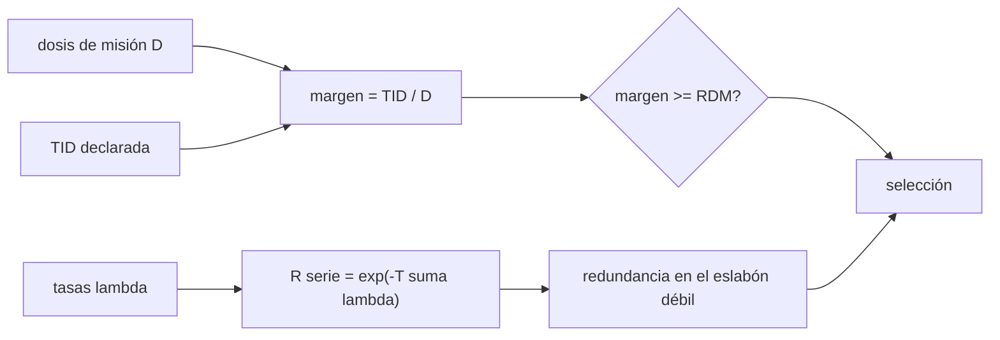

# B95-C02 — Componentes comerciales en vuelo: selección y riesgo

<!-- nav:top -->
[🏠 Programa](../../../../README.md) · [📚 Bloque B95](../../../tronco-comun/B95-plataformas-de-satelites-pequenos-y-cubesat.md) · [← Anterior: B95-C01 — Unidad CubeSat, dimensiones y formatos](../B95-C01-unidad-cubesat-dimensiones-y-formatos/CLASE.md) · [Siguiente: B95-C03 — Selección y comparación de plataformas →](../B95-C03-seleccion-y-comparacion-de-plataformas/CLASE.md)
<!-- /nav -->

## 1. Ubicación, nivel y alcance

Clase 2 del bloque B95. Nivel N4. Los satélites pequeños usan componentes comerciales (COTS) porque son más baratos y rápidos de conseguir que los endurecidos, a cambio de más riesgo. Aquí contrastas la dosis ionizante tolerada por un componente con la dosis de una misión, aplicas un margen de diseño y estimas la supervivencia de un sistema en serie, con y sin redundancia. Usas [B85](../../../tronco-comun/B85-gestion-termica-y-entorno-espacial.md) para el entorno y [B88](../../../tronco-comun/B88-avionica-y-software-critico-espacial.md) para la aviónica; la dosis, las tasas de fallo y el margen de la clase son **ilustrativos**.

## 2. Por qué esta clase existe

Un componente comercial puede funcionar bien en tierra y degradarse o fallar en órbita. La decisión central: **¿qué componente comercial se puede usar en esta misión, con qué margen de radiación y con qué fiabilidad del conjunto?**

## 3. Lo que podrás hacer al terminar

1. Calcular la dosis de una misión a partir de una tasa y una duración.
2. Calcular el margen de dosis de un componente y aplicar un margen de diseño (RDM).
3. Distinguir una dosis tolerada declarada, estimada y ensayada.
4. Calcular la supervivencia de un sistema en serie y comprobarla con Monte Carlo.
5. Evaluar qué componente conviene duplicar.
6. Separar lo consultado (valores declarados por fabricantes) de lo ilustrativo (dosis y tasas) y lo no consultado.

La evidencia es la **matriz de riesgo de componentes comerciales** del ejercicio 12 (sección 20).

## 4. Con qué llegas y cómo comprobarlo

1. ¿Qué es la dosis ionizante total (TID) y en qué unidades se da?
2. ¿Qué es una tasa de fallo constante?
3. ¿Qué es un sistema en serie?
4. ¿Qué es una simulación Monte Carlo con semilla?
5. ¿Qué diferencia hay entre un dato declarado y uno verificado?

<details>
<summary>Ver respuestas</summary>

1. La radiación ionizante absorbida con el tiempo; en krad(Si). 2. Una probabilidad de fallo por unidad de tiempo que no cambia; la vida sigue una exponencial. 3. Uno que falla si falla cualquiera de sus partes. 4. Repetir un experimento aleatorio muchas veces con una semilla fija para reproducirlo. 5. El declarado lo afirma el fabricante; el verificado lo comprobó un tercero con un ensayo.
</details>

Con cuatro o cinco aciertos, sigue; si no, repasa los prerrequisitos.

## 5. Un caso de contexto y casos de referencia

Una misión **ilustrativa** de `2 años` con `6 krad(Si)/año` detrás de blindaje acumula `12 krad(Si)`. Con un margen de diseño `RDM = 2`, un computador de a bordo declarado para `20 krad` queda con margen `1,67` y no pasa; uno declarado para `30 krad` tiene `2,50` y pasa. Es el **ejemplo conductor**. Los valores de TID de los candidatos provienen de la tabla del informe de la NASA y son **declarados por los fabricantes**; la dosis, las tasas de fallo y el RDM son ilustrativos.

## 6. Vocabulario

El **COTS** (*commercial off-the-shelf*) es un componente comercial no diseñado para el espacio. La **TID** es la dosis ionizante total. El **SEU** es un cambio de estado de un bit por una partícula, no destructivo; el **SEL** (*latch-up*) es un estado de corriente alta potencialmente destructivo. El **RDM** (*radiation design margin*) es el cociente exigido entre la dosis tolerada y la de misión. La **tasa de fallo** `λ` es la probabilidad de fallo por año.

## 7. Modelo mental: una cadena de eslabones comerciales



*Descripción textual:* la dosis y la TID declarada dan un margen que se compara con el RDM; las tasas de fallo dan la supervivencia en serie, que mejora duplicando el eslabón más débil; ambos criterios alimentan la selección.

Analogía: una cadena es tan fuerte como su eslabón más débil, y reforzar uno distinto del débil casi no ayuda. Límite: el modelo usa tasa constante y conmutador ideal; no incluye SEL ni SEU, que se mitigan con detección y reinicio.

## 8. La explicación, paso a paso

### 8.1 Dosis y margen

`D = tasa × T = 6 × 2 = 12 krad(Si)`. El margen es `M = TID/D`. Con `RDM = 2`, un componente es aceptable si `TID ≥ 24 krad`.

| Componente (valor declarado) | TID (krad) | Margen | ¿Cumple RDM 2? | Latch-up |
|---|---|---|---|---|
| OBC A (20 krad, sistema) | 20 | 1,67 | No | protegido |
| OBC B (30 krad, PCB) | 30 | 2,50 | Sí | protegido |
| OBC C (40 krad, ensayado) | 40 | 3,33 | Sí | protegido |
| SBC D (60 krad(Si)) | 60 | 5,00 | Sí | sin protección |
| SBC E (100 krad, sin recinto) | 100 | 8,33 | Sí | protegido |

Los valores de TID son los que aparecen declarados en la tabla de aviónica del informe de la NASA; las asignaciones de latch-up de la última columna y sus nombres de fila son **ilustrativos**. Un valor «ensayado», «de PCB» o «de sistema» tiene un nivel de evidencia distinto.

### 8.2 Supervivencia en serie

Con tasas ilustrativas `λ = 0,05; 0,06; 0,07; 0,08; 0,20 /año` (suma `0,46`), `R = exp(−0,46 × 2) = 0,39852`. Monte Carlo (200 000 repeticiones, semilla 20261110) da `0,39840`, a `0,00012` de la fórmula con `σ = 0,00109`.

### 8.3 Redundancia fría

Duplicar el OBC A (`λ = 0,05`) lleva su fiabilidad de `0,90484` a `0,99094`, pero el sistema pasa de `0,39852` a solo `0,43644`: el eslabón débil del sistema es el de `λ = 0,20`. Duplicar ese: `R_par = 1 − (1 − e^(−0,4))² = 0,8913` y el sistema sube a `≈ 0,530` (cuenta a mano: `0,39852/0,67032 × 0,8913`).

### 8.4 Sensibilidad a la dosis

Si la dosis se duplica a `24 krad`, solo cumplen el RDM los componentes de `60` y `100 krad`: el resultado depende de la órbita y del blindaje.

## 9. Magnitudes, símbolos y unidades

| Símbolo | Qué es | Unidad | Valor / nota |
|---|---|---|---|
| `D` | dosis de misión | krad(Si) | 12 (ilustrativo) |
| `TID` | dosis tolerada declarada | krad(Si) | 20 a 100 (declarada) |
| `M` | margen de dosis | — | 1,67 a 8,33 |
| `RDM` | margen de diseño exigido | — | 2 (ilustrativo) |
| `λ` | tasa de fallo | 1/año | 0,05 a 0,20 (ilustrativa) |
| `R` | supervivencia | — | 0,3985 en serie |

## 10. Convenciones y referencias

La dosis es en silicio (krad(Si)) detrás de un blindaje no especificado. Tasa de fallo constante, fallos independientes y conmutador ideal en la redundancia. Las cifras de TID son de fabricantes, vistas en el informe de la NASA, que advierte que no las verificó. Dosis, `λ` y RDM son ilustrativos.

## 11. De dónde sale lo que afirmamos

| ID | Fuente | Localizador | Respalda | Estado |
|---|---|---|---|---|
| S1 | NASA, State-of-the-Art of Small Spacecraft Technology, cap. 8 «Small Spacecraft Avionics» — https://www.nasa.gov/smallsat-institute/sst-soa/small-spacecraft-avionics/ (consultada 2026-11-10; página del 2026-05-19, marcada como archivada; leída por WebFetch) | 8.2.1 y Tabla 8-4 | Los COTS son muy susceptibles a la radiación; mitigaciones (ECC, watchdog, scrubbing, redundancia); valores de TID declarados de 20 a 100 krad | Consultada (últimos 4 591 caracteres no leídos) |
| S2 | NASA SoA 2026, cap. 6 «Structures, Materials, and Mechanisms» — https://www.nasa.gov/smallsat-institute/sst-soa/structures-materials-and-mechanisms/ (2026-11-10) | sección de fiabilidad | Los mecanismos contribuyeron a más del 10 % de las fallas reportadas de satélites pequeños | Consultada (por WebFetch) |
| — | Fiabilidad exponencial, serie y redundancia fría | — | las verifica el laboratorio con Monte Carlo | No consultada en una fuente concreta |

Límites: no se consultó una ficha de componente concreta ni un ensayo de radiación; la dosis y las tasas de fallo son inventadas para la clase.

## 12. Cómo ver el riesgo

| Magnitud | Valor |
|---|---|
| dosis de misión | 12 krad(Si) |
| TID mínima para RDM 2 | 24 krad |
| `R` serie (analítica / Monte Carlo) | 0,39852 / 0,39840 |
| `R` del OBC A simple / par | 0,90484 / 0,99094 |

Descripción larga: la supervivencia del conjunto es baja por la suma de tasas; reforzar el eslabón débil rinde más que reforzar uno ya bueno.

## 13. Ejemplo trabajado: el margen del OBC B

**Paso 1 · Dosis.** `D = 6 × 2 = 12 krad(Si)`.

**Paso 2 · Margen.** `M = 30/12 = 2,50`.

**Paso 3 · Decisión.** `2,50 ≥ 2` → cumple el RDM.

**Paso 4 · Cautela.** El `30 krad` es de nivel de PCB y declarado; no equivale a un ensayo del conjunto.

## 14. Distintas formas de describir el riesgo

**Por dosis:** `M` y RDM. **Por evidencia:** declarado, estimado o ensayado. **Por eventos:** SEU y SEL con mitigación. **Por fiabilidad:** `R` en serie. **Por arquitectura:** dónde duplicar.

## 15. Práctica guiada

**Ejercicio 1 · con los pasos indicados.** Calcula la dosis de una misión de `3 años` a `4 krad(Si)/año`. *Pasos:* multiplica tasa por tiempo.

<details><summary>Solución comentada</summary>

`4 × 3 = 12 krad(Si)`.
</details>

**Ejercicio 2 · con una pista.** Margen de un componente de `40 krad` con esa dosis. *Pista:* `M = TID/D`.

<details><summary>Solución comentada</summary>

`40/12 = 3,33`.
</details>

**Ejercicio 3 · casi autónomo.** ¿Qué TID mínima exige un `RDM = 2` con `12 krad`?

<details><summary>Solución comentada</summary>

`24 krad`.
</details>

## 16. Práctica autónoma, transferencia e integrador

**Ejercicio 4 · autónomo.** Suma de tasas del sistema ilustrativo.

<details><summary>Solución comentada</summary>

`0,05 + 0,06 + 0,07 + 0,08 + 0,20 = 0,46 /año`.
</details>

**Ejercicio 5 · autónomo.** Supervivencia en serie a `2 años`.

<details><summary>Solución comentada</summary>

`exp(−0,92) = 0,3985`; coincide con el laboratorio.
</details>

**Ejercicio 6 · autónomo.** Fiabilidad del par frío con `λ = 0,05` y `T = 2`.

<details><summary>Solución comentada</summary>

`1 − (1 − 0,9048)² = 0,9909`.
</details>

**Ejercicio 7 · autónomo.** ¿A qué eslabón le conviene la redundancia, al de `λ = 0,05` o al de `0,20`?

<details><summary>Solución comentada</summary>

Al de `0,20`: el sistema sube a `≈ 0,530` frente a `0,436` (sección 8.3).
</details>

**Ejercicio 8 · autónomo.** Con una misión de `5 años` y `6 krad/año`, ¿qué componentes cumplen `RDM = 2`?

<details><summary>Solución comentada</summary>

`D = 30 krad` → se exigen `60 krad`: cumplen el de `60` (justo, margen `2,0`) y el de `100`.
</details>

**Ejercicio 9 · transferencia.** **Transferencia.** Un OBC dice «30 krad estimado, no ensayado» y otro «ensayado a 40 krad». ¿Cuál elegirías con igual precio y por qué?

<details><summary>Solución comentada</summary>

El ensayado: tiene más evidencia, aunque `30` estimado ya pase el RDM con margen `2,5`; lo estimado puede estar equivocado.
</details>

**Ejercicio 10 · transferencia.** **Transferencia.** Un componente tiene `100 krad` de TID pero no tiene protección de latch-up. ¿Basta el margen de dosis?

<details><summary>Solución comentada</summary>

No: la TID no cubre el SEL, que es otro mecanismo; se necesita detección y corte de corriente o un ensayo de SEL.
</details>

**Ejercicio 11 · transferencia.** **Transferencia.** ¿Por qué no sirve presentar la simulación Monte Carlo como observación de vuelo?

<details><summary>Solución comentada</summary>

Porque usa tasas inventadas; solo verifica el código frente a la fórmula, no la fiabilidad real.
</details>

**Ejercicio 12 · integrador.** **Integrador.** Elabora tu *matriz de riesgo de componentes comerciales*: dosis, margen frente al RDM, nivel de evidencia, latch-up, supervivencia en serie y qué duplicar, con lo consultado y lo ilustrativo.

<details><summary>Solución comentada</summary>

Secciones 8.1–8.4 y la salida del laboratorio.
</details>

## 17. Laboratorio: margen de dosis y supervivencia

El script [riesgo_comercial.py](riesgo_comercial.py) calcula los márgenes, la supervivencia en serie (analítica y Monte Carlo) y el efecto de la redundancia (**comprueba** Monte Carlo dentro de 4σ y que el par supera al simple).

**Datos:** TID declaradas (consultadas); dosis, `λ`, RDM y protección de latch-up **ilustrativos**. **Predice antes de ejecutar:** ¿qué componente falla el RDM? (El de 20 krad.) **Ejecución del 2026-11-10 (Python 3.12.9):**

```text
Python 3.12.9 (biblioteca estandar)
Dosis de mision ILUSTRATIVA D = 6.0 krad(Si)/anio x 2.0 anios = 12.00 krad(Si); RDM = 2.0
 componente                       TID[krad]  margen  RDM?   latch-up
 OBC A (20 krad declarado)           20.0    1.67  NO     protegido
 OBC B (30 krad, PCB)                30.0    2.50  si     protegido
 OBC C (40 krad ensayado)            40.0    3.33  si     protegido
 SBC D (60 krad(Si))                 60.0    5.00  si     sin proteccion
 SBC E (100 krad, sin recinto)      100.0    8.33  si     protegido
Supervivencia en serie de los 5 (analitica) R = 0.39852
Monte Carlo (N = 200000, semilla 20261110) R = 0.39840 ; |dif| = 0.00012 ; sigma = 0.00109
Efecto de la redundancia fria en el OBC A (lambda = 0.05/anio, T = 2 anios):
  simple R = 0.90484 ; par R = 0.99094
  sistema con OBC A duplicado R = 0.43644
Con la dosis duplicada (24.0 krad) cumplen RDM: [False, False, False, True, True]
Pruebas superadas.
```

```bash
python programa/clases/B95/B95-C02-componentes-comerciales-en-vuelo-seleccion-y-riesgo/riesgo_comercial.py
```

**Límites:** tasa constante, fallos independientes, conmutador ideal, sin SEL ni SEU; los valores de TID son declarados por fabricantes.

## 18. Errores frecuentes y cómo corregirlos

**Tomar la TID declarada como verificada.** Se corrige con 8.1.

**Duplicar el componente más fiable.** Se corrige con 8.3.

**Creer que la TID cubre el latch-up.** Se corrige con el ejercicio 10.

**Presentar la simulación como un dato de vuelo.** Se corrige con la sección 10.

## 19. Cómo sabrás que vas bien

Tras la sección 8: ¿qué margen esperabas para el OBC A y cuál obtuviste? Si dudas, repasa el ejemplo 13. Tras el laboratorio: ¿qué comprueba? (ver la sección 17).

## 20. Qué entregas y cómo se evalúa

El producto es tu **matriz de riesgo de componentes comerciales** (ejercicio 12).

| Criterio | Inicial | En desarrollo | Logrado | Destacado |
|---|---|---|---|---|
| Conceptos | Los confunde | Parciales | Aplica margen y RDM | Explica los límites |
| Cálculo | Sin unidades | Con errores | Tablas con unidades | Calcula casos nuevos |
| Numérico | Sin comprobar | Una vía | Monte Carlo contra la fórmula | Interpreta la dispersión |
| Fuentes | Sin fuente | Sin fecha | Fuentes con fecha y estado | Declara lo ilustrativo y lo no consultado |
| Límites | No los nombra | Uno | Tres | Discute SEL y evidencia |

**Condiciones críticas (no se compensan con promedio):** rotular dosis y tasas como ilustrativas; no tratar un valor declarado como verificado; citar solo lo consultado.

## 21. Ética, seguridad y límites

Clase educativa: los datos son ilustrativos y ningún resultado sustituye a un análisis de radiación de la misión ni a ensayos del componente. Los nombres de filas del ejemplo no corresponden a productos. Accesibilidad: tablas equivalentes a las gráficas, fórmulas en texto, ejercicios sin conexión.

## 22. Para cerrar y seguir

Con `12 krad(Si)` y `RDM = 2` fallan los componentes de menos de `24 krad`, y la supervivencia en serie es `0,3985`: reforzar el eslabón débil la lleva a `≈ 0,53`. Queda una pregunta: ¿cómo se compara una plataforma con otra con criterios trazables?

**Glosario español–inglés.** dosis ionizante total · *total ionizing dose*; componente comercial · *commercial off-the-shelf part*; latch-up · *single-event latch-up*; margen de diseño · *design margin*; redundancia fría · *cold redundancy*.

**Continuidad.** [B95-C03](../B95-C03-seleccion-y-comparacion-de-plataformas/CLASE.md) compara plataformas.

**Referencias:** ver sección 11.

<!-- nav:bottom -->
---

[← Anterior: B95-C01 — Unidad CubeSat, dimensiones y formatos](../B95-C01-unidad-cubesat-dimensiones-y-formatos/CLASE.md) · [📚 Bloque B95](../../../tronco-comun/B95-plataformas-de-satelites-pequenos-y-cubesat.md) · [Siguiente: B95-C03 — Selección y comparación de plataformas →](../B95-C03-seleccion-y-comparacion-de-plataformas/CLASE.md)
<!-- /nav -->
