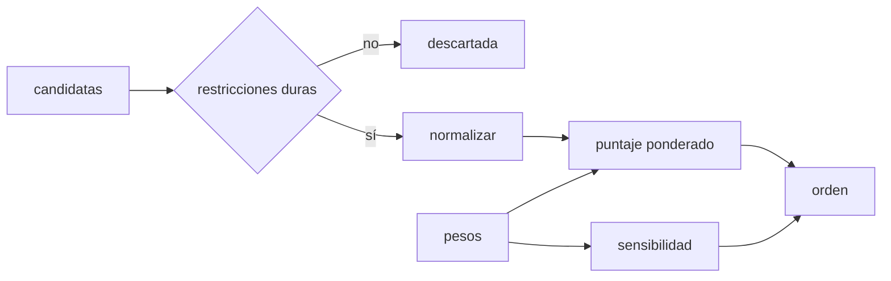

# B95-C03 — Selección y comparación de plataformas

<!-- nav:top -->
[🏠 Programa](../../../../README.md) · [📚 Bloque B95](../../../tronco-comun/B95-plataformas-de-satelites-pequenos-y-cubesat.md) · [← Anterior: B95-C02 — Componentes comerciales en vuelo: selección y riesgo](../B95-C02-componentes-comerciales-en-vuelo-seleccion-y-riesgo/CLASE.md) · [Siguiente: B95-C04 — Antenas desplegables para satélites pequeños →](../B95-C04-antenas-desplegables-para-satelites-pequenos/CLASE.md)
<!-- /nav -->

## 1. Ubicación, nivel y alcance

Clase 3 del bloque B95. Nivel N4. Entre varias plataformas disponibles hay que decidir con criterios que otro pueda revisar. Aquí separas las restricciones duras de los criterios ponderados, normalizas atributos con unidades distintas, calculas un puntaje y compruebas si el orden resiste cambios en los pesos y en el método de normalización. Usas [B83](../../../tronco-comun/B83-ingenieria-de-sistemas-y-diseno-de-misiones.md) para los requisitos y [B95-C01](../B95-C01-unidad-cubesat-dimensiones-y-formatos/CLASE.md) para los formatos. Las cuatro plataformas de la clase son **sintéticas** y no representan productos.

## 2. Por qué esta clase existe

Elegir una plataforma «porque la conocemos» no se puede defender. La decisión central: **¿qué plataforma cumple lo imprescindible, cuál puntúa mejor y cuánto depende ese resultado de los pesos que elegimos?**

## 3. Lo que podrás hacer al terminar

1. Descartar candidatas con restricciones duras que no se compensan.
2. Normalizar criterios de beneficio y de coste a `[0, 1]`.
3. Calcular un puntaje ponderado con pesos que suman 1.
4. Contrastar dos métodos de normalización.
5. Medir la estabilidad del orden con pesos aleatorios con semilla.
6. Redactar un registro de decisión que separe lo consultado, lo ilustrativo y lo no consultado.

La evidencia es el **registro de decisión trazable entre plataformas** del ejercicio 12 (sección 20).

## 4. Con qué llegas y cómo comprobarlo

1. ¿Qué es un requisito y qué es un criterio de preferencia?
2. ¿Qué es normalizar un atributo?
3. ¿Qué es un peso?
4. ¿Qué es una distribución de Dirichlet(1,…,1)?
5. ¿Qué es una verificación por segunda vía?

<details>
<summary>Ver respuestas</summary>

1. El requisito se cumple o no; el criterio ordena las opciones que lo cumplen. 2. Llevarlo a una escala común sin unidades. 3. La importancia relativa de un criterio; aquí suman 1. 4. La distribución uniforme sobre los vectores de pesos positivos que suman 1. 5. Calcular lo mismo con otro método y comparar.
</details>

Con cuatro o cinco aciertos, sigue; si no, repasa los prerrequisitos.

## 5. Un caso de contexto y casos de referencia

Cuatro plataformas sintéticas (A 3U, B 6U, C 6U, D 12U) compiten por una misión **ilustrativa** que exige `≥ 1,2 kg` de carga útil y `≥ 8 W`. La A se descarta (`1,0 kg` y `6 W`). Entre B, C y D gana D con `0,633` frente a `0,403` y `0,378`, pero con pesos aleatorios D gana solo `46,9 %` de las veces. Es el **ejemplo conductor**. Los atributos, los requisitos y los pesos son **ilustrativos**.

## 6. Vocabulario

Una **restricción dura** es un requisito que descarta si no se cumple. Un **criterio de beneficio** es mejor cuanto mayor; uno de **coste** es mejor cuanto menor. La **normalización min-max** lleva el mejor valor a 1 y el peor a 0. El **puntaje ponderado** es `Σ w_j x_j`. La **sensibilidad** mide cuánto cambia la decisión al cambiar los pesos.

## 7. Modelo mental: un embudo y luego una balanza



*Descripción textual:* las candidatas pasan primero por las restricciones duras; las que quedan se normalizan y se puntúan con los pesos; la sensibilidad repite el puntaje con pesos distintos.

Analogía: un embudo que deja pasar solo lo que cabe, y después una balanza cuyo resultado cambia si cambias las pesas. Límite: el puntaje aditivo compensa criterios entre sí, algo que las restricciones duras evitan solo para lo que se declara como requisito.

## 8. La explicación, paso a paso

### 8.1 Restricciones duras

La A (`1,0 kg`, `6,0 W`) no llega a `1,2 kg` ni a `8 W` y se descarta **antes** de ponderar: ningún precio bajo la compensa.

### 8.2 Normalización y puntaje

Para B, C y D los valores normalizados por min-max (coste, plazo y apuntamiento invertidos) y los pesos `0,30; 0,20; 0,20; 0,20; 0,10` dan:

| Plataforma | Carga | Potencia | Apuntamiento | Coste | Plazo | Puntaje |
|---|---|---|---|---|---|---|
| B 6U | 0,167 | 0,267 | 0,000 | 1,000 | 1,000 | 0,4033 |
| C 6U | 0,000 | 0,000 | 1,000 | 0,556 | 0,667 | 0,3778 |
| D 12U | 1,000 | 1,000 | 0,667 | 0,000 | 0,000 | 0,6333 |

Cuenta a mano para B: `0,3 × 0,167 + 0,2 × 0,267 + 0 + 0,2 × 1 + 0,1 × 1 = 0,4033`.

### 8.3 Segunda vía de normalización

Con normalización vectorial (cada atributo dividido por la norma del vector) el orden es el mismo: D, B, C. Que dos métodos coincidan da confianza, pero no demuestra que el orden sea correcto.

### 8.4 Sensibilidad y dependencia de la lista

Con 20 000 vectores de pesos aleatorios (semilla 20261110) ganan B `35,85 %`, C `17,24 %` y D `46,91 %`: D es la más probable pero no domina. Al quitar D y renormalizar, el orden pasa a B primero, C segundo. Con la normalización min-max el puntaje de una plataforma depende de las demás candidatas.

## 9. Magnitudes, símbolos y unidades

| Símbolo | Qué es | Unidad | Valor / nota |
|---|---|---|---|
| `x_ij` | atributo `j` de la plataforma `i` | kg, W, arcsec, kUSD, meses | ilustrativo |
| `w_j` | peso del criterio | — | suma 1 |
| `x̂_ij` | atributo normalizado | — | 0 a 1 |
| `S_i` | puntaje | — | 0,3778 a 0,6333 |
| `p_i` | fracción de victorias | — | 0,1724 a 0,4691 |

## 10. Convenciones y referencias

Requisitos y pesos ilustrativos. Plataformas sintéticas: los nombres A–D no corresponden a productos reales. Unidades: kg, W, arcsec (menos es mejor), kUSD ilustrativos y meses. Aleatoriedad: semilla 20261110. El CDS Rev. 14.1 (consultado) da `6,00 kg` para 3U y `12,00 kg` para 6U como masa máxima típica, y se usa solo como contexto.

## 11. De dónde sale lo que afirmamos

| ID | Fuente | Localizador | Respalda | Estado |
|---|---|---|---|---|
| S1 | Cal Poly CubeSat Design Specification Rev. 14.1 — https://www.nasa.gov/wp-content/uploads/2018/01/cubesatdesignspecificationrev14_12022-02-09.pdf (consultada 2026-11-10) | Tabla 1 | Masa máxima típica 3U 6,00 kg y 6U 12,00 kg | Consultada |
| S2 | NASA SoA 2026, índice general — https://www.nasa.gov/smallsat-institute/sst-soa/ (consultada 2026-11-10) | lista de capítulos | Existencia de un capítulo de plataformas completas y de integración, lanzamiento y despliegue | Consultada |
| S3 | NASA SoA 2026, capítulo de plataformas completas | — | Tablas de plataformas reales | No consultada (la página no se pudo recuperar) |
| — | Suma ponderada, normalización min-max y vectorial, Dirichlet | — | las verifica el laboratorio con una segunda vía | No consultada en una fuente concreta |

Límites: no se usan datos de plataformas reales; los atributos son inventados y el resultado no recomienda ningún producto.

## 12. Cómo ver la decisión

| Magnitud | Valor |
|---|---|
| plataformas que pasan las restricciones | B, C, D |
| puntajes (min-max) | D 0,6333; B 0,4033; C 0,3778 |
| victorias con pesos aleatorios | D 0,4691; B 0,3585; C 0,1724 |
| orden sin D | B, C |

Descripción larga: D lidera pero no domina; el orden entre B y C cambia según los pesos.

## 13. Ejemplo trabajado: el puntaje de D

**Paso 1 · Normalizar.** Carga `1,0`, potencia `1,0`, apuntamiento `0,667`, coste `0`, plazo `0`.

**Paso 2 · Ponderar.** `0,3 × 1 + 0,2 × 1 + 0,2 × 0,667 + 0,2 × 0 + 0,1 × 0`.

**Paso 3 · Sumar.** `0,3 + 0,2 + 0,1333 = 0,6333`.

**Paso 4 · Cautela.** Es el primero con estos pesos, no con todos.

## 14. Distintas formas de describir la decisión

**Por restricción:** pasa o no pasa. **Por puntaje:** `S_i`. **Por orden:** ranking. **Por robustez:** fracción de victorias. **Por trazabilidad:** quién fijó los pesos y con qué fuente.

## 15. Práctica guiada

**Ejercicio 1 · con los pasos indicados.** ¿Qué plataformas descarta la restricción de `1,2 kg` y `8 W`? *Pasos:* compara cada una con ambos límites.

<details><summary>Solución comentada</summary>

La A (`1,0 kg`, `6 W`). B, C y D pasan.
</details>

**Ejercicio 2 · con una pista.** Normaliza el coste de B entre B, C y D. *Pista:* menos es mejor; `900`, `1300`, `1800`.

<details><summary>Solución comentada</summary>

B es el más barato: `(1800 − 900)/(1800 − 900) = 1` para el máximo coste menos el suyo; el valor normalizado de B es `1,0`.
</details>

**Ejercicio 3 · casi autónomo.** Comprueba que los pesos suman 1.

<details><summary>Solución comentada</summary>

`0,30 + 0,20 + 0,20 + 0,20 + 0,10 = 1,00`.
</details>

## 16. Práctica autónoma, transferencia e integrador

**Ejercicio 4 · autónomo.** Puntaje de C con los pesos del ejemplo.

<details><summary>Solución comentada</summary>

`0 + 0 + 0,2 × 1 + 0,2 × 0,556 + 0,1 × 0,667 = 0,3778`.
</details>

**Ejercicio 5 · autónomo.** Puntajes con pesos iguales (`0,2` cada uno).

<details><summary>Solución comentada</summary>

D `0,533`, B `0,487`, C `0,444` (cuenta a mano con la tabla 8.2): D sigue primero, pero B se acerca.
</details>

**Ejercicio 6 · autónomo.** Verifica que las fracciones de victorias suman 1.

<details><summary>Solución comentada</summary>

`0,3585 + 0,1724 + 0,4691 = 1,0000`.
</details>

**Ejercicio 7 · autónomo.** ¿Qué significa que D gane `46,9 %`?

<details><summary>Solución comentada</summary>

Que con pesos al azar uniformes D es la mejor poco menos de la mitad de las veces: la decisión no es robusta frente a los pesos.
</details>

**Ejercicio 8 · autónomo.** ¿Qué indica que ambas normalizaciones den el mismo orden?

<details><summary>Solución comentada</summary>

Que el orden no depende de ese método en este caso; no prueba que los pesos sean correctos.
</details>

**Ejercicio 9 · transferencia.** **Transferencia.** Al quitar D, ¿por qué cambian los puntajes de B y C?

<details><summary>Solución comentada</summary>

Porque min-max usa el mínimo y el máximo de las candidatas: cambiar la lista cambia la escala.
</details>

**Ejercicio 10 · transferencia.** **Transferencia.** Un proveedor ofrece la A con un precio casi nulo. ¿Entra?

<details><summary>Solución comentada</summary>

No: la restricción dura no se compensa con el precio; solo entraría si el requisito se revisa y se documenta.
</details>

**Ejercicio 11 · transferencia.** **Transferencia.** Quieres usar plataformas reales. ¿Qué debes cambiar?

<details><summary>Solución comentada</summary>

Reemplazar los atributos por datos de fichas citadas con fecha, rotularlos como declarados por el fabricante y registrar quién fijó los pesos.
</details>

**Ejercicio 12 · integrador.** **Integrador.** Elabora tu *registro de decisión trazable entre plataformas*: requisitos, restricciones, normalización, pesos, puntajes, sensibilidad y lista de lo consultado, ilustrativo y no consultado.

<details><summary>Solución comentada</summary>

Secciones 8.1–8.4 y la salida del laboratorio.
</details>

## 17. Laboratorio: decisión entre cuatro plataformas sintéticas

El script [decision_plataformas.py](decision_plataformas.py) aplica restricciones, puntúa con dos normalizaciones y mide la sensibilidad a los pesos (**comprueba** que los pesos suman 1, que lo normalizado está en `[0, 1]`, que A se descarta y que las victorias suman `N`).

**Datos:** CDS (contexto); plataformas, requisitos y pesos **sintéticos**. **Predice antes de ejecutar:** ¿gana D con todos los pesos aleatorios? (No: `≈ 47 %`.) **Ejecución del 2026-11-10 (Python 3.12.9):**

```text
Python 3.12.9 (biblioteca estandar)
Requisitos ILUSTRATIVOS: carga util >= 1.2 kg ; potencia >= 8.0 W
Plataformas candidatas SINTETICAS (no son productos reales):
  A 3U   carga  1.0 kg  P   6.0 W  apunt.  60.0  coste   450.0 kUSD  plazo  8.0 m  -> DESCARTADA
  B 6U   carga  2.5 kg  P  14.0 W  apunt.  30.0  coste   900.0 kUSD  plazo 12.0 m  -> pasa restricciones
  C 6U   carga  2.0 kg  P  10.0 W  apunt.  15.0  coste  1300.0 kUSD  plazo 14.0 m  -> pasa restricciones
  D 12U  carga  5.0 kg  P  25.0 W  apunt.  20.0  coste  1800.0 kUSD  plazo 18.0 m  -> pasa restricciones
Pesos ILUSTRATIVOS [0.3, 0.2, 0.2, 0.2, 0.1] (suma = 1.00)
Puntaje ponderado (min-max):
  D 12U  0.6333
  B 6U   0.4033
  C 6U   0.3778
Orden con normalizacion vectorial (segunda via): ['D 12U', 'B 6U', 'C 6U'] ; orden min-max: ['D 12U', 'B 6U', 'C 6U']
Sensibilidad: pesos Dirichlet(1,...,1), N = 20000, semilla 20261110; fraccion de victorias:
  B 6U   0.3585
  C 6U   0.1724
  D 12U  0.4691
Sin D 12U (min-max renormaliza): orden = ['B 6U', 'C 6U']  (antes: ['D 12U', 'B 6U', 'C 6U'])
Pruebas superadas.
```

```bash
python programa/clases/B95/B95-C03-seleccion-y-comparacion-de-plataformas/decision_plataformas.py
```

**Límites:** puntaje aditivo y pesos independientes; plataformas sintéticas; sin incertidumbre en los atributos.

## 18. Errores frecuentes y cómo corregirlos

**Compensar un requisito con un puntaje.** Se corrige con 8.1.

**Fijar los pesos sin dejar constancia.** Se corrige con la sección 14.

**Tomar el ranking como robusto.** Se corrige con 8.4.

**Presentar las plataformas sintéticas como productos.** Se corrige con la sección 10.

## 19. Cómo sabrás que vas bien

Tras la sección 8: ¿qué orden esperabas y cuál obtuviste? Si dudas, repasa el ejemplo 13. Tras el laboratorio: ¿qué comprueba? (ver la sección 17).

## 20. Qué entregas y cómo se evalúa

El producto es tu **registro de decisión trazable entre plataformas** (ejercicio 12).

| Criterio | Inicial | En desarrollo | Logrado | Destacado |
|---|---|---|---|---|
| Conceptos | Los confunde | Parciales | Separa restricción y criterio | Explica los límites |
| Cálculo | Sin unidades | Con errores | Tablas con unidades | Calcula casos nuevos |
| Numérico | Sin comprobar | Una vía | Dos normalizaciones | Mide la sensibilidad |
| Fuentes | Sin fuente | Sin fecha | Fuentes con fecha y estado | Declara lo ilustrativo y lo no consultado |
| Límites | No los nombra | Uno | Tres | Discute la dependencia de la lista |

**Condiciones críticas (no se compensan con promedio):** rotular las plataformas y los pesos como ilustrativos; no recomendar un producto real; citar solo lo consultado.

## 21. Ética, seguridad y límites

Clase educativa: los datos son sintéticos y ninguna cifra describe un producto ni recomienda un proveedor. Una decisión real exige datos de fichas citadas, revisión de pares y trazabilidad de quién fijó los pesos. Accesibilidad: tablas equivalentes a las gráficas, fórmulas en texto, ejercicios sin conexión.

## 22. Para cerrar y seguir

De cuatro plataformas sintéticas una se descarta, D lidera con `0,633` pero gana solo `46,9 %` con pesos aleatorios, y sin D el orden cambia. Queda una pregunta: ¿cómo se pliega una antena larga en un volumen mínimo?

**Glosario español–inglés.** restricción dura · *hard constraint*; criterio · *criterion*; peso · *weight*; sensibilidad · *sensitivity*; plataforma · *platform*.

**Continuidad.** [B95-C04](../B95-C04-antenas-desplegables-para-satelites-pequenos/CLASE.md) estudia las antenas desplegables.

**Referencias:** ver sección 11.

<!-- nav:bottom -->
---

[← Anterior: B95-C02 — Componentes comerciales en vuelo: selección y riesgo](../B95-C02-componentes-comerciales-en-vuelo-seleccion-y-riesgo/CLASE.md) · [📚 Bloque B95](../../../tronco-comun/B95-plataformas-de-satelites-pequenos-y-cubesat.md) · [Siguiente: B95-C04 — Antenas desplegables para satélites pequeños →](../B95-C04-antenas-desplegables-para-satelites-pequenos/CLASE.md)
<!-- /nav -->
