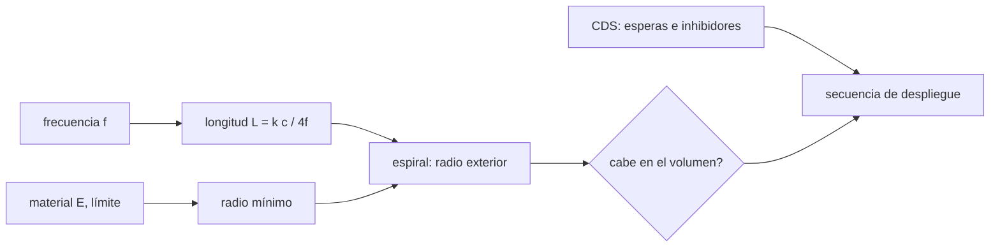

# B95-C04 — Antenas desplegables para satélites pequeños

<!-- nav:top -->
[🏠 Programa](../../../../README.md) · [📚 Bloque B95](../../../tronco-comun/B95-plataformas-de-satelites-pequenos-y-cubesat.md) · [← Anterior: B95-C03 — Selección y comparación de plataformas](../B95-C03-seleccion-y-comparacion-de-plataformas/CLASE.md) · [Siguiente: B96-C01 — Segmento espacial y segmento terrestre →](../../B96/B96-C01-segmento-espacial-y-segmento-terrestre/CLASE.md)
<!-- /nav -->

## 1. Ubicación, nivel y alcance

Clase 4 y última del bloque B95. Nivel N4. Una antena de UHF mide decenas de centímetros y un CubeSat no los tiene en su volumen de lanzamiento: se pliega y se despliega en órbita. Aquí dimensionas un monopolo de cuarto de onda, calculas el rollo de cinta elástica que lo contiene, compruebas que la deformación al enrollar no supere el límite elástico y revisas las reglas de tiempo y seguridad del despliegue. Usas [B89](../../../tronco-comun/B89-comunicaciones-y-navegacion-satelital.md) y [B91](../../../tronco-comun/B91-antenas-y-propagacion-para-enlaces-espaciales.md) para ganancia y pérdidas, y [B95-C01](../B95-C01-unidad-cubesat-dimensiones-y-formatos/CLASE.md) para el volumen. La frecuencia y el material son **ilustrativos**.

## 2. Por qué esta clase existe

Un enlace con la Tierra necesita una antena, y una antena que no se despliega deja el satélite mudo. La decisión central: **¿qué longitud necesita la antena, cómo se pliega sin dañarla y qué riesgo añade el mecanismo?**

## 3. Lo que podrás hacer al terminar

1. Calcular la longitud de un monopolo de cuarto de onda con factor de acortamiento.
2. Calcular la deformación y la tensión de una cinta enrollada y su radio mínimo de enrollado.
3. Calcular el tamaño del rollo en espiral y comprobarlo por dos vías.
4. Comprobar que cabe en el volumen disponible.
5. Aplicar las esperas y los inhibidores del CDS al despliegue y estimar el riesgo del mecanismo.
6. Separar lo consultado (CDS, informe de la NASA, definición de `c`) de lo ilustrativo (frecuencia, material) y lo no consultado.

La evidencia es la **ficha de diseño de una antena de cinta para 1U** del ejercicio 12 (sección 20).

## 4. Con qué llegas y cómo comprobarlo

1. ¿Qué relación hay entre frecuencia y longitud de onda?
2. ¿Qué es el límite elástico de un material?
3. ¿Qué es la deformación por flexión de una lámina?
4. ¿Qué es un factor de seguridad?
5. ¿Qué es una verificación por segunda vía?

<details>
<summary>Ver respuestas</summary>

1. `λ = c/f`. 2. La tensión a partir de la cual el material se deforma permanentemente. 3. El cociente entre la distancia a la fibra neutra y el radio de curvatura: `t/(2r)` para una lámina de espesor `t`. 4. El cociente entre el límite y la tensión aplicada. 5. Calcular lo mismo con otro método y comparar.
</details>

Con cuatro o cinco aciertos, sigue; si no, repasa los prerrequisitos.

## 5. Un caso de contexto y casos de referencia

A `437,5 MHz` (**ilustrativa**), `λ = 68,52 cm` y un monopolo con factor `0,95` mide `16,27 cm`. Una cinta de `0,1 mm` de espesor y `6 mm` de ancho, enrollada con radio interior `10 mm`, se deforma `0,5 %` (`650 MPa`, bajo el límite de `733 MPa` con factor 1,5) y ocupa un rollo de `≈ 21 mm` de diámetro y `6 mm` de alto. Es el **ejemplo conductor**. La frecuencia y el material son ilustrativos y no se consultaron en una ficha.

## 6. Vocabulario

Un **monopolo de cuarto de onda** mide `k λ/4`, con `k` el factor de acortamiento. Una **cinta elástica** (*tape spring*) es una lámina curvada que se aplana y enrolla y recupera su forma al soltarse. El **hilo de quemado** (*burn wire*) es un hilo que sostiene la antena plegada y se funde para liberarla. La **fibra neutra** es la línea que no se alarga al doblar. El **inhibidor** es un dispositivo físico que impide la liberación.

## 7. Modelo mental: un metro de costurera en su carcasa



*Descripción textual:* la frecuencia da la longitud; el material da el radio mínimo de enrollado; ambos dan el radio exterior del rollo, que debe caber en el volumen; el CDS fija la secuencia de despliegue.

Analogía: un metro de costurera cabe en una carcasa chica enrollándolo, pero si el radio es muy pequeño se marca y no vuelve a ser recto. Límite: el modelo es de flexión elástica con curvatura uniforme; ignora la torsión, la fricción entre vueltas y el comportamiento real de la cinta al desplegarse.

## 8. La explicación, paso a paso

### 8.1 Longitud de la antena

`λ = c/f = 299 792 458/437,5×10⁶ = 0,6852 m`. `L = 0,95 × λ/4 = 16,27 cm`. Con un plano de tierra ideal la ganancia teórica es `5,15 dBi` (el dipolo de media onda `2,15 dBi`); en un CubeSat pequeño no hay plano ideal, así que son referencias y no mediciones.

### 8.2 Cuánto se puede curvar

Al enrollar una lámina de espesor `t` en radio `r`, `ε = t/(2r)` y `σ = E ε`. Para `σ ≤ σ_y/FS`: `r ≥ t E FS/(2 σ_y)`. Con `t = 0,1 mm`, `E = 130 GPa`, `σ_y = 1100 MPa`, `FS = 1,5`: `r_min = 8,864 mm`. Con `r = 10 mm`: `ε = 0,005`, `σ = 650 MPa` (límite con factor `733,3 MPa`).

### 8.3 Tamaño del rollo

Con paso `t + holgura = 0,15 mm` la longitud de una espiral de Arquimedes es `L = π(r_ext² − r_int²)/paso`. Para `162,7 mm` hace falta `r_ext = 10,381 mm`; con tres vueltas enteras el radio es `10,45 mm` y el rollo contiene `192,74 mm`. La suma de vueltas da el mismo valor (diferencia relativa `1,6 × 10⁻¹⁵`). El diámetro de `20,9 mm` y los `6 mm` de ancho caben en `90 × 90 × 10 mm`.

### 8.4 Despliegue y riesgo

El CDS exige que los desplegables esperen al menos `30 min` tras activar el interruptor de despliegue, que no se transmita antes de `45 min`, que los desplegables los sujete el CubeSat y no el dispensador, y que haya tres inhibidores independientes de liberación. Con un quemado de `5 s` el despliegue ocurre a `30,083 min`. El informe de la NASA indica que los mecanismos contribuyeron a más del 10 % de las fallas reportadas y que añadir un mecanismo suele aumentar el riesgo: con fiabilidad ilustrativa `0,98` por mecanismo, `1, 2 y 4` en serie dan `0,9800; 0,9604; 0,9224`.

## 9. Magnitudes, símbolos y unidades

| Símbolo | Qué es | Unidad | Valor / nota |
|---|---|---|---|
| `f` | frecuencia | Hz | 437,5 × 10⁶ (ilustrativa) |
| `c` | velocidad de la luz | m/s | 299 792 458 (exacta) |
| `L` | longitud del monopolo | m | 0,1627 |
| `t` | espesor de la cinta | mm | 0,1 (ilustrativo) |
| `E` | módulo de Young | GPa | 130 (ilustrativo) |
| `σ_y` | límite elástico | MPa | 1100 (ilustrativo) |
| `r` | radio de enrollado | mm | 10 (mín. 8,864) |
| `ε` | deformación | — | 0,005 |

## 10. Convenciones y referencias

Frecuencia, factor de acortamiento, espesor, ancho, módulo, límite elástico, factor de seguridad y volumen son **ilustrativos**. Material genérico tipo resorte de cobre-berilio: no se consultó ninguna ficha. Unidades SI; milímetros para el rollo. Flexión elástica con curvatura uniforme; la ganancia teórica es la de un modelo ideal.

## 11. De dónde sale lo que afirmamos

| ID | Fuente | Localizador | Respalda | Estado |
|---|---|---|---|---|
| S1 | Cal Poly CubeSat Design Specification Rev. 14.1 — https://www.nasa.gov/wp-content/uploads/2018/01/cubesatdesignspecificationrev14_12022-02-09.pdf (consultada 2026-11-10) | 2.2.4, 2.3.8, 2.4.4, 2.4.5 | Desplegables sujetos por el CubeSat; tres inhibidores de liberación; espera de 30 min para desplegar y de 45 min para transmitir | Consultada |
| S2 | NASA SoA 2026, cap. 9 «Communications» — https://www.nasa.gov/smallsat-institute/sst-soa/communications/ (consultada 2026-11-10, página del 2026-05-18; leída por WebFetch) | 9.2.7 y Tabla 9-2 | Tipos de antenas desplegables; el único mecanismo nombrado es el hilo de quemado; ejemplos declarados por fabricantes (p. ej. un torniquete UHF de 0 dBi y `10 × 10 × 3 cm` plegado) | Consultada (últimos 26 539 caracteres no leídos) |
| S3 | NASA SoA 2026, cap. 6 «Structures, Materials, and Mechanisms» — https://www.nasa.gov/smallsat-institute/sst-soa/structures-materials-and-mechanisms/ (consultada 2026-11-10) | sección de fiabilidad y Tabla 6-4 | Mecanismos con más del 10 % de las fallas reportadas; técnicas de liberación; uso del volumen extra de una lata en un 3U | Consultada (últimos 25 784 caracteres no leídos) |
| S4 | NIST/CODATA, velocidad de la luz en el vacío | — | `c = 299 792 458 m/s` es exacta por definición del SI | No consultada en línea en esta sesión (valor definicional) |
| — | Flexión de lámina, espiral de Arquimedes, monopolo de cuarto de onda | — | las verifica el laboratorio con una segunda vía | No consultada en una fuente concreta |

Límites: no se consultó ficha de material ni de antena concreta; ningún dato de la clase es una medición de vuelo.

## 12. Cómo ver el diseño

| Magnitud | Valor |
|---|---|
| longitud del monopolo | 16,27 cm |
| radio mínimo de enrollado | 8,864 mm |
| tensión al enrollar (10 mm) | 650 MPa (límite/FS 733,3) |
| rollo (diámetro, alto) | 20,9 mm; 6 mm |

Descripción larga: la antena de 16 cm queda en un rollo de 2 cm; el radio interior debe superar 8,9 mm para no pasar el límite elástico con el factor elegido.

## 13. Ejemplo trabajado: el radio mínimo

**Paso 1 · Condición.** `σ = E t/(2r) ≤ σ_y/FS = 733,3 MPa`.

**Paso 2 · Despeje.** `r ≥ t E/(2 × 733,3 MPa) = 0,1 × 130 000/(2 × 733,3)`.

**Paso 3 · Cálculo.** `r_min = 8,864 mm`.

**Paso 4 · Elección.** `r = 10 mm > 8,864 mm`: cumple con margen.

## 14. Distintas formas de describir una antena desplegable

**Por frecuencia y longitud:** `f`, `L`. **Por geometría plegada:** diámetro y alto del rollo. **Por mecánica:** `ε`, `σ`. **Por secuencia:** esperas e inhibidores. **Por riesgo:** fiabilidad de cada mecanismo.

## 15. Práctica guiada

**Ejercicio 1 · con los pasos indicados.** Calcula `λ` a `437,5 MHz`. *Pasos:* divide `c` por la frecuencia.

<details><summary>Solución comentada</summary>

`299 792 458/437,5×10⁶ = 0,6852 m`.
</details>

**Ejercicio 2 · con una pista.** Longitud del monopolo con `k = 0,95`. *Pista:* `k λ/4`.

<details><summary>Solución comentada</summary>

`0,95 × 0,6852/4 = 0,1627 m`.
</details>

**Ejercicio 3 · casi autónomo.** Deformación al enrollar con `r = 10 mm` y `t = 0,1 mm`.

<details><summary>Solución comentada</summary>

`ε = 0,1/(2 × 10) = 0,005`.
</details>

## 16. Práctica autónoma, transferencia e integrador

**Ejercicio 4 · autónomo.** Tensión con `E = 130 GPa`.

<details><summary>Solución comentada</summary>

`130 000 MPa × 0,005 = 650 MPa`.
</details>

**Ejercicio 5 · autónomo.** Radio mínimo si el espesor sube a `0,2 mm`.

<details><summary>Solución comentada</summary>

Es lineal en `t`: `2 × 8,864 = 17,73 mm`.
</details>

**Ejercicio 6 · autónomo.** ¿Cuántas vueltas da el rollo para `162,7 mm`?

<details><summary>Solución comentada</summary>

La circunferencia media es `≈ 2π × 10,2 = 64 mm`; `162,7/64 ≈ 2,5 vueltas` (el laboratorio redondea a tres).
</details>

**Ejercicio 7 · autónomo.** Fiabilidad de cuatro mecanismos de `0,98` en serie.

<details><summary>Solución comentada</summary>

`0,98⁴ = 0,9224`.
</details>

**Ejercicio 8 · autónomo.** ¿A qué minuto se completa un quemado de `5 s` iniciado a los `30 min`?

<details><summary>Solución comentada</summary>

`30 + 5/60 = 30,083 min`.
</details>

**Ejercicio 9 · transferencia.** **Transferencia.** Con la misma antena a `145 MHz`, ¿cuánto mide?

<details><summary>Solución comentada</summary>

`L ∝ 1/f`: `16,27 × 437,5/145 ≈ 49,1 cm`; un rollo mucho mayor.
</details>

**Ejercicio 10 · transferencia.** **Transferencia.** Un catálogo declara un torniquete UHF de `0 dBi` plegado en `10 × 10 × 3 cm`. ¿Qué debes hacer antes de adoptarlo?

<details><summary>Solución comentada</summary>

Tratarlo como valor declarado por el fabricante, no verificado por la NASA: pedir ensayo de despliegue y de radiación, y comprobar el volumen frente a la plataforma.
</details>

**Ejercicio 11 · transferencia.** **Transferencia.** ¿Por qué el CDS exige que el CubeSat y no el dispensador sujete los desplegables?

<details><summary>Solución comentada</summary>

El CDS (apartado 2.2.4) lo fija como requisito que proviene de la mayoría de los proveedores de lanzamiento; la razón detallada no se consultó. La consecuencia práctica es que el diseño del CubeSat debe incluir su propio sujetador.
</details>

**Ejercicio 12 · integrador.** **Integrador.** Elabora tu *ficha de diseño de una antena de cinta para 1U*: longitud, radio mínimo y tensión, tamaño del rollo con dos vías, secuencia de despliegue con las esperas y lista de lo consultado, ilustrativo y no consultado.

<details><summary>Solución comentada</summary>

Secciones 8.1–8.4 y la salida del laboratorio.
</details>

## 17. Laboratorio: una antena de cinta enrollada

El script [antena_cinta.py](antena_cinta.py) calcula la longitud, el radio mínimo, el rollo por dos vías (área y suma de vueltas) y el riesgo de los mecanismos (**comprueba** concordancia `< 10⁻³`, tensión bajo el límite y volumen).

**Datos:** `c` exacta; frecuencia, material, volumen y fiabilidades **ilustrativos**. **Predice antes de ejecutar:** ¿es segura la tensión con `r = 10 mm`? (Sí: `650 MPa`.) **Ejecución del 2026-11-10 (Python 3.12.9):**

```text
Python 3.12.9 (biblioteca estandar)
Frecuencia ILUSTRATIVA f = 437.5 MHz ; lambda = 68.52 cm ; L = 0.95 x lambda/4 = 16.27 cm
Cinta t = 0.1 mm: radio interior minimo con FS = 1.5: 8.864 mm ; usado r_int = 10.0 mm
  deformacion al enrollar eps = 0.00500 ; tension = 650.0 MPa ; limite/FS = 733.3 MPa ; seguro: True
Rollo en espiral (paso 0.15 mm): r_ext necesario = 10.381 mm ; diametro = 20.76 mm
  r_ext cuantizado a vueltas enteras = 10.450 mm ; L(area) = 192.74 mm ; L(vueltas) = 192.74 mm ; dif. relativa = 1.62e-15
Ancho de cinta 6 mm <= alto disponible 10.0 mm y diametro 20.9 mm <= 90.0 mm: cabe = True
Referencia teorica: dipolo de media onda 2.15 dBi ; monopolo de cuarto de onda sobre plano ideal 5.15 dBi (modelo ideal, no medido)
CDS 2.4.4: despliegue no antes de 30 min ; si el quemado dura 5 s el despliegue ocurre a 30.083 min
  1 mecanismo(s) en serie con fiabilidad ILUSTRATIVA 0.98: 0.9800
  2 mecanismo(s) en serie con fiabilidad ILUSTRATIVA 0.98: 0.9604
  4 mecanismo(s) en serie con fiabilidad ILUSTRATIVA 0.98: 0.9224
Pruebas superadas.
```

```bash
python programa/clases/B95/B95-C04-antenas-desplegables-para-satelites-pequenos/antena_cinta.py
```

**Límites:** flexión elástica pura; sin torsión, fricción ni dinámica de despliegue; ganancia ideal, no medida.

## 18. Errores frecuentes y cómo corregirlos

**Enrollar con un radio menor que el mínimo.** Se corrige con 8.2.

**Esperar la ganancia ideal en un CubeSat sin plano de tierra.** Se corrige con 8.1.

**Contar solo el volumen plegado y olvidar el riesgo del mecanismo.** Se corrige con 8.4.

**Tomar datos de fabricantes como verificados.** Se corrige con la sección 10.

## 19. Cómo sabrás que vas bien

Tras la sección 8: ¿qué radio mínimo esperabas y cuál obtuviste? Si dudas, repasa el ejemplo 13. Tras el laboratorio: ¿qué comprueba? (ver la sección 17).

## 20. Qué entregas y cómo se evalúa

El producto es tu **ficha de diseño de una antena de cinta para 1U** (ejercicio 12).

| Criterio | Inicial | En desarrollo | Logrado | Destacado |
|---|---|---|---|---|
| Conceptos | Los confunde | Parciales | Aplica longitud, flexión y secuencia | Explica los límites |
| Cálculo | Sin unidades | Con errores | Tablas con unidades | Calcula casos nuevos |
| Numérico | Sin comprobar | Una vía | Dos vías del rollo coinciden | Interpreta la cuantización |
| Fuentes | Sin fuente | Sin fecha | Fuentes con fecha y estado | Declara lo ilustrativo y lo no consultado |
| Límites | No los nombra | Uno | Tres | Discute torsión y ganancia real |

**Condiciones críticas (no se compensan con promedio):** rotular frecuencia y material como ilustrativos; no presentar la ganancia ideal como medida; citar solo lo consultado.

## 21. Ética, seguridad y límites

Clase educativa: los datos son ilustrativos y el modelo no sustituye ensayos de despliegue, de vibración ni la coordinación de frecuencias ante la autoridad competente. Accesibilidad: tablas equivalentes a las gráficas, fórmulas en texto, ejercicios sin conexión.

## 22. Para cerrar y seguir

Una antena de `16,27 cm` cabe en un rollo de `≈ 21 mm` si el radio interior supera `8,9 mm`, y su despliegue obedece las esperas del CDS. Con esto se cierra el bloque: formato, componentes, decisión y un subsistema crítico de una plataforma pequeña.

**Glosario español–inglés.** monopolo de cuarto de onda · *quarter-wave monopole*; cinta elástica · *tape spring*; hilo de quemado · *burn wire*; límite elástico · *yield strength*; deformación · *strain*.

**Continuidad.** [B96](../../../tronco-comun/B96-control-y-operacion-de-misiones-espaciales.md) abre la operación de misiones.

**Referencias:** ver sección 11.

<!-- nav:bottom -->
---

[← Anterior: B95-C03 — Selección y comparación de plataformas](../B95-C03-seleccion-y-comparacion-de-plataformas/CLASE.md) · [📚 Bloque B95](../../../tronco-comun/B95-plataformas-de-satelites-pequenos-y-cubesat.md) · [Siguiente: B96-C01 — Segmento espacial y segmento terrestre →](../../B96/B96-C01-segmento-espacial-y-segmento-terrestre/CLASE.md)
<!-- /nav -->
