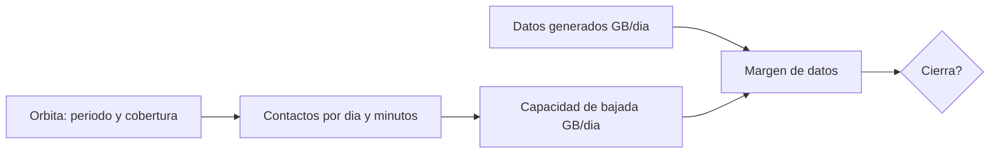

# B96-C02 — Concepto de operaciones de misión

<!-- nav:top -->
[🏠 Programa](../../../../README.md) · [📚 Bloque B96](../../../tronco-comun/B96-control-y-operacion-de-misiones-espaciales.md) · [← Anterior: B96-C01 — Segmento espacial y segmento terrestre](../B96-C01-segmento-espacial-y-segmento-terrestre/CLASE.md) · [Siguiente: B96-C03 — Roles de control de misión →](../B96-C03-roles-de-control-de-mision/CLASE.md)
<!-- /nav -->

## 1. Ubicación, nivel y alcance

Clase 2 del bloque B96. Nivel N3. El **concepto de operaciones** (ConOps) describe cómo se usará la misión: fases, modos, contactos, flujo de datos y quién hace qué. Aquí lo conviertes en un **cuadro de cierre**: cuántos contactos y minutos hay por día, cuántos datos se generan y cuántos caben en la bajada. El satélite, la estación y las tasas son **sintéticos**. Todos los datos son **sintéticos** salvo los que se rotulan como consultados.

## 2. Por qué esta clase existe

Un ConOps que no cierra se descubre en órbita, cuando ya no tiene arreglo barato. La decisión central: **¿alcanzan los contactos para bajar lo que la misión genera, con margen?**

## 3. Lo que podrás hacer al terminar

1. Calcular el periodo, el semiángulo de cobertura y la duración máxima de una pasada.
2. Estimar el contacto diario a partir del número y la duración de las pasadas.
3. Comparar el volumen generado con la capacidad de bajada y obtener el margen.
4. Despejar la carga útil máxima que cierra con un margen dado.
5. Estimar la carga de trabajo del operador por día.
6. Separar lo consultado de lo sintético.

La evidencia es la **cuadro de cierre de un concepto de operaciones** del ejercicio 12 (sección 20).

## 4. Con qué llegas y cómo comprobarlo

1. ¿Qué es el periodo orbital?
2. ¿Qué es el margen?
3. ¿Qué es una fase de misión?
4. ¿Cómo se pasa de bit/s a GB?
5. ¿Qué es una pasada?

<details>
<summary>Ver respuestas</summary>

1. El tiempo de una vuelta; `P = 2π√(a³/μ)`. 2. La holgura relativa: capacidad/demanda − 1. 3. Un periodo con objetivos y modos propios, como lanzamiento, puesta en servicio y operación nominal. 4. Se multiplica por el tiempo y se divide por 8 y por 10⁹. 5. Un intervalo en que el satélite está sobre la elevación mínima de una estación.
</details>

Con cuatro o cinco aciertos, sigue; si no, repasa los prerrequisitos.

## 5. Un caso de contexto y casos de referencia

Un satélite **sintético** a 550 km genera 2 kbit/s de telemetría continua y 0,8 GB/día de carga útil. Con una estación, 5 pasadas útiles de 4,77 min en promedio y una bajada de 2 Mbit/s con 85 % de eficiencia, caben 0,304 GB/día frente a 0,822 GB/día generados: el margen es de −63,0 %; **el concepto no cierra**. La carga útil máxima con 20 % de margen sería 0,232 GB/día.

## 6. Vocabulario

**ConOps:** descripción de cómo se opera la misión. **Fase:** periodo con modos y objetivos propios. **Contacto:** intervalo de comunicación. **Eficiencia de protocolo:** fracción de la tasa que lleva datos útiles. **Margen de datos:** `capacidad/demanda − 1`. **Carga de trabajo:** minutos de operador por día.

## 7. Modelo mental



*Descripción textual:* la órbita y la estación fijan los contactos; los contactos y la tasa fijan la capacidad; la capacidad se compara con lo generado y el margen decide si el ConOps cierra.

Analogía: un ConOps es como el horario de una línea de buses: si los pasajeros por día superan la capacidad de los viajes, no importa cuán bien esté escrito. Límite: los datos se pueden almacenar a bordo y bajar otro día; los pasajeros no esperan indefinidamente.

## 8. La explicación, paso a paso

### 8.1 Qué dicen las fuentes

ECSS-E-ST-70-11C (S1) busca que la nave pueda operarse en situaciones nominales o de contingencia predefinidas; ECSS-E-ST-70-31C (S2) fija qué información de vigilancia y control entrega el proveedor para operar. El capítulo de la NASA (S3) separa el MOC del SOC y trata las pasadas de enlace directo; de ahí sale la idea de que la capacidad se mide en datos por día. Solo se consultaron los resúmenes y la parte inicial del capítulo.

### 8.2 Cobertura de una pasada

`P = 2π√(a³/μ) = 95,65 min` con `a = 6 928,137 km`. El semiángulo central a `ε = 10°` es `λ = arccos(R/a · cos ε) − ε = 14,96°` y la pasada cenital dura `P·λ/π = 7,95 min`. Hay 15,05 revoluciones por día.

### 8.3 Datos

Generado: `2 000 × 86 400/8/10⁹ = 0,0216 GB` de plataforma más 0,8 GB de carga. Capacidad: `5 × 4,77 min × 60 × 2×10⁶ × 0,85/8/10⁹ = 0,304 GB`. Margen: `0,304/0,822 − 1 = −63,0 %`.

### 8.4 Qué hacer cuando no cierra

Cuatro palancas: más pasadas (más estaciones, C17), más tasa (C27), menos carga (C10) o compresión. La carga máxima con 20 % de margen es `cap/1,2 − gen = 0,232 GB/día`. La carga de trabajo es de `5 × (4,77 + 10) = 73,8 min/día`.

## 9. Magnitudes, símbolos y unidades

| Símbolo | Qué es | Unidad | Valor / nota |
|---|---|---|---|
| `a` | semieje mayor | km | 6 928,137 |
| `P` | periodo | min | 95,65 |
| `λ` | semiángulo central | ° | 14,96 |
| `G` | datos generados | GB/día | 0,822 |
| `C` | capacidad de bajada | GB/día | 0,304 |

## 10. Convenciones y referencias

Órbita circular kepleriana, Tierra esférica (radio 6 378,137 km, μ = 398 600,4418 km³/s²). GB = 10⁹ bytes. Pasadas útiles, factor de duración media 0,6, eficiencia 85 %, tasas y criterio de margen del 20 % son **sintéticos**. Tolerancia: `(gen + carga_max) × 1,2 = cap` a `10⁻⁹`.

## 11. De dónde sale lo que afirmamos

| ID | Fuente | Localizador | Respalda | Estado |
|---|---|---|---|---|
| S1 | ECSS, «ECSS-E-ST-70-11C — Space segment operability», 31 jul 2008 (cancelada y reemplazada por la Rev.1 del 15 oct 2025) — https://ecss.nl/standard/ecss-e-st-70-11c-space-segment-operability/ (consultada 2026-11-10) | página de la norma (solo el resumen; no el texto de requisitos) | disposiciones de diseño de las funciones de a bordo de un segmento espacial no tripulado para que pueda operarse en vuelo en situaciones nominales o de contingencia predefinidas; excluye la operabilidad específica de cada misión | Consultada (solo la página) |
| S2 | ECSS, «ECSS-E-ST-70-31C — Ground systems and operations — Monitoring and control data definition», 31 jul 2008 — https://ecss.nl/standard/ecss-e-st-70-31c-ground-systems-and-operations-monitoring-and-control-data/ (consultada 2026-11-10) | página de la norma (solo el resumen) | especifica la información de vigilancia y control que un proveedor entrega con su producto para integrarlo, probarlo y operarlo; indica qué datos, no el formato de entrega | Consultada (solo la página) |
| S3 | NASA, «Ground Data Systems and Mission Operations», en State-of-the-Art of Small Spacecraft Technology — https://www.nasa.gov/smallsat-institute/sst-soa/ground-data-systems-and-mission-operations/ (consultada 2026-11-10; leídos los primeros 100 000 caracteres de 215 453) | capítulo (parte inicial) | un centro de operaciones de misión (MOC) comanda la nave y un centro de operaciones científicas (SOC) genera productos; enlaces directos a la Tierra frente a relevos; bandas UHF, S, X y Ka; la licencia tarda meses; las antenas suelen adquirir el satélite con 5–10° de elevación; margen típico de 3 dB para retorno de datos en LEO a 1 500 km de distancia oblicua | Consultada (parte del capítulo) |
| — | Libros de texto de operaciones de misión, comunicaciones espaciales y mecánica orbital (p. ej., Wertz y Larson, Montenbruck y Gill, Vallado) | — | — | No consultada |
| — | Relaciones y algoritmos estándar usados por el laboratorio (mecánica kepleriana circular y presupuesto de datos) | — | los verifica el laboratorio con una segunda vía o con pruebas | No consultada en una fuente concreta |

Límites: las normas se leyeron solo en su resumen; el número de pasadas útiles es sintético y lo calcula C04. Lo simulado no se presenta como dato de vuelo ni como medición.

## 12. Cómo ver los resultados

| Magnitud | Valor |
|---|---|
| Periodo | 95,65 min |
| Duración máxima de pasada | 7,95 min |
| Contacto total | 23,8 min/día |
| Generado / capacidad | 0,822 / 0,304 GB/día |
| Margen | −63,0 % (no cierra) |

Descripción larga: la capacidad de bajada es solo el 37 % de lo generado; el factor limitante es la carga útil, no la telemetría.

## 13. Ejemplo trabajado

**Paso 1 · Periodo.** `95,65 min`.

**Paso 2 · Contacto.** `5 × 4,77 = 23,8 min`.

**Paso 3 · Capacidad.** `0,304 GB`.

**Paso 4 · Margen.** `0,304/0,822 − 1 = −63 %`.

**Paso 5 · Corrección.** Carga máxima `0,232 GB/día`.

## 14. Distintas formas de describir el problema

**Por tablas:** cuadro de cierre (esta clase). **Por simulación:** jornada completa (C20). **Por texto:** documento de ConOps con fases, modos y responsabilidades (ECSS-E-ST-70-11C, solo resumen).

## 15. Práctica guiada

**Ejercicio 1 · con los pasos indicados.** Calcula los GB por día de 2 kbit/s continuos.

<details><summary>Solución comentada</summary>

`2 000 × 86 400/8 = 21,6 MB = 0,0216 GB`.
</details>

**Ejercicio 2 · con una pista.** Calcula el contacto diario de 4 pasadas de 5 min.

<details><summary>Solución comentada</summary>

`20 min/día`.
</details>

**Ejercicio 3 · casi autónomo.** Calcula la capacidad de 20 min a 1 Mbit/s con eficiencia 80 %.

<details><summary>Solución comentada</summary>

`20 × 60 × 10⁶ × 0,8/8 = 120 MB`.
</details>

## 16. Práctica autónoma, transferencia e integrador

**Ejercicio 4 · autónomo.** Si se duplican las pasadas, ¿cuál es el nuevo margen?

<details><summary>Solución comentada</summary>

Capacidad 0,608; `0,608/0,822 − 1 = −26 %`: sigue sin cerrar.
</details>

**Ejercicio 5 · autónomo.** ¿Cuántas pasadas hacen falta para cerrar con margen 20 %?

<details><summary>Solución comentada</summary>

`0,822 × 1,2/0,0608 por pasada = 16,2`: 17 pasadas.
</details>

**Ejercicio 6 · autónomo.** ¿Qué tasa de bajada cierra con las 5 pasadas actuales y margen 20 %?

<details><summary>Solución comentada</summary>

`2 × 0,822 × 1,2/0,304 = 6,5 Mbit/s`.
</details>

**Ejercicio 7 · autónomo.** Calcula las revoluciones por día de un periodo de 90 min.

<details><summary>Solución comentada</summary>

`1 440/90 = 16`.
</details>

**Ejercicio 8 · autónomo.** ¿Qué pasa con la duración máxima si la elevación mínima sube a 20°?

<details><summary>Solución comentada</summary>

Disminuye: `λ` es menor porque el cono de visibilidad se achica.
</details>

**Ejercicio 9 · transferencia.** **Transferencia.** Un colega entrega un ConOps sin cuadro de datos. ¿Qué le exiges?

<details><summary>Solución comentada</summary>

Un presupuesto diario de contactos y datos con margen y criterio explícito.
</details>

**Ejercicio 10 · transferencia.** **Transferencia.** ¿Por qué no basta que 'la telemetría quepa'?

<details><summary>Solución comentada</summary>

Porque la carga útil domina el volumen y puede dejar el sistema sin margen.
</details>

**Ejercicio 11 · transferencia.** **Transferencia.** Una nave guarda datos a bordo si no los puede bajar. ¿Qué límite aparece?

<details><summary>Solución comentada</summary>

La capacidad de almacenamiento: el déficit diario se acumula hasta llenar la memoria.
</details>

**Ejercicio 12 · integrador.** **Integrador.** Elabora tu *cuadro de cierre de un concepto de operaciones*: periodo, contactos, datos generados y capacidad, margen, carga máxima y lista de lo consultado, sintético y no consultado.

<details><summary>Solución comentada</summary>

Secciones 8.2–8.4 y la salida del laboratorio.
</details>

## 17. Laboratorio: cierre de datos por día

El script [cierre_de_concepto_de_operaciones.py](cierre_de_concepto_de_operaciones.py) calcula el periodo y la cobertura, el contacto diario, los datos generados y bajados, el margen y la carga útil máxima; **comprueba** el despeje de la carga máxima y el periodo.

**Datos:** satélite, estación, tasas y criterio **sintéticos**. **Predice antes de ejecutar:** ¿cierra el concepto? (no: el margen es −63 %). **Ejecución del 2026-11-10 (Python 3.12.9):**

```text
Python 3.12.9
Datos SINTETICOS: satelite, estacion y tasas ficticias
Periodo = 95.65 min ; semiangulo central = 14.96 grados ; duracion maxima de pasada = 7.95 min
Revoluciones por dia = 15.05
Pasadas utiles = 5/dia ; duracion media = 4.77 min ; contacto total = 23.8 min/dia
Generado = 0.822 GB/dia (plataforma 0.022 + carga 0.8) ; capacidad de bajada = 0.304 GB/dia
Margen de datos = -63.0 % ; cierra: NO (criterio sintetico >= 20 %)
Carga de trabajo = 73.8 min/dia de operador
Carga util maxima con margen 20 % = 0.232 GB/dia
Pruebas superadas.
```

```bash
python programa/clases/B96/B96-C02-concepto-de-operaciones-de-mision/cierre_de_concepto_de_operaciones.py
```

**Límites:** sin almacenamiento a bordo, sin degradación de enlace, número de pasadas fijo y sin retransmisiones.

## 18. Errores frecuentes y cómo corregirlos

**Contar la telemetría y olvidar la carga útil.** Suma ambas (8.3)

**Usar la duración máxima como media.** Usa la duración media de las pasadas (8.3)

**Aceptar un margen negativo.** Aplica una palanca de 8.4

## 19. Cómo sabrás que vas bien

Tras 8.3: ¿cuántas pasadas haría falta para cerrar? Si dudas, repasa el ejercicio 5. Tras el laboratorio: ¿qué comprueba el despeje? (ver sección 17).

## 20. Qué entregas y cómo se evalúa

El producto es tu **cuadro de cierre de un concepto de operaciones** (ejercicio 12).

| Criterio | Inicial | En desarrollo | Logrado | Destacado |
|---|---|---|---|---|
| Conceptos | Los confunde | Parciales | Explica el método y su dominio | Explica los límites y las alternativas |
| Cálculo | Sin unidades | Con errores | Resultados con unidades y comprobados | Resuelve casos nuevos |
| Numérico | Sin comprobar | Un caso | Verifica con una segunda vía en varios casos | Interpreta las diferencias y los fallos |
| Fuentes | Sin fuente | Sin fecha | Fuentes con fecha y estado | Declara lo sintético y lo no consultado |
| Límites | No los nombra | Uno | Tres | Discute qué falta del modelo |

**Condiciones críticas (no se compensan con promedio):** rotular los datos como sintéticos; comprobar cada resultado con una segunda vía; citar solo lo consultado.

## 21. Ética, seguridad y límites

Clase educativa: los modelos son simplificados y los datos son sintéticos; ningún resultado describe una misión real, certifica conformidad con una norma ni sustituye la revisión de especialistas.  Accesibilidad: tablas equivalentes a las gráficas, fórmulas en texto, ejercicios sin conexión.

## 22. Para cerrar y seguir

El ConOps sintético genera 0,822 GB/día y solo baja 0,304: no cierra. La carga útil máxima con 20 % de margen es 0,232 GB/día. Queda una pregunta: ¿quién opera cada pieza de este sistema?

**Glosario español–inglés.** concepto de operaciones · *concept of operations (ConOps)*; margen · *margin*; contacto · *contact*; capacidad de bajada · *downlink capacity*; fase de misión · *mission phase*.

**Continuidad.** [B96-C03](../B96-C03-roles-de-control-de-mision/CLASE.md) trata los roles de control de misión.

**Referencias:** ver sección 11.

<!-- nav:bottom -->
---

[← Anterior: B96-C01 — Segmento espacial y segmento terrestre](../B96-C01-segmento-espacial-y-segmento-terrestre/CLASE.md) · [📚 Bloque B96](../../../tronco-comun/B96-control-y-operacion-de-misiones-espaciales.md) · [Siguiente: B96-C03 — Roles de control de misión →](../B96-C03-roles-de-control-de-mision/CLASE.md)
<!-- /nav -->
