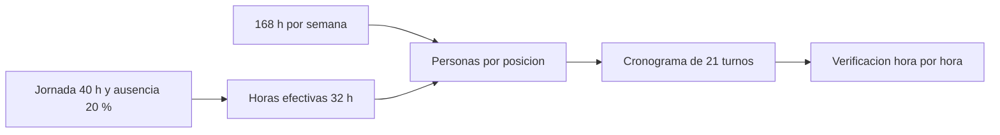

# B96-C03 — Roles de control de misión

<!-- nav:top -->
[🏠 Programa](../../../../README.md) · [📚 Bloque B96](../../../tronco-comun/B96-control-y-operacion-de-misiones-espaciales.md) · [← Anterior: B96-C02 — Concepto de operaciones de misión](../B96-C02-concepto-de-operaciones-de-mision/CLASE.md) · [Siguiente: B96-C04 — Planificación de contactos →](../B96-C04-planificacion-de-contactos/CLASE.md)
<!-- /nav -->

## 1. Ubicación, nivel y alcance

Clase 3 del bloque B96. Nivel N3. En una sala de control cada **posición** (director de vuelo, operador de enlace, ingeniero de subsistemas, dinámica de vuelo, cargas útiles) debe estar cubierta cuando hay contacto. Aquí calculas cuántas personas hacen falta para cubrir una posición las 24 h y verificas con un cronograma que cada hora tiene alguien. Todo es **sintético**: horas, ausencias y posiciones ficticias. Todos los datos son **sintéticos** salvo los que se rotulan como consultados.

## 2. Por qué esta clase existe

Un rol vacío durante un contacto es un contacto perdido. La decisión central: **¿cuánto personal exige cubrir una posición 24/7 y cómo se comprueba que el cronograma no deja huecos?**

## 3. Lo que podrás hacer al terminar

1. Calcular las horas efectivas por persona descontando ausencias.
2. Obtener el número de personas por posición 24/7.
3. Sumar posiciones equivalentes y estimar el personal mínimo.
4. Construir un cronograma de tres turnos y verificar su cobertura hora por hora.
5. Comprobar que ninguna persona hace turnos contiguos.
6. Separar lo consultado de lo sintético.

La evidencia es la **plan de dotación con verificación de cobertura** del ejercicio 12 (sección 20).

## 4. Con qué llegas y cómo comprobarlo

1. ¿Cuántas horas tiene una semana?
2. ¿Qué es una fracción de ausencia?
3. ¿Qué es un turno?
4. ¿Qué es una posición?
5. ¿Qué es un cronograma verificado?

<details>
<summary>Ver respuestas</summary>

1. 168. 2. La parte del tiempo contratado que no se trabaja (vacaciones, enfermedad, formación). 3. Un bloque de horas asignado a una persona. 4. Un puesto con funciones propias dentro de la sala. 5. Uno cuyo cumplimiento de reglas se comprueba por cálculo y no solo se afirma.
</details>

Con cuatro o cinco aciertos, sigue; si no, repasa los prerrequisitos.

## 5. Un caso de contexto y casos de referencia

Para una posición 24/7, con 40 h por semana y 20 % de ausencia, cada persona aporta 32 h efectivas; `168/32 = 5,25`: hacen falta **6 personas**. Con cinco posiciones (dos de ellas a media dedicación) son 4,0 equivalentes y 21 personas. El cronograma de 21 turnos de 8 h entre 6 personas da cuatro, cuatro, cuatro, tres, tres y tres turnos y cubre cada una de las 168 h con una persona.

## 6. Vocabulario

**Posición:** puesto de la sala de control. **Cobertura 24/7:** presencia en las 168 h semanales. **Horas efectivas:** jornada menos ausencias. **Turno:** bloque de 8 h. **Equivalente a tiempo completo (ETC):** fracción de una posición 24/7.

## 7. Modelo mental



*Descripción textual:* las 168 h semanales se dividen por las horas efectivas por persona; el resultado se redondea hacia arriba y se reparte en turnos que luego se verifican hora por hora.

Analogía: cubrir una posición 24/7 es como mantener una guardia de bomberos: la estación nunca puede quedar vacía aunque alguien enferme. Límite: en una misión de LEO la presencia se puede concentrar en las pasadas y no en las 24 h.

## 8. La explicación, paso a paso

### 8.1 Qué dicen las fuentes

Ninguna de las fuentes consultadas fija dotaciones. ECSS-E-ST-70-11C (S1) trata la operabilidad del segmento espacial y ECSS-E-ST-70-32C (S2) el lenguaje de procedimientos que ejecutan los operadores; ambas se leyeron solo en su resumen. Los números de esta clase son **sintéticos** y ejemplifican el método de cálculo.

### 8.2 Personas por posición

Horas efectivas `= 40 × (1 − 0,20) = 32 h`. Personas `= 168/32 = 5,25`, que se redondea a 6. Las posiciones equivalentes son `1 + 1 + 1 + 0,5 + 0,5 = 4,0`; el mínimo es `⌈4,0 × 5,25⌉ = 21`.

### 8.3 Cronograma y verificación

Con 21 turnos semanales y 6 personas se asignan por turno y en rotación. Cada hora de la semana (168) se cubre exactamente una vez; ninguna persona tiene dos turnos contiguos y el máximo es de 4 turnos (32 h), dentro de las 40 h.

### 8.4 Riesgo de ausencia imprevista

Si cada titular falta con probabilidad `p = 5 %`, la simulación de 100 000 turnos da 4,87 %: de cada 20 turnos, uno queda sin su titular y necesita un suplente.

## 9. Magnitudes, símbolos y unidades

| Símbolo | Qué es | Unidad | Valor / nota |
|---|---|---|---|
| `H` | horas de la semana | h | 168 |
| `J` | jornada | h/semana | 40 (sintética) |
| `a` | fracción de ausencia | — | 0,20 (sintética) |
| `N` | personas por posición | — | 5,25 → 6 |
| `p` | ausencia imprevista | — | 0,05 (sintética) |

## 10. Convenciones y referencias

Semana de 168 h, turnos de 8 h, tiempos en horas. Jornada, ausencia, posiciones y `p` **sintéticos**; no son normas laborales de ningún país. Tolerancia: `N` igual a `168/32` a `10⁻¹²`; cobertura exactamente 1 en cada hora. Semilla del Monte Carlo: 96.

## 11. De dónde sale lo que afirmamos

| ID | Fuente | Localizador | Respalda | Estado |
|---|---|---|---|---|
| S1 | ECSS, «ECSS-E-ST-70-11C — Space segment operability», 31 jul 2008 (cancelada y reemplazada por la Rev.1 del 15 oct 2025) — https://ecss.nl/standard/ecss-e-st-70-11c-space-segment-operability/ (consultada 2026-11-10) | página de la norma (solo el resumen; no el texto de requisitos) | disposiciones de diseño de las funciones de a bordo de un segmento espacial no tripulado para que pueda operarse en vuelo en situaciones nominales o de contingencia predefinidas; excluye la operabilidad específica de cada misión | Consultada (solo la página) |
| S2 | ECSS, «ECSS-E-ST-70-32C — Test and operations procedure language», 31 jul 2008 — https://ecss.nl/standard/ecss-e-st-70-32c-test-and-operations-procedure-language/ (consultada 2026-11-10) | página de la norma (solo el resumen) | define las capacidades del lenguaje con que se escriben procedimientos de prueba y de operación y especifica el lenguaje PLUTO | Consultada (solo la página) |
| — | Libros de texto de operaciones de misión, comunicaciones espaciales y mecánica orbital (p. ej., Wertz y Larson, Montenbruck y Gill, Vallado) | — | — | No consultada |
| — | Relaciones y algoritmos estándar usados por el laboratorio (división y redondeo hacia arriba; simulación Monte Carlo con semilla fija) | — | los verifica el laboratorio con una segunda vía o con pruebas | No consultada en una fuente concreta |

Límites: las normas consultadas no tratan dotación; el método ignora competencias, formación y descansos legales. Lo simulado no se presenta como dato de vuelo ni como medición.

## 12. Cómo ver los resultados

| Concepto | Valor |
|---|---|
| Horas efectivas | 32 h/semana |
| Personas por posición | 5,25 (6) |
| Personal mínimo de la sala | 21 |
| Turnos por persona | 4, 4, 4, 3, 3, 3 |
| Ausencia simulada | 4,87 % |

Descripción larga: el redondeo hacia arriba de 5,25 a 6 añade un 14 % de holgura que absorbe las ausencias imprevistas.

## 13. Ejemplo trabajado

**Paso 1 · Efectivas.** `40 × 0,8 = 32 h`.

**Paso 2 · Personas.** `168/32 = 5,25 → 6`.

**Paso 3 · Sala.** `4,0 × 5,25 = 21`.

**Paso 4 · Cobertura.** 168 horas con exactamente una persona.

**Paso 5 · Ausencia.** `≈ 5 %` de turnos sin titular.

## 14. Distintas formas de describir el problema

**Por cálculo:** personas por posición (esta clase). **Por cronograma:** matriz día × turno. **Por simulación:** ausencias aleatorias (8.4). **Por contacto:** presencia solo en pasadas (C17 y C20).

## 15. Práctica guiada

**Ejercicio 1 · con los pasos indicados.** Calcula las horas efectivas con 36 h y 10 % de ausencia.

<details><summary>Solución comentada</summary>

`36 × 0,9 = 32,4 h`.
</details>

**Ejercicio 2 · con una pista.** ¿Cuántas personas cubren una posición con 32,4 h efectivas?

<details><summary>Solución comentada</summary>

`168/32,4 = 5,19 → 6`.
</details>

**Ejercicio 3 · casi autónomo.** ¿Cuántos turnos de 8 h tiene una semana?

<details><summary>Solución comentada</summary>

`168/8 = 21`.
</details>

## 16. Práctica autónoma, transferencia e integrador

**Ejercicio 4 · autónomo.** ¿Cuántas personas cubre una posición solo 8 h por día en 5 días?

<details><summary>Solución comentada</summary>

`40/32 = 1,25 → 2`.
</details>

**Ejercicio 5 · autónomo.** Si la ausencia sube a 30 %, ¿cuántas personas por posición?

<details><summary>Solución comentada</summary>

`168/28 = 6 → 6`.
</details>

**Ejercicio 6 · autónomo.** Una persona hace 5 turnos de 8 h. ¿Cumple 40 h?

<details><summary>Solución comentada</summary>

`5 × 8 = 40 h`: sí, pero sin margen.
</details>

**Ejercicio 7 · autónomo.** ¿Qué significa 'cobertura máxima 1' en la verificación?

<details><summary>Solución comentada</summary>

Que ninguna hora tiene dos personas asignadas: no hay solapes ni derroche.
</details>

**Ejercicio 8 · autónomo.** Con `p = 5 %` y 21 turnos, ¿cuántos turnos sin titular se esperan por semana?

<details><summary>Solución comentada</summary>

`21 × 0,05 = 1,05`.
</details>

**Ejercicio 9 · transferencia.** **Transferencia.** Un jefe afirma que 5 personas bastan por posición porque `168/40 = 4,2`. ¿Qué falta?

<details><summary>Solución comentada</summary>

Descontó cero ausencias; con 20 % la cuenta es 5,25 y exige 6.
</details>

**Ejercicio 10 · transferencia.** **Transferencia.** ¿Por qué se verifican los turnos contiguos de la misma persona?

<details><summary>Solución comentada</summary>

Porque dos turnos seguidos (16 h) violan el descanso mínimo y aumentan el error.
</details>

**Ejercicio 11 · transferencia.** **Transferencia.** Una misión de LEO solo necesita operador durante 5 pasadas de 10 min al día. ¿Cambia el cálculo?

<details><summary>Solución comentada</summary>

Sí: se cubre por ventanas y no 24/7; el cálculo usa las horas de contacto más preparación (C17).
</details>

**Ejercicio 12 · integrador.** **Integrador.** Elabora tu *plan de dotación con verificación de cobertura*: horas efectivas, personas por posición, personal de la sala, cronograma verificado y lista de lo consultado, sintético y no consultado.

<details><summary>Solución comentada</summary>

Secciones 8.2–8.4 y la salida del laboratorio.
</details>

## 17. Laboratorio: cronograma de turnos verificado

El script [dotacion_de_turnos.py](dotacion_de_turnos.py) calcula las horas efectivas y el personal, construye un cronograma de 21 turnos, verifica la cobertura hora por hora y los turnos contiguos y simula ausencias con semilla fija; **comprueba** cobertura exactamente 1 y ausencia de turnos contiguos.

**Datos:** jornada, ausencia y posiciones **sintéticas**; semilla 96. **Predice antes de ejecutar:** ¿cuántas personas por posición? (6, de 5,25). **Ejecución del 2026-11-10 (Python 3.12.9):**

```text
Python 3.12.9
Datos SINTETICOS: horas, ausencias y posiciones ficticias
Horas efectivas por persona = 32.0 h/sem ; personas por posicion 24/7 = 5.250 -> 6
Posiciones equivalentes 24/7 = 4.0 ; personal minimo = 21
Turnos de 8 h por persona = [4, 4, 4, 3, 3, 3] ; horas = [32, 32, 32, 24, 24, 24]
Cobertura minima = 1 ; maxima = 1 ; horas sin cubrir = 0
Turnos contiguos de una misma persona = 0
Ausencia inesperada del titular de un turno (p = 5 %): 4.87 % de 100000 turnos simulados
Pruebas superadas.
```

```bash
python programa/clases/B96/B96-C03-roles-de-control-de-mision/dotacion_de_turnos.py
```

**Límites:** no considera competencias, habilitaciones, descansos legales ni turnos nocturnos distintos.

## 18. Errores frecuentes y cómo corregirlos

**Olvidar las ausencias.** Aplica la fracción de ausencia (8.2)

**Redondear 5,25 a 5.** Redondea hacia arriba (8.2)

**Asumir que el cronograma cubre sin comprobarlo.** Verifica hora por hora (8.3)

## 19. Cómo sabrás que vas bien

Tras 8.2: ¿cuántas personas haría falta con 30 % de ausencia? Si dudas, repasa el ejercicio 5. Tras el laboratorio: ¿qué comprueba la cobertura? (ver sección 17).

## 20. Qué entregas y cómo se evalúa

El producto es tu **plan de dotación con verificación de cobertura** (ejercicio 12).

| Criterio | Inicial | En desarrollo | Logrado | Destacado |
|---|---|---|---|---|
| Conceptos | Los confunde | Parciales | Explica el método y su dominio | Explica los límites y las alternativas |
| Cálculo | Sin unidades | Con errores | Resultados con unidades y comprobados | Resuelve casos nuevos |
| Numérico | Sin comprobar | Un caso | Verifica con una segunda vía en varios casos | Interpreta las diferencias y los fallos |
| Fuentes | Sin fuente | Sin fecha | Fuentes con fecha y estado | Declara lo sintético y lo no consultado |
| Límites | No los nombra | Uno | Tres | Discute qué falta del modelo |

**Condiciones críticas (no se compensan con promedio):** rotular los datos como sintéticos; comprobar cada resultado con una segunda vía; citar solo lo consultado.

## 21. Ética, seguridad y límites

Clase educativa: los modelos son simplificados y los datos son sintéticos; ningún resultado describe una misión real, certifica conformidad con una norma ni sustituye la revisión de especialistas.  Accesibilidad: tablas equivalentes a las gráficas, fórmulas en texto, ejercicios sin conexión.

## 22. Para cerrar y seguir

Una posición 24/7 exige 6 personas con 20 % de ausencia y la sala sintética, 21; el cronograma cubre las 168 h con una persona por hora. Queda una pregunta: ¿cuándo se puede hablar con el satélite?

**Glosario español–inglés.** posición · *console position*; turno · *shift*; cobertura · *coverage*; director de vuelo · *flight director*; operador de enlace · *link operator*.

**Continuidad.** [B96-C04](../B96-C04-planificacion-de-contactos/CLASE.md) trata la planificación de contactos.

**Referencias:** ver sección 11.

<!-- nav:bottom -->
---

[← Anterior: B96-C02 — Concepto de operaciones de misión](../B96-C02-concepto-de-operaciones-de-mision/CLASE.md) · [📚 Bloque B96](../../../tronco-comun/B96-control-y-operacion-de-misiones-espaciales.md) · [Siguiente: B96-C04 — Planificación de contactos →](../B96-C04-planificacion-de-contactos/CLASE.md)
<!-- /nav -->
