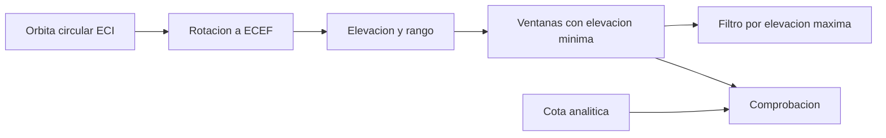

# B96-C04 — Planificación de contactos

<!-- nav:top -->
[🏠 Programa](../../../../README.md) · [📚 Bloque B96](../../../tronco-comun/B96-control-y-operacion-de-misiones-espaciales.md) · [← Anterior: B96-C03 — Roles de control de misión](../B96-C03-roles-de-control-de-mision/CLASE.md) · [Siguiente: B96-C05 — Estaciones de seguimiento →](../B96-C05-estaciones-de-seguimiento/CLASE.md)
<!-- /nav -->

## 1. Ubicación, nivel y alcance

Clase 4 del bloque B96. Nivel N3. Planificar contactos es saber **cuándo** el satélite estará sobre la elevación mínima de una estación. Aquí propagas una órbita circular con una Tierra esférica que rota, calculas las ventanas de un día y las contrastas con la cota analítica de duración. Todo es **sintético**: la órbita y la estación no corresponden a ningún satélite real, y no se usan elementos orbitales publicados. Todos los datos son **sintéticos** salvo los que se rotulan como consultados.

## 2. Por qué esta clase existe

Un contacto perdido por mala planificación no se recupera hasta la siguiente pasada, que puede estar a horas. La decisión central: **¿qué ventanas hay, cuánto duran y cuáles merece la pena usar?**

## 3. Lo que podrás hacer al terminar

1. Propagar una órbita circular kepleriana y pasar de ECI a ECEF con la rotación terrestre.
2. Calcular elevación y rango desde una estación.
3. Detectar ventanas con una elevación mínima y medir su duración.
4. Comprobar las duraciones contra la cota analítica y con un paso de integración más fino.
5. Filtrar las pasadas por elevación máxima.
6. Separar lo consultado de lo sintético.

La evidencia es la **tabla de contactos de un día** del ejercicio 12 (sección 20).

## 4. Con qué llegas y cómo comprobarlo

1. ¿Qué es ECI y qué es ECEF?
2. ¿Qué es la elevación mínima?
3. ¿Qué es una órbita circular?
4. ¿Qué es una inclinación heliosíncrona?
5. ¿Qué es una cota analítica?

<details>
<summary>Ver respuestas</summary>

1. ECI no rota con la Tierra; ECEF gira con ella. Se pasa de uno a otro con una rotación `ωₑt`. 2. El ángulo bajo el cual la estación no usa el enlace (obstáculos, atmósfera, ruido); la NASA indica 5–10° típico. 3. Una con radio constante; velocidad angular `n = √(μ/a³)`. 4. Una cercana a 97–98° en LEO; aquí 97,6° es un valor ilustrativo. 5. Un valor máximo calculable en fórmula cerrada para comparar.
</details>

Con cuatro o cinco aciertos, sigue; si no, repasa los prerrequisitos.

## 5. Un caso de contexto y casos de referencia

Un satélite **sintético** a 550 km e inclinación 97,6° y una estación a 40° N, 0° E, con elevación mínima de 10°, tienen en el día de ejemplo 4 pasadas: 7,08, 7,00, 5,50 y 5,25 min. El contacto total es de 24,8 min y solo 2 pasadas superan 25° de elevación máxima (14,1 min). La cota analítica cenital es de 7,95 min.

## 6. Vocabulario

**Ventana:** intervalo con elevación ≥ mínima. **Elevación máxima:** pico de la pasada. **ECI/ECEF:** marcos inercial y fijo a la Tierra. **Semiángulo central:** ángulo en el centro de la Tierra entre la estación y el borde de visibilidad. **Cota:** valor máximo analítico.

## 7. Modelo mental



*Descripción textual:* la órbita se pasa a ECEF, se calcula la elevación en cada instante, se agrupan los intervalos sobre el mínimo y se comprueban contra la cota analítica y contra un paso más fino.

Analogía: una ventana de contacto es como el paso del sol por un hueco entre edificios: dura más si pasa por el centro. Límite: la Tierra además gira mientras tanto.

## 8. La explicación, paso a paso

### 8.1 Qué dicen las fuentes

El capítulo de la NASA (S1) indica que las antenas suelen adquirir el satélite con 5–10° de elevación y que el enlace directo ofrece contactos frecuentes pero cortos. La geometría usada aquí es estándar y no se tomó de una fuente concreta.

### 8.2 Propagación

Para `a = R + h`, `n = √(μ/a³)` y argumento de latitud `u = u₀ + nt`: `x = a(cos Ω cos u − sen Ω sen u cos i)`, `y = a(sen Ω cos u + cos Ω sen u cos i)`, `z = a sen u sen i`. Se rota a ECEF con `θ = ωₑ t` y se calcula la elevación con el vector hacia arriba de la estación.

### 8.3 Ventanas del día de ejemplo

| Pasada | Inicio (s) | Fin (s) | Duración (min) | Elev. máx. (°) |
|---|---|---|---|---|
| 1 | 415 | 840 | 7,08 | 31,1 |
| 2 | 42 210 | 42 630 | 7,00 | 30,5 |
| 3 | 47 920 | 48 250 | 5,50 | 18,4 |
| 4 | 80 890 | 81 205 | 5,25 | 17,6 |

Total 24,8 min. La cota cenital analítica es `P λ/π = 7,95 min`; ninguna pasada la supera (más 5 % de tolerancia).

### 8.4 Comprobaciones y filtro

Con paso de 5 s y con paso de 1 s resultan 4 pasadas y el mismo contacto total (24,8 min). Un filtro de elevación máxima ≥ 25° deja 2 pasadas y 14,1 min: las de baja elevación tienen señal más débil y se usan para tareas cortas.

## 9. Magnitudes, símbolos y unidades

| Símbolo | Qué es | Unidad | Valor / nota |
|---|---|---|---|
| `h, i` | altura e inclinación | km, ° | 550; 97,6 |
| `ε_min` | elevación mínima | ° | 10 |
| `ωₑ` | rotación terrestre | rad/s | 7,2921159×10⁻⁵ |
| `μ` | parámetro gravitacional | km³/s² | 398 600,4418 |
| `P` | periodo | min | 95,65 |

## 10. Convenciones y referencias

Órbita circular de 550 km, Tierra esférica de radio 6 378,137 km, rotación uniforme, ECI con eje z al polo y ECEF obtenido por rotación `ωₑ t`; estación a 40° N, 0° E, ascensión recta del nodo 0°, argumento inicial 0° (todo **sintético**). Tiempo en s desde un instante arbitrario. Tolerancias: duración frente a cota `≤ 1,05` veces; conteo con 5 s igual al de 1 s; suma de contactos con diferencia `< 10 s` por pasada.

## 11. De dónde sale lo que afirmamos

| ID | Fuente | Localizador | Respalda | Estado |
|---|---|---|---|---|
| S1 | NASA, «Ground Data Systems and Mission Operations», en State-of-the-Art of Small Spacecraft Technology — https://www.nasa.gov/smallsat-institute/sst-soa/ground-data-systems-and-mission-operations/ (consultada 2026-11-10; leídos los primeros 100 000 caracteres de 215 453) | capítulo (parte inicial) | un centro de operaciones de misión (MOC) comanda la nave y un centro de operaciones científicas (SOC) genera productos; enlaces directos a la Tierra frente a relevos; bandas UHF, S, X y Ka; la licencia tarda meses; las antenas suelen adquirir el satélite con 5–10° de elevación; margen típico de 3 dB para retorno de datos en LEO a 1 500 km de distancia oblicua | Consultada (parte del capítulo) |
| — | Libros de texto de operaciones de misión, comunicaciones espaciales y mecánica orbital (p. ej., Wertz y Larson, Montenbruck y Gill, Vallado) | — | — | No consultada |
| — | Relaciones y algoritmos estándar usados por el laboratorio (mecánica kepleriana circular, rotación terrestre uniforme y geometría esférica) | — | los verifica el laboratorio con una segunda vía o con pruebas | No consultada en una fuente concreta |

Límites: no hay achatamiento, arrastre, refracción ni efemérides reales; la fecha y los elementos son sintéticos. Lo simulado no se presenta como dato de vuelo ni como medición.

## 12. Cómo ver los resultados

| Magnitud | Valor |
|---|---|
| Pasadas del día | 4 |
| Contacto total | 24,8 min |
| Cota cenital analítica | 7,95 min |
| Pasadas con elevación máx. ≥ 25° | 2 (14,1 min) |

Descripción larga: las cuatro pasadas se reparten en el día con huecos de horas, porque el plano orbital solo está cerca de la estación cuando la rotación de la Tierra la acerca a él; las de mayor elevación duran más.

## 13. Ejemplo trabajado

**Paso 1 · Periodo.** `95,65 min`.

**Paso 2 · Cota.** `7,95 min`.

**Paso 3 · Ventanas.** 4 pasadas, 24,8 min.

**Paso 4 · Refinar.** Paso de 1 s: mismas 4 pasadas.

**Paso 5 · Filtrar.** Elevación máxima ≥ 25°: 2 pasadas, 14,1 min.

## 14. Distintas formas de describir el problema

**Por simulación:** tabla de ventanas (esta clase). **Por fórmula:** cota de duración por semiángulo central. **Por geometría de estación:** azimut y Doppler (C05). **Por asignación:** reparto entre estaciones (C17).

## 15. Práctica guiada

**Ejercicio 1 · con los pasos indicados.** Calcula `n` para `a = 6 928,137 km`.

<details><summary>Solución comentada</summary>

`√(398 600,4418/6 928,137³) = 1,0948×10⁻³ rad/s`.
</details>

**Ejercicio 2 · con una pista.** ¿Cuántos minutos dura una vuelta con `P = 95,65 min` en un día?

<details><summary>Solución comentada</summary>

`1 440/95,65 = 15,05` vueltas.
</details>

**Ejercicio 3 · casi autónomo.** Calcula la duración de la pasada 1 en segundos.

<details><summary>Solución comentada</summary>

`840 − 415 = 425 s`.
</details>

## 16. Práctica autónoma, transferencia e integrador

**Ejercicio 4 · autónomo.** ¿Qué fracción del día es contacto con 24,8 min?

<details><summary>Solución comentada</summary>

`24,8/1 440 = 1,7 %`.
</details>

**Ejercicio 5 · autónomo.** Si la elevación mínima baja a 5°, ¿qué pasa con las duraciones?

<details><summary>Solución comentada</summary>

Aumentan: la ventana es más ancha.
</details>

**Ejercicio 6 · autónomo.** ¿Por qué la pasada de 17,6° dura menos que la de 31,1°?

<details><summary>Solución comentada</summary>

Pasa más lejos del cenit y atraviesa una cuerda menor del cono de visibilidad.
</details>

**Ejercicio 7 · autónomo.** ¿Qué compara la prueba con el paso de 1 s?

<details><summary>Solución comentada</summary>

Que la rejilla de 5 s no pierda ni cree pasadas.
</details>

**Ejercicio 8 · autónomo.** Estima el semiángulo central a ε = 0° y h = 550 km.

<details><summary>Solución comentada</summary>

`arccos(6 378,137/6 928,137) = 23,0°`.
</details>

**Ejercicio 9 · transferencia.** **Transferencia.** Un colega copia las ventanas para operar su satélite. ¿Es válido?

<details><summary>Solución comentada</summary>

No: los elementos, la estación y la fecha son sintéticos; hacen falta efemérides y elementos reales.
</details>

**Ejercicio 10 · transferencia.** **Transferencia.** ¿Qué efecto no modelado cambiaría las horas de inicio?

<details><summary>Solución comentada</summary>

El achatamiento terrestre y el arrastre, que desplazan el plano y el argumento.
</details>

**Ejercicio 11 · transferencia.** **Transferencia.** ¿Cómo elegirías entre una pasada de 31° y otra de 18° para un comando crítico?

<details><summary>Solución comentada</summary>

La de 31°: más duración y mejor margen de enlace; la de 18° queda de reserva.
</details>

**Ejercicio 12 · integrador.** **Integrador.** Elabora tu *tabla de contactos de un día*: periodo, ventanas con duración y elevación máxima, comprobaciones, filtro y lista de lo consultado, sintético y no consultado.

<details><summary>Solución comentada</summary>

Secciones 8.2–8.4 y la salida del laboratorio.
</details>

## 17. Laboratorio: ventanas de un día

El script [ventanas_de_visibilidad.py](ventanas_de_visibilidad.py) propaga la órbita, calcula la elevación a cada paso, detecta las ventanas y las contrasta con la cota analítica y con un paso de 1 s; usa la biblioteca común [b96_comun.py](../b96_comun.py); **comprueba** la cota, el conteo y el contacto total.

**Datos:** órbita, estación y fecha **sintéticas**. **Predice antes de ejecutar:** ¿cuántas pasadas hay en el día? (4). **Ejecución del 2026-11-10 (Python 3.12.9):**

```text
Python 3.12.9
Datos SINTETICOS: orbita circular de 550 km, inclinacion 97.6 grados; estacion en 40 N, 0 E; Tierra esferica que rota
Periodo = 95.65 min ; duracion maxima analitica (cenital, Tierra fija) = 7.95 min
Pasada  inicio[s]   fin[s]  dur[min]  elev_max[grados]
   1        415       840      7.08       31.1
   2      42210     42630      7.00       30.5
   3      47920     48250      5.50       18.4
   4      80890     81205      5.25       17.6
Pasadas = 4 ; contacto total = 24.8 min ; tiempo medio entre inicios = 447.1 min
Con paso de 1 s: pasadas = 4 ; contacto total = 24.8 min
Pasadas con elevacion maxima >= 25 grados = 2 ; contacto = 14.1 min
Pruebas superadas.
```

```bash
python programa/clases/B96/B96-C04-planificacion-de-contactos/ventanas_de_visibilidad.py
```

**Límites:** Tierra esférica, órbita circular, sin refracción ni obstáculos del horizonte.

## 18. Errores frecuentes y cómo corregirlos

**Usar la elevación mínima de 0°.** Usa la del equipo y del sitio (8.3)

**Olvidar la rotación terrestre.** Pasa de ECI a ECEF (8.2)

**Tomar los datos como efemérides.** Revisa la sección 10

## 19. Cómo sabrás que vas bien

Tras 8.3: ¿qué pasada elegirías para un comando crítico? Si dudas, repasa el ejercicio 11. Tras el laboratorio: ¿qué comprueba la cota? (ver sección 17).

## 20. Qué entregas y cómo se evalúa

El producto es tu **tabla de contactos de un día** (ejercicio 12).

| Criterio | Inicial | En desarrollo | Logrado | Destacado |
|---|---|---|---|---|
| Conceptos | Los confunde | Parciales | Explica el método y su dominio | Explica los límites y las alternativas |
| Cálculo | Sin unidades | Con errores | Resultados con unidades y comprobados | Resuelve casos nuevos |
| Numérico | Sin comprobar | Un caso | Verifica con una segunda vía en varios casos | Interpreta las diferencias y los fallos |
| Fuentes | Sin fuente | Sin fecha | Fuentes con fecha y estado | Declara lo sintético y lo no consultado |
| Límites | No los nombra | Uno | Tres | Discute qué falta del modelo |

**Condiciones críticas (no se compensan con promedio):** rotular los datos como sintéticos; comprobar cada resultado con una segunda vía; citar solo lo consultado.

## 21. Ética, seguridad y límites

Clase educativa: los modelos son simplificados y los datos son sintéticos; ningún resultado describe una misión real, certifica conformidad con una norma ni sustituye la revisión de especialistas.  Accesibilidad: tablas equivalentes a las gráficas, fórmulas en texto, ejercicios sin conexión.

## 22. Para cerrar y seguir

El día sintético tiene 4 pasadas y 24,8 min de contacto, ninguna sobre la cota de 7,95 min; solo 2 superan 25° de elevación. Queda una pregunta: ¿qué ve la estación durante la pasada?

**Glosario español–inglés.** ventana de contacto · *contact window*; elevación · *elevation*; marco inercial · *inertial frame*; planificación de contactos · *contact planning*.

**Continuidad.** [B96-C05](../B96-C05-estaciones-de-seguimiento/CLASE.md) trata las estaciones de seguimiento.

**Referencias:** ver sección 11.

<!-- nav:bottom -->
---

[← Anterior: B96-C03 — Roles de control de misión](../B96-C03-roles-de-control-de-mision/CLASE.md) · [📚 Bloque B96](../../../tronco-comun/B96-control-y-operacion-de-misiones-espaciales.md) · [Siguiente: B96-C05 — Estaciones de seguimiento →](../B96-C05-estaciones-de-seguimiento/CLASE.md)
<!-- /nav -->
