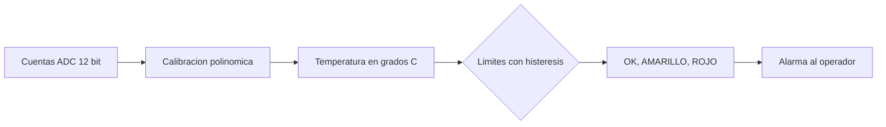

# B96-C06 — Telemetría operativa

<!-- nav:top -->
[🏠 Programa](../../../../README.md) · [📚 Bloque B96](../../../tronco-comun/B96-control-y-operacion-de-misiones-espaciales.md) · [← Anterior: B96-C05 — Estaciones de seguimiento](../B96-C05-estaciones-de-seguimiento/CLASE.md) · [Siguiente: B96-C07 — Telecomandos y autorizaciones →](../B96-C07-telecomandos-y-autorizaciones/CLASE.md)
<!-- /nav -->

## 1. Ubicación, nivel y alcance

Clase 6 del bloque B96. Nivel N3. La **telemetría operativa** llega como cuentas de un conversor; el sistema de tierra las convierte a unidades de ingeniería con una calibración y las compara con **límites** para avisar al operador. Aquí calibras un sensor de temperatura **sintético** de 12 bit, defines límites amarillo y rojo y comparas la vigilancia con y sin histéresis. No se usa ninguna telemetría real. Todos los datos son **sintéticos** salvo los que se rotulan como consultados.

## 2. Por qué esta clase existe

Un límite mal definido llena la pantalla de alarmas que nadie atiende o calla ante un fallo real. La decisión central: **¿cómo se convierte una cuenta en una magnitud y cuándo se levanta o se baja una alarma?**

## 3. Lo que podrás hacer al terminar

1. Convertir cuentas a unidades de ingeniería con un polinomio y comprobar su monotonía.
2. Calcular la resolución de un parámetro.
3. Definir límites amarillo y rojo con histéresis.
4. Medir cuántos cambios de estado evita la histéresis.
5. Verificar la vigilancia con una serie sin ruido.
6. Separar lo consultado de lo sintético.

La evidencia es la **definición de parámetros y límites de telemetría** del ejercicio 12 (sección 20).

## 4. Con qué llegas y cómo comprobarlo

1. ¿Qué es una cuenta de un ADC de 12 bit?
2. ¿Qué es un polinomio de calibración?
3. ¿Qué es la histéresis de una alarma?
4. ¿Qué es el ruido?
5. ¿Qué es un límite rojo?

<details>
<summary>Ver respuestas</summary>

1. Un entero entre 0 y 4 095. 2. Una función `a₀ + a₁x + a₂x²` que pasa de cuentas a unidades. 3. Un margen distinto para subir y para bajar el estado, que evita oscilaciones. 4. Una variación aleatoria alrededor del valor verdadero. 5. Un valor a partir del cual se exige acción inmediata.
</details>

Con cuatro o cinco aciertos, sigue; si no, repasa los prerrequisitos.

## 5. Un caso de contexto y casos de referencia

Un sensor **sintético** de 12 bit se calibra con `T = −50 + 0,0488 x + 1,5×10⁻⁷ x²`: 0 cuentas dan −50 °C y 4 095 dan 152,4 °C, con resolución de 0,0488 °C. Una serie de 600 muestras sube de 20 °C a 38 °C con ruido de 0,4 °C. Con límites en 30 °C (amarillo) y 36 °C (rojo) y 1,0 °C de histéresis hay 4 cambios de estado; sin histéresis, 10.

## 6. Vocabulario

**Telemetría:** valores medidos en la nave. **Calibración:** función de cuentas a unidades. **Límite:** valor que activa un estado de alarma. **Histéresis:** margen de retorno. **Parámetro:** una magnitud con nombre, unidad y límites. **Cuenta:** valor entero del conversor.

## 7. Modelo mental



*Descripción textual:* las cuentas se convierten a temperatura con el polinomio; la temperatura se compara con límites que tienen histéresis; el resultado es un estado OK, amarillo o rojo.

Analogía: la histéresis es como el termostato de una casa: enciende a 19 °C y apaga a 21 °C para no encenderse y apagarse cada segundo. Límite: en una nave un límite rojo no se anula solo, lo reconoce un operador.

## 8. La explicación, paso a paso

### 8.1 Qué dicen las fuentes

ECSS-E-ST-70-41C (S1) define cómo se usan los paquetes de telemetría y telecomando para vigilar y controlar subsistemas y cargas útiles, con servicios opcionales adaptables a cada misión. ECSS-E-ST-70-31C (S2) fija qué información de vigilancia y control debe entregar un proveedor (parámetros, límites, calibraciones) para operar el producto. Solo se leyeron los resúmenes; los números de esta clase son **sintéticos**.

### 8.2 Calibración

`T(x) = −50 + 0,0488 x + 1,5×10⁻⁷ x²` es estrictamente creciente en 0–4 095 cuentas (comprobado punto a punto).

| Cuentas | T (°C) |
|---|---|
| 0 | −50,000 |
| 1 024 | 0,128 |
| 2 048 | 50,572 |
| 3 072 | 101,329 |
| 4 095 | 152,351 |

### 8.3 Límites con histéresis

Amarillo al subir a 30 °C y vuelta a OK al bajar de 29 °C; rojo al subir a 36 °C y vuelta a amarillo al bajar de 35 °C. Con 600 muestras (máximo 38,08 °C, mínimo 18,81 °C), la histéresis da 4 cambios y la ausencia de histéresis 10: el ruido de 0,4 °C hace oscilar el estado cerca de los límites.

### 8.4 Verificación

La serie sin ruido cruza cada límite una vez: OK → amarillo → rojo → amarillo → OK, es decir, exactamente 4 cambios. Con la serie ruidosa, 489 muestras quedan en OK, 77 en amarillo y 34 en rojo.

## 9. Magnitudes, símbolos y unidades

| Símbolo | Qué es | Unidad | Valor / nota |
|---|---|---|---|
| `x` | cuentas del ADC | — | 0 a 4 095 |
| `T` | temperatura | °C | −50 a 152,4 |
| `a₀, a₁, a₂` | coeficientes | °C, °C, °C | −50; 0,0488; 1,5×10⁻⁷ (sintéticos) |
| `L` | límites amarillo y rojo | °C | 30; 36 |
| `h` | histéresis | °C | 1,0 |

## 10. Convenciones y referencias

Temperatura en °C; ADC de 12 bit sin signo; la inversa del polinomio se halla por bisección en 60 pasos. Ruido gaussiano de 0,4 °C con semilla 96. Todo **sintético**; los coeficientes y límites no son de ningún equipo. Tolerancias: monotonía exacta; 4 cambios en la serie sin ruido; los cambios con histéresis `≤` los de sin histéresis.

## 11. De dónde sale lo que afirmamos

| ID | Fuente | Localizador | Respalda | Estado |
|---|---|---|---|---|
| S1 | ECSS, «ECSS-E-ST-70-41C — Telemetry and telecommand packet utilization», 15 abr 2016 — https://ecss.nl/standard/ecss-e-st-70-41c-space-engineering-telemetry-and-telecommand-packet-utilization-15-april-2016/ (consultada 2026-11-10) | página de la norma (solo el resumen) | cómo se usan los paquetes de telecomando y telemetría para vigilar y controlar subsistemas y cargas útiles; servicios opcionales adaptables por misión; excluye paquetes de datos de carga útil propios de cada misión, audio y vídeo | Consultada (solo la página) |
| S2 | ECSS, «ECSS-E-ST-70-31C — Ground systems and operations — Monitoring and control data definition», 31 jul 2008 — https://ecss.nl/standard/ecss-e-st-70-31c-ground-systems-and-operations-monitoring-and-control-data/ (consultada 2026-11-10) | página de la norma (solo el resumen) | especifica la información de vigilancia y control que un proveedor entrega con su producto para integrarlo, probarlo y operarlo; indica qué datos, no el formato de entrega | Consultada (solo la página) |
| — | Libros de texto de operaciones de misión, comunicaciones espaciales y mecánica orbital (p. ej., Wertz y Larson, Montenbruck y Gill, Vallado) | — | — | No consultada |
| — | Relaciones y algoritmos estándar usados por el laboratorio (calibración polinomial, bisección y máquina de estados de límites) | — | los verifica el laboratorio con una segunda vía o con pruebas | No consultada en una fuente concreta |

Límites: las normas se leyeron solo en su resumen; no hay saturación del ADC, deriva ni calibración por tramos. Lo simulado no se presenta como dato de vuelo ni como medición.

## 12. Cómo ver los resultados

| Magnitud | Valor |
|---|---|
| Resolución | 0,0488 °C |
| Cambios con histéresis | 4 |
| Cambios sin histéresis | 10 |
| Muestras OK / amarillo / rojo | 489 / 77 / 34 |

Descripción larga: la histéresis reduce los cambios de estado de 10 a 4 sin perder ninguna alarma roja real.

## 13. Ejemplo trabajado

**Paso 1 · Calibración.** `x = 2 048 → 50,572 °C`.

**Paso 2 · Resolución.** `0,0488 °C/cuenta`.

**Paso 3 · Límites.** Amarillo a 30, rojo a 36, vuelta 1 °C por debajo.

**Paso 4 · Serie.** 600 muestras, máximo 38,08 °C.

**Paso 5 · Verificación.** Sin ruido: 4 cambios.

## 14. Distintas formas de describir el problema

**Por tabla:** definición de parámetros y límites (esta clase). **Por estadística:** detección de anomalías (C13). **Por paquetes:** servicios de telemetría (ECSS-E-ST-70-41C, solo resumen).

## 15. Práctica guiada

**Ejercicio 1 · con los pasos indicados.** Calcula `T` para 1 000 cuentas.

<details><summary>Solución comentada</summary>

`−50 + 48,8 + 0,15 = −1,05 °C`.
</details>

**Ejercicio 2 · con una pista.** ¿Qué resolución tendría un ADC de 10 bit sobre el mismo rango de 202,4 °C?

<details><summary>Solución comentada</summary>

`202,4/1 023 = 0,198 °C`.
</details>

**Ejercicio 3 · casi autónomo.** ¿Es creciente `T` si `a₂ < 0` pequeño?

<details><summary>Solución comentada</summary>

Mientras `a₁ + 2a₂x > 0` en todo el rango; se comprueba punto a punto.
</details>

## 16. Práctica autónoma, transferencia e integrador

**Ejercicio 4 · autónomo.** ¿Cuántos cambios de estado produce una serie que sube a 38 °C y baja a 20 °C sin ruido?

<details><summary>Solución comentada</summary>

4: OK→amarillo→rojo→amarillo→OK.
</details>

**Ejercicio 5 · autónomo.** Con histéresis de 2 °C, ¿a qué temperatura vuelve el rojo a amarillo?

<details><summary>Solución comentada</summary>

`36 − 2 = 34 °C`.
</details>

**Ejercicio 6 · autónomo.** ¿Qué pasa si la histéresis es mayor que la diferencia entre amarillo y rojo?

<details><summary>Solución comentada</summary>

El estado puede saltar de rojo a OK sin pasar por amarillo; se evita con histéresis menor que el escalón.
</details>

**Ejercicio 7 · autónomo.** Calcula el porcentaje de muestras en rojo.

<details><summary>Solución comentada</summary>

`34/600 = 5,7 %`.
</details>

**Ejercicio 8 · autónomo.** ¿Por qué se calibra en tierra y no a bordo?

<details><summary>Solución comentada</summary>

Porque los coeficientes pueden corregirse sin modificar el software de vuelo.
</details>

**Ejercicio 9 · transferencia.** **Transferencia.** Un colega usa los coeficientes de esta clase para su sensor. ¿Es válido?

<details><summary>Solución comentada</summary>

No: son sintéticos; cada sensor tiene su calibración de proveedor.
</details>

**Ejercicio 10 · transferencia.** **Transferencia.** ¿Qué riesgo corre una alarma sin histéresis cerca del límite?

<details><summary>Solución comentada</summary>

Oscila y satura al operador con avisos repetidos (10 frente a 4 cambios).
</details>

**Ejercicio 11 · transferencia.** **Transferencia.** ¿Qué información debe entregar el proveedor para vigilar un parámetro?

<details><summary>Solución comentada</summary>

Nombre, unidad, calibración y límites (ECSS-E-ST-70-31C, solo resumen).
</details>

**Ejercicio 12 · integrador.** **Integrador.** Elabora tu *definición de parámetros y límites de telemetría*: calibración, resolución, límites con histéresis, resultados de la serie y lista de lo consultado, sintético y no consultado.

<details><summary>Solución comentada</summary>

Secciones 8.2–8.4 y la salida del laboratorio.
</details>

## 17. Laboratorio: calibración y límites con histéresis

El script [telemetria_y_limites.py](telemetria_y_limites.py) convierte cuentas a °C, comprueba la monotonía, genera una serie ruidosa con semilla fija y vigila los límites con y sin histéresis; **comprueba** que la histéresis no aumenta los cambios y que la serie sin ruido da exactamente 4.

**Datos:** sensor, calibración, límites y ruido **sintéticos**; semilla 96. **Predice antes de ejecutar:** ¿cuántos cambios de estado produce la serie con histéresis? (4; sin ella, 10). **Ejecución del 2026-11-10 (Python 3.12.9):**

```text
Python 3.12.9
Datos SINTETICOS: sensor de temperatura ficticio de 12 bit; semilla 96
cuentas     0 ->  -50.000 grados C
cuentas  1024 ->    0.128 grados C
cuentas  2048 ->   50.572 grados C
cuentas  3072 ->  101.329 grados C
cuentas  4095 ->  152.351 grados C
Resolucion (1 cuenta) = 0.0488 grados C ; rango = -50.0 a 152.4 grados C
Muestras = 600 ; max = 38.08 C ; min = 18.81 C
Cambios de estado con histeresis 1.0 C = 4 ; sin histeresis = 10
Muestras con histeresis: ROJO = 34 ; AMARILLO = 77 ; OK = 489
Serie sin ruido: cambios = 4 (OK->AMARILLO->ROJO->AMARILLO->OK = 4)
Pruebas superadas.
```

```bash
python programa/clases/B96/B96-C06-telemetria-operativa/telemetria_y_limites.py
```

**Límites:** un solo parámetro, ruido gaussiano blanco, sin saturación ni pérdida de paquetes.

## 18. Errores frecuentes y cómo corregirlos

**Alarmar sin histéresis.** Define un margen de retorno (8.3)

**Usar cuentas como si fueran unidades.** Calibra primero (8.2)

**Presentar los coeficientes como reales.** Revisa la sección 10

## 19. Cómo sabrás que vas bien

Tras 8.3: ¿a cuántos °C vuelve el amarillo a OK? Si dudas, repasa el ejercicio 5. Tras el laboratorio: ¿qué comprueba la serie sin ruido? (ver sección 17).

## 20. Qué entregas y cómo se evalúa

El producto es tu **definición de parámetros y límites de telemetría** (ejercicio 12).

| Criterio | Inicial | En desarrollo | Logrado | Destacado |
|---|---|---|---|---|
| Conceptos | Los confunde | Parciales | Explica el método y su dominio | Explica los límites y las alternativas |
| Cálculo | Sin unidades | Con errores | Resultados con unidades y comprobados | Resuelve casos nuevos |
| Numérico | Sin comprobar | Un caso | Verifica con una segunda vía en varios casos | Interpreta las diferencias y los fallos |
| Fuentes | Sin fuente | Sin fecha | Fuentes con fecha y estado | Declara lo sintético y lo no consultado |
| Límites | No los nombra | Uno | Tres | Discute qué falta del modelo |

**Condiciones críticas (no se compensan con promedio):** rotular los datos como sintéticos; comprobar cada resultado con una segunda vía; citar solo lo consultado.

## 21. Ética, seguridad y límites

Clase educativa: los modelos son simplificados y los datos son sintéticos; ningún resultado describe una misión real, certifica conformidad con una norma ni sustituye la revisión de especialistas.  Accesibilidad: tablas equivalentes a las gráficas, fórmulas en texto, ejercicios sin conexión.

## 22. Para cerrar y seguir

La calibración sintética resuelve 0,0488 °C por cuenta y la histéresis de 1 °C reduce los cambios de estado de 10 a 4. Queda una pregunta: ¿quién puede enviar un comando y con qué autorización?

**Glosario español–inglés.** telemetría · *telemetry*; calibración · *calibration*; límite · *limit*; histéresis · *hysteresis*; parámetro · *parameter*.

**Continuidad.** [B96-C07](../B96-C07-telecomandos-y-autorizaciones/CLASE.md) trata los telecomandos y las autorizaciones.

**Referencias:** ver sección 11.

<!-- nav:bottom -->
---

[← Anterior: B96-C05 — Estaciones de seguimiento](../B96-C05-estaciones-de-seguimiento/CLASE.md) · [📚 Bloque B96](../../../tronco-comun/B96-control-y-operacion-de-misiones-espaciales.md) · [Siguiente: B96-C07 — Telecomandos y autorizaciones →](../B96-C07-telecomandos-y-autorizaciones/CLASE.md)
<!-- /nav -->
