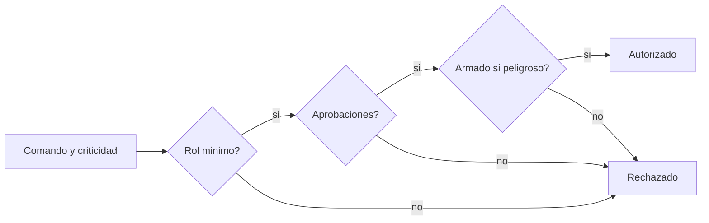

# B96-C07 — Telecomandos y autorizaciones

<!-- nav:top -->
[🏠 Programa](../../../../README.md) · [📚 Bloque B96](../../../tronco-comun/B96-control-y-operacion-de-misiones-espaciales.md) · [← Anterior: B96-C06 — Telemetría operativa](../B96-C06-telemetria-operativa/CLASE.md) · [Siguiente: B96-C08 — Gestión de estados de satélite →](../B96-C08-gestion-de-estados-de-satelite/CLASE.md)
<!-- /nav -->

## 1. Ubicación, nivel y alcance

Clase 7 del bloque B96. Nivel N3. Un **telecomando** puede cambiar el estado de la nave; por eso cada comando tiene una **criticidad** y exige un rol mínimo y, a veces, la aprobación de otra persona (**regla de dos personas**) y un paso de armado. Aquí defines una política **sintética** de cuatro niveles y la pruebas de forma exhaustiva contra una implementación independiente. La clase es defensiva y no trata cómo vulnerar sistemas reales. Todos los datos son **sintéticos** salvo los que se rotulan como consultados.

## 2. Por qué esta clase existe

Un comando enviado por la persona equivocada o sin segunda revisión puede perder la misión. La decisión central: **¿qué rol, qué aprobaciones y qué armado exige cada nivel de criticidad y cómo se prueba que la política no tiene huecos?**

## 3. Lo que podrás hacer al terminar

1. Definir niveles de criticidad y reglas de rol y aprobación.
2. Implementar la política y una referencia independiente.
3. Probar exhaustivamente todas las combinaciones y contar discrepancias.
4. Verificar propiedades: armado obligatorio, dos actores y monotonía por rol.
5. Interpretar la tabla de combinaciones permitidas.
6. Separar lo consultado de lo sintético.

La evidencia es la **política de autorización con prueba exhaustiva** del ejercicio 12 (sección 20).

## 4. Con qué llegas y cómo comprobarlo

1. ¿Qué es un telecomando?
2. ¿Qué es la regla de dos personas?
3. ¿Qué es el armado?
4. ¿Qué es una prueba exhaustiva?
5. ¿Qué es monotonía por rol?

<details>
<summary>Ver respuestas</summary>

1. Un comando enviado desde tierra a la nave. 2. Un comando crítico requiere que otra persona lo apruebe. 3. Un paso previo explícito que habilita un comando peligroso. 4. Evaluar todas las combinaciones de un espacio finito. 5. Un rol mayor nunca pierde un permiso de uno menor.
</details>

Con cuatro o cinco aciertos, sigue; si no, repasa los prerrequisitos.

## 5. Un caso de contexto y casos de referencia

La política **sintética** tiene tres roles (operador, ingeniero, director) y cuatro criticidades (rutina, sensible, crítico, peligroso). Rutina: cualquiera. Sensible: ingeniero o director. Crítico: director con una aprobación. Peligroso: director con aprobación de un ingeniero o director y armado. De 120 combinaciones evaluadas, 61 se permiten (30, 20, 8 y 3 por nivel) y hay 0 discrepancias con la referencia.

## 6. Vocabulario

**Criticidad:** consecuencia de un comando. **Rol:** nivel de autoridad. **Aprobación:** visto bueno de otra persona. **Armado:** habilitación explícita previa. **Referencia independiente:** otra implementación de la misma política. **Monotonía:** propiedad de orden.

## 7. Modelo mental



*Descripción textual:* un comando pasa tres controles seguidos: rol mínimo, aprobaciones suficientes y armado cuando es peligroso; si falla uno, se rechaza.

Analogía: la regla de dos personas es como las dos llaves de una caja fuerte: ninguna sola abre. Límite: aquí las dos personas son de roles distintos y quedan registradas (C30).

## 8. La explicación, paso a paso

### 8.1 Qué dicen las fuentes

ECSS-E-ST-70-41C (S1) describe cómo se usan los paquetes de telecomando para controlar subsistemas y cargas útiles, con servicios opcionales adaptables a cada misión; ECSS-E-ST-70-32C (S2) especifica un lenguaje de procedimientos de operación (PLUTO) y ECSS-E-ST-70-01C (S3) trata los procedimientos de control a bordo. Solo se consultaron los resúmenes; ninguna prescribe esta política, que es un **ejemplo sintético**.

### 8.2 La política

| Criticidad | Rol mínimo | Aprobaciones | Armado |
|---|---|---|---|
| Rutina | operador | 0 | no |
| Sensible | ingeniero | 0 | no |
| Crítico | director | 1 | no |
| Peligroso | director | 1 (ingeniero o director) | sí |

### 8.3 Prueba exhaustiva

Se evalúan `3 × 4 × 5 × 2 = 120` combinaciones (rol, criticidad, cinco listas de aprobaciones, armado sí/no) con la política y con una referencia independiente basada en tablas de mínimos. Permitidas: 30 de rutina, 20 de sensible, 8 de crítico y 3 de peligroso; discrepancias, 0.

### 8.4 Propiedades

(1) Ningún comando peligroso se permite sin armado. (2) Ningún comando crítico se permite sin aprobación. (3) Monotonía: si un rol menor está autorizado, el siguiente también lo está. Las tres se comprueban sobre todo el espacio.

## 9. Magnitudes, símbolos y unidades

| Símbolo | Qué es | Unidad | Valor / nota |
|---|---|---|---|
| `rol` | operador, ingeniero, director | — | 3 niveles |
| `criticidad` | rutina…peligroso | — | 4 niveles |
| `aprob.` | aprobaciones de otras personas | — | 0 a 2 |
| `armado` | habilitación previa | — | sí/no |
| `N` | combinaciones | — | 120 |

## 10. Convenciones y referencias

Política de 4 niveles y 3 roles, completamente **sintética**; las aprobaciones son de personas distintas del solicitante. Sin criptografía ni autenticación de enlace (eso se trata en otros bloques). Tolerancia: discrepancias con la referencia = 0; propiedades cumplidas en todo el espacio.

## 11. De dónde sale lo que afirmamos

| ID | Fuente | Localizador | Respalda | Estado |
|---|---|---|---|---|
| S1 | ECSS, «ECSS-E-ST-70-41C — Telemetry and telecommand packet utilization», 15 abr 2016 — https://ecss.nl/standard/ecss-e-st-70-41c-space-engineering-telemetry-and-telecommand-packet-utilization-15-april-2016/ (consultada 2026-11-10) | página de la norma (solo el resumen) | cómo se usan los paquetes de telecomando y telemetría para vigilar y controlar subsistemas y cargas útiles; servicios opcionales adaptables por misión; excluye paquetes de datos de carga útil propios de cada misión, audio y vídeo | Consultada (solo la página) |
| S2 | ECSS, «ECSS-E-ST-70-32C — Test and operations procedure language», 31 jul 2008 — https://ecss.nl/standard/ecss-e-st-70-32c-test-and-operations-procedure-language/ (consultada 2026-11-10) | página de la norma (solo el resumen) | define las capacidades del lenguaje con que se escriben procedimientos de prueba y de operación y especifica el lenguaje PLUTO | Consultada (solo la página) |
| S3 | ECSS, «ECSS-E-ST-70-01C — Spacecraft on-board control procedures», 16 abr 2010 — https://ecss.nl/standard/ecss-e-st-70-01c-on-board-control-procedures/ (consultada 2026-11-10) | página de la norma (solo el resumen) | marco para sistemas de procedimientos de control a bordo (OBCP): ejecución a bordo y preparación y gestión en tierra, y su ciclo de desarrollo | Consultada (solo la página) |
| — | Libros de texto de operaciones de misión, comunicaciones espaciales y mecánica orbital (p. ej., Wertz y Larson, Montenbruck y Gill, Vallado) | — | — | No consultada |
| — | Relaciones y algoritmos estándar usados por el laboratorio (enumeración exhaustiva de un espacio finito) | — | los verifica el laboratorio con una segunda vía o con pruebas | No consultada en una fuente concreta |

Límites: las normas se leyeron solo en su resumen; la política no modela autenticación, tiempos ni delegaciones. Lo simulado no se presenta como dato de vuelo ni como medición.

## 12. Cómo ver los resultados

| Criticidad | Permitidas de 30 |
|---|---|
| Rutina | 30 |
| Sensible | 20 |
| Crítico | 8 |
| Peligroso | 3 |

Descripción larga: cada nivel permite menos combinaciones que el anterior; solo 3 de las 30 combinaciones de un comando peligroso son válidas.

## 13. Ejemplo trabajado

**Paso 1 · Caso.** Un director quiere enviar un comando peligroso, con un ingeniero aprobando y el armado hecho: permitido.

**Paso 2 · Sin armado.** Rechazado.

**Paso 3 · Sin aprobación.** Rechazado.

**Paso 4 · Operador.** Rechazado aunque haya aprobación.

**Paso 5 · Prueba.** 120 combinaciones, 0 discrepancias.

## 14. Distintas formas de describir el problema

**Por tabla:** política (esta clase). **Por registro:** bitácora de quién aprobó (C30). **Por procedimiento:** pasos de ejecución (C14). **Por máquina de estados:** qué comando vale en cada estado (C08).

## 15. Práctica guiada

**Ejercicio 1 · con los pasos indicados.** ¿Puede un operador enviar un comando sensible?

<details><summary>Solución comentada</summary>

No: exige ingeniero o director.
</details>

**Ejercicio 2 · con una pista.** ¿Puede un ingeniero enviar un comando crítico?

<details><summary>Solución comentada</summary>

No: exige director con una aprobación.
</details>

**Ejercicio 3 · casi autónomo.** ¿Qué falta para que un director envíe un crítico solo?

<details><summary>Solución comentada</summary>

Una aprobación de otra persona.
</details>

## 16. Práctica autónoma, transferencia e integrador

**Ejercicio 4 · autónomo.** ¿Cuántas combinaciones tiene el espacio de la prueba?

<details><summary>Solución comentada</summary>

`3 × 4 × 5 × 2 = 120`.
</details>

**Ejercicio 5 · autónomo.** ¿Por qué la aprobación de un operador no basta en un comando peligroso?

<details><summary>Solución comentada</summary>

Exige aprobación de ingeniero o director.
</details>

**Ejercicio 6 · autónomo.** Cuenta las combinaciones de rutina permitidas.

<details><summary>Solución comentada</summary>

`3 roles × 5 aprobaciones × 2 armados = 30`.
</details>

**Ejercicio 7 · autónomo.** ¿Qué significa la monotonía?

<details><summary>Solución comentada</summary>

Si un operador puede, un ingeniero también; el rol mayor no pierde permisos.
</details>

**Ejercicio 8 · autónomo.** Añade el nivel 'catastrófico' con dos aprobaciones. ¿Qué debes volver a hacer?

<details><summary>Solución comentada</summary>

Ampliar la política y la referencia y repetir la prueba exhaustiva.
</details>

**Ejercicio 9 · transferencia.** **Transferencia.** Un colega propone que el solicitante se apruebe a sí mismo. ¿Qué respondes?

<details><summary>Solución comentada</summary>

Anula la regla de dos personas: la aprobación debe venir de otra persona.
</details>

**Ejercicio 10 · transferencia.** **Transferencia.** ¿Por qué conviene una implementación de referencia independiente?

<details><summary>Solución comentada</summary>

Porque dos implementaciones separadas que coinciden en todo el espacio dan confianza sin depender de una sola lectura de la regla.
</details>

**Ejercicio 11 · transferencia.** **Transferencia.** ¿Qué no cubre esta política respecto a la seguridad real?

<details><summary>Solución comentada</summary>

Autenticación, integridad del enlace, tiempos de aprobación y delegaciones.
</details>

**Ejercicio 12 · integrador.** **Integrador.** Elabora tu *política de autorización con prueba exhaustiva*: tabla de reglas, combinaciones, discrepancias, propiedades y lista de lo consultado, sintético y no consultado.

<details><summary>Solución comentada</summary>

Secciones 8.2–8.4 y la salida del laboratorio.
</details>

## 17. Laboratorio: prueba exhaustiva de la política

El script [politica_de_autorizacion.py](politica_de_autorizacion.py) implementa la política y una referencia independiente, evalúa las 120 combinaciones, cuenta las permitidas por nivel y **comprueba** discrepancias nulas, armado obligatorio, dos actores y monotonía.

**Datos:** roles, niveles y reglas **sintéticos**. **Predice antes de ejecutar:** ¿cuántas combinaciones de comando peligroso se permiten? (3). **Ejecución del 2026-11-10 (Python 3.12.9):**

```text
Python 3.12.9
Datos SINTETICOS: roles, niveles de criticidad y reglas ficticios
Combinaciones evaluadas = 120 ; permitidas = 61 ; discrepancias con la referencia = 0
Permitidas por criticidad: {'rutina': 30, 'sensible': 20, 'critico': 8, 'peligroso': 3}
Monotonia por rol = True
Pruebas superadas.
```

```bash
python programa/clases/B96/B96-C07-telecomandos-y-autorizaciones/politica_de_autorizacion.py
```

**Límites:** no modela autenticación, tiempo de espera de la aprobación ni delegación de roles.

## 18. Errores frecuentes y cómo corregirlos

**Dejar que el solicitante se apruebe.** La aprobación viene de otra persona (8.2)

**Probar solo algunos casos.** Enumera todo el espacio (8.3)

**Presentar la política como norma.** Revisa la sección 10

## 19. Cómo sabrás que vas bien

Tras 8.3: ¿cuántas combinaciones de comando crítico se permiten? Si dudas, repasa el ejercicio 4. Tras el laboratorio: ¿qué comprueba la referencia? (ver sección 17).

## 20. Qué entregas y cómo se evalúa

El producto es tu **política de autorización con prueba exhaustiva** (ejercicio 12).

| Criterio | Inicial | En desarrollo | Logrado | Destacado |
|---|---|---|---|---|
| Conceptos | Los confunde | Parciales | Explica el método y su dominio | Explica los límites y las alternativas |
| Cálculo | Sin unidades | Con errores | Resultados con unidades y comprobados | Resuelve casos nuevos |
| Numérico | Sin comprobar | Un caso | Verifica con una segunda vía en varios casos | Interpreta las diferencias y los fallos |
| Fuentes | Sin fuente | Sin fecha | Fuentes con fecha y estado | Declara lo sintético y lo no consultado |
| Límites | No los nombra | Uno | Tres | Discute qué falta del modelo |

**Condiciones críticas (no se compensan con promedio):** rotular los datos como sintéticos; comprobar cada resultado con una segunda vía; citar solo lo consultado.

## 21. Ética, seguridad y límites

Clase educativa: los modelos son simplificados y los datos son sintéticos; ningún resultado describe una misión real, certifica conformidad con una norma ni sustituye la revisión de especialistas.  Accesibilidad: tablas equivalentes a las gráficas, fórmulas en texto, ejercicios sin conexión.

## 22. Para cerrar y seguir

La política sintética permite 61 de 120 combinaciones y la prueba exhaustiva no halla discrepancias con la referencia; los comandos peligrosos exigen armado y dos actores. Queda una pregunta: ¿en qué estados puede estar la nave cuando llega el comando?

**Glosario español–inglés.** telecomando · *telecommand*; criticidad · *criticality*; regla de dos personas · *two-person rule*; armado · *arming*; autorización · *authorization*.

**Continuidad.** [B96-C08](../B96-C08-gestion-de-estados-de-satelite/CLASE.md) trata la gestión de estados del satélite.

**Referencias:** ver sección 11.

<!-- nav:bottom -->
---

[← Anterior: B96-C06 — Telemetría operativa](../B96-C06-telemetria-operativa/CLASE.md) · [📚 Bloque B96](../../../tronco-comun/B96-control-y-operacion-de-misiones-espaciales.md) · [Siguiente: B96-C08 — Gestión de estados de satélite →](../B96-C08-gestion-de-estados-de-satelite/CLASE.md)
<!-- /nav -->
