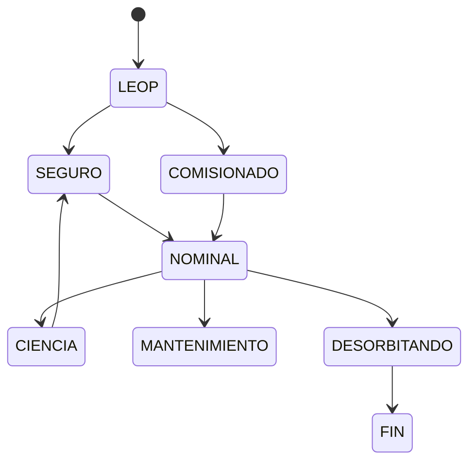

# B96-C08 — Gestión de estados de satélite

<!-- nav:top -->
[🏠 Programa](../../../../README.md) · [📚 Bloque B96](../../../tronco-comun/B96-control-y-operacion-de-misiones-espaciales.md) · [← Anterior: B96-C07 — Telecomandos y autorizaciones](../B96-C07-telecomandos-y-autorizaciones/CLASE.md) · [Siguiente: B96-C09 — Secuencias de misión →](../B96-C09-secuencias-de-mision/CLASE.md)
<!-- /nav -->

## 1. Ubicación, nivel y alcance

Clase 8 del bloque B96. Nivel N3. Un satélite está siempre en un **estado** (modo) y solo puede pasar a otros por **transiciones** permitidas. Aquí modelas ocho estados **sintéticos** (LEOP, SEGURO, COMISIONADO, NOMINAL, CIENCIA, MANTENIMIENTO, DESORBITANDO, FIN), calculas qué se alcanza desde el lanzamiento, el camino más corto a ciencia y verificas la propiedad de seguridad: desde cualquier estado se puede volver a SEGURO. Todos los datos son **sintéticos** salvo los que se rotulan como consultados.

## 2. Por qué esta clase existe

Un comando válido en un estado puede ser peligroso en otro; y un modo seguro al que no se puede volver es una trampa. La decisión central: **¿qué transiciones existen y se puede siempre llegar al estado seguro?**

## 3. Lo que podrás hacer al terminar

1. Describir una máquina de estados con transiciones permitidas.
2. Calcular la alcanzabilidad con búsqueda en anchura y comprobarla con una en profundidad.
3. Hallar el camino más corto entre dos estados.
4. Verificar la propiedad de seguridad de retorno a SEGURO.
5. Identificar qué estados rechazan un comando.
6. Separar lo consultado de lo sintético.

La evidencia es la **diagrama y tabla de estados con alcanzabilidad** del ejercicio 12 (sección 20).

## 4. Con qué llegas y cómo comprobarlo

1. ¿Qué es un grafo dirigido?
2. ¿Qué es la búsqueda en anchura?
3. ¿Qué es un modo seguro?
4. ¿Qué es un sumidero?
5. ¿Qué es una propiedad de seguridad?

<details>
<summary>Ver respuestas</summary>

1. Nodos y flechas con sentido. 2. Un recorrido por niveles que halla caminos más cortos en número de pasos. 3. Un estado de mínimo consumo y configuración conocida al que la nave pasa ante una falla. 4. Un estado sin transiciones de salida. 5. Una condición que debe cumplirse siempre, como poder volver a SEGURO.
</details>

Con cuatro o cinco aciertos, sigue; si no, repasa los prerrequisitos.

## 5. Un caso de contexto y casos de referencia

El grafo sintético tiene 8 estados y 17 transiciones de las 64 posibles. Desde LEOP se alcanzan los 8; el camino más corto a CIENCIA es LEOP → SEGURO → NOMINAL → CIENCIA (3 pasos) y FIN solo se alcanza desde DESORBITANDO. Ningún estado queda sin camino a SEGURO; seis estados rechazan el comando de ciencia.

## 6. Vocabulario

**Estado/modo:** configuración operativa. **Transición:** cambio permitido. **Alcanzabilidad:** estados a los que se llega desde otro. **Sumidero:** estado terminal. **Propiedad de seguridad:** condición que siempre debe cumplirse. **LEOP:** fase de lanzamiento y primeras órbitas.

## 7. Modelo mental



*Descripción textual:* la nave pasa de LEOP a SEGURO o a COMISIONADO, de ahí a NOMINAL y desde NOMINAL a ciencia, mantenimiento o desorbitado; desde casi todos los estados hay flecha a SEGURO.

Analogía: los estados son como las habitaciones de una casa con puertas de sentido único: la propiedad de seguridad dice que desde cualquier habitación se llega al refugio. Límite: aquí no se modelan las condiciones físicas que disparan cada puerta.

## 8. La explicación, paso a paso

### 8.1 Qué dicen las fuentes

ECSS-E-ST-70-11C (S1) busca que las funciones de a bordo permitan operar la nave en situaciones nominales o de contingencia predefinidas; ECSS-E-ST-70-41C (S2) trata servicios de control de la nave. Solo se leyeron los resúmenes. Los estados y transiciones de esta clase son un **ejemplo sintético**.

### 8.2 Alcanzabilidad

Búsqueda en anchura desde LEOP: SEGURO y COMISIONADO a 1 paso, NOMINAL a 2, CIENCIA, MANTENIMIENTO y DESORBITANDO a 3, FIN a 4. Una búsqueda en profundidad independiente da el mismo conjunto.

### 8.3 Propiedades

(1) Desde todo estado distinto de FIN y SEGURO hay un camino a SEGURO (lista de excepciones vacía). (2) FIN es sumidero y solo lo alcanza DESORBITANDO. (3) El comando de ciencia solo vale en NOMINAL y CIENCIA: lo rechazan LEOP, SEGURO, COMISIONADO, MANTENIMIENTO, DESORBITANDO y FIN.

### 8.4 Qué ocurre si se rompe

Si se quita la transición MANTENIMIENTO → SEGURO, ese estado aún llega a NOMINAL y de ahí a SEGURO, así que la propiedad se mantiene; si se quita también MANTENIMIENTO → NOMINAL, el estado queda atrapado y la verificación lo detecta.

## 9. Magnitudes, símbolos y unidades

| Símbolo | Qué es | Unidad | Valor / nota |
|---|---|---|---|
| `S` | estados | — | 8 |
| `A` | transiciones permitidas | — | 17 de 64 |
| `d` | pasos desde LEOP | — | 0 a 4 |
| `camino` | LEOP→CIENCIA | pasos | 3 |
| `rechazos` | estados que rechazan ciencia | — | 6 |

## 10. Convenciones y referencias

Grafo dirigido y finito de 8 estados, **sintético**; sin tiempos ni condiciones de disparo. Un camino se mide en número de transiciones. Tolerancia: conjunto alcanzable por anchura igual al de profundidad; lista de estados sin retorno a SEGURO vacía.

## 11. De dónde sale lo que afirmamos

| ID | Fuente | Localizador | Respalda | Estado |
|---|---|---|---|---|
| S1 | ECSS, «ECSS-E-ST-70-11C — Space segment operability», 31 jul 2008 (cancelada y reemplazada por la Rev.1 del 15 oct 2025) — https://ecss.nl/standard/ecss-e-st-70-11c-space-segment-operability/ (consultada 2026-11-10) | página de la norma (solo el resumen; no el texto de requisitos) | disposiciones de diseño de las funciones de a bordo de un segmento espacial no tripulado para que pueda operarse en vuelo en situaciones nominales o de contingencia predefinidas; excluye la operabilidad específica de cada misión | Consultada (solo la página) |
| S2 | ECSS, «ECSS-E-ST-70-41C — Telemetry and telecommand packet utilization», 15 abr 2016 — https://ecss.nl/standard/ecss-e-st-70-41c-space-engineering-telemetry-and-telecommand-packet-utilization-15-april-2016/ (consultada 2026-11-10) | página de la norma (solo el resumen) | cómo se usan los paquetes de telecomando y telemetría para vigilar y controlar subsistemas y cargas útiles; servicios opcionales adaptables por misión; excluye paquetes de datos de carga útil propios de cada misión, audio y vídeo | Consultada (solo la página) |
| — | Libros de texto de operaciones de misión, comunicaciones espaciales y mecánica orbital (p. ej., Wertz y Larson, Montenbruck y Gill, Vallado) | — | — | No consultada |
| — | Relaciones y algoritmos estándar usados por el laboratorio (búsqueda en anchura y en profundidad sobre un grafo dirigido) | — | los verifica el laboratorio con una segunda vía o con pruebas | No consultada en una fuente concreta |

Límites: las normas se leyeron solo en su resumen; el modelo ignora condiciones de transición, tiempos y autonomía a bordo. Lo simulado no se presenta como dato de vuelo ni como medición.

## 12. Cómo ver los resultados

| Estado | Pasos desde LEOP |
|---|---|
| LEOP | 0 |
| SEGURO, COMISIONADO | 1 |
| NOMINAL | 2 |
| CIENCIA, MANTENIMIENTO, DESORBITANDO | 3 |
| FIN | 4 |

Descripción larga: el grafo es poco denso (17 de 64) y NOMINAL es el centro desde el que se llega a los modos operativos y al retiro.

## 13. Ejemplo trabajado

**Paso 1 · Alcance.** Los 8 estados desde LEOP.

**Paso 2 · Camino.** LEOP → SEGURO → NOMINAL → CIENCIA.

**Paso 3 · Seguridad.** Todo estado llega a SEGURO.

**Paso 4 · Sumidero.** FIN solo desde DESORBITANDO.

**Paso 5 · Comando.** Ciencia rechazado en 6 estados.

## 14. Distintas formas de describir el problema

**Por diagrama:** estados y flechas (esta clase). **Por matriz:** 8 × 8 de ceros y unos. **Por reglas:** qué comando vale en cada estado (C07, C14).

## 15. Práctica guiada

**Ejercicio 1 · con los pasos indicados.** ¿Cuántas transiciones tiene SEGURO?

<details><summary>Solución comentada</summary>

3: COMISIONADO, NOMINAL y LEOP.
</details>

**Ejercicio 2 · con una pista.** ¿Cuántos pasos hay de COMISIONADO a CIENCIA?

<details><summary>Solución comentada</summary>

2: COMISIONADO → NOMINAL → CIENCIA.
</details>

**Ejercicio 3 · casi autónomo.** ¿Qué estados llegan a FIN?

<details><summary>Solución comentada</summary>

Solo DESORBITANDO.
</details>

## 16. Práctica autónoma, transferencia e integrador

**Ejercicio 4 · autónomo.** ¿Cuántos pasos hay de LEOP a FIN?

<details><summary>Solución comentada</summary>

4.
</details>

**Ejercicio 5 · autónomo.** ¿Qué fracción de la matriz es ocupada?

<details><summary>Solución comentada</summary>

`17/64 = 26,6 %`.
</details>

**Ejercicio 6 · autónomo.** Añade LEOP → NOMINAL. ¿Cambia el camino a CIENCIA?

<details><summary>Solución comentada</summary>

Sí: 2 pasos (LEOP → NOMINAL → CIENCIA); pero se pierde el paso por SEGURO, que es una decisión de política.
</details>

**Ejercicio 7 · autónomo.** Si se elimina SEGURO → NOMINAL, ¿cómo se llega a NOMINAL?

<details><summary>Solución comentada</summary>

Por COMISIONADO.
</details>

**Ejercicio 8 · autónomo.** ¿Por qué es peligroso un estado sin salida distinto de FIN?

<details><summary>Solución comentada</summary>

Porque deja la nave atrapada: viola la propiedad de seguridad.
</details>

**Ejercicio 9 · transferencia.** **Transferencia.** Un colega pide comando de ciencia en SEGURO. ¿Qué respondes?

<details><summary>Solución comentada</summary>

Se rechaza: el estado seguro minimiza consumo y no admite carga útil.
</details>

**Ejercicio 10 · transferencia.** **Transferencia.** ¿Qué otro algoritmo confirma la alcanzabilidad?

<details><summary>Solución comentada</summary>

La búsqueda en profundidad, que debe dar el mismo conjunto.
</details>

**Ejercicio 11 · transferencia.** **Transferencia.** ¿Qué no modela este grafo respecto a un satélite real?

<details><summary>Solución comentada</summary>

Condiciones de disparo, tiempos, autonomía a bordo y estados compuestos de subsistemas.
</details>

**Ejercicio 12 · integrador.** **Integrador.** Elabora tu *diagrama y tabla de estados con alcanzabilidad*: transiciones, alcanzables, camino más corto, propiedades y lista de lo consultado, sintético y no consultado.

<details><summary>Solución comentada</summary>

Secciones 8.2–8.4 y la salida del laboratorio.
</details>

## 17. Laboratorio: alcanzabilidad y seguridad del grafo de estados

El script [maquina_de_estados.py](maquina_de_estados.py) construye el grafo, calcula distancias con anchura, verifica con profundidad, halla el camino a CIENCIA y comprueba que desde todo estado se llega a SEGURO y que FIN solo se alcanza desde DESORBITANDO.

**Datos:** estados y transiciones **sintéticos**. **Predice antes de ejecutar:** ¿cuántos pasos hay de LEOP a CIENCIA? (3). **Ejecución del 2026-11-10 (Python 3.12.9):**

```text
Python 3.12.9
Datos SINTETICOS: estados y transiciones ficticios
Alcanzables desde LEOP: {'LEOP': 0, 'SEGURO': 1, 'COMISIONADO': 1, 'NOMINAL': 2, 'CIENCIA': 3, 'MANTENIMIENTO': 3, 'DESORBITANDO': 3, 'FIN': 4}
Camino mas corto LEOP -> CIENCIA: LEOP -> SEGURO -> NOMINAL -> CIENCIA
Estados desde los que no se llega a SEGURO = []
Estados con transicion a FIN: ['DESORBITANDO']
Transiciones permitidas = 17 de 64 posibles
Estados que rechazan el comando de ciencia: ['LEOP', 'SEGURO', 'COMISIONADO', 'MANTENIMIENTO', 'DESORBITANDO', 'FIN']
Pruebas superadas.
```

```bash
python programa/clases/B96/B96-C08-gestion-de-estados-de-satelite/maquina_de_estados.py
```

**Límites:** grafo estático, sin condiciones, tiempos ni estados paralelos de subsistemas.

## 18. Errores frecuentes y cómo corregirlos

**Olvidar una transición de retorno.** Verifica la propiedad de seguridad (8.3)

**Aceptar un comando en cualquier estado.** Define en qué estados vale (8.3)

**Tomar el grafo como el de una misión.** Revisa la sección 10

## 19. Cómo sabrás que vas bien

Tras 8.3: ¿qué estado rechaza el comando de ciencia además de SEGURO? Si dudas, repasa el ejercicio 9. Tras el laboratorio: ¿qué comprueba la profundidad? (ver sección 17).

## 20. Qué entregas y cómo se evalúa

El producto es tu **diagrama y tabla de estados con alcanzabilidad** (ejercicio 12).

| Criterio | Inicial | En desarrollo | Logrado | Destacado |
|---|---|---|---|---|
| Conceptos | Los confunde | Parciales | Explica el método y su dominio | Explica los límites y las alternativas |
| Cálculo | Sin unidades | Con errores | Resultados con unidades y comprobados | Resuelve casos nuevos |
| Numérico | Sin comprobar | Un caso | Verifica con una segunda vía en varios casos | Interpreta las diferencias y los fallos |
| Fuentes | Sin fuente | Sin fecha | Fuentes con fecha y estado | Declara lo sintético y lo no consultado |
| Límites | No los nombra | Uno | Tres | Discute qué falta del modelo |

**Condiciones críticas (no se compensan con promedio):** rotular los datos como sintéticos; comprobar cada resultado con una segunda vía; citar solo lo consultado.

## 21. Ética, seguridad y límites

Clase educativa: los modelos son simplificados y los datos son sintéticos; ningún resultado describe una misión real, certifica conformidad con una norma ni sustituye la revisión de especialistas.  Accesibilidad: tablas equivalentes a las gráficas, fórmulas en texto, ejercicios sin conexión.

## 22. Para cerrar y seguir

El grafo sintético tiene 17 transiciones, se recorre en 4 pasos hasta FIN y cumple que todo estado vuelve a SEGURO. Queda una pregunta: ¿cómo se encadenan las acciones durante una pasada?

**Glosario español–inglés.** estado · *state*; transición · *transition*; modo seguro · *safe mode*; alcanzabilidad · *reachability*; sumidero · *sink*.

**Continuidad.** [B96-C09](../B96-C09-secuencias-de-mision/CLASE.md) trata las secuencias de misión.

**Referencias:** ver sección 11.

<!-- nav:bottom -->
---

[← Anterior: B96-C07 — Telecomandos y autorizaciones](../B96-C07-telecomandos-y-autorizaciones/CLASE.md) · [📚 Bloque B96](../../../tronco-comun/B96-control-y-operacion-de-misiones-espaciales.md) · [Siguiente: B96-C09 — Secuencias de misión →](../B96-C09-secuencias-de-mision/CLASE.md)
<!-- /nav -->
