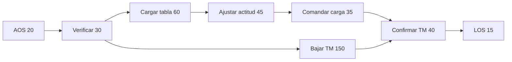

# B96-C09 — Secuencias de misión

<!-- nav:top -->
[🏠 Programa](../../../../README.md) · [📚 Bloque B96](../../../tronco-comun/B96-control-y-operacion-de-misiones-espaciales.md) · [← Anterior: B96-C08 — Gestión de estados de satélite](../B96-C08-gestion-de-estados-de-satelite/CLASE.md) · [Siguiente: B96-C10 — Planificación de cargas útiles →](../B96-C10-planificacion-de-cargas-utiles/CLASE.md)
<!-- /nav -->

## 1. Ubicación, nivel y alcance

Clase 9 del bloque B96. Nivel N3. Una **secuencia de misión** ordena las actividades de una pasada (adquisición de señal, verificación, carga de tablas, bajada, comandos de carga útil, confirmación, cierre) con **dependencias** y **duraciones**. Aquí calculas el **camino crítico**, la holgura de cada actividad y si todo cabe en el contacto de 425 s de C04. Las actividades y duraciones son **sintéticas**. Todos los datos son **sintéticos** salvo los que se rotulan como consultados.

## 2. Por qué esta clase existe

Una secuencia que no cabe en la ventana deja comandos sin ejecutar o telemetría sin confirmar. La decisión central: **¿qué actividades fijan la duración mínima y cuánta holgura queda?**

## 3. Lo que podrás hacer al terminar

1. Describir una secuencia como un grafo de actividades con dependencias.
2. Calcular inicio y fin temprano y tardío de cada actividad.
3. Hallar el camino crítico y la holgura.
4. Comprobar el camino crítico con una enumeración de todos los caminos.
5. Comparar la duración con la ventana y medir la sensibilidad a retrasos.
6. Separar lo consultado de lo sintético.

La evidencia es la **cronograma de secuencia con camino crítico** del ejercicio 12 (sección 20).

## 4. Con qué llegas y cómo comprobarlo

1. ¿Qué es una dependencia?
2. ¿Qué es el orden topológico?
3. ¿Qué es la holgura?
4. ¿Qué es AOS y LOS?
5. ¿Qué es un camino crítico?

<details>
<summary>Ver respuestas</summary>

1. Una actividad que no puede empezar hasta que termine otra. 2. Un orden en que cada actividad viene después de sus predecesoras. 3. Cuánto puede retrasarse una actividad sin retrasar el final. 4. Adquisición y pérdida de señal: inicio y fin del contacto. 5. La cadena de actividades de holgura cero que fija la duración total.
</details>

Con cuatro o cinco aciertos, sigue; si no, repasa los prerrequisitos.

## 5. Un caso de contexto y casos de referencia

La secuencia **sintética** de una pasada tiene 8 actividades. Su camino crítico es AOS_y_enganche (20 s) → Verificar_estado (30) → Bajar_TM_historica (150) → Confirmar_TM (40) → LOS_y_cierre (15), con 255 s. Las actividades de carga de tabla, ajuste de actitud y comando de carga útil tienen 10 s de holgura. La ventana es de 425 s: sobran 170 s. Retrasar 30 s una actividad crítica deja 140 s.

## 6. Vocabulario

**Secuencia:** lista ordenada de actividades. **Camino crítico:** cadena de holgura cero. **ES/EF:** inicio y fin tempranos. **LS/LF:** inicio y fin tardíos. **Holgura:** `LS − ES`. **AOS/LOS:** inicio y fin del contacto.

## 7. Modelo mental



*Descripción textual:* tras verificar el estado se abren dos ramas, la de cargar tabla y comandar la carga útil y la de bajar telemetría; la más larga (bajar telemetría) fija la duración.

Analogía: una secuencia es como cocinar una comida con varias ollas: el tiempo total lo fija la receta más lenta, no la suma de todas. Límite: en la nave algunos comandos compiten por el mismo recurso y no pueden ir en paralelo.

## 8. La explicación, paso a paso

### 8.1 Qué dicen las fuentes

ECSS-E-ST-70-32C (S1) define el lenguaje con que se escriben los procedimientos de prueba y operación (PLUTO) y ECSS-E-ST-70-01C (S2) trata los procedimientos de control a bordo, con su preparación en tierra. Solo se leyeron los resúmenes. El método de camino crítico es estándar y se verifica en el laboratorio; las actividades son **sintéticas**.

### 8.2 Cálculo hacia adelante y hacia atrás

`ES = max(EF de las predecesoras)`, `EF = ES + duración`; después `LF = min(LS de las sucesoras)` y `LS = LF − duración`. La holgura es `LS − ES`.

| Actividad | Duración (s) | ES | EF | Holgura |
|---|---|---|---|---|
| AOS_y_enganche | 20 | 0 | 20 | 0 |
| Verificar_estado | 30 | 20 | 50 | 0 |
| Cargar_tabla | 60 | 50 | 110 | 10 |
| Bajar_TM_historica | 150 | 50 | 200 | 0 |
| Ajustar_actitud | 45 | 110 | 155 | 10 |
| Comandar_carga_util | 35 | 155 | 190 | 10 |
| Confirmar_TM | 40 | 200 | 240 | 0 |
| LOS_y_cierre | 15 | 240 | 255 | 0 |

### 8.3 Comprobación independiente

Una enumeración de todos los caminos del grafo da 255 s como el más largo, con las mismas actividades que el camino crítico.

### 8.4 Ventana y sensibilidad

Con 425 s de ventana, la holgura global es 170 s. Un retraso de 30 s en cualquier actividad crítica da 285 s y 140 s de holgura. Una actividad no crítica puede retrasarse hasta 10 s sin efecto.

## 9. Magnitudes, símbolos y unidades

| Símbolo | Qué es | Unidad | Valor / nota |
|---|---|---|---|
| `d` | duración de actividad | s | 15 a 150 |
| `ES, EF` | inicio y fin tempranos | s | 0 a 255 |
| `holgura` | LS − ES | s | 0 o 10 |
| `D` | duración total | s | 255 |
| `W` | ventana de contacto | s | 425 |

## 10. Convenciones y referencias

Tiempos en segundos desde AOS; actividades secuenciales por recurso salvo las que el grafo permite en paralelo; sin variabilidad en las duraciones. Todo **sintético**. Tolerancia: duración del camino crítico igual a la del más largo por enumeración (exacta).

## 11. De dónde sale lo que afirmamos

| ID | Fuente | Localizador | Respalda | Estado |
|---|---|---|---|---|
| S1 | ECSS, «ECSS-E-ST-70-32C — Test and operations procedure language», 31 jul 2008 — https://ecss.nl/standard/ecss-e-st-70-32c-test-and-operations-procedure-language/ (consultada 2026-11-10) | página de la norma (solo el resumen) | define las capacidades del lenguaje con que se escriben procedimientos de prueba y de operación y especifica el lenguaje PLUTO | Consultada (solo la página) |
| S2 | ECSS, «ECSS-E-ST-70-01C — Spacecraft on-board control procedures», 16 abr 2010 — https://ecss.nl/standard/ecss-e-st-70-01c-on-board-control-procedures/ (consultada 2026-11-10) | página de la norma (solo el resumen) | marco para sistemas de procedimientos de control a bordo (OBCP): ejecución a bordo y preparación y gestión en tierra, y su ciclo de desarrollo | Consultada (solo la página) |
| — | Libros de texto de operaciones de misión, comunicaciones espaciales y mecánica orbital (p. ej., Wertz y Larson, Montenbruck y Gill, Vallado) | — | — | No consultada |
| — | Relaciones y algoritmos estándar usados por el laboratorio (método de camino crítico (CPM) y enumeración de caminos) | — | los verifica el laboratorio con una segunda vía o con pruebas | No consultada en una fuente concreta |

Límites: las normas se leyeron solo en su resumen; no hay recursos compartidos, duraciones inciertas ni reintentos. Lo simulado no se presenta como dato de vuelo ni como medición.

## 12. Cómo ver los resultados

| Magnitud | Valor |
|---|---|
| Duración total | 255 s |
| Camino crítico | 5 actividades |
| Holgura de la carga útil | 10 s |
| Holgura frente a la ventana | 170 s |

Descripción larga: la rama de bajada de telemetría (150 s) es 10 s más larga que la rama de carga de tabla, actitud y comando (140 s), por eso es crítica.

## 13. Ejemplo trabajado

**Paso 1 · Adelante.** `EF(Confirmar) = 240`.

**Paso 2 · Total.** `255 s`.

**Paso 3 · Atrás.** `LS(Cargar_tabla) = 60`, holgura 10.

**Paso 4 · Camino.** 5 actividades críticas.

**Paso 5 · Ventana.** `425 − 255 = 170 s`.

## 14. Distintas formas de describir el problema

**Por tabla:** ES, EF, holgura (esta clase). **Por diagrama:** red de actividades. **Por lenguaje:** procedimiento en PLUTO (ECSS-E-ST-70-32C, solo resumen). **Por simulación:** jornada completa (C20).

## 15. Práctica guiada

**Ejercicio 1 · con los pasos indicados.** Calcula `EF` de Cargar_tabla.

<details><summary>Solución comentada</summary>

`50 + 60 = 110 s`.
</details>

**Ejercicio 2 · con una pista.** ¿Cuál es la duración de la rama de carga útil desde Verificar?

<details><summary>Solución comentada</summary>

`60 + 45 + 35 = 140 s`.
</details>

**Ejercicio 3 · casi autónomo.** ¿Y de la rama de bajada?

<details><summary>Solución comentada</summary>

`150 s`: es la más larga.
</details>

## 16. Práctica autónoma, transferencia e integrador

**Ejercicio 4 · autónomo.** ¿Cuánta holgura tiene Cargar_tabla?

<details><summary>Solución comentada</summary>

`150 − 140 = 10 s`.
</details>

**Ejercicio 5 · autónomo.** ¿Cuántas actividades son críticas?

<details><summary>Solución comentada</summary>

5.
</details>

**Ejercicio 6 · autónomo.** Si Bajar_TM se acorta a 120 s, ¿cuál es el nuevo camino crítico?

<details><summary>Solución comentada</summary>

La rama de carga útil (140 s): total `20 + 30 + 140 + 40 + 15 = 245 s`.
</details>

**Ejercicio 7 · autónomo.** ¿Cuánto puede alargarse AOS_y_enganche antes de salirse de la ventana?

<details><summary>Solución comentada</summary>

`170 s`.
</details>

**Ejercicio 8 · autónomo.** Si se añade una actividad de 200 s en el camino crítico, ¿cabe?

<details><summary>Solución comentada</summary>

`255 + 200 = 455 > 425`: no cabe.
</details>

**Ejercicio 9 · transferencia.** **Transferencia.** Un colega suma todas las duraciones y obtiene 395 s. ¿Qué error comete?

<details><summary>Solución comentada</summary>

Suma ramas paralelas: la duración la fija el camino más largo (255 s).
</details>

**Ejercicio 10 · transferencia.** **Transferencia.** ¿Por qué conviene dejar holgura respecto a la ventana?

<details><summary>Solución comentada</summary>

Porque la adquisición de señal puede retrasarse y los comandos pueden repetirse.
</details>

**Ejercicio 11 · transferencia.** **Transferencia.** ¿Qué no modela este método sobre una pasada real?

<details><summary>Solución comentada</summary>

Recursos compartidos, duraciones inciertas, reintentos y caídas del enlace.
</details>

**Ejercicio 12 · integrador.** **Integrador.** Elabora tu *cronograma de secuencia con camino crítico*: tabla de tiempos, camino crítico, comprobación por enumeración, holgura frente a la ventana y lista de lo consultado, sintético y no consultado.

<details><summary>Solución comentada</summary>

Secciones 8.2–8.4 y la salida del laboratorio.
</details>

## 17. Laboratorio: camino crítico de una pasada

El script [camino_critico_de_pasada.py](camino_critico_de_pasada.py) calcula ES, EF, LS, LF y holgura, halla el camino crítico, lo contrasta con la enumeración de todos los caminos y mide la sensibilidad a un retraso de 30 s; **comprueba** que ambos métodos dan 255 s.

**Datos:** actividades y duraciones **sintéticas**; ventana de 425 s tomada de la pasada de C04. **Predice antes de ejecutar:** ¿cuántos segundos dura la secuencia? (255). **Ejecución del 2026-11-10 (Python 3.12.9):**

```text
Python 3.12.9
Datos SINTETICOS: actividades y duraciones ficticias; contacto de 425 s
Actividad             dur   ES   EF  holg
AOS_y_enganche         20    0   20     0
Verificar_estado       30   20   50     0
Cargar_tabla           60   50  110    10
Bajar_TM_historica    150   50  200     0
Ajustar_actitud        45  110  155    10
Comandar_carga_util    35  155  190    10
Confirmar_TM           40  200  240     0
LOS_y_cierre           15  240  255     0
Camino critico: AOS_y_enganche -> Verificar_estado -> Bajar_TM_historica -> Confirmar_TM -> LOS_y_cierre ; duracion = 255 s
Camino mas largo por enumeracion = 255 s
Ventana de contacto = 425 s ; holgura global = 170 s ; cabe: SI
  +30 s en AOS_y_enganche       -> duracion = 285 s ; holgura = 140 s
  +30 s en Verificar_estado     -> duracion = 285 s ; holgura = 140 s
  +30 s en Bajar_TM_historica   -> duracion = 285 s ; holgura = 140 s
  +30 s en Confirmar_TM         -> duracion = 285 s ; holgura = 140 s
  +30 s en LOS_y_cierre         -> duracion = 285 s ; holgura = 140 s
Pruebas superadas.
```

```bash
python programa/clases/B96/B96-C09-secuencias-de-mision/camino_critico_de_pasada.py
```

**Límites:** duraciones deterministas, sin recursos compartidos ni reintentos.

## 18. Errores frecuentes y cómo corregirlos

**Sumar todas las duraciones.** La duración la fija el camino más largo (8.2)

**Ignorar la holgura.** Calcula `LS − ES` (8.2)

**No comparar con la ventana.** Aplica 8.4

## 19. Cómo sabrás que vas bien

Tras 8.2: ¿cuántos segundos puede retrasarse la carga útil sin consecuencias? Si dudas, repasa el ejercicio 4. Tras el laboratorio: ¿qué comprueba la enumeración? (ver sección 17).

## 20. Qué entregas y cómo se evalúa

El producto es tu **cronograma de secuencia con camino crítico** (ejercicio 12).

| Criterio | Inicial | En desarrollo | Logrado | Destacado |
|---|---|---|---|---|
| Conceptos | Los confunde | Parciales | Explica el método y su dominio | Explica los límites y las alternativas |
| Cálculo | Sin unidades | Con errores | Resultados con unidades y comprobados | Resuelve casos nuevos |
| Numérico | Sin comprobar | Un caso | Verifica con una segunda vía en varios casos | Interpreta las diferencias y los fallos |
| Fuentes | Sin fuente | Sin fecha | Fuentes con fecha y estado | Declara lo sintético y lo no consultado |
| Límites | No los nombra | Uno | Tres | Discute qué falta del modelo |

**Condiciones críticas (no se compensan con promedio):** rotular los datos como sintéticos; comprobar cada resultado con una segunda vía; citar solo lo consultado.

## 21. Ética, seguridad y límites

Clase educativa: los modelos son simplificados y los datos son sintéticos; ningún resultado describe una misión real, certifica conformidad con una norma ni sustituye la revisión de especialistas.  Accesibilidad: tablas equivalentes a las gráficas, fórmulas en texto, ejercicios sin conexión.

## 22. Para cerrar y seguir

La secuencia sintética dura 255 s, su camino crítico baja telemetría y deja 170 s de holgura en una ventana de 425 s. Queda una pregunta: ¿qué observaciones de la carga útil caben en los recursos disponibles?

**Glosario español–inglés.** secuencia · *sequence*; camino crítico · *critical path*; holgura · *slack*; dependencia · *dependency*; procedimiento · *procedure*.

**Continuidad.** [B96-C10](../B96-C10-planificacion-de-cargas-utiles/CLASE.md) trata la planificación de cargas útiles.

**Referencias:** ver sección 11.

<!-- nav:bottom -->
---

[← Anterior: B96-C08 — Gestión de estados de satélite](../B96-C08-gestion-de-estados-de-satelite/CLASE.md) · [📚 Bloque B96](../../../tronco-comun/B96-control-y-operacion-de-misiones-espaciales.md) · [Siguiente: B96-C10 — Planificación de cargas útiles →](../B96-C10-planificacion-de-cargas-utiles/CLASE.md)
<!-- /nav -->
