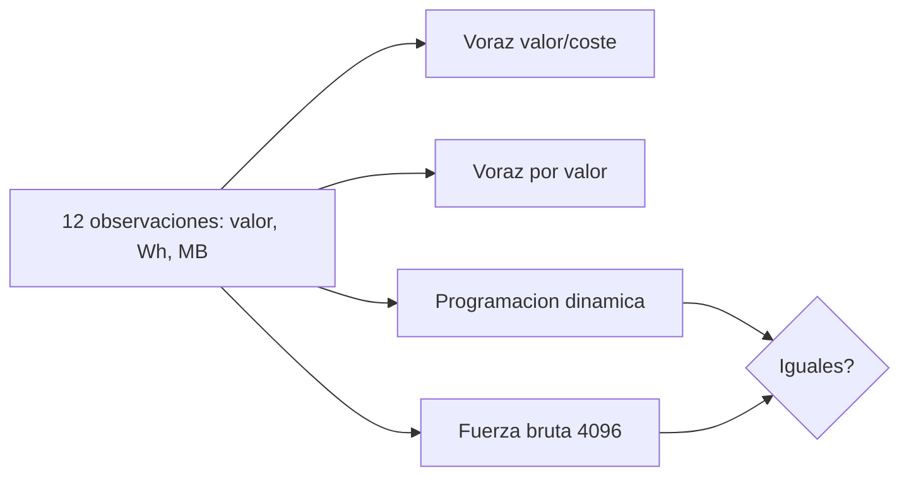

# B96-C10 — Planificación de cargas útiles

<!-- nav:top -->
[🏠 Programa](../../../../README.md) · [📚 Bloque B96](../../../tronco-comun/B96-control-y-operacion-de-misiones-espaciales.md) · [← Anterior: B96-C09 — Secuencias de misión](../B96-C09-secuencias-de-mision/CLASE.md) · [Siguiente: B96-C11 — Operación durante eclipse →](../../../tronco-comun/B96-control-y-operacion-de-misiones-espaciales.md#b96-c11)
<!-- /nav -->

## 1. Ubicación, nivel y alcance

Clase 10 del bloque B96. Nivel N3. Cada observación de la **carga útil** da un valor científico y consume energía y espacio de datos; el plan elige cuáles ejecutar dentro de los presupuestos. Aquí comparas dos métodos voraces con la **programación dinámica** exacta y la fuerza bruta. Las observaciones, valores y consumos son **sintéticos**. Todos los datos son **sintéticos** salvo los que se rotulan como consultados.

## 2. Por qué esta clase existe

Una observación que no cabe en la energía o en el almacenamiento no se hace, y una elegida a ojo puede dejar valor sin usar. La decisión central: **¿qué conjunto de observaciones da más valor dentro de la energía y los datos disponibles?**

## 3. Lo que podrás hacer al terminar

1. Plantear la selección de observaciones como una mochila con dos restricciones.
2. Implementar dos reglas voraces.
3. Calcular el óptimo por programación dinámica y comprobarlo por fuerza bruta.
4. Medir la brecha de cada regla frente al óptimo.
5. Estudiar la sensibilidad del valor al presupuesto de energía.
6. Separar lo consultado de lo sintético.

La evidencia es la **plan de carga útil con comparación de óptimos** del ejercicio 12 (sección 20).

## 4. Con qué llegas y cómo comprobarlo

1. ¿Qué es un presupuesto?
2. ¿Qué es un algoritmo voraz?
3. ¿Qué es la programación dinámica?
4. ¿Qué es la fuerza bruta?
5. ¿Qué es una brecha de optimalidad?

<details>
<summary>Ver respuestas</summary>

1. Un límite de un recurso. 2. Uno que elige lo mejor en cada paso sin deshacer. 3. Resolver subproblemas y reutilizar sus resultados para hallar el óptimo. 4. Probar todas las combinaciones. 5. La diferencia relativa entre una solución y el óptimo.
</details>

Con cuatro o cinco aciertos, sigue; si no, repasa los prerrequisitos.

## 5. Un caso de contexto y casos de referencia

Doce observaciones **sintéticas** compiten por 40 Wh y 160 MB. El óptimo es de **29** (O2, O5, O6, O8, O12; 40 Wh y 160 MB). El voraz por valor/coste logra 29 (brecha 0 en este caso), el voraz por valor solo 26 (O8, O3, O5; brecha 10,3 %). Con 20 Wh el óptimo cae a 15.

## 6. Vocabulario

**Observación:** actividad de la carga útil con valor, energía y datos. **Mochila:** problema de selección con capacidad. **Voraz:** elección paso a paso. **Programación dinámica:** solución exacta por subproblemas. **Brecha:** `(óptimo − obtenido)/óptimo`.

## 7. Modelo mental



*Descripción textual:* las mismas observaciones se resuelven por dos reglas voraces, por programación dinámica y por fuerza bruta; los dos métodos exactos deben coincidir y las reglas voraces se comparan con ellos.

Analogía: elegir observaciones es como llenar una maleta con peso y volumen limitados: lo más valioso por kilo no siempre da la maleta más valiosa. Límite: aquí los recursos son de dos tipos a la vez.

## 8. La explicación, paso a paso

### 8.1 Qué dicen las fuentes

El capítulo «Power» de la NASA (S1) indica que los paneles solares de las misiones pequeñas se agrupan cerca de 30 W/kg y que la profundidad de descarga acelera el envejecimiento de las baterías, lo que limita la energía disponible por pasada. El capítulo sobre sistemas terrestres (S2) describe el flujo de datos hacia el MOC y el SOC. Solo se leyó la parte inicial de ambos; los presupuestos de esta clase son **sintéticos**.

### 8.2 El problema

Se maximiza `Σ vᵢ xᵢ` con `Σ eᵢ xᵢ ≤ 40 Wh`, `Σ dᵢ xᵢ ≤ 160 MB`, `xᵢ ∈ {0,1}`.

### 8.3 Resultados

| Método | Valor | Energía (Wh) | Datos (MB) |
|---|---|---|---|
| Voraz valor/coste | 29 | 40 | 150 |
| Voraz por valor | 26 | 39 | 140 |
| Programación dinámica | 29 | 40 | 160 |
| Fuerza bruta (4 096 subconjuntos) | 29 | 40 | 160 |

La programación dinámica y la fuerza bruta coinciden; el voraz por valor deja 3 puntos (10,3 %) sin usar.

### 8.4 Sensibilidad

El óptimo con 40, 35, 30, 25 y 20 Wh es 29, 25, 22, 18 y 15: perder la mitad de la energía cuesta casi la mitad del valor. Una regla voraz buena en este caso (brecha 0) no está garantizada en otros: solo el método exacto lo está.

## 9. Magnitudes, símbolos y unidades

| Símbolo | Qué es | Unidad | Valor / nota |
|---|---|---|---|
| `v` | valor científico | puntos | 2 a 10 |
| `e` | energía | Wh | 3 a 15 |
| `d` | datos | MB | 5 a 60 |
| `E, D` | presupuestos | Wh, MB | 40; 160 |
| `brecha` | (óptimo − obtenido)/óptimo | % | 0 y 10,3 |

## 10. Convenciones y referencias

Valores, energías y datos enteros; observaciones indivisibles; presupuestos independientes. Todo **sintético**. Tolerancia: programación dinámica igual a fuerza bruta (exacta). Una regla voraz nunca supera al óptimo.

## 11. De dónde sale lo que afirmamos

| ID | Fuente | Localizador | Respalda | Estado |
|---|---|---|---|---|
| S1 | NASA, «Power», en State-of-the-Art of Small Spacecraft Technology — https://www.nasa.gov/smallsat-institute/sst-soa/power/ (consultada 2026-11-10; leídos los primeros 100 000 caracteres de 119 638) | capítulo (parte inicial) | potencia específica de paneles solares con mediana cercana a 30 W/kg; baterías de ion-litio comerciales de 150–270 Wh/kg a 3,6 V; la profundidad de descarga acelera el envejecimiento y la vida se prueba en condiciones de la misión; sin cifras de profundidad de descarga | Consultada (parte del capítulo) |
| S2 | NASA, «Ground Data Systems and Mission Operations», en State-of-the-Art of Small Spacecraft Technology — https://www.nasa.gov/smallsat-institute/sst-soa/ground-data-systems-and-mission-operations/ (consultada 2026-11-10; leídos los primeros 100 000 caracteres de 215 453) | capítulo (parte inicial) | un centro de operaciones de misión (MOC) comanda la nave y un centro de operaciones científicas (SOC) genera productos; enlaces directos a la Tierra frente a relevos; bandas UHF, S, X y Ka; la licencia tarda meses; las antenas suelen adquirir el satélite con 5–10° de elevación; margen típico de 3 dB para retorno de datos en LEO a 1 500 km de distancia oblicua | Consultada (parte del capítulo) |
| — | Libros de texto de operaciones de misión, comunicaciones espaciales y mecánica orbital (p. ej., Wertz y Larson, Montenbruck y Gill, Vallado) | — | — | No consultada |
| — | Relaciones y algoritmos estándar usados por el laboratorio (mochila 0/1 con dos restricciones, programación dinámica y fuerza bruta) | — | los verifica el laboratorio con una segunda vía o con pruebas | No consultada en una fuente concreta |

Límites: los capítulos se leyeron solo en parte; no se modelan dependencias entre observaciones, ventanas ni orden temporal. Lo simulado no se presenta como dato de vuelo ni como medición.

## 12. Cómo ver los resultados

| Energía (Wh) | Valor óptimo |
|---|---|
| 40 | 29 |
| 35 | 25 |
| 30 | 22 |
| 25 | 18 |
| 20 | 15 |

Descripción larga: el valor óptimo crece de forma casi lineal con la energía; las observaciones baratas y de valor medio se eligen primero.

## 13. Ejemplo trabajado

**Paso 1 · Voraz.** Ordena por `valor/(e/40 + d/160)`.

**Paso 2 · Óptimo.** Tabla de 41 × 161 estados.

**Paso 3 · Bruta.** 4 096 subconjuntos.

**Paso 4 · Comparar.** 29 = 29.

**Paso 5 · Brecha.** Voraz por valor: 3 puntos (10,3 %).

## 14. Distintas formas de describir el problema

**Por tabla:** plan elegido (esta clase). **Por ventana:** observaciones en el tiempo (C09 y C17). **Por energía:** balance durante la órbita (C12).

## 15. Práctica guiada

**Ejercicio 1 · con los pasos indicados.** Calcula la energía de O2, O5, O6, O8 y O12.

<details><summary>Solución comentada</summary>

`7 + 10 + 4 + 14 + 5 = 40 Wh`.
</details>

**Ejercicio 2 · con una pista.** Calcula los datos de ese plan.

<details><summary>Solución comentada</summary>

`25 + 35 + 10 + 45 + 45 = 160 MB`.
</details>

**Ejercicio 3 · casi autónomo.** Calcula el valor de ese plan.

<details><summary>Solución comentada</summary>

`5 + 7 + 3 + 10 + 4 = 29`.
</details>

## 16. Práctica autónoma, transferencia e integrador

**Ejercicio 4 · autónomo.** Calcula la brecha del voraz por valor.

<details><summary>Solución comentada</summary>

`(29 − 26)/29 = 10,3 %`.
</details>

**Ejercicio 5 · autónomo.** ¿Cuántos subconjuntos tiene un problema de 12 observaciones?

<details><summary>Solución comentada</summary>

`2¹² = 4 096`.
</details>

**Ejercicio 6 · autónomo.** ¿Cuántos subconjuntos tendría con 30 observaciones?

<details><summary>Solución comentada</summary>

`2³⁰ ≈ 1,07×10⁹`: la fuerza bruta ya no es práctica; la programación dinámica sí.
</details>

**Ejercicio 7 · autónomo.** ¿Qué pasa con el óptimo si el presupuesto de datos se reduce a 100 MB?

<details><summary>Solución comentada</summary>

Baja o se mantiene; hay que recalcular con `D = 100`.
</details>

**Ejercicio 8 · autónomo.** ¿Cuánto valor se pierde al pasar de 40 a 20 Wh?

<details><summary>Solución comentada</summary>

`29 − 15 = 14` puntos (48 %).
</details>

**Ejercicio 9 · transferencia.** **Transferencia.** Un colega afirma que el voraz siempre es óptimo. ¿Qué respondes?

<details><summary>Solución comentada</summary>

El voraz por valor logra 26 frente a 29: no es óptimo en general.
</details>

**Ejercicio 10 · transferencia.** **Transferencia.** ¿Por qué se usa la fuerza bruta aquí si es costosa?

<details><summary>Solución comentada</summary>

Para verificar el óptimo de la programación dinámica en un caso pequeño.
</details>

**Ejercicio 11 · transferencia.** **Transferencia.** ¿Qué no modela este plan respecto a la operación real?

<details><summary>Solución comentada</summary>

Dependencias, orden temporal, ventanas de visibilidad y variaciones de consumo.
</details>

**Ejercicio 12 · integrador.** **Integrador.** Elabora tu *plan de carga útil con comparación de óptimos*: observaciones, método voraz, óptimo, brecha, sensibilidad y lista de lo consultado, sintético y no consultado.

<details><summary>Solución comentada</summary>

Secciones 8.2–8.4 y la salida del laboratorio.
</details>

## 17. Laboratorio: plan de observaciones con presupuesto

El script [plan_de_carga_util.py](plan_de_carga_util.py) calcula dos soluciones voraces, el óptimo por programación dinámica y la fuerza bruta, la brecha y la sensibilidad al presupuesto de energía; **comprueba** que los dos métodos exactos coinciden y que ninguna regla supera el óptimo.

**Datos:** observaciones y presupuestos **sintéticos**. **Predice antes de ejecutar:** ¿cuál es el valor óptimo con 40 Wh y 160 MB? (29). **Ejecución del 2026-11-10 (Python 3.12.9):**

```text
Python 3.12.9
Datos SINTETICOS: observaciones, valores y consumos ficticios
Voraz por valor/coste: ['O9', 'O6', 'O4', 'O8', 'O10', 'O12'] ; valor = 29 ; energia = 40/40 Wh ; datos = 150/160 MB
Voraz por valor:       ['O8', 'O3', 'O5'] ; valor = 26 ; energia = 39/40 Wh ; datos = 140/160 MB
Optimo por programacion dinamica = 29 ; por fuerza bruta (4096 subconjuntos) = 29 ; seleccion = ['O2', 'O5', 'O6', 'O8', 'O12']
Brecha del voraz por valor/coste = 0 (0.0 %) ; del voraz por valor = 3 (10.3 %)
  energia 40 Wh -> valor optimo = 29
  energia 35 Wh -> valor optimo = 25
  energia 30 Wh -> valor optimo = 22
  energia 25 Wh -> valor optimo = 18
  energia 20 Wh -> valor optimo = 15
Pruebas superadas.
```

```bash
python programa/clases/B96/B96-C10-planificacion-de-cargas-utiles/plan_de_carga_util.py
```

**Límites:** observaciones independientes e indivisibles, sin orden temporal, sin ventanas ni degradación de baterías.

## 18. Errores frecuentes y cómo corregirlos

**Elegir por valor y no por valor/coste.** Compara ambas reglas (8.3)

**Confiar en el voraz sin verificar.** Contrasta con el óptimo (8.3)

**Presentar los presupuestos como reales.** Revisa la sección 10

## 19. Cómo sabrás que vas bien

Tras 8.3: ¿qué método garantiza el óptimo? Si dudas, repasa el ejercicio 9. Tras el laboratorio: ¿qué comprueba la fuerza bruta? (ver sección 17).

## 20. Qué entregas y cómo se evalúa

El producto es tu **plan de carga útil con comparación de óptimos** (ejercicio 12).

| Criterio | Inicial | En desarrollo | Logrado | Destacado |
|---|---|---|---|---|
| Conceptos | Los confunde | Parciales | Explica el método y su dominio | Explica los límites y las alternativas |
| Cálculo | Sin unidades | Con errores | Resultados con unidades y comprobados | Resuelve casos nuevos |
| Numérico | Sin comprobar | Un caso | Verifica con una segunda vía en varios casos | Interpreta las diferencias y los fallos |
| Fuentes | Sin fuente | Sin fecha | Fuentes con fecha y estado | Declara lo sintético y lo no consultado |
| Límites | No los nombra | Uno | Tres | Discute qué falta del modelo |

**Condiciones críticas (no se compensan con promedio):** rotular los datos como sintéticos; comprobar cada resultado con una segunda vía; citar solo lo consultado.

## 21. Ética, seguridad y límites

Clase educativa: los modelos son simplificados y los datos son sintéticos; ningún resultado describe una misión real, certifica conformidad con una norma ni sustituye la revisión de especialistas.  Accesibilidad: tablas equivalentes a las gráficas, fórmulas en texto, ejercicios sin conexión.

## 22. Para cerrar y seguir

El plan óptimo sintético vale 29 con 40 Wh y 160 MB; el voraz por valor deja 10,3 % sin usar. Queda una pregunta: ¿qué cambia cuando el satélite entra en la sombra de la Tierra?

**Glosario español–inglés.** carga útil · *payload*; presupuesto · *budget*; programación dinámica · *dynamic programming*; algoritmo voraz · *greedy algorithm*; brecha · *optimality gap*.

**Continuidad.** [B96-C11](../B96-C11-operacion-durante-eclipse/CLASE.md) trata la operación durante el eclipse.

**Referencias:** ver sección 11.

<!-- nav:bottom -->
---

[← Anterior: B96-C09 — Secuencias de misión](../B96-C09-secuencias-de-mision/CLASE.md) · [📚 Bloque B96](../../../tronco-comun/B96-control-y-operacion-de-misiones-espaciales.md) · [Siguiente: B96-C11 — Operación durante eclipse →](../../../tronco-comun/B96-control-y-operacion-de-misiones-espaciales.md#b96-c11)
<!-- /nav -->
