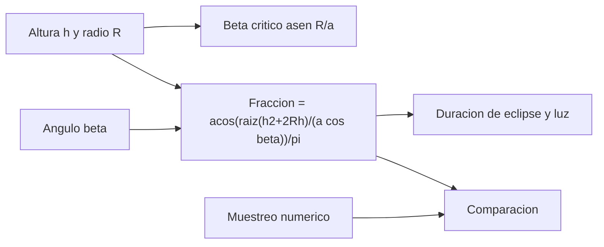

# B96-C11 — Operación durante eclipse

<!-- nav:top -->
[🏠 Programa](../../../../README.md) · [📚 Bloque B96](../../../tronco-comun/B96-control-y-operacion-de-misiones-espaciales.md) · [← Anterior: B96-C10 — Planificación de cargas útiles](../B96-C10-planificacion-de-cargas-utiles/CLASE.md) · [Siguiente: B96-C12 — Gestión de energía en operaciones →](../B96-C12-gestion-de-energia-en-operaciones/CLASE.md)
<!-- /nav -->

## 1. Ubicación, nivel y alcance

Clase 11 del bloque B96. Nivel N3. En una órbita baja la nave pasa parte de cada vuelta en la sombra de la Tierra y deja de generar energía: es el **eclipse**. Su duración depende de la altura y del **ángulo beta** (el que forma el Sol con el plano orbital). Aquí calculas la fracción de eclipse con la fórmula de la sombra cilíndrica y la contrastas con un muestreo numérico de la geometría. Todo es **sintético**: órbita circular de 550 km, Sol en el infinito y sin penumbra. Todos los datos son **sintéticos** salvo los que se rotulan como consultados.

## 2. Por qué esta clase existe

La batería se descarga durante el eclipse y las operaciones que usan energía deben planificarse alrededor de él. La decisión central: **¿cuánto dura el eclipse en cada época del año y cuándo hay luz continua?**

## 3. Lo que podrás hacer al terminar

1. Calcular el periodo y el ángulo beta crítico de una órbita circular.
2. Calcular la fracción y duración del eclipse según beta.
3. Verificar la fórmula con un muestreo numérico de la geometría de la sombra.
4. Identificar cuándo no hay eclipse.
5. Interpretar la tabla de eclipse y luz por ángulo beta.
6. Separar lo consultado de lo sintético.

La evidencia es la **tabla de eclipses por ángulo beta** del ejercicio 12 (sección 20).

## 4. Con qué llegas y cómo comprobarlo

1. ¿Qué es el ángulo beta?
2. ¿Qué es la sombra cilíndrica?
3. ¿Qué es la penumbra?
4. ¿Qué es el periodo de una órbita circular?
5. ¿Qué es un muestreo numérico?

<details>
<summary>Ver respuestas</summary>

1. El ángulo entre la dirección al Sol y el plano orbital. 2. Un modelo donde la sombra es un cilindro del radio de la Tierra paralelo a la dirección al Sol. 3. La zona de sombra parcial que este modelo ignora. 4. `P = 2π√(a³/μ)`. 5. Evaluar una condición en muchos puntos y contar los que la cumplen.
</details>

Con cuatro o cinco aciertos, sigue; si no, repasa los prerrequisitos.

## 5. Un caso de contexto y casos de referencia

Con `h = 550 km` el periodo es 95,650 min y el ángulo beta crítico, 67,02°. Con beta 0° el eclipse dura 35,61 min (fracción 0,372) y hay 60,04 min de luz; con 60°, 20,54 min; con 66°, 8,64 min; desde 67,02° la nave está al sol todo el tiempo. La diferencia máxima entre fórmula y muestreo es de 4,6×10⁻⁶.

## 6. Vocabulario

**Eclipse:** paso por la sombra. **Beta:** ángulo Sol–plano orbital. **Beta crítico:** `asen(R/a)`: sobre él no hay eclipse. **Sombra cilíndrica:** modelo de sombra sin penumbra. **Fracción de eclipse:** parte de la vuelta en sombra.

## 7. Modelo mental



*Descripción textual:* la altura y el ángulo beta dan la fracción de eclipse por una fórmula cerrada; el resultado se compara con un muestreo numérico de la geometría y se convierte en minutos de eclipse y de luz.

Analogía: el eclipse orbital es como el cono de sombra de una columna: una nave que pasa lejos del eje central lo roza menos tiempo. Límite: aquí el Sol es un punto y la sombra tiene bordes duros.

## 8. La explicación, paso a paso

### 8.1 Qué dicen las fuentes

El capítulo «Power» de la NASA (S1) trata la generación solar y el almacenamiento en baterías de los satélites pequeños y señala que la profundidad de descarga acelera el envejecimiento; esa descarga ocurre en el eclipse. La geometría de la sombra es estándar y la verifica el laboratorio; no se tomó de una fuente concreta.

### 8.2 Fórmula

Con `a = R + h` y beta `β`: el eclipse existe si `|β| < β* = asen(R/a)`; entonces la fracción es `f = (1/π) arccos(√(h² + 2Rh)/(a cos β))`. Para 550 km: `P = 95,650 min`, `β* = 67,02°`.

### 8.3 Tabla

| β (°) | Fracción | Eclipse (min) | Luz (min) |
|---|---|---|---|
| 0 | 0,37231 | 35,61 | 60,04 |
| 20 | 0,36359 | 34,78 | 60,87 |
| 40 | 0,32975 | 31,54 | 64,11 |
| 60 | 0,21474 | 20,54 | 75,11 |
| 66 | 0,09031 | 8,64 | 87,01 |
| 70 | 0 | 0 | 95,65 |
| 75 | 0 | 0 | 95,65 |

### 8.4 Verificación numérica

Se muestrean 200 000 puntos de la órbita y se cuenta cuántos cumplen `r·ŝ < 0` y `|r − (r·ŝ)ŝ| < R` (detrás de la Tierra y dentro del cilindro). La diferencia máxima con la fórmula es 4,55×10⁻⁶.

## 9. Magnitudes, símbolos y unidades

| Símbolo | Qué es | Unidad | Valor / nota |
|---|---|---|---|
| `h` | altura | km | 550 |
| `a` | radio orbital | km | 6 928,137 |
| `β` | ángulo beta | ° | 0 a 75 |
| `β*` | beta crítico | ° | 67,02 |
| `f` | fracción de eclipse | — | 0 a 0,372 |

## 10. Convenciones y referencias

Órbita circular, Sol en el infinito con rayos paralelos, sombra cilíndrica de radio 6 378,137 km, sin penumbra ni refracción atmosférica; marco orbital con el plano en xy y el Sol en el plano xz. Todo **sintético**. Tolerancia: fórmula frente a muestreo `< 10⁻⁴`; orden monótono decreciente de la fracción con `β`.

## 11. De dónde sale lo que afirmamos

| ID | Fuente | Localizador | Respalda | Estado |
|---|---|---|---|---|
| S1 | NASA, «Power», en State-of-the-Art of Small Spacecraft Technology — https://www.nasa.gov/smallsat-institute/sst-soa/power/ (consultada 2026-11-10; leídos los primeros 100 000 caracteres de 119 638) | capítulo (parte inicial) | potencia específica de paneles solares con mediana cercana a 30 W/kg; baterías de ion-litio comerciales de 150–270 Wh/kg a 3,6 V; la profundidad de descarga acelera el envejecimiento y la vida se prueba en condiciones de la misión; sin cifras de profundidad de descarga | Consultada (parte del capítulo) |
| — | Libros de texto de operaciones de misión, comunicaciones espaciales y mecánica orbital (p. ej., Wertz y Larson, Montenbruck y Gill, Vallado) | — | — | No consultada |
| — | Relaciones y algoritmos estándar usados por el laboratorio (geometría de la sombra cilíndrica y mecánica kepleriana) | — | los verifica el laboratorio con una segunda vía o con pruebas | No consultada en una fuente concreta |

Límites: el capítulo se leyó solo en parte; no hay penumbra, achatamiento ni movimiento del Sol durante la vuelta. Lo simulado no se presenta como dato de vuelo ni como medición.

## 12. Cómo ver los resultados

| β (°) | Eclipse (min) |
|---|---|
| 0 | 35,61 |
| 40 | 31,54 |
| 60 | 20,54 |
| 66 | 8,64 |
| ≥ 67,02 | 0 |

Descripción larga: la duración del eclipse baja despacio al principio y cae rápido cerca del beta crítico, donde se anula.

## 13. Ejemplo trabajado

**Paso 1 · Periodo.** `95,650 min`.

**Paso 2 · Crítico.** `asen(6 378,137/6 928,137) = 67,02°`.

**Paso 3 · Fracción a 0°.** `acos(2 628,6/6 928,1)/π = 0,372`.

**Paso 4 · Minutos.** `0,372 × 95,65 = 35,61 min`.

**Paso 5 · Comprobación.** El muestreo da el mismo valor.

## 14. Distintas formas de describir el problema

**Por fórmula:** fracción de eclipse (esta clase). **Por muestreo:** cuenta numérica. **Por energía:** descarga de la batería (C12). **Por estaciones:** beta varía con el año.

## 15. Práctica guiada

**Ejercicio 1 · con los pasos indicados.** Calcula `β*` para 550 km.

<details><summary>Solución comentada</summary>

`asen(6 378,137/6 928,137) = 67,02°`.
</details>

**Ejercicio 2 · con una pista.** ¿Cuántos minutos de luz hay con β = 0°?

<details><summary>Solución comentada</summary>

`95,65 − 35,61 = 60,04 min`.
</details>

**Ejercicio 3 · casi autónomo.** ¿Qué fracción de la vuelta es eclipse con β = 60°?

<details><summary>Solución comentada</summary>

0,215.
</details>

## 16. Práctica autónoma, transferencia e integrador

**Ejercicio 4 · autónomo.** ¿Qué pasa con el eclipse con β = 70°?

<details><summary>Solución comentada</summary>

No hay: 70° supera 67,02°.
</details>

**Ejercicio 5 · autónomo.** Calcula la fracción para β = 0° y h = 400 km.

<details><summary>Solución comentada</summary>

`acos(2 294,0/6 778,137)/π = 0,3901`.
</details>

**Ejercicio 6 · autónomo.** ¿Crece o decrece el eclipse con la altura a β = 0°?

<details><summary>Solución comentada</summary>

Decrece en fracción: la órbita más alta ve una sombra relativamente más estrecha.
</details>

**Ejercicio 7 · autónomo.** ¿Por qué el muestreo usa `r·ŝ < 0`?

<details><summary>Solución comentada</summary>

Porque solo está en sombra la nave que está detrás de la Tierra respecto del Sol.
</details>

**Ejercicio 8 · autónomo.** Si la penumbra dura 1 min, ¿qué hace con el eclipse total?

<details><summary>Solución comentada</summary>

Lo alarga en la práctica; el modelo cilíndrico lo subestima.
</details>

**Ejercicio 9 · transferencia.** **Transferencia.** Un colega usa 35,6 min de eclipse para cualquier satélite. ¿Qué respondes?

<details><summary>Solución comentada</summary>

Es válido solo para esta órbita sintética a β = 0°; depende de altura y beta.
</details>

**Ejercicio 10 · transferencia.** **Transferencia.** ¿Qué significa que el eclipse sea cero para β alto?

<details><summary>Solución comentada</summary>

La nave tiene luz continua y las operaciones de energía son menos críticas.
</details>

**Ejercicio 11 · transferencia.** **Transferencia.** ¿Cómo varía beta durante el año?

<details><summary>Solución comentada</summary>

Cambia por el movimiento aparente del Sol y por la precesión del plano; hay que calcularla con efemérides.
</details>

**Ejercicio 12 · integrador.** **Integrador.** Elabora tu *tabla de eclipses por ángulo beta*: periodo, beta crítico, fracciones, minutos, comprobación numérica y lista de lo consultado, sintético y no consultado.

<details><summary>Solución comentada</summary>

Secciones 8.2–8.4 y la salida del laboratorio.
</details>

## 17. Laboratorio: fracción de eclipse por beta

El script [eclipse_y_beta.py](eclipse_y_beta.py) calcula el periodo, el beta crítico y la fracción de eclipse con la fórmula cerrada, y la compara con un muestreo de 200 000 puntos de la órbita; **comprueba** que la diferencia es menor que `10⁻⁴` y que la fracción decrece con beta.

**Datos:** órbita y modelo de sombra **sintéticos**. **Predice antes de ejecutar:** ¿cuánto dura el eclipse con β = 0°? (35,6 min). **Ejecución del 2026-11-10 (Python 3.12.9):**

```text
Python 3.12.9
Datos SINTETICOS: orbita circular de 550 km; Sol a distancia infinita (rayos paralelos); sombra cilindrica; sin penumbra
Periodo = 95.650 min ; beta critico = 67.02 grados
beta[gr]  fraccion_analitica  fraccion_numerica  eclipse[min]  luz[min]
      0            0.37231            0.37231         35.61     60.04
     20            0.36359            0.36359         34.78     60.87
     40            0.32975            0.32975         31.54     64.11
     60            0.21474            0.21474         20.54     75.11
     66            0.09031            0.09031          8.64     87.01
     70            0.00000            0.00000          0.00     95.65
     75            0.00000            0.00000          0.00     95.65
Diferencia maxima analitica/numerica = 4.55e-06
Pruebas superadas.
```

```bash
python programa/clases/B96/B96-C11-operacion-durante-eclipse/eclipse_y_beta.py
```

**Límites:** sombra cilíndrica, Sol en el infinito, sin penumbra y beta constante en la vuelta.

## 18. Errores frecuentes y cómo corregirlos

**Suponer eclipse con cualquier beta.** Compara con `β*` (8.2)

**Usar la altura como radio orbital.** Suma el radio terrestre (8.2)

**Ignorar la penumbra.** Anota el límite del modelo (sección 10)

## 19. Cómo sabrás que vas bien

Tras 8.3: ¿cuántos minutos de eclipse hay a 66°? Si dudas, repasa el ejercicio 3. Tras el laboratorio: ¿qué comprueba el muestreo? (ver sección 17).

## 20. Qué entregas y cómo se evalúa

El producto es tu **tabla de eclipses por ángulo beta** (ejercicio 12).

| Criterio | Inicial | En desarrollo | Logrado | Destacado |
|---|---|---|---|---|
| Conceptos | Los confunde | Parciales | Explica el método y su dominio | Explica los límites y las alternativas |
| Cálculo | Sin unidades | Con errores | Resultados con unidades y comprobados | Resuelve casos nuevos |
| Numérico | Sin comprobar | Un caso | Verifica con una segunda vía en varios casos | Interpreta las diferencias y los fallos |
| Fuentes | Sin fuente | Sin fecha | Fuentes con fecha y estado | Declara lo sintético y lo no consultado |
| Límites | No los nombra | Uno | Tres | Discute qué falta del modelo |

**Condiciones críticas (no se compensan con promedio):** rotular los datos como sintéticos; comprobar cada resultado con una segunda vía; citar solo lo consultado.

## 21. Ética, seguridad y límites

Clase educativa: los modelos son simplificados y los datos son sintéticos; ningún resultado describe una misión real, certifica conformidad con una norma ni sustituye la revisión de especialistas.  Accesibilidad: tablas equivalentes a las gráficas, fórmulas en texto, ejercicios sin conexión.

## 22. Para cerrar y seguir

A 550 km el eclipse dura 35,61 min con beta 0° y desaparece por encima de 67,02°; fórmula y muestreo coinciden a 4,6×10⁻⁶. Queda una pregunta: ¿cómo se gestiona la energía durante ese eclipse?

**Glosario español–inglés.** eclipse · *eclipse*; ángulo beta · *beta angle*; sombra cilíndrica · *cylindrical shadow*; penumbra · *penumbra*; fracción de eclipse · *eclipse fraction*.

**Continuidad.** [B96-C12](../B96-C12-gestion-de-energia-en-operaciones/CLASE.md) trata la gestión de energía en operaciones.

**Referencias:** ver sección 11.

<!-- nav:bottom -->
---

[← Anterior: B96-C10 — Planificación de cargas útiles](../B96-C10-planificacion-de-cargas-utiles/CLASE.md) · [📚 Bloque B96](../../../tronco-comun/B96-control-y-operacion-de-misiones-espaciales.md) · [Siguiente: B96-C12 — Gestión de energía en operaciones →](../B96-C12-gestion-de-energia-en-operaciones/CLASE.md)
<!-- /nav -->
