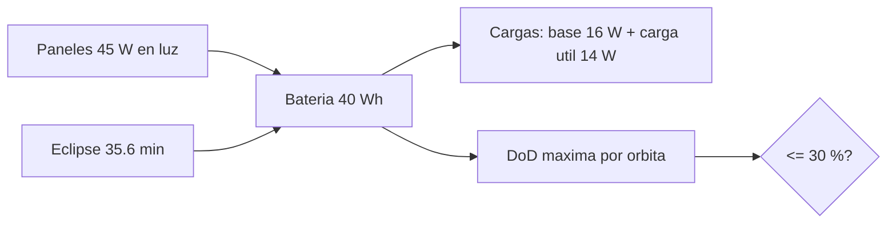

# B96-C12 — Gestión de energía en operaciones

<!-- nav:top -->
[🏠 Programa](../../../../README.md) · [📚 Bloque B96](../../../tronco-comun/B96-control-y-operacion-de-misiones-espaciales.md) · [← Anterior: B96-C11 — Operación durante eclipse](../B96-C11-operacion-durante-eclipse/CLASE.md) · [Siguiente: B96-C13 — Detección de anomalías →](../B96-C13-deteccion-de-anomalias/CLASE.md)
<!-- /nav -->

## 1. Ubicación, nivel y alcance

Clase 12 del bloque B96. Nivel N3. La **gestión de energía en operaciones** consiste en decidir cuándo encender la carga útil sabiendo que los paneles generan solo en la luz y la batería sostiene la nave en el eclipse. Aquí simulas 30 órbitas de un satélite **sintético** con cuatro planes de operación, calculas la **profundidad de descarga** (DoD) y la verificas con una fórmula analítica. Paneles, batería y cargas son de ejemplo. Todos los datos son **sintéticos** salvo los que se rotulan como consultados.

## 2. Por qué esta clase existe

Una batería descargada en exceso se degrada y una nave sin energía deja de ser comandable. La decisión central: **¿qué plan de operación mantiene la batería dentro de su criterio de descarga y recupera la carga en cada órbita?**

## 3. Lo que podrás hacer al terminar

1. Calcular el eclipse y la luz de una órbita circular.
2. Simular el estado de carga de una batería a lo largo de varias órbitas.
3. Calcular la DoD de un plan y verificarla con una fórmula analítica.
4. Calcular el balance neto de energía por órbita.
5. Aplicar un criterio de DoD a cuatro planes y decidir cuáles cumplen.
6. Separar lo consultado de lo sintético.

La evidencia es la **balance de energía operativo** del ejercicio 12 (sección 20).

## 4. Con qué llegas y cómo comprobarlo

1. ¿Qué es el estado de carga (SOC)?
2. ¿Qué es la profundidad de descarga (DoD)?
3. ¿Qué es la eficiencia de carga?
4. ¿Qué es un balance neto?
5. ¿Qué es un ciclo orbital?

<details>
<summary>Ver respuestas</summary>

1. La fracción de energía almacenada respecto de la capacidad. 2. La fracción de la capacidad usada en un ciclo. 3. La fracción de energía generada que se guarda. 4. Entrada menos salida de energía en un periodo. 5. Una vuelta: una fase de luz y una de eclipse.
</details>

Con cuatro o cinco aciertos, sigue; si no, repasa los prerrequisitos.

## 5. Un caso de contexto y casos de referencia

Un satélite **sintético** con paneles de 45 W en luz, carga base de 16 W, carga útil de 14 W, batería de 40 Wh y eficiencia de 0,92 pasa 35,61 min en eclipse y 60,04 min en luz. Con solo la carga base la DoD es de 23,8 %; con la carga útil 20 min en luz, 23,8 %; 20 min en eclipse, 35,4 %; 30 min en eclipse, 41,3 %. Con el criterio sintético de 30 % solo cumplen los dos primeros planes. En todos los casos la batería vuelve al 100 % cada órbita.

## 6. Vocabulario

**SOC:** estado de carga. **DoD:** profundidad de descarga. **Carga base:** consumo de la plataforma. **Balance neto:** entrada − salida. **Eficiencia de carga:** parte de la energía generada que se almacena. **Plan de operación:** cuándo se enciende la carga útil.

## 7. Modelo mental



*Descripción textual:* en la luz, los paneles alimentan las cargas y cargan la batería; en el eclipse la batería alimenta todo; la mayor descarga de la órbita es la DoD y se compara con un criterio.

Analogía: la batería es como una cuenta de ahorro: se llena de día y se gasta de noche; el plan decide si los gastos grandes se hacen de día o de noche. Límite: la cuenta tiene fondo y tope, y gastar mucho acorta su vida útil.

## 8. La explicación, paso a paso

### 8.1 Qué dicen las fuentes

El capítulo «Power» de la NASA (S1) indica que los paneles de misiones pequeñas se agrupan cerca de 30 W/kg, que las baterías de ion-litio comerciales dan 150–270 Wh/kg a 3,6 V y que la profundidad de descarga, la temperatura y la velocidad de carga aceleran el envejecimiento; recomienda ensayos de vida con las condiciones de la misión y no da cifras de DoD. Solo se leyó la parte inicial del capítulo. El criterio de 30 % y los demás valores son **sintéticos**.

### 8.2 Modelo

Por paso de 10 s: en luz `ΔE = (P_arr·η − P_carga)Δt`; en eclipse `ΔE = −P_carga Δt`; la energía se limita a la capacidad. La DoD máxima es `1 − E_min/C`.

### 8.3 Resultados de 30 órbitas

| Plan | SOC tras 30 órbitas | DoD sim. | DoD analítica |
|---|---|---|---|
| Solo base | 100 % | 23,8 % | 23,7 % |
| Carga 20 min en luz | 100 % | 23,8 % | 23,7 % |
| Carga 20 min en eclipse | 100 % | 35,4 % | 35,4 % |
| Carga 30 min en eclipse | 100 % | 41,3 % | 41,2 % |

La DoD analítica de un eclipse es `(P_base t_ecl + P_pay t_pay)/C`. El balance neto por orbita (entrada 41,43 Wh) es +15,92, +11,25, +11,25 y +8,92 Wh: positivo en los cuatro, por eso la batería se recarga.

### 8.4 Decisión

Con DoD ≤ 30 % cumplen los planes sin carga útil en eclipse; pasar la carga útil a la luz mantiene la DoD en 23,8 %. La regla práctica: **las cargas grandes se programan en luz** siempre que el objetivo científico lo permita.

## 9. Magnitudes, símbolos y unidades

| Símbolo | Qué es | Unidad | Valor / nota |
|---|---|---|---|
| `P_arr` | generación en luz | W | 45 (sintética) |
| `P_base, P_pay` | cargas base y útil | W | 16; 14 |
| `C` | capacidad de batería | Wh | 40 |
| `η` | eficiencia de carga | — | 0,92 |
| `DoD` | profundidad de descarga | % | 23,8 a 41,3 |

## 10. Convenciones y referencias

Órbita circular de 550 km con β = 0°; paso de simulación 10 s; potencia en W y energía en Wh; la batería se limita a su capacidad y se inicia llena. Todo **sintético**. Tolerancias: DoD simulada frente a analítica `< 1 %` (absoluto); DoD ≤ 50 % en todos los planes.

## 11. De dónde sale lo que afirmamos

| ID | Fuente | Localizador | Respalda | Estado |
|---|---|---|---|---|
| S1 | NASA, «Power», en State-of-the-Art of Small Spacecraft Technology — https://www.nasa.gov/smallsat-institute/sst-soa/power/ (consultada 2026-11-10; leídos los primeros 100 000 caracteres de 119 638) | capítulo (parte inicial) | potencia específica de paneles solares con mediana cercana a 30 W/kg; baterías de ion-litio comerciales de 150–270 Wh/kg a 3,6 V; la profundidad de descarga acelera el envejecimiento y la vida se prueba en condiciones de la misión; sin cifras de profundidad de descarga | Consultada (parte del capítulo) |
| — | Libros de texto de operaciones de misión, comunicaciones espaciales y mecánica orbital (p. ej., Wertz y Larson, Montenbruck y Gill, Vallado) | — | — | No consultada |
| — | Relaciones y algoritmos estándar usados por el laboratorio (balance de energía por pasos y energía de un eclipse) | — | los verifica el laboratorio con una segunda vía o con pruebas | No consultada en una fuente concreta |

Límites: el capítulo se leyó solo en parte; sin degradación de paneles, temperatura, tensión de la batería ni apuntamiento variable. Lo simulado no se presenta como dato de vuelo ni como medición.

## 12. Cómo ver los resultados

| Plan | DoD | ¿≤ 30 %? |
|---|---|---|
| Solo base | 23,8 % | sí |
| Carga 20 min en luz | 23,8 % | sí |
| Carga 20 min en eclipse | 35,4 % | no |
| Carga 30 min en eclipse | 41,3 % | no |

Descripción larga: mover la carga útil de eclipse a luz baja la DoD de 35,4 % a 23,8 % sin cambiar el consumo total.

## 13. Ejemplo trabajado

**Paso 1 · Eclipse.** `35,61 min`.

**Paso 2 · Energía de eclipse.** `16 W × 35,61 min = 9,49 Wh`.

**Paso 3 · DoD base.** `9,49/40 = 23,7 %`.

**Paso 4 · Con carga útil 20 min en eclipse.** `(9,49 + 14 × 20/60)/40 = 35,4 %`.

**Paso 5 · Recarga.** El neto es positivo: 100 % cada órbita.

## 14. Distintas formas de describir el problema

**Por simulación:** SOC a lo largo del tiempo (esta clase). **Por fórmula:** DoD de un eclipse. **Por plan:** cargas en luz o en eclipse (C10, C11).

## 15. Práctica guiada

**Ejercicio 1 · con los pasos indicados.** Calcula la energía de eclipse con 16 W durante 35,61 min.

<details><summary>Solución comentada</summary>

`16 × 35,61/60 = 9,49 Wh`.
</details>

**Ejercicio 2 · con una pista.** Calcula la DoD con esa energía y 40 Wh.

<details><summary>Solución comentada</summary>

`9,49/40 = 23,7 %`.
</details>

**Ejercicio 3 · casi autónomo.** Calcula la energía de la carga útil de 14 W durante 20 min.

<details><summary>Solución comentada</summary>

`14 × 20/60 = 4,67 Wh`.
</details>

## 16. Práctica autónoma, transferencia e integrador

**Ejercicio 4 · autónomo.** ¿Cuál es la DoD con esa carga en eclipse?

<details><summary>Solución comentada</summary>

`(9,49 + 4,67)/40 = 35,4 %`.
</details>

**Ejercicio 5 · autónomo.** Calcula la entrada de energía por orbita.

<details><summary>Solución comentada</summary>

`45 × 0,92 × 60,04/60 = 41,43 Wh`.
</details>

**Ejercicio 6 · autónomo.** ¿Cuál es el balance neto con la carga útil 20 min?

<details><summary>Solución comentada</summary>

`41,43 − (16 × 95,65/60 + 14 × 20/60) = 11,25 Wh`.
</details>

**Ejercicio 7 · autónomo.** ¿Qué ocurre si la generación baja a 30 W?

<details><summary>Solución comentada</summary>

Entrada `30 × 0,92 × 1,0007 = 27,6 Wh` y el neto del plan base es `27,6 − 25,5 = +2,1 Wh`: casi no recarga.
</details>

**Ejercicio 8 · autónomo.** ¿Por qué conviene la carga útil en luz?

<details><summary>Solución comentada</summary>

Porque en luz la alimentan los paneles y no descarga la batería.
</details>

**Ejercicio 9 · transferencia.** **Transferencia.** Un colega propone DoD de 60 % para ahorrar masa. ¿Qué respondes?

<details><summary>Solución comentada</summary>

Acorta la vida útil; el capítulo de la NASA indica que la DoD acelera el envejecimiento y recomienda ensayos de vida con condiciones de misión.
</details>

**Ejercicio 10 · transferencia.** **Transferencia.** ¿Qué efecto no modela el balance respecto a una misión real?

<details><summary>Solución comentada</summary>

Degradación de paneles, temperatura, tensión de la batería y apuntamiento.
</details>

**Ejercicio 11 · transferencia.** **Transferencia.** ¿Cuántos minutos máximos de carga útil caben en eclipse con DoD ≤ 30 %?

<details><summary>Solución comentada</summary>

`(0,30 × 40 − 9,49) × 60/14 = 10,8 min`.
</details>

**Ejercicio 12 · integrador.** **Integrador.** Elabora tu *balance de energía operativo*: eclipse, planes, DoD simulada y analítica, balance neto, criterio y lista de lo consultado, sintético y no consultado.

<details><summary>Solución comentada</summary>

Secciones 8.2–8.4 y la salida del laboratorio.
</details>

## 17. Laboratorio: 30 órbitas de balance de energía

El script [balance_de_energia.py](balance_de_energia.py) simula el SOC de la batería durante 30 órbitas con cuatro planes de operación, calcula la DoD máxima y la contrasta con la fórmula analítica; **comprueba** que la diferencia es menor que 1 % y que la DoD ≤ 50 %.

**Datos:** paneles, batería y cargas **sintéticos**; órbita de 550 km con β = 0°. **Predice antes de ejecutar:** ¿qué plan supera el criterio de 30 %? (los dos con carga útil en eclipse). **Ejecución del 2026-11-10 (Python 3.12.9):**

```text
Python 3.12.9
Datos SINTETICOS: paneles, bateria y cargas ficticios; eclipse de beta = 0 en orbita de 550 km
Periodo = 95.65 min ; eclipse = 35.61 min ; luz = 60.04 min
Caso                        SOC fin orbita 30  DoD maxima
solo base                              100.0%       23.8%
carga 20 min en luz                    100.0%       23.8%
carga 20 min en eclipse                100.0%       35.4%
carga 30 min en eclipse                100.0%       41.3%
  solo base                  DoD analitica =  23.7% ; simulada =  23.8%
  carga 20 min en luz        DoD analitica =  23.7% ; simulada =  23.8%
  carga 20 min en eclipse    DoD analitica =  35.4% ; simulada =  35.4%
  carga 30 min en eclipse    DoD analitica =  41.2% ; simulada =  41.3%
  solo base                  entrada = 41.43 Wh ; salida = 25.51 Wh ; neto = +15.92 Wh/orbita
  carga 20 min en luz        entrada = 41.43 Wh ; salida = 30.17 Wh ; neto = +11.25 Wh/orbita
  carga 20 min en eclipse    entrada = 41.43 Wh ; salida = 30.17 Wh ; neto = +11.25 Wh/orbita
  carga 30 min en eclipse    entrada = 41.43 Wh ; salida = 32.51 Wh ; neto = +8.92 Wh/orbita
Criterio sintetico DoD <= 30 %: solo base: cumple, carga 20 min en luz: cumple, carga 20 min en eclipse: NO, carga 30 min en eclipse: NO
Pruebas superadas.
```

```bash
python programa/clases/B96/B96-C12-gestion-de-energia-en-operaciones/balance_de_energia.py
```

**Límites:** sin degradación, temperatura ni tensión de batería; generación constante en luz.

## 18. Errores frecuentes y cómo corregirlos

**Olvidar la eficiencia de carga.** Aplícala a la generación (8.2)

**Programar la carga útil en eclipse sin calcular.** Calcula la DoD (8.3)

**Aceptar una DoD sin criterio.** Compara con el criterio (8.4)

## 19. Cómo sabrás que vas bien

Tras 8.3: ¿qué plan tiene la DoD más baja con carga útil activa? Si dudas, repasa el ejercicio 4. Tras el laboratorio: ¿qué comprueba la fórmula analítica? (ver sección 17).

## 20. Qué entregas y cómo se evalúa

El producto es tu **balance de energía operativo** (ejercicio 12).

| Criterio | Inicial | En desarrollo | Logrado | Destacado |
|---|---|---|---|---|
| Conceptos | Los confunde | Parciales | Explica el método y su dominio | Explica los límites y las alternativas |
| Cálculo | Sin unidades | Con errores | Resultados con unidades y comprobados | Resuelve casos nuevos |
| Numérico | Sin comprobar | Un caso | Verifica con una segunda vía en varios casos | Interpreta las diferencias y los fallos |
| Fuentes | Sin fuente | Sin fecha | Fuentes con fecha y estado | Declara lo sintético y lo no consultado |
| Límites | No los nombra | Uno | Tres | Discute qué falta del modelo |

**Condiciones críticas (no se compensan con promedio):** rotular los datos como sintéticos; comprobar cada resultado con una segunda vía; citar solo lo consultado.

## 21. Ética, seguridad y límites

Clase educativa: los modelos son simplificados y los datos son sintéticos; ningún resultado describe una misión real, certifica conformidad con una norma ni sustituye la revisión de especialistas.  Accesibilidad: tablas equivalentes a las gráficas, fórmulas en texto, ejercicios sin conexión.

## 22. Para cerrar y seguir

Con 45 W de paneles, 40 Wh de batería y 35,61 min de eclipse, la DoD va de 23,8 % a 41,3 % según el plan; las cargas grandes conviene programarlas en luz. Queda una pregunta: ¿cómo se detecta que algo se sale de lo esperado?

**Glosario español–inglés.** estado de carga · *state of charge (SOC)*; profundidad de descarga · *depth of discharge (DoD)*; balance de energía · *energy balance*; eficiencia de carga · *charge efficiency*; batería · *battery*.

**Continuidad.** [B96-C13](../B96-C13-deteccion-de-anomalias/CLASE.md) trata la detección de anomalías.

**Referencias:** ver sección 11.

<!-- nav:bottom -->
---

[← Anterior: B96-C11 — Operación durante eclipse](../B96-C11-operacion-durante-eclipse/CLASE.md) · [📚 Bloque B96](../../../tronco-comun/B96-control-y-operacion-de-misiones-espaciales.md) · [Siguiente: B96-C13 — Detección de anomalías →](../B96-C13-deteccion-de-anomalias/CLASE.md)
<!-- /nav -->
