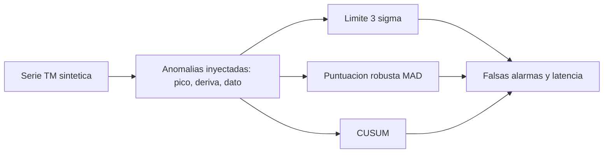

# B96-C13 — Detección de anomalías

<!-- nav:top -->
[🏠 Programa](../../../../README.md) · [📚 Bloque B96](../../../tronco-comun/B96-control-y-operacion-de-misiones-espaciales.md) · [← Anterior: B96-C12 — Gestión de energía en operaciones](../B96-C12-gestion-de-energia-en-operaciones/CLASE.md) · [Siguiente: B96-C14 — Procedimientos de recuperación →](../B96-C14-procedimientos-de-recuperacion/CLASE.md)
<!-- /nav -->

## 1. Ubicación, nivel y alcance

Clase 13 del bloque B96. Nivel N3. Una **anomalía** es un comportamiento de la telemetría que se aparta de lo esperado. Aquí detectas tres anomalías **inyectadas** en una serie **sintética** (un pico, una deriva lenta y un dato aislado) con tres detectores: un **límite fijo** de 3σ, una **puntuación robusta** (mediana y MAD) y la suma acumulada **CUSUM**; y comparas aciertos, falsas alarmas y latencia. No se usa ninguna telemetría real. Todos los datos son **sintéticos** salvo los que se rotulan como consultados.

## 2. Por qué esta clase existe

Un detector que no ve una deriva lenta avisa cuando ya es tarde, y uno que alarma por todo se ignora. La decisión central: **¿qué detector ve cada tipo de anomalía, con qué retraso y a qué costo en falsas alarmas?**

## 3. Lo que podrás hacer al terminar

1. Inyectar anomalías conocidas en una serie sintética.
2. Implementar un límite fijo, una puntuación robusta y CUSUM.
3. Medir falsas alarmas y latencia de detección.
4. Comparar las falsas alarmas observadas con las esperadas por la teoría gaussiana.
5. Explicar por qué un detector ve un tipo de anomalía y no otro.
6. Separar lo consultado de lo sintético.

La evidencia es la **informe de detección con matriz de confusión** del ejercicio 12 (sección 20).

## 4. Con qué llegas y cómo comprobarlo

1. ¿Qué es una desviación estándar?
2. ¿Qué es una falsa alarma?
3. ¿Qué es la mediana?
4. ¿Qué es el MAD?
5. ¿Qué es la latencia de detección?

<details>
<summary>Ver respuestas</summary>

1. Una medida de la dispersión; en una gaussiana, el 99,73 % de los datos queda a menos de 3σ. 2. Una alarma sin anomalía real. 3. El valor central de una muestra ordenada; es robusta frente a valores extremos. 4. La mediana de las desviaciones absolutas respecto de la mediana; ×1,4826 estima σ. 5. Muestras entre el inicio de la anomalía y la primera alarma.
</details>

Con cuatro o cinco aciertos, sigue; si no, repasa los prerrequisitos.

## 5. Un caso de contexto y casos de referencia

La serie sintética tiene 3 000 muestras `N(10; 0,5)` con tres anomalías: un pico de +4σ (40 muestras desde la 800), una deriva de +0,8σ (400 muestras desde la 1 600) y un dato aislado de +6σ en la 2 500. El límite de 3σ detecta el pico y el dato al instante pero la deriva solo tras 53 muestras, con 6 falsas alarmas (6,9 esperadas). La puntuación robusta no ve la deriva (la ventana se adapta) y CUSUM la ve en 7 muestras, con 5 falsas alarmas.

## 6. Vocabulario

**Anomalía:** desvío de lo esperado. **Límite fijo:** umbral de 3σ. **Puntuación robusta:** desvío en unidades de MAD. **CUSUM:** suma acumulada de desvíos. **Falsa alarma:** alarma sin anomalía. **Latencia:** retraso de la primera alarma.

## 7. Modelo mental



*Descripción textual:* la misma serie con anomalías inyectadas pasa por tres detectores; cada uno se evalúa por sus falsas alarmas y su latencia en cada anomalía.

Analogía: el límite fijo es como un detector de humo que suena con humo abundante; CUSUM es como alguien que nota que la casa huele cada vez más a quemado. Límite: ninguno de los dos entiende la causa (C21).

## 8. La explicación, paso a paso

### 8.1 Qué dicen las fuentes

ECSS-E-ST-70-11C (S1) trata las funciones de a bordo para operar la nave en situaciones nominales y de contingencia, y ECSS-E-ST-70-31C (S2) los datos de vigilancia y control (parámetros y límites). El capítulo de la NASA sobre sistemas terrestres (S3) menciona la vigilancia desde el MOC. Solo se leyeron resúmenes o la parte inicial; los detectores y números de esta clase son **sintéticos** y estándar.

### 8.2 Los tres detectores

(1) **Límite:** alarma si `|x − 10| > 3 × 0,5`. (2) **Robusta:** con ventana de 200 muestras previas, alarma si `|x − mediana| > 4 × 1,4826 × MAD`. (3) **CUSUM:** `S = max(0, S + (x − μ)/σ − 0,5)` y alarma si `S > 5`, con reinicio.

### 8.3 Resultados

| Detector | Alarmas | Falsas | Latencias (pico, deriva, dato) |
|---|---|---|---|
| Límite 3σ | 46 | 6 | 0, 53, 0 |
| Robusta z = 4 | 9 | 1 | 4, no detecta, 0 |
| CUSUM | 52 | 5 | 1, 7, 0 |

Las falsas alarmas esperadas del límite son `p·N = 0,0027 × 2 559 = 6,9`; se observaron 6.

### 8.4 Qué enseña la comparación

Un límite fijo es excelente para saltos grandes, pero una deriva de 0,8σ solo cruza el umbral por casualidad del ruido (53 muestras). La puntuación robusta se adapta a la deriva porque la ventana la absorbe: ve picos, no cambios lentos. CUSUM acumula el exceso y detecta la deriva en 7 muestras, a costa de falsas alarmas y de necesitar μ y σ de referencia.

## 9. Magnitudes, símbolos y unidades

| Símbolo | Qué es | Unidad | Valor / nota |
|---|---|---|---|
| `μ, σ` | media y desviación de referencia | unidades de TM | 10; 0,5 |
| `N` | muestras | — | 3 000 |
| `k, h` | parámetros de CUSUM | σ | 0,5; 5 |
| `z` | umbral robusto | MAD | 4 |
| `lat` | latencia | muestras | 0 a 53 |

## 10. Convenciones y referencias

Serie gaussiana blanca `N(10; 0,5)` con semilla 96; anomalías con inicio y duración conocidos; una falsa alarma es una alarma fuera de las muestras anómalas; la latencia se mide hasta 60 muestras tras el fin. Todo **sintético**. Tolerancias: falsas del límite dentro de 4√(esperadas) + 1; pico y dato detectados al instante por el límite; CUSUM detecta la deriva en < 60 muestras.

## 11. De dónde sale lo que afirmamos

| ID | Fuente | Localizador | Respalda | Estado |
|---|---|---|---|---|
| S1 | ECSS, «ECSS-E-ST-70-11C — Space segment operability», 31 jul 2008 (cancelada y reemplazada por la Rev.1 del 15 oct 2025) — https://ecss.nl/standard/ecss-e-st-70-11c-space-segment-operability/ (consultada 2026-11-10) | página de la norma (solo el resumen; no el texto de requisitos) | disposiciones de diseño de las funciones de a bordo de un segmento espacial no tripulado para que pueda operarse en vuelo en situaciones nominales o de contingencia predefinidas; excluye la operabilidad específica de cada misión | Consultada (solo la página) |
| S2 | ECSS, «ECSS-E-ST-70-31C — Ground systems and operations — Monitoring and control data definition», 31 jul 2008 — https://ecss.nl/standard/ecss-e-st-70-31c-ground-systems-and-operations-monitoring-and-control-data/ (consultada 2026-11-10) | página de la norma (solo el resumen) | especifica la información de vigilancia y control que un proveedor entrega con su producto para integrarlo, probarlo y operarlo; indica qué datos, no el formato de entrega | Consultada (solo la página) |
| S3 | NASA, «Ground Data Systems and Mission Operations», en State-of-the-Art of Small Spacecraft Technology — https://www.nasa.gov/smallsat-institute/sst-soa/ground-data-systems-and-mission-operations/ (consultada 2026-11-10; leídos los primeros 100 000 caracteres de 215 453) | capítulo (parte inicial) | un centro de operaciones de misión (MOC) comanda la nave y un centro de operaciones científicas (SOC) genera productos; enlaces directos a la Tierra frente a relevos; bandas UHF, S, X y Ka; la licencia tarda meses; las antenas suelen adquirir el satélite con 5–10° de elevación; margen típico de 3 dB para retorno de datos en LEO a 1 500 km de distancia oblicua | Consultada (parte del capítulo) |
| — | Libros de texto de operaciones de misión, comunicaciones espaciales y mecánica orbital (p. ej., Wertz y Larson, Montenbruck y Gill, Vallado) | — | — | No consultada |
| — | Relaciones y algoritmos estándar usados por el laboratorio (estadística gaussiana, mediana/MAD y CUSUM) | — | los verifica el laboratorio con una segunda vía o con pruebas | No consultada en una fuente concreta |

Límites: las normas se leyeron solo en su resumen; la serie es de una variable, ruido blanco y sin estacionalidad ni dependencias entre parámetros. Lo simulado no se presenta como dato de vuelo ni como medición.

## 12. Cómo ver los resultados

| Detector | ¿Ve el pico? | ¿Ve la deriva? | ¿Ve el dato aislado? |
|---|---|---|---|
| Límite 3σ | sí (0) | tarde (53) | sí (0) |
| Robusta | sí (4) | no | sí (0) |
| CUSUM | sí (1) | sí (7) | sí (0) |

Descripción larga: solo CUSUM ve las tres anomalías con latencia baja, y el límite y la puntuación robusta fallan o tardan con la deriva.

## 13. Ejemplo trabajado

**Paso 1 · Serie.** 3 000 muestras con semilla 96.

**Paso 2 · Anomalías.** Pico, deriva y dato.

**Paso 3 · Límite.** 46 alarmas, 6 falsas.

**Paso 4 · CUSUM.** Deriva en 7 muestras.

**Paso 5 · Teoría.** `0,0027 × 2 559 = 6,9` falsas esperadas.

## 14. Distintas formas de describir el problema

**Por umbral:** límites (esta clase y C06). **Por estadística acumulada:** CUSUM. **Por robustez:** mediana y MAD. **Por explicación:** diagnóstico (C21).

## 15. Práctica guiada

**Ejercicio 1 · con los pasos indicados.** Calcula `3σ` para `σ = 0,5`.

<details><summary>Solución comentada</summary>

`1,5` unidades: el límite es `10 ± 1,5`.
</details>

**Ejercicio 2 · con una pista.** ¿Qué fracción de una gaussiana queda fuera de 3σ?

<details><summary>Solución comentada</summary>

`0,0027`.
</details>

**Ejercicio 3 · casi autónomo.** ¿Cuántas falsas alarmas se esperan en 1 000 muestras sanas con 3σ?

<details><summary>Solución comentada</summary>

`2,7`.
</details>

## 16. Práctica autónoma, transferencia e integrador

**Ejercicio 4 · autónomo.** Un pico de +4σ, ¿lo ve el límite de 3σ?

<details><summary>Solución comentada</summary>

Sí, `4σ > 3σ`: latencia 0.
</details>

**Ejercicio 5 · autónomo.** ¿Por qué el límite tarda 53 muestras en ver la deriva de 0,8σ?

<details><summary>Solución comentada</summary>

Porque necesita que el ruido sume por encima de +3σ; con +0,8σ de deriva ocurre rara vez.
</details>

**Ejercicio 6 · autónomo.** ¿Qué hace el término `− k` en CUSUM?

<details><summary>Solución comentada</summary>

Descarta los desvíos pequeños: solo acumula el exceso sobre `0,5σ`.
</details>

**Ejercicio 7 · autónomo.** ¿Por qué la puntuación robusta no ve la deriva?

<details><summary>Solución comentada</summary>

La ventana de 200 muestras se llena de datos derivados y la mediana sube con ellos.
</details>

**Ejercicio 8 · autónomo.** ¿Cuántas muestras sanas tiene la serie?

<details><summary>Solución comentada</summary>

`3 000 − (40 + 400 + 1) = 2 559`.
</details>

**Ejercicio 9 · transferencia.** **Transferencia.** Un colega usa 3σ con σ estimada de los datos con anomalías incluidas. ¿Qué problema aparece?

<details><summary>Solución comentada</summary>

Se infla la σ y el umbral sube: se pierden anomalías.
</details>

**Ejercicio 10 · transferencia.** **Transferencia.** ¿Qué detector elegirías para una deriva lenta de un sensor?

<details><summary>Solución comentada</summary>

CUSUM (o un ajuste de tendencia); el límite fijo avisa tarde.
</details>

**Ejercicio 11 · transferencia.** **Transferencia.** ¿Qué sacrificas al bajar el umbral de CUSUM?

<details><summary>Solución comentada</summary>

Más falsas alarmas: baja la latencia pero aumenta la carga del operador.
</details>

**Ejercicio 12 · integrador.** **Integrador.** Elabora tu *informe de detección con matriz de confusión*: tres detectores, aciertos, falsas alarmas, latencias, comparación con la teoría y lista de lo consultado, sintético y no consultado.

<details><summary>Solución comentada</summary>

Secciones 8.2–8.4 y la salida del laboratorio.
</details>

## 17. Laboratorio: tres detectores sobre una serie con anomalías

El script [deteccion_de_anomalias.py](deteccion_de_anomalias.py) genera la serie con semilla fija, inyecta tres anomalías, aplica el límite de 3σ, la puntuación robusta y CUSUM y mide falsas alarmas y latencias; **comprueba** que las falsas del límite coinciden con la teoría y que CUSUM ve la deriva.

**Datos:** serie y anomalías **sintéticas**; semilla 96. **Predice antes de ejecutar:** ¿qué detector ve la deriva lenta? (CUSUM, en 7 muestras). **Ejecución del 2026-11-10 (Python 3.12.9):**

```text
Python 3.12.9
Datos SINTETICOS: serie de 3000 muestras N(10, 0.5); tres anomalias inyectadas; semilla 96
limite 3 sigma     alarmas =   46 ; falsas =   6 ; latencias (muestras) = [0, 53, 0]
robusta z=4        alarmas =    9 ; falsas =   1 ; latencias (muestras) = [4, None, 0]
CUSUM k=.5 h=5     alarmas =   52 ; falsas =   5 ; latencias (muestras) = [1, 7, 0]
Falsas esperadas del limite 3 sigma = 6.9 (p = 0.00270) ; observadas = 6
Deriva: limite fijo la detecta? si, tarde ; CUSUM la detecta en 7 muestras
Pruebas superadas.
```

```bash
python programa/clases/B96/B96-C13-deteccion-de-anomalias/deteccion_de_anomalias.py
```

**Límites:** serie gaussiana blanca de una variable, sin estacionalidad ni correlación; μ y σ de referencia conocidas.

## 18. Errores frecuentes y cómo corregirlos

**Estimar σ con los datos anómalos.** Estímala de un periodo sano (8.2)

**Contar solo aciertos.** Mide también falsas alarmas y latencia (8.3)

**Elegir el detector por la tasa de aciertos de un solo tipo.** Prueba varios tipos de anomalía (8.4)

## 19. Cómo sabrás que vas bien

Tras 8.3: ¿qué detector no ve la deriva? Si dudas, repasa el ejercicio 7. Tras el laboratorio: ¿qué se compara con la teoría? (ver sección 17).

## 20. Qué entregas y cómo se evalúa

El producto es tu **informe de detección con matriz de confusión** (ejercicio 12).

| Criterio | Inicial | En desarrollo | Logrado | Destacado |
|---|---|---|---|---|
| Conceptos | Los confunde | Parciales | Explica el método y su dominio | Explica los límites y las alternativas |
| Cálculo | Sin unidades | Con errores | Resultados con unidades y comprobados | Resuelve casos nuevos |
| Numérico | Sin comprobar | Un caso | Verifica con una segunda vía en varios casos | Interpreta las diferencias y los fallos |
| Fuentes | Sin fuente | Sin fecha | Fuentes con fecha y estado | Declara lo sintético y lo no consultado |
| Límites | No los nombra | Uno | Tres | Discute qué falta del modelo |

**Condiciones críticas (no se compensan con promedio):** rotular los datos como sintéticos; comprobar cada resultado con una segunda vía; citar solo lo consultado.

## 21. Ética, seguridad y límites

Clase educativa: los modelos son simplificados y los datos son sintéticos; ningún resultado describe una misión real, certifica conformidad con una norma ni sustituye la revisión de especialistas.  Accesibilidad: tablas equivalentes a las gráficas, fórmulas en texto, ejercicios sin conexión.

## 22. Para cerrar y seguir

El límite de 3σ ve saltos pero no la deriva (6 falsas, 53 muestras), la puntuación robusta se adapta a ella y CUSUM la detecta en 7 muestras con 5 falsas. Queda una pregunta: una vez detectada, ¿cómo se recupera la nave?

**Glosario español–inglés.** anomalía · *anomaly*; falsa alarma · *false alarm*; latencia de detección · *detection latency*; suma acumulada · *cumulative sum (CUSUM)*; mediana · *median*.

**Continuidad.** [B96-C14](../B96-C14-procedimientos-de-recuperacion/CLASE.md) trata los procedimientos de recuperación.

**Referencias:** ver sección 11.

<!-- nav:bottom -->
---

[← Anterior: B96-C12 — Gestión de energía en operaciones](../B96-C12-gestion-de-energia-en-operaciones/CLASE.md) · [📚 Bloque B96](../../../tronco-comun/B96-control-y-operacion-de-misiones-espaciales.md) · [Siguiente: B96-C14 — Procedimientos de recuperación →](../B96-C14-procedimientos-de-recuperacion/CLASE.md)
<!-- /nav -->
