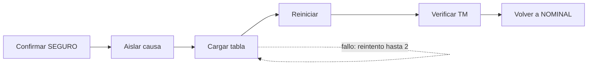

# B96-C14 — Procedimientos de recuperación

<!-- nav:top -->
[🏠 Programa](../../../../README.md) · [📚 Bloque B96](../../../tronco-comun/B96-control-y-operacion-de-misiones-espaciales.md) · [← Anterior: B96-C13 — Detección de anomalías](../B96-C13-deteccion-de-anomalias/CLASE.md) · [Siguiente: B96-C15 — Operaciones de emergencia →](../B96-C15-operaciones-de-emergencia/CLASE.md)
<!-- /nav -->

## 1. Ubicación, nivel y alcance

Clase 14 del bloque B96. Nivel N3. Un **procedimiento de recuperación** es una lista de pasos con verificación que devuelve la nave de un estado seguro al nominal. Aquí modelas uno **sintético** de seis pasos, calculas su duración nominal, su probabilidad de éxito con reintentos y lo simulas por Monte Carlo; comparas con la ventana de contacto. Pasos, tiempos y probabilidades son ficticios. Todos los datos son **sintéticos** salvo los que se rotulan como consultados.

## 2. Por qué esta clase existe

Una recuperación que no cabe en la pasada o que falla en un paso sin reintento deja a la nave a medias hasta el siguiente contacto. La decisión central: **¿cabe el procedimiento en la ventana y qué probabilidad tiene de completarse con reintentos?**

## 3. Lo que podrás hacer al terminar

1. Describir un procedimiento como una secuencia de pasos con verificación.
2. Calcular la duración nominal y compararla con la ventana.
3. Calcular la probabilidad de éxito con reintentos acotados.
4. Verificarla con un Monte Carlo y su error estadístico.
5. Medir el efecto de los reintentos.
6. Separar lo consultado de lo sintético.

La evidencia es la **procedimiento de recuperación con tiempos** del ejercicio 12 (sección 20).

## 4. Con qué llegas y cómo comprobarlo

1. ¿Qué es un paso con verificación?
2. ¿Qué es un reintento?
3. ¿Cómo se calcula la probabilidad de que `n` pasos independientes tengan éxito?
4. ¿Qué es un Monte Carlo?
5. ¿Qué es un error estadístico?

<details>
<summary>Ver respuestas</summary>

1. Una acción cuyo resultado se confirma en telemetría antes de seguir. 2. Repetir un paso fallido. 3. Se multiplican las probabilidades. 4. Repetir muchas veces una simulación aleatoria y promediar. 5. La incertidumbre de una frecuencia estimada: `√(p(1−p)/M)`.
</details>

Con cuatro o cinco aciertos, sigue; si no, repasa los prerrequisitos.

## 5. Un caso de contexto y casos de referencia

El procedimiento **sintético** tiene seis pasos (30, 25, 60, 40, 35 y 30 s): 220 s nominales, que caben en una pasada de 420 s. Con hasta 2 reintentos por paso la probabilidad de completarlo es 0,998714 (sin reintentos, 0,7644). En 200 000 corridas el éxito fue 0,998645, a 6,9×10⁻⁵ de la teoría (4σ = 3,2×10⁻⁴); el tiempo medio de los exitosos es de 230,9 s y el máximo, 450 s.

## 6. Vocabulario

**Procedimiento:** pasos ordenados con verificación. **Reintento:** repetición de un paso fallido. **Duración nominal:** suma sin fallos. **Probabilidad de éxito:** producto de las de cada paso. **Monte Carlo:** simulación repetida.

## 7. Modelo mental



*Descripción textual:* seis pasos en cadena; cada uno se verifica y, si falla, se repite hasta dos veces antes de abortar el procedimiento.

Analogía: un procedimiento de recuperación es como la lista de verificación de una tripulación tras una falla: cada punto se confirma antes del siguiente. Límite: aquí la tripulación no está a bordo y se comunica por radio.

## 8. La explicación, paso a paso

### 8.1 Qué dicen las fuentes

ECSS-E-ST-70-32C (S1) define las capacidades del lenguaje con que se escriben procedimientos de prueba y de operación (PLUTO), y ECSS-E-ST-70-01C (S2) trata los procedimientos de control a bordo, con su preparación y gestión en tierra. ECSS-E-ST-70-11C (S3) busca que la nave pueda operarse en contingencias predefinidas. Solo se leyeron los resúmenes; los pasos y probabilidades de esta clase son **sintéticos**.

### 8.2 Duración y probabilidad

Duración nominal `= 30 + 25 + 60 + 40 + 35 + 30 = 220 s`. Con `m = 3` intentos por paso, el éxito del paso es `1 − (1 − p)³` y el del procedimiento es el producto: `0,998714`. Sin reintentos es `Πp = 0,7644`.

### 8.3 Monte Carlo

Se simulan 200 000 procedimientos con semilla 96: éxito 0,998645; la diferencia con la teoría (6,93×10⁻⁵) es menor que 4σ = 3,2×10⁻⁴. El tiempo medio de los exitosos es 230,9 s; el máximo, 450 s, que ocurre si un paso se repite dos veces y sobrepasa los 420 s de la ventana (muy pocos casos).

### 8.4 Qué decide el plan

Los reintentos suben la probabilidad de 0,76 a 0,999 y cuestan solo 11 s de media. Pero el peor caso (450 s) excede la ventana: el procedimiento debe poder **pausarse y continuarse** en la pasada siguiente, y cada paso debe dejar la nave en un estado seguro si se interrumpe.

## 9. Magnitudes, símbolos y unidades

| Símbolo | Qué es | Unidad | Valor / nota |
|---|---|---|---|
| `n` | pasos | — | 6 |
| `d` | duración nominal | s | 220 |
| `p` | éxito de un intento | — | 0,90 a 0,99 |
| `m` | intentos por paso | — | 3 |
| `W` | ventana | s | 420 |

## 10. Convenciones y referencias

Pasos independientes; tiempo en s; un paso se repite hasta `m = 3` intentos; si no logra éxito el procedimiento aborta. Todo **sintético**. Semilla 96 y 200 000 corridas. Tolerancia: éxito simulado frente a analítico `< 4σ`.

## 11. De dónde sale lo que afirmamos

| ID | Fuente | Localizador | Respalda | Estado |
|---|---|---|---|---|
| S1 | ECSS, «ECSS-E-ST-70-32C — Test and operations procedure language», 31 jul 2008 — https://ecss.nl/standard/ecss-e-st-70-32c-test-and-operations-procedure-language/ (consultada 2026-11-10) | página de la norma (solo el resumen) | define las capacidades del lenguaje con que se escriben procedimientos de prueba y de operación y especifica el lenguaje PLUTO | Consultada (solo la página) |
| S2 | ECSS, «ECSS-E-ST-70-01C — Spacecraft on-board control procedures», 16 abr 2010 — https://ecss.nl/standard/ecss-e-st-70-01c-on-board-control-procedures/ (consultada 2026-11-10) | página de la norma (solo el resumen) | marco para sistemas de procedimientos de control a bordo (OBCP): ejecución a bordo y preparación y gestión en tierra, y su ciclo de desarrollo | Consultada (solo la página) |
| S3 | ECSS, «ECSS-E-ST-70-11C — Space segment operability», 31 jul 2008 (cancelada y reemplazada por la Rev.1 del 15 oct 2025) — https://ecss.nl/standard/ecss-e-st-70-11c-space-segment-operability/ (consultada 2026-11-10) | página de la norma (solo el resumen; no el texto de requisitos) | disposiciones de diseño de las funciones de a bordo de un segmento espacial no tripulado para que pueda operarse en vuelo en situaciones nominales o de contingencia predefinidas; excluye la operabilidad específica de cada misión | Consultada (solo la página) |
| — | Libros de texto de operaciones de misión, comunicaciones espaciales y mecánica orbital (p. ej., Wertz y Larson, Montenbruck y Gill, Vallado) | — | — | No consultada |
| — | Relaciones y algoritmos estándar usados por el laboratorio (producto de probabilidades independientes, reintentos geométricos y Monte Carlo) | — | los verifica el laboratorio con una segunda vía o con pruebas | No consultada en una fuente concreta |

Límites: las normas se leyeron solo en su resumen; los pasos son independientes y la ventana es fija; no se modela la pérdida del enlace ni el cambio de pasada. Lo simulado no se presenta como dato de vuelo ni como medición.

## 12. Cómo ver los resultados

| Magnitud | Valor |
|---|---|
| Duración nominal | 220 s |
| Éxito sin reintentos | 0,7644 |
| Éxito con 2 reintentos (analítico) | 0,998714 |
| Éxito Monte Carlo | 0,998645 |
| Tiempo medio de los exitosos | 230,9 s |

Descripción larga: los reintentos suben el éxito casi 24 puntos porcentuales con un costo medio de 11 s.

## 13. Ejemplo trabajado

**Paso 1 · Nominal.** `220 s`.

**Paso 2 · Un paso.** `1 − (0,10)³ = 0,999` para el de `p = 0,90`.

**Paso 3 · Total.** Producto: `0,998714`.

**Paso 4 · Simulación.** 0,998645.

**Paso 5 · Ventana.** El peor caso (450 s) supera 420 s.

## 14. Distintas formas de describir el problema

**Por lista:** procedimiento (esta clase). **Por lenguaje:** procedimientos PLUTO (ECSS-E-ST-70-32C, solo resumen). **Por estado:** transiciones de C08. **Por tiempo:** secuencia de C09.

## 15. Práctica guiada

**Ejercicio 1 · con los pasos indicados.** Suma las duraciones de los seis pasos.

<details><summary>Solución comentada</summary>

`220 s`.
</details>

**Ejercicio 2 · con una pista.** Calcula el éxito de un paso de `p = 0,90` con 3 intentos.

<details><summary>Solución comentada</summary>

`1 − 0,1³ = 0,999`.
</details>

**Ejercicio 3 · casi autónomo.** Calcula el éxito sin reintentos del paso de `p = 0,95`.

<details><summary>Solución comentada</summary>

`0,95`.
</details>

## 16. Práctica autónoma, transferencia e integrador

**Ejercicio 4 · autónomo.** ¿Cuánto es `0,99 × 0,98 × 0,95 × 0,90 × 0,97 × 0,95`?

<details><summary>Solución comentada</summary>

`0,7644`.
</details>

**Ejercicio 5 · autónomo.** ¿Cuánto tiempo extra cuesta repetir una vez el paso de 60 s?

<details><summary>Solución comentada</summary>

`60 s`.
</details>

**Ejercicio 6 · autónomo.** ¿Cuál es la duración máxima con todos los pasos repetidos dos veces?

<details><summary>Solución comentada</summary>

`3 × 220 = 660 s`.
</details>

**Ejercicio 7 · autónomo.** ¿Por qué el máximo observado es 450 s y no 660 s?

<details><summary>Solución comentada</summary>

Porque que todos los pasos fallen dos veces tiene probabilidad despreciable.
</details>

**Ejercicio 8 · autónomo.** ¿Qué pasa si la ventana se reduce a 200 s?

<details><summary>Solución comentada</summary>

El procedimiento no cabe ni nominalmente: hay que dividirlo en dos pasadas con puntos seguros.
</details>

**Ejercicio 9 · transferencia.** **Transferencia.** Un colega propone quitar la verificación para ahorrar tiempo. ¿Qué respondes?

<details><summary>Solución comentada</summary>

Se pierde la capacidad de detectar fallos y de reintentar; se evita un ahorro de unos segundos al precio de una recuperación incierta.
</details>

**Ejercicio 10 · transferencia.** **Transferencia.** ¿Qué efecto tiene que los pasos no sean independientes?

<details><summary>Solución comentada</summary>

El producto de probabilidades deja de valer; una causa común reduce el éxito real.
</details>

**Ejercicio 11 · transferencia.** **Transferencia.** ¿Qué debe garantizar un procedimiento que se interrumpe a la mitad?

<details><summary>Solución comentada</summary>

Que la nave quede en un estado seguro y conocido.
</details>

**Ejercicio 12 · integrador.** **Integrador.** Elabora tu *procedimiento de recuperación con tiempos*: pasos, duración nominal, éxito con y sin reintentos, Monte Carlo, ventana y lista de lo consultado, sintético y no consultado.

<details><summary>Solución comentada</summary>

Secciones 8.2–8.4 y la salida del laboratorio.
</details>

## 17. Laboratorio: recuperación con reintentos

El script [procedimiento_de_recuperacion.py](procedimiento_de_recuperacion.py) calcula la duración nominal, la probabilidad analítica de éxito con reintentos y la simula con 200 000 corridas y semilla fija; **comprueba** que la diferencia es menor que 4σ y que los reintentos mejoran el éxito.

**Datos:** pasos, tiempos y probabilidades **sintéticos**; semilla 96. **Predice antes de ejecutar:** ¿qué éxito tiene el procedimiento con 2 reintentos? (≈ 0,9987). **Ejecución del 2026-11-10 (Python 3.12.9):**

```text
Python 3.12.9
Datos SINTETICOS: pasos, duraciones y probabilidades ficticias; semilla 96
Duracion nominal sin fallos = 220 s ; ventana = 420 s ; cabe en una pasada: SI
Probabilidad analitica de completar el procedimiento = 0.998714
Monte Carlo (200000 corridas): exito = 0.998645 ; tiempo medio de los exitosos = 230.9 s ; max = 450 s
Exitos que terminan dentro de una pasada = 100.00 % de los exitosos
Diferencia analitica/simulada = 6.93e-05 (4 sigma = 3.21e-04)
Sin reintentos: probabilidad = 0.7644 ; con 2 reintentos = 0.9987
Pruebas superadas.
```

```bash
python programa/clases/B96/B96-C14-procedimientos-de-recuperacion/procedimiento_de_recuperacion.py
```

**Límites:** pasos independientes, ventana fija, sin pérdida de enlace ni cambio de pasada.

## 18. Errores frecuentes y cómo corregirlos

**Olvidar la verificación de cada paso.** Verifica en telemetría (8.2)

**Calcular solo el caso nominal.** Considera reintentos y el peor caso (8.4)

**Suponer independencia sin discutirla.** Considera causas comunes (ejercicio 10)

## 19. Cómo sabrás que vas bien

Tras 8.2: ¿cuál es el éxito sin reintentos? Si dudas, repasa el ejercicio 4. Tras el laboratorio: ¿qué se compara con la simulación? (ver sección 17).

## 20. Qué entregas y cómo se evalúa

El producto es tu **procedimiento de recuperación con tiempos** (ejercicio 12).

| Criterio | Inicial | En desarrollo | Logrado | Destacado |
|---|---|---|---|---|
| Conceptos | Los confunde | Parciales | Explica el método y su dominio | Explica los límites y las alternativas |
| Cálculo | Sin unidades | Con errores | Resultados con unidades y comprobados | Resuelve casos nuevos |
| Numérico | Sin comprobar | Un caso | Verifica con una segunda vía en varios casos | Interpreta las diferencias y los fallos |
| Fuentes | Sin fuente | Sin fecha | Fuentes con fecha y estado | Declara lo sintético y lo no consultado |
| Límites | No los nombra | Uno | Tres | Discute qué falta del modelo |

**Condiciones críticas (no se compensan con promedio):** rotular los datos como sintéticos; comprobar cada resultado con una segunda vía; citar solo lo consultado.

## 21. Ética, seguridad y límites

Clase educativa: los modelos son simplificados y los datos son sintéticos; ningún resultado describe una misión real, certifica conformidad con una norma ni sustituye la revisión de especialistas.  Accesibilidad: tablas equivalentes a las gráficas, fórmulas en texto, ejercicios sin conexión.

## 22. Para cerrar y seguir

El procedimiento sintético dura 220 s, tiene éxito 0,9987 con dos reintentos (0,7644 sin ellos) y su peor caso excede la ventana de 420 s. Queda una pregunta: ¿qué cambia cuando no hay tiempo para un procedimiento ordenado?

**Glosario español–inglés.** procedimiento de recuperación · *recovery procedure*; reintento · *retry*; verificación · *verification*; ventana · *window*; Monte Carlo · *Monte Carlo*.

**Continuidad.** [B96-C15](../B96-C15-operaciones-de-emergencia/CLASE.md) trata las operaciones de emergencia.

**Referencias:** ver sección 11.

<!-- nav:bottom -->
---

[← Anterior: B96-C13 — Detección de anomalías](../B96-C13-deteccion-de-anomalias/CLASE.md) · [📚 Bloque B96](../../../tronco-comun/B96-control-y-operacion-de-misiones-espaciales.md) · [Siguiente: B96-C15 — Operaciones de emergencia →](../B96-C15-operaciones-de-emergencia/CLASE.md)
<!-- /nav -->
