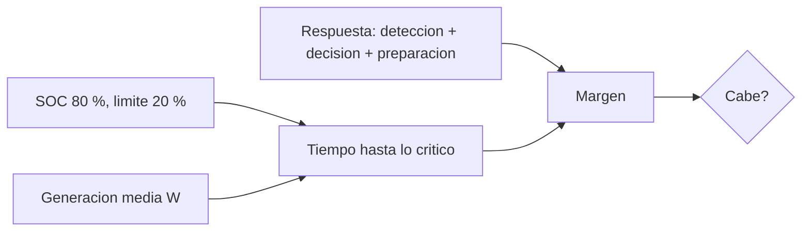

# B96-C15 — Operaciones de emergencia

<!-- nav:top -->
[🏠 Programa](../../../../README.md) · [📚 Bloque B96](../../../tronco-comun/B96-control-y-operacion-de-misiones-espaciales.md) · [← Anterior: B96-C14 — Procedimientos de recuperación](../B96-C14-procedimientos-de-recuperacion/CLASE.md) · [Siguiente: B96-C16 — Gestión de datos científicos →](../../../tronco-comun/B96-control-y-operacion-de-misiones-espaciales.md#b96-c16)
<!-- /nav -->

## 1. Ubicación, nivel y alcance

Clase 15 del bloque B96. Nivel N3. En una **emergencia** (por ejemplo, pérdida de contacto con la nave) lo que decide la conducta es el **tiempo**: cuánto falta para que la batería llegue a su límite crítico y cuánto tarda la respuesta. Aquí comparas ambos tiempos para un satélite **sintético** en modo seguro y obtienes la generación mínima que permite responder a tiempo. Todos los valores son de ejemplo. Todos los datos son **sintéticos** salvo los que se rotulan como consultados.

## 2. Por qué esta clase existe

Cuando falta el contacto, esperar tiene un costo medible. La decisión central: **¿alcanza el tiempo de respuesta antes del límite crítico y qué se puede hacer para ganar margen?**

## 3. Lo que podrás hacer al terminar

1. Calcular el tiempo hasta el SOC crítico con una descarga neta constante.
2. Verificarlo por integración numérica.
3. Componer el tiempo de respuesta (detección, decisión y preparación).
4. Calcular el margen y la generación mínima que permite responder.
5. Evaluar el efecto de reducir cargas.
6. Separar lo consultado de lo sintético.

La evidencia es la **árbol de decisión de emergencia con tiempos** del ejercicio 12 (sección 20).

## 4. Con qué llegas y cómo comprobarlo

1. ¿Qué es el SOC crítico?
2. ¿Qué es una descarga neta?
3. ¿Cómo se calcula el tiempo hasta vaciar?
4. ¿Qué es el tiempo de respuesta?
5. ¿Qué es un modo seguro?

<details>
<summary>Ver respuestas</summary>

1. El estado de carga bajo el cual la batería no debe bajar. 2. Carga menos generación, en W. 3. `ΔE/P_neta`. 4. Tiempo entre la falla y la primera acción útil. 5. Un modo de mínimo consumo y configuración conocida.
</details>

Con cuatro o cinco aciertos, sigue; si no, repasa los prerrequisitos.

## 5. Un caso de contexto y casos de referencia

El satélite **sintético** de 40 Wh pierde el contacto con SOC 80 %; su límite crítico es 20 % y su carga en modo seguro es 12 W. Sin generación el SOC crítico llega en 2,00 h; con 6 W de generación media, en 4,00 h. La respuesta toma `1,5 + 0,5 + 1,0 = 3,0 h`. La respuesta cabe solo si la generación media es ≥ 4,00 W; apagar cargas hasta 6 W también la haría caber sin generación.

## 6. Vocabulario

**Emergencia:** situación que exige acción inmediata. **Tiempo hasta lo crítico:** `ΔE/(P_carga − P_gen)`. **Tiempo de respuesta:** detección + decisión + preparación. **Margen:** diferencia entre ambos. **Descarga neta:** carga menos generación.

## 7. Modelo mental



*Descripción textual:* el tiempo hasta lo crítico se calcula con la energía disponible y la descarga neta; se compara con el tiempo de respuesta; el margen indica si hay tiempo y la generación mínima indica cuánto falta.

Analogía: es como una carrera de relevos contra un cronómetro: lo que importa es si el último relevo llega antes de que termine el tiempo. Límite: aquí el cronómetro depende de cuánta energía entra, no solo de la carga.

## 8. La explicación, paso a paso

### 8.1 Qué dicen las fuentes

ECSS-E-ST-70-11C (S1) busca que la nave pueda operarse en situaciones nominales o de contingencia predefinidas; ECSS-E-ST-70-01C (S2) trata los procedimientos de control a bordo, que permiten responder cuando no hay contacto. El capítulo «Power» de la NASA (S3) indica que la profundidad de descarga acelera el envejecimiento de las baterías. Solo se leyeron resúmenes o la parte inicial; todos los números de esta clase son **sintéticos**.

### 8.2 Tiempo hasta lo crítico

`t_c = (SOC₀ − SOC_min) C/(P_carga − P_gen)`, con `C = 40 Wh`, `0,60 × 40 = 24 Wh` utilizables y `P_carga = 12 W`.

| Generación media (W) | `t_c` (h) |
|---|---|
| 0 | 2,00 |
| 3 | 2,67 |
| 6 | 4,00 |
| 9 | 8,00 |
| 11 | 24,00 |

Una integración con paso de 1 s da 2,0000 h y 4,0003 h (diferencia `< 10⁻³ h`).

### 8.3 Respuesta y margen

Tiempo de respuesta `= 1,5 + 0,5 + 1,0 = 3,0 h`. Margen `= t_c − 3,0`: −1,00 h con 0 W, −0,33 con 3 W, +1,00 con 6 W, +5,00 con 9 W. Generación mínima: `12 − 24/3,0 = 4,00 W`.

### 8.4 Cómo ganar margen

Reducir la carga: con 8 W y sin generación `t_c = 3,0 h` y con 6 W, `4,0 h`. Acortar la detección (más estaciones, C17) también ayuda. En una emergencia real la regla es **primero ganar tiempo** (apagar lo no esencial) y después diagnosticar.

## 9. Magnitudes, símbolos y unidades

| Símbolo | Qué es | Unidad | Valor / nota |
|---|---|---|---|
| `C` | capacidad | Wh | 40 |
| `SOC₀, SOC_min` | estado de carga inicial y crítico | — | 0,80; 0,20 |
| `P_carga` | carga en modo seguro | W | 12 |
| `P_gen` | generación media | W | 0 a 11 |
| `t_c` | tiempo hasta lo crítico | h | 2,00 a 24,00 |

## 10. Convenciones y referencias

Descarga neta constante, tiempo en horas, energía en Wh; el SOC crítico no se compensa con la eficiencia. Todo **sintético**. Tolerancias: analítico frente a integración `< 10⁻³ h`; `t_c(g_min)` igual al tiempo de respuesta a `10⁻⁹`.

## 11. De dónde sale lo que afirmamos

| ID | Fuente | Localizador | Respalda | Estado |
|---|---|---|---|---|
| S1 | ECSS, «ECSS-E-ST-70-11C — Space segment operability», 31 jul 2008 (cancelada y reemplazada por la Rev.1 del 15 oct 2025) — https://ecss.nl/standard/ecss-e-st-70-11c-space-segment-operability/ (consultada 2026-11-10) | página de la norma (solo el resumen; no el texto de requisitos) | disposiciones de diseño de las funciones de a bordo de un segmento espacial no tripulado para que pueda operarse en vuelo en situaciones nominales o de contingencia predefinidas; excluye la operabilidad específica de cada misión | Consultada (solo la página) |
| S2 | ECSS, «ECSS-E-ST-70-01C — Spacecraft on-board control procedures», 16 abr 2010 — https://ecss.nl/standard/ecss-e-st-70-01c-on-board-control-procedures/ (consultada 2026-11-10) | página de la norma (solo el resumen) | marco para sistemas de procedimientos de control a bordo (OBCP): ejecución a bordo y preparación y gestión en tierra, y su ciclo de desarrollo | Consultada (solo la página) |
| S3 | NASA, «Power», en State-of-the-Art of Small Spacecraft Technology — https://www.nasa.gov/smallsat-institute/sst-soa/power/ (consultada 2026-11-10; leídos los primeros 100 000 caracteres de 119 638) | capítulo (parte inicial) | potencia específica de paneles solares con mediana cercana a 30 W/kg; baterías de ion-litio comerciales de 150–270 Wh/kg a 3,6 V; la profundidad de descarga acelera el envejecimiento y la vida se prueba en condiciones de la misión; sin cifras de profundidad de descarga | Consultada (parte del capítulo) |
| — | Libros de texto de operaciones de misión, comunicaciones espaciales y mecánica orbital (p. ej., Wertz y Larson, Montenbruck y Gill, Vallado) | — | — | No consultada |
| — | Relaciones y algoritmos estándar usados por el laboratorio (cociente de energía sobre potencia neta e integración de Euler) | — | los verifica el laboratorio con una segunda vía o con pruebas | No consultada en una fuente concreta |

Límites: las fuentes se leyeron solo en resumen o en parte; la carga y la generación son constantes, sin temperatura, sin eclipse y sin descarga profunda en la química de la batería. Lo simulado no se presenta como dato de vuelo ni como medición.

## 12. Cómo ver los resultados

| Generación (W) | Margen (h) | ¿Cabe? |
|---|---|---|
| 0 | −1,00 | no |
| 3 | −0,33 | no |
| 6 | +1,00 | sí |
| 9 | +5,00 | sí |

Descripción larga: el margen pasa de negativo a positivo cerca de los 4 W de generación; por debajo no hay tiempo para la respuesta de 3 horas.

## 13. Ejemplo trabajado

**Paso 1 · Energía utilizable.** `0,60 × 40 = 24 Wh`.

**Paso 2 · Sin generación.** `24/12 = 2,00 h`.

**Paso 3 · Respuesta.** `1,5 + 0,5 + 1,0 = 3,0 h`.

**Paso 4 · Margen.** `2,0 − 3,0 = −1,0 h`.

**Paso 5 · Mínima.** `12 − 24/3 = 4,00 W`.

## 14. Distintas formas de describir el problema

**Por tiempo:** tabla de márgenes (esta clase). **Por procedimiento:** pasos ordenados (C14). **Por energía:** balance orbital (C12). **Por coordinación:** otra estación acorta la detección (C17).

## 15. Práctica guiada

**Ejercicio 1 · con los pasos indicados.** Calcula la energía utilizable con SOC de 80 % a 20 % y 40 Wh.

<details><summary>Solución comentada</summary>

`24 Wh`.
</details>

**Ejercicio 2 · con una pista.** Calcula `t_c` con 12 W y generación 3 W.

<details><summary>Solución comentada</summary>

`24/9 = 2,67 h`.
</details>

**Ejercicio 3 · casi autónomo.** ¿Cuánto vale el tiempo de respuesta?

<details><summary>Solución comentada</summary>

`1,5 + 0,5 + 1,0 = 3,0 h`.
</details>

## 16. Práctica autónoma, transferencia e integrador

**Ejercicio 4 · autónomo.** ¿Cuál es el margen con 9 W de generación?

<details><summary>Solución comentada</summary>

`8,00 − 3,0 = +5,00 h`.
</details>

**Ejercicio 5 · autónomo.** ¿Qué carga permite 3,0 h sin generación?

<details><summary>Solución comentada</summary>

`24/3 = 8 W`.
</details>

**Ejercicio 6 · autónomo.** Si la detección baja de 1,5 h a 0,5 h, ¿cuál es el margen sin generación?

<details><summary>Solución comentada</summary>

Respuesta 2,0 h; margen `2,0 − 2,0 = 0`.
</details>

**Ejercicio 7 · autónomo.** ¿Qué ocurre con `t_c` si la generación iguala la carga?

<details><summary>Solución comentada</summary>

Es infinito: no hay descarga neta.
</details>

**Ejercicio 8 · autónomo.** Si el SOC inicial fuera 60 %, ¿cuál sería `t_c` sin generación?

<details><summary>Solución comentada</summary>

`0,40 × 40/12 = 1,33 h`.
</details>

**Ejercicio 9 · transferencia.** **Transferencia.** Un colega propone esperar a la siguiente pasada sin actuar. ¿Qué respondes?

<details><summary>Solución comentada</summary>

Hay que comparar el tiempo hasta esa pasada con `t_c`; si no cabe, hay que ganar tiempo antes.
</details>

**Ejercicio 10 · transferencia.** **Transferencia.** ¿Qué hace en una emergencia real la regla 'primero ganar tiempo'?

<details><summary>Solución comentada</summary>

Reduce consumo y estabiliza la nave para ampliar el margen antes del diagnóstico.
</details>

**Ejercicio 11 · transferencia.** **Transferencia.** ¿Qué efectos no modela el cálculo?

<details><summary>Solución comentada</summary>

Temperatura, eclipse, tensión de batería y variaciones de la carga.
</details>

**Ejercicio 12 · integrador.** **Integrador.** Elabora tu *árbol de decisión de emergencia con tiempos*: tiempo hasta lo crítico, respuesta, margen, generación mínima, acciones para ganar tiempo y lista de lo consultado, sintético y no consultado.

<details><summary>Solución comentada</summary>

Secciones 8.2–8.4 y la salida del laboratorio.
</details>

## 17. Laboratorio: tiempo hasta lo crítico frente a la respuesta

El script [tiempo_hasta_lo_critico.py](tiempo_hasta_lo_critico.py) calcula `t_c` para varias generaciones, lo verifica por integración numérica, compone la respuesta, calcula el margen y la generación mínima y evalúa reducciones de carga; **comprueba** `t_c(g_min)` igual a la respuesta y la concordancia con la integración.

**Datos:** batería, cargas y tiempos **sintéticos**. **Predice antes de ejecutar:** ¿cabe la respuesta sin generación? (no: 2,0 h < 3,0 h). **Ejecución del 2026-11-10 (Python 3.12.9):**

```text
Python 3.12.9
Datos SINTETICOS: bateria, cargas y tiempos de respuesta ficticios
Generacion media [W]  tiempo hasta SOC critico [h]
                0.0                         2.00
                3.0                         2.67
                6.0                         4.00
                9.0                         8.00
               11.0                        24.00
  g = 0.0 W: analitico = 2.0000 h ; integrado = 2.0000 h ; dif = 4.44e-16 h
  g = 6.0 W: analitico = 4.0000 h ; integrado = 4.0003 h ; dif = 2.78e-04 h
Tiempo de respuesta = 1.5 + 0.5 + 1.0 = 3.00 h
Generacion  t_critico  margen [h]  veredicto
       0.0       2.00       -1.00  NO cabe
       3.0       2.67       -0.33  NO cabe
       6.0       4.00        1.00  cabe
       9.0       8.00        5.00  cabe
      11.0      24.00       21.00  cabe
Generacion media minima para que la respuesta quepa = 4.00 W
  carga 12.0 W, sin generacion: t_critico = 2.00 h
  carga  8.0 W, sin generacion: t_critico = 3.00 h
  carga  6.0 W, sin generacion: t_critico = 4.00 h
Pruebas superadas.
```

```bash
python programa/clases/B96/B96-C15-operaciones-de-emergencia/tiempo_hasta_lo_critico.py
```

**Límites:** carga y generación constantes, sin temperatura, sin eclipse y sin límites de tensión.

## 18. Errores frecuentes y cómo corregirlos

**Usar toda la capacidad.** Resta el SOC crítico (8.2)

**Olvidar el tiempo de detección.** Compón la respuesta completa (8.3)

**Esperar sin comparar tiempos.** Calcula el margen (8.3)

## 19. Cómo sabrás que vas bien

Tras 8.3: ¿qué generación mínima permite responder? Si dudas, repasa el ejercicio 5. Tras el laboratorio: ¿qué comprueba la integración? (ver sección 17).

## 20. Qué entregas y cómo se evalúa

El producto es tu **árbol de decisión de emergencia con tiempos** (ejercicio 12).

| Criterio | Inicial | En desarrollo | Logrado | Destacado |
|---|---|---|---|---|
| Conceptos | Los confunde | Parciales | Explica el método y su dominio | Explica los límites y las alternativas |
| Cálculo | Sin unidades | Con errores | Resultados con unidades y comprobados | Resuelve casos nuevos |
| Numérico | Sin comprobar | Un caso | Verifica con una segunda vía en varios casos | Interpreta las diferencias y los fallos |
| Fuentes | Sin fuente | Sin fecha | Fuentes con fecha y estado | Declara lo sintético y lo no consultado |
| Límites | No los nombra | Uno | Tres | Discute qué falta del modelo |

**Condiciones críticas (no se compensan con promedio):** rotular los datos como sintéticos; comprobar cada resultado con una segunda vía; citar solo lo consultado.

## 21. Ética, seguridad y límites

Clase educativa: los modelos son simplificados y los datos son sintéticos; ningún resultado describe una misión real, certifica conformidad con una norma ni sustituye la revisión de especialistas.  Accesibilidad: tablas equivalentes a las gráficas, fórmulas en texto, ejercicios sin conexión.

## 22. Para cerrar y seguir

Sin generación la batería sintética llega a su límite en 2,0 h y la respuesta toma 3,0 h: no cabe; con al menos 4 W de generación o con 8 W de carga sí. Queda una pregunta: ¿cómo se gestionan los datos científicos que sí se logran bajar?

**Glosario español–inglés.** emergencia · *emergency*; tiempo de respuesta · *response time*; descarga neta · *net discharge*; margen · *margin*; pérdida de contacto · *loss of contact*.

**Continuidad.** [B96-C16](../B96-C16-gestion-de-datos-cientificos/CLASE.md) trata la gestión de datos científicos.

**Referencias:** ver sección 11.

<!-- nav:bottom -->
---

[← Anterior: B96-C14 — Procedimientos de recuperación](../B96-C14-procedimientos-de-recuperacion/CLASE.md) · [📚 Bloque B96](../../../tronco-comun/B96-control-y-operacion-de-misiones-espaciales.md) · [Siguiente: B96-C16 — Gestión de datos científicos →](../../../tronco-comun/B96-control-y-operacion-de-misiones-espaciales.md#b96-c16)
<!-- /nav -->
