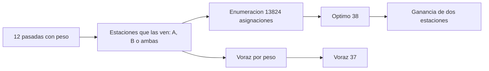

# B96-C17 — Coordinación de múltiples estaciones

<!-- nav:top -->
[🏠 Programa](../../../../README.md) · [📚 Bloque B96](../../../tronco-comun/B96-control-y-operacion-de-misiones-espaciales.md) · [← Anterior: B96-C16 — Gestión de datos científicos](../B96-C16-gestion-de-datos-cientificos/CLASE.md) · [Siguiente: B96-C18 — Fin de vida y disposición orbital →](../B96-C18-fin-de-vida-y-disposicion-orbital/CLASE.md)
<!-- /nav -->

## 1. Ubicación, nivel y alcance

Clase 17 del bloque B96. Nivel N3. Con **varias estaciones** una pasada puede atenderse desde más de una, pero cada estación solo atiende una pasada a la vez. Aquí resuelves, con 12 pasadas **sintéticas** y dos estaciones, la asignación de máximo peso por enumeración exacta, la comparas con una regla voraz por peso y mides la ganancia de tener dos estaciones frente a una. Pasadas, pesos y estaciones son ficticios. Todos los datos son **sintéticos** salvo los que se rotulan como consultados.

## 2. Por qué esta clase existe

Dos pasadas que se solapan en la misma antena obligan a elegir; sin coordinación se pierde la más valiosa. La decisión central: **¿qué pasadas se atienden y desde qué estación para maximizar el valor sin solapes?**

## 3. Lo que podrás hacer al terminar

1. Plantear la asignación como una selección de intervalos con estaciones alternativas.
2. Verificar que una asignación es válida (sin solapes por estación).
3. Hallar el óptimo por enumeración exhaustiva.
4. Comparar una regla voraz con el óptimo.
5. Medir la ganancia de añadir una segunda estación.
6. Separar lo consultado de lo sintético.

La evidencia es la **plan de asignación de estaciones** del ejercicio 12 (sección 20).

## 4. Con qué llegas y cómo comprobarlo

1. ¿Qué es un solape?
2. ¿Qué es una asignación válida?
3. ¿Qué es el peso de una pasada?
4. ¿Qué es la enumeración exhaustiva?
5. ¿Qué es una regla voraz?

<details>
<summary>Ver respuestas</summary>

1. Dos intervalos que comparten algún instante. 2. La que no pone dos pasadas solapadas en la misma estación. 3. Su prioridad o valor operativo. 4. Probar todas las combinaciones posibles. 5. Elegir en orden de peso lo que quepa sin deshacer.
</details>

Con cuatro o cinco aciertos, sigue; si no, repasa los prerrequisitos.

## 5. Un caso de contexto y casos de referencia

Las 12 pasadas **sintéticas** (pesos 1 a 9) pueden verse desde A, desde B o desde ambas. El óptimo, hallado entre 13 824 asignaciones, atiende 8 y suma **38** de un peso total de 47. El voraz por peso suma 37 y atiende 7 (brecha 1). Con solo la estación A el óptimo es 15; con solo la B, 27.

## 6. Vocabulario

**Pasada:** ventana de visibilidad de un satélite. **Estación:** antena que atiende una pasada a la vez. **Asignación:** estación (o ninguna) por pasada. **Peso:** valor operativo. **Brecha:** diferencia con el óptimo.

## 7. Modelo mental



*Descripción textual:* cada pasada tiene estaciones posibles; se enumeran todas las asignaciones válidas para hallar el óptimo y se compara con la regla voraz y con el uso de una sola estación.

Analogía: es como asignar mesas a reservas en dos restaurantes: la misma reserva puede ir a cualquiera, pero una mesa no atiende dos grupos a la vez. Límite: aquí no hay tiempo de traslado entre estaciones, porque una pasada se atiende entera desde una.

## 8. La explicación, paso a paso

### 8.1 Qué dicen las fuentes

El capítulo de la NASA sobre sistemas terrestres (S1) describe redes de estaciones, como la Near Space Network y proveedores comerciales, y servicios de planificación y programación; también indica que la licencia de bandas tarda meses. Solo se leyó la parte inicial. El algoritmo de asignación es estándar y lo verifica el laboratorio; las pasadas y pesos son **sintéticos**.

### 8.2 El problema

Se maximiza `Σ wᵢ` sobre las pasadas atendidas con la restricción de no solape por estación. Cada pasada elige `ninguna`, `A` o `B` según las estaciones que la ven. Con 12 pasadas hay `Π(1 + |visᵢ|) = 13 824` asignaciones.

### 8.3 Resultados

| Método | Peso | Pasadas atendidas |
|---|---|---|
| Óptimo (enumeración) | 38 | 8 de 12 |
| Voraz por peso | 37 | 7 |
| Solo estación A | 15 | — |
| Solo estación B | 27 | — |
| Peso total posible | 47 | 12 |

La segunda estación aporta `38 − 27 = 11` puntos (41 %) sobre la mejor estación sola.

### 8.4 Qué enseña

El voraz es casi óptimo aquí (brecha 1) pero no está garantizado; con más pasadas la enumeración deja de ser práctica y se usa programación dinámica o programación entera. Aun el óptimo deja 4 pasadas sin atender: la coordinación mejora el uso, pero no sustituye a más capacidad.

## 9. Magnitudes, símbolos y unidades

| Símbolo | Qué es | Unidad | Valor / nota |
|---|---|---|---|
| `n` | pasadas | — | 12 |
| `w` | peso | puntos | 1 a 9 |
| `N` | asignaciones | — | 13 824 |
| `W*` | peso óptimo | puntos | 38 |
| `brecha` | óptimo − voraz | puntos | 1 |

## 10. Convenciones y referencias

Tiempos en minutos desde el inicio de la jornada; cada pasada se atiende entera desde una sola estación; una antena por estación; dos estaciones (A y B); semilla 96. Todo **sintético**. Tolerancias: asignaciones válidas (sin solapes); voraz `≤` óptimo; óptimo con dos estaciones `≥` el de cada una sola.

## 11. De dónde sale lo que afirmamos

| ID | Fuente | Localizador | Respalda | Estado |
|---|---|---|---|---|
| S1 | NASA, «Ground Data Systems and Mission Operations», en State-of-the-Art of Small Spacecraft Technology — https://www.nasa.gov/smallsat-institute/sst-soa/ground-data-systems-and-mission-operations/ (consultada 2026-11-10; leídos los primeros 100 000 caracteres de 215 453) | capítulo (parte inicial) | un centro de operaciones de misión (MOC) comanda la nave y un centro de operaciones científicas (SOC) genera productos; enlaces directos a la Tierra frente a relevos; bandas UHF, S, X y Ka; la licencia tarda meses; las antenas suelen adquirir el satélite con 5–10° de elevación; margen típico de 3 dB para retorno de datos en LEO a 1 500 km de distancia oblicua | Consultada (parte del capítulo) |
| — | Libros de texto de operaciones de misión, comunicaciones espaciales y mecánica orbital (p. ej., Wertz y Larson, Montenbruck y Gill, Vallado) | — | — | No consultada |
| — | Relaciones y algoritmos estándar usados por el laboratorio (selección de intervalos con pesos por enumeración exhaustiva) | — | los verifica el laboratorio con una segunda vía o con pruebas | No consultada en una fuente concreta |

Límites: el capítulo se leyó solo en parte; no hay tiempos de apuntamiento, conflictos de frecuencia ni prioridades dinámicas. Lo simulado no se presenta como dato de vuelo ni como medición.

## 12. Cómo ver los resultados

| Escenario | Peso óptimo |
|---|---|
| Solo A | 15 |
| Solo B | 27 |
| A y B | 38 |
| Peso total | 47 |

Descripción larga: dos estaciones logran 38 de 47 puntos; la estación B sola ya lograba 27.

## 13. Ejemplo trabajado

**Paso 1 · Visibilidad.** Cada pasada con sus estaciones posibles.

**Paso 2 · Validez.** Sin solape en la misma estación.

**Paso 3 · Óptimo.** 38 puntos entre 13 824 asignaciones.

**Paso 4 · Voraz.** 37 puntos.

**Paso 5 · Ganancia.** `38 − 27 = 11` puntos con la segunda estación.

## 14. Distintas formas de describir el problema

**Por enumeración:** óptimo (esta clase). **Por programación dinámica:** intervalos con pesos en una estación. **Por simulación:** jornada completa (C20). **Por continuidad:** qué pasa si una estación cae (C23).

## 15. Práctica guiada

**Ejercicio 1 · con los pasos indicados.** ¿Cuántas asignaciones tendría un problema de 3 pasadas visibles desde A y B?

<details><summary>Solución comentada</summary>

`3³ = 27`.
</details>

**Ejercicio 2 · con una pista.** ¿Se solapan [47, 60) y [32, 45)?

<details><summary>Solución comentada</summary>

No: la segunda termina en 45 < 47.
</details>

**Ejercicio 3 · casi autónomo.** ¿Se solapan [61, 76) y [67, 83)?

<details><summary>Solución comentada</summary>

Sí: comparten [67, 76).
</details>

## 16. Práctica autónoma, transferencia e integrador

**Ejercicio 4 · autónomo.** Calcula el porcentaje del peso total que atiende el óptimo.

<details><summary>Solución comentada</summary>

`38/47 = 80,9 %`.
</details>

**Ejercicio 5 · autónomo.** ¿Cuál es la ganancia de la segunda estación sobre la mejor sola?

<details><summary>Solución comentada</summary>

`38 − 27 = 11` puntos.
</details>

**Ejercicio 6 · autónomo.** ¿Qué pasa si se cae la estación B?

<details><summary>Solución comentada</summary>

El óptimo baja a 15 (solo A): pierde 23 puntos.
</details>

**Ejercicio 7 · autónomo.** ¿Por qué el voraz por peso no es siempre óptimo?

<details><summary>Solución comentada</summary>

Una pasada de peso alto puede bloquear dos de peso medio que sumarían más.
</details>

**Ejercicio 8 · autónomo.** Si hay 30 pasadas, ¿por qué no se usa enumeración?

<details><summary>Solución comentada</summary>

El número de asignaciones crece exponencialmente (`3³⁰ ≈ 2×10¹⁴`).
</details>

**Ejercicio 9 · transferencia.** **Transferencia.** Un colega asigna siempre la estación más cercana. ¿Qué falla?

<details><summary>Solución comentada</summary>

Ignora los solapes y las prioridades; puede perder pasadas de alto peso.
</details>

**Ejercicio 10 · transferencia.** **Transferencia.** ¿Qué pasa si una pasada necesita 2 min de apuntamiento antes?

<details><summary>Solución comentada</summary>

Hay que extender el intervalo con ese tiempo para detectar solapes reales.
</details>

**Ejercicio 11 · transferencia.** **Transferencia.** ¿Qué no modela esta clase de una red de estaciones real?

<details><summary>Solución comentada</summary>

Tiempos de apuntamiento, conflictos de frecuencia, costos por estación y cambios de plan.
</details>

**Ejercicio 12 · integrador.** **Integrador.** Elabora tu *plan de asignación de estaciones*: pasadas, asignación óptima y voraz, ganancia de la segunda estación y lista de lo consultado, sintético y no consultado.

<details><summary>Solución comentada</summary>

Secciones 8.2–8.4 y la salida del laboratorio.
</details>

## 17. Laboratorio: asignación óptima de pasadas a dos estaciones

El script [asignacion_de_estaciones.py](asignacion_de_estaciones.py) genera 12 pasadas con semilla fija, enumera las 13 824 asignaciones para hallar el óptimo, calcula una solución voraz y los óptimos con una sola estación; **comprueba** la validez, que el voraz no supera el óptimo y que dos estaciones no empeoran.

**Datos:** pasadas, pesos y visibilidades **sintéticos**; semilla 96. **Predice antes de ejecutar:** ¿cuántos puntos suma el óptimo? (38). **Ejecución del 2026-11-10 (Python 3.12.9):**

```text
Python 3.12.9
Datos SINTETICOS: 12 pasadas ficticias; estaciones A y B; semilla 96
id   sat inicio fin peso estaciones
P01   S2     47   60    4  A,B
P02   S3     12   25    1  A
P03   S2     21   35    2  A,B
P04   S2     32   45    3  B
P05   S2     64   72    9  A,B
P06   S1     61   76    6  B
P07   S1     67   83    3  B
P08   S3      7   16    4  B
P09   S3     47   56    2  A
P10   S3    120  136    5  B
P11   S2     32   43    1  B
P12   S3     35   51    7  B
Optimo por enumeracion (13824 asignaciones): peso = 38 ; atendidas = 8 de 12
Voraz por peso: peso = 37 ; atendidas = 7 ; brecha = 1
Optimo con solo A = 15 ; solo B = 27 ; con A y B = 38 ; peso total = 47
Pruebas superadas.
```

```bash
python programa/clases/B96/B96-C17-coordinacion-de-multiples-estaciones/asignacion_de_estaciones.py
```

**Límites:** pasadas atendidas enteras, sin tiempos de apuntamiento ni conflictos de frecuencia.

## 18. Errores frecuentes y cómo corregirlos

**Asignar sin comprobar solapes.** Verifica cada estación (8.2)

**Confiar en el voraz.** Compara con el óptimo (8.3)

**Olvidar que una pasada se atiende desde una sola estación.** Elige una (8.2)

## 19. Cómo sabrás que vas bien

Tras 8.3: ¿cuánto gana la segunda estación? Si dudas, repasa el ejercicio 5. Tras el laboratorio: ¿qué comprueba la validez? (ver sección 17).

## 20. Qué entregas y cómo se evalúa

El producto es tu **plan de asignación de estaciones** (ejercicio 12).

| Criterio | Inicial | En desarrollo | Logrado | Destacado |
|---|---|---|---|---|
| Conceptos | Los confunde | Parciales | Explica el método y su dominio | Explica los límites y las alternativas |
| Cálculo | Sin unidades | Con errores | Resultados con unidades y comprobados | Resuelve casos nuevos |
| Numérico | Sin comprobar | Un caso | Verifica con una segunda vía en varios casos | Interpreta las diferencias y los fallos |
| Fuentes | Sin fuente | Sin fecha | Fuentes con fecha y estado | Declara lo sintético y lo no consultado |
| Límites | No los nombra | Uno | Tres | Discute qué falta del modelo |

**Condiciones críticas (no se compensan con promedio):** rotular los datos como sintéticos; comprobar cada resultado con una segunda vía; citar solo lo consultado.

## 21. Ética, seguridad y límites

Clase educativa: los modelos son simplificados y los datos son sintéticos; ningún resultado describe una misión real, certifica conformidad con una norma ni sustituye la revisión de especialistas.  Accesibilidad: tablas equivalentes a las gráficas, fórmulas en texto, ejercicios sin conexión.

## 22. Para cerrar y seguir

Con dos estaciones el plan sintético suma 38 de 47 puntos frente a 27 de la mejor sola, y el voraz queda a un punto del óptimo. Queda una pregunta: ¿cómo se retira un satélite al terminar su vida útil?

**Glosario español–inglés.** asignación · *assignment*; solape · *overlap*; red de estaciones · *ground station network*; peso · *weight*; óptimo · *optimum*.

**Continuidad.** [B96-C18](../B96-C18-fin-de-vida-y-disposicion-orbital/CLASE.md) trata el fin de vida y la disposición orbital.

**Referencias:** ver sección 11.

<!-- nav:bottom -->
---

[← Anterior: B96-C16 — Gestión de datos científicos](../B96-C16-gestion-de-datos-cientificos/CLASE.md) · [📚 Bloque B96](../../../tronco-comun/B96-control-y-operacion-de-misiones-espaciales.md) · [Siguiente: B96-C18 — Fin de vida y disposición orbital →](../B96-C18-fin-de-vida-y-disposicion-orbital/CLASE.md)
<!-- /nav -->
