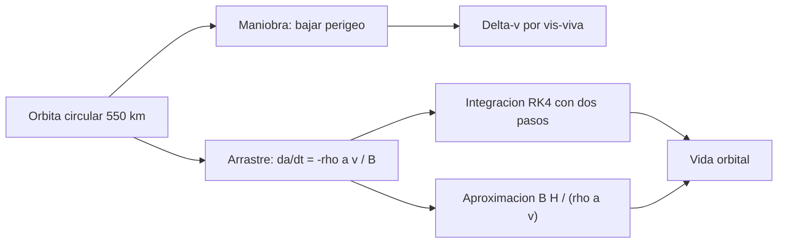

# B96-C18 — Fin de vida y disposición orbital

<!-- nav:top -->
[🏠 Programa](../../../../README.md) · [📚 Bloque B96](../../../tronco-comun/B96-control-y-operacion-de-misiones-espaciales.md) · [← Anterior: B96-C17 — Coordinación de múltiples estaciones](../B96-C17-coordinacion-de-multiples-estaciones/CLASE.md) · [Siguiente: B96-C19 — Lecciones aprendidas operativas →](../B96-C19-lecciones-aprendidas-operativas/CLASE.md)
<!-- /nav -->

## 1. Ubicación, nivel y alcance

Clase 18 del bloque B96. Nivel N3. Al final de su vida un satélite debe retirarse: en LEO, bajando la órbita hasta que la atmósfera lo haga reentrar. Aquí calculas el **Δv de retiro** para bajar el perigeo y el **tiempo de decaimiento por arrastre** con una atmósfera exponencial **sintética**, verificado con dos pasos de integración y con una aproximación analítica. No se usa ninguna atmósfera ni umbral normativo real. Todos los datos son **sintéticos** salvo los que se rotulan como consultados.

## 2. Por qué esta clase existe

Un satélite que no se retira queda como desecho. La decisión central: **¿cuánto Δv cuesta bajar el perigeo y cuánto tarda la nave en reentrar por sí sola?**

## 3. Lo que podrás hacer al terminar

1. Calcular el Δv de una maniobra de retiro con la ecuación vis-viva.
2. Verificar la maniobra con la energía específica.
3. Integrar el decaimiento por arrastre con RK4.
4. Comprobar la integración con dos pasos y con una aproximación analítica.
5. Comparar la vida natural con un umbral de lectura.
6. Separar lo consultado de lo sintético.

La evidencia es la **plan de disposición con tiempo de decaimiento** del ejercicio 12 (sección 20).

## 4. Con qué llegas y cómo comprobarlo

1. ¿Qué es la ecuación vis-viva?
2. ¿Qué es la energía específica orbital?
3. ¿Qué es el coeficiente balístico?
4. ¿Cómo varía la densidad atmosférica con la altura?
5. ¿Qué es RK4?

<details>
<summary>Ver respuestas</summary>

1. `v² = μ(2/r − 1/a)`. 2. `v²/2 − μ/r = −μ/(2a)`, constante en una órbita. 3. `B = m/(C_D A)`; mayor `B`, menor frenado. 4. Decrece de forma aproximadamente exponencial con altura de escala `H`. 5. Un integrador de cuarto orden con cuatro evaluaciones por paso.
</details>

Con cuatro o cinco aciertos, sigue; si no, repasa los prerrequisitos.

## 5. Un caso de contexto y casos de referencia

Desde 550 km, bajar el perigeo a 400, 300, 200 y 100 km cuesta 41,62, 70,01, 98,92 y 128,39 m/s. Con la atmósfera **sintética** (3,0×10⁻¹² kg/m³ a 400 km, `H = 60 km`) y un satélite de 50 kg (`C_D = 2,2`, `A = 0,1 m²`, `B = 227 kg/m²`) la vida natural desde 400, 450, 500 y 550 km es 2,74, 6,34, 14,59 y 33,50 años. La aproximación `B H/(ρ a v)` da 2,77, 6,35, 14,56 y 33,39.

## 6. Vocabulario

**Disposición:** retiro de la nave al final de su vida. **Δv:** cambio de velocidad. **Perigeo:** punto más bajo. **Coeficiente balístico:** `m/(C_D A)`. **Altura de escala:** distancia en que la densidad cae en un factor `e`. **Vida orbital:** tiempo hasta la reentrada.

## 7. Modelo mental



*Descripción textual:* la disposición se estudia por dos vías: una maniobra que baja el perigeo (Δv) o el decaimiento natural por arrastre; el segundo se integra numéricamente con dos pasos y se compara con una aproximación analítica.

Analogía: bajar el perigeo es como frenar en una pendiente: un frenado corto da una caída rápida. El arrastre natural es como dejar rodar sobre arena: lento al principio y rápido al final. Límite: en la nave el frenado depende de la actividad solar, que aquí no se modela.

## 8. La explicación, paso a paso

### 8.1 Qué dicen las fuentes

La página de mitigación del Programa de Desechos Orbitales de la NASA (S1) registra que existen directrices de mitigación desde 1995, prácticas estándar de EE. UU. (2001 y 2019), directrices del IADC (2002) y de la ONU (2007), que la NPR 8715.6E entró en vigor el 18 de abril de 2024 y que NASA-STD-8719.14 y su manual contienen los requisitos técnicos; la página no reproduce cifras de disposición, y **no se consultaron** ni esas normas ni las directrices del IADC. La física del arrastre y de la maniobra es estándar y la verifica el laboratorio.

### 8.2 Maniobra de retiro

`Δv = v_c − v_a`, con `v_c = √(μ/a₀)` y `v_a = √(μ(2/a₀ − 1/a_t))`, `a_t = (a₀ + R + h_p)/2`. Para `h_p = 100 km`: `Δv = 128,39 m/s`. La energía específica por vis-viva y por `−μ/2a_t` coincide: −29,732381 km²/s².

| Perigeo (km) | Δv (m/s) |
|---|---|
| 400 | 41,62 |
| 300 | 70,01 |
| 200 | 98,92 |
| 100 | 128,39 |

### 8.3 Decaimiento natural

`da/dt = −ρ a v/B` con `ρ(h) = ρ₀ exp(−(h − 400)/60)`. RK4 con pasos de 1 día y de 12 h da vidas que difieren menos de 1 %:

| h₀ (km) | RK4, 1 día (años) | RK4, 12 h | `B H/(ρ a v)` |
|---|---|---|---|
| 400 | 2,741 | 2,741 | 2,771 |
| 450 | 6,338 | 6,338 | 6,353 |
| 500 | 14,587 | 14,586 | 14,564 |
| 550 | 33,495 | 33,495 | 33,391 |

### 8.4 Lectura

Con este modelo sintético, la nave de 550 km tarda 33,5 años en reentrar: supera un umbral de lectura de 25 años (usado solo como referencia; la regla vigente **no se consultó**). Una maniobra de 70 m/s a 300 km de perigeo acorta ese plazo; el costo de combustible y su fiabilidad son parte de la decisión.

## 9. Magnitudes, símbolos y unidades

| Símbolo | Qué es | Unidad | Valor / nota |
|---|---|---|---|
| `Δv` | cambio de velocidad | m/s | 41,62 a 128,39 |
| `B` | coeficiente balístico | kg/m² | 227 |
| `ρ₀, H` | densidad base y escala | kg/m³, km | 3,0×10⁻¹² a 400 km; 60 (sintéticos) |
| `t` | vida orbital | años | 2,74 a 33,50 |
| `μ` | parámetro gravitacional | km³/s² | 398 600,4418 |

## 10. Convenciones y referencias

Órbita circular que decae por arrastre; unidades SI en `da/dt` y km en las alturas; atmósfera exponencial ficticia, sin actividad solar ni rotación atmosférica; reentrada convencional a 150 km. Todo **sintético**. Tolerancias: RK4 de 1 día frente a 12 h `< 1 %`; aproximación analítica frente a RK4 `< 25 %`; energía por dos vías a `10⁻⁹`.

## 11. De dónde sale lo que afirmamos

| ID | Fuente | Localizador | Respalda | Estado |
|---|---|---|---|---|
| S1 | NASA, Orbital Debris Program Office, «Mitigation» — https://orbitaldebris.jsc.nasa.gov/mitigation/ (consultada 2026-11-10) | página de mitigación | cronología de directrices (NASA 1995, prácticas estándar de EE. UU. 2001 y 2019, IADC 2002, ONU COPUOS 2007) y entrada en vigor de la NPR 8715.6E el 18 de abril de 2024; remite a NASA-STD-8719.14 y NASA-HDBK-8719.14 para los requisitos técnicos, que la página no reproduce | Consultada (solo la página; sin cifras de disposición) |
| — | Libros de texto de operaciones de misión, comunicaciones espaciales y mecánica orbital (p. ej., Wertz y Larson, Montenbruck y Gill, Vallado) | — | — | No consultada |
| — | Relaciones y algoritmos estándar usados por el laboratorio (vis-viva, energía específica, arrastre de órbita circular y RK4) | — | los verifica el laboratorio con una segunda vía o con pruebas | No consultada en una fuente concreta |

Límites: la página de la NASA no da cifras; la atmósfera es ficticia, no hay variación solar, excentricidad de decaimiento ni reentrada controlada, y el umbral de 25 años es solo una referencia de lectura. Lo simulado no se presenta como dato de vuelo ni como medición.

## 12. Cómo ver los resultados

| h₀ (km) | Vida (años) |
|---|---|
| 400 | 2,74 |
| 450 | 6,34 |
| 500 | 14,59 |
| 550 | 33,50 |

Descripción larga: la vida crece de forma exponencial con la altura inicial, porque la densidad cae exponencialmente.

## 13. Ejemplo trabajado

**Paso 1 · Δv.** Perigeo 300 km: `70,01 m/s`.

**Paso 2 · Coeficiente balístico.** `50/(2,2 × 0,1) = 227 kg/m²`.

**Paso 3 · Vida a 550 km.** RK4: `33,495 años`.

**Paso 4 · Comprobación.** Paso de 12 h: igual; analítica `33,39`.

**Paso 5 · Lectura.** Supera 25 años: conviene maniobrar.

## 14. Distintas formas de describir el problema

**Por maniobra:** Δv (esta clase). **Por arrastre:** vida natural. **Por regulación:** normas de mitigación (NPR 8715.6E, solo citada). **Por riesgo:** probabilidad de éxito de la maniobra.

## 15. Práctica guiada

**Ejercicio 1 · con los pasos indicados.** Calcula la velocidad circular a 550 km.

<details><summary>Solución comentada</summary>

`√(398 600,4418/6 928,137) = 7,585 km/s`.
</details>

**Ejercicio 2 · con una pista.** ¿Cuánto cuesta bajar el perigeo a 100 km?

<details><summary>Solución comentada</summary>

`128,39 m/s`.
</details>

**Ejercicio 3 · casi autónomo.** ¿Qué relación hay entre Δv y la profundidad del perigeo?

<details><summary>Solución comentada</summary>

Crece casi linealmente: 41,6, 70,0, 98,9 y 128,4 m/s.
</details>

## 16. Práctica autónoma, transferencia e integrador

**Ejercicio 4 · autónomo.** Calcula `B` para 100 kg, `C_D = 2,2` y `A = 0,2 m²`.

<details><summary>Solución comentada</summary>

`100/(2,2 × 0,2) = 227 kg/m²`.
</details>

**Ejercicio 5 · autónomo.** ¿Qué pasa con la vida si `B` se duplica?

<details><summary>Solución comentada</summary>

Se duplica aproximadamente: `t ∝ B`.
</details>

**Ejercicio 6 · autónomo.** Calcula la densidad a 500 km con el modelo.

<details><summary>Solución comentada</summary>

`3,0×10⁻¹² e^(−100/60) = 5,7×10⁻¹³ kg/m³`.
</details>

**Ejercicio 7 · autónomo.** ¿Por qué la aproximación `B H/(ρ a v)` funciona?

<details><summary>Solución comentada</summary>

Porque la densidad crece exponencialmente al bajar y casi toda la vida se gasta en la primera altura de escala.
</details>

**Ejercicio 8 · autónomo.** Si la actividad solar duplica la densidad, ¿qué ocurre con la vida?

<details><summary>Solución comentada</summary>

Se reduce a la mitad aproximadamente.
</details>

**Ejercicio 9 · transferencia.** **Transferencia.** Un colega afirma que 550 km reentra en menos de 5 años. ¿Qué respondes?

<details><summary>Solución comentada</summary>

En el modelo sintético son 33,5 años; el resultado real depende de la atmósfera real y de la actividad solar.
</details>

**Ejercicio 10 · transferencia.** **Transferencia.** ¿Qué compara la prueba con dos pasos de integración?

<details><summary>Solución comentada</summary>

Que el resultado no depende del paso numérico.
</details>

**Ejercicio 11 · transferencia.** **Transferencia.** ¿Qué falta para una disposición real?

<details><summary>Solución comentada</summary>

Atmósfera real, requisitos normativos, fiabilidad de la maniobra y pasivación.
</details>

**Ejercicio 12 · integrador.** **Integrador.** Elabora tu *plan de disposición con tiempo de decaimiento*: Δv por perigeo, vida natural, comprobaciones, lectura frente al umbral y lista de lo consultado, sintético y no consultado.

<details><summary>Solución comentada</summary>

Secciones 8.2–8.4 y la salida del laboratorio.
</details>

## 17. Laboratorio: Δv de retiro y vida por arrastre

El script [disposicion_orbital.py](disposicion_orbital.py) calcula el Δv por vis-viva para cuatro perigeos, lo verifica por energía, integra el decaimiento con RK4 en dos pasos y lo compara con la aproximación analítica; **comprueba** la energía, la convergencia en el paso y la monotonía de la vida con la altura.

**Datos:** atmósfera y satélite **sintéticos**. **Predice antes de ejecutar:** ¿cuánto tarda en reentrar desde 550 km? (≈ 33,5 años). **Ejecución del 2026-11-10 (Python 3.12.9):**

```text
Python 3.12.9
Datos SINTETICOS: atmosfera exponencial ficticia (rho = 3.0e-12 kg/m3 a 400 km, H = 60 km); satelite de 50 kg, Cd = 2.2, A = 0.1 m2
Perigeo   400 km: delta-v =   41.62 m/s
Perigeo   300 km: delta-v =   70.01 m/s
Perigeo   200 km: delta-v =   98.92 m/s
Perigeo   100 km: delta-v =  128.39 m/s
Energia especifica: vis-viva = -29.732381 ; -mu/2a = -29.732381 km2/s2
h0 [km]  vida RK4 dt=1 d [anios]  RK4 dt=0.5 d  aproximacion B H/(rho a v)  [anios]
    400                2.741          2.741                      2.771
    450                6.338          6.338                      6.353
    500               14.587         14.586                     14.564
    550               33.495         33.495                     33.391
Vida natural desde 550 km = 33.5 anios ; supera 25.0 anios: SI (umbral usado solo como referencia de lectura)
Pruebas superadas.
```

```bash
python programa/clases/B96/B96-C18-fin-de-vida-y-disposicion-orbital/disposicion_orbital.py
```

**Límites:** órbita circular, atmósfera exponencial fija, sin actividad solar, sin reentrada controlada.

## 18. Errores frecuentes y cómo corregirlos

**Usar el Δv como suma de las velocidades.** Resta `v_a` de `v_c` (8.2)

**Confiar en un paso numérico.** Compara dos pasos (8.3)

**Presentar la atmósfera como real.** Revisa la sección 10

## 19. Cómo sabrás que vas bien

Tras 8.3: ¿cómo cambia la vida si se duplica la densidad? Si dudas, repasa el ejercicio 8. Tras el laboratorio: ¿qué comprueba la energía? (ver sección 17).

## 20. Qué entregas y cómo se evalúa

El producto es tu **plan de disposición con tiempo de decaimiento** (ejercicio 12).

| Criterio | Inicial | En desarrollo | Logrado | Destacado |
|---|---|---|---|---|
| Conceptos | Los confunde | Parciales | Explica el método y su dominio | Explica los límites y las alternativas |
| Cálculo | Sin unidades | Con errores | Resultados con unidades y comprobados | Resuelve casos nuevos |
| Numérico | Sin comprobar | Un caso | Verifica con una segunda vía en varios casos | Interpreta las diferencias y los fallos |
| Fuentes | Sin fuente | Sin fecha | Fuentes con fecha y estado | Declara lo sintético y lo no consultado |
| Límites | No los nombra | Uno | Tres | Discute qué falta del modelo |

**Condiciones críticas (no se compensan con promedio):** rotular los datos como sintéticos; comprobar cada resultado con una segunda vía; citar solo lo consultado.

## 21. Ética, seguridad y límites

Clase educativa: los modelos son simplificados y los datos son sintéticos; ningún resultado describe una misión real, certifica conformidad con una norma ni sustituye la revisión de especialistas.  Accesibilidad: tablas equivalentes a las gráficas, fórmulas en texto, ejercicios sin conexión.

## 22. Para cerrar y seguir

Bajar el perigeo a 300 km desde 550 km cuesta 70 m/s y la vida natural sintética desde 550 km es de 33,5 años. Queda una pregunta: ¿qué se aprende de los errores pasados?

**Glosario español–inglés.** disposición · *disposal*; perigeo · *perigee*; arrastre · *drag*; coeficiente balístico · *ballistic coefficient*; reentrada · *reentry*.

**Continuidad.** [B96-C19](../B96-C19-lecciones-aprendidas-operativas/CLASE.md) trata las lecciones aprendidas operativas.

**Referencias:** ver sección 11.

<!-- nav:bottom -->
---

[← Anterior: B96-C17 — Coordinación de múltiples estaciones](../B96-C17-coordinacion-de-multiples-estaciones/CLASE.md) · [📚 Bloque B96](../../../tronco-comun/B96-control-y-operacion-de-misiones-espaciales.md) · [Siguiente: B96-C19 — Lecciones aprendidas operativas →](../B96-C19-lecciones-aprendidas-operativas/CLASE.md)
<!-- /nav -->
