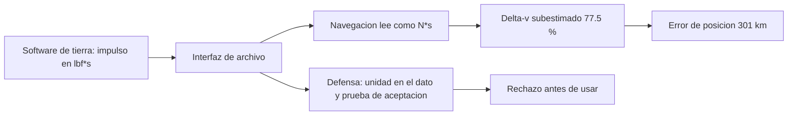

# B96-C19 — Lecciones aprendidas operativas

<!-- nav:top -->
[🏠 Programa](../../../../README.md) · [📚 Bloque B96](../../../tronco-comun/B96-control-y-operacion-de-misiones-espaciales.md) · [← Anterior: B96-C18 — Fin de vida y disposición orbital](../B96-C18-fin-de-vida-y-disposicion-orbital/CLASE.md) · [Siguiente: B96-C20 — Simulación de jornada de control de misión →](../B96-C20-simulacion-de-jornada-de-control-de-mision/CLASE.md)
<!-- /nav -->

## 1. Ubicación, nivel y alcance

Clase 19 del bloque B96. Nivel N3. Las **lecciones aprendidas** convierten un error pasado en una defensa presente. Aquí estudias un tipo de error que la NASA describe en Mars Climate Orbiter (software de tierra en unidades inglesas frente a software de a bordo en métricas), lo reproduces en un caso **sintético** de impulsos de maniobra en lbf·s leídos como N·s y construyes la defensa: magnitudes etiquetadas con su unidad y una prueba de aceptación de interfaz. El caso **no reproduce** los datos de la misión real. Todos los datos son **sintéticos** salvo los que se rotulan como consultados.

## 2. Por qué esta clase existe

Un número sin unidad es una trampa: el programa corre, el valor parece razonable y la nave se pierde. La decisión central: **¿cómo se evita que una conversión de unidades pase inadvertida entre el software de tierra y el de vuelo?**

## 3. Lo que podrás hacer al terminar

1. Calcular el efecto de leer lbf·s como N·s en un impulso y en un Δv.
2. Estimar el error de posición por deriva lineal.
3. Implementar una cantidad con unidad que rechace sumas entre unidades distintas.
4. Escribir una prueba de aceptación de interfaz con la unidad declarada.
5. Explicar por qué la defensa es de proceso y no solo de cálculo.
6. Separar lo consultado de lo sintético.

La evidencia es la **caso de lección aprendida con su defensa** del ejercicio 12 (sección 20).

## 4. Con qué llegas y cómo comprobarlo

1. ¿Cuánto es 1 lbf en N?
2. ¿Qué es un impulso?
3. ¿Qué es una deriva lineal?
4. ¿Qué es una prueba de aceptación de interfaz?
5. ¿Qué es un tipo con unidad?

<details>
<summary>Ver respuestas</summary>

1. 4,4482216152605 N (por definición). 2. Fuerza por tiempo, en N·s; `Δv = I/m`. 3. Un error de posición que crece como `Δv × t`. 4. Una verificación de que lo que entrega un lado es lo que el otro espera. 5. Un valor que lleva su unidad y la verifica al operar.
</details>

Con cuatro o cinco aciertos, sigue; si no, repasa los prerrequisitos.

## 5. Un caso de contexto y casos de referencia

Un caso **sintético** de una nave de 600 kg con 10 impulsos verdaderos de 2 N·s: el software de tierra entrega 0,4496 (en lbf·s) y el de navegación lo lee como N·s. El Δv modelado es 7,49 mm/s en vez de 33,33 mm/s (error del 77,5 %) y, tras 135 días de deriva lineal, el error de posición es de 301 km. NASA indica que en Mars Climate Orbiter el desajuste entre unidades inglesas y métricas distorsionó el cálculo de trayectoria y la nave llegó demasiado cerca de Marte (contacto perdido el 23 de septiembre de 1999).

## 6. Vocabulario

**Lección aprendida:** conocimiento extraído de un error para evitarlo. **lbf·s:** libra-fuerza por segundo (impulso). **N·s:** newton por segundo. **Interfaz:** frontera entre dos sistemas que intercambian datos. **Tipo con unidad:** valor que lleva su unidad. **Prueba de aceptación:** verificación de lo entregado frente a lo esperado.

## 7. Modelo mental



*Descripción textual:* el software de tierra entrega un número en lbf·s y navegación lo lee como N·s, subestimando el impulso; la defensa añade la unidad al dato y una prueba que rechaza lo que no coincide.

Analogía: es como pedir una receta en tazas y leerla en litros: la receta tiene sentido, pero el resultado no. Límite: aquí el error se acumula durante meses y se descubre cuando ya es tarde.

## 8. La explicación, paso a paso

### 8.1 Qué dice la fuente

La página de la NASA sobre Mars Climate Orbiter (S1) indica que el software de tierra usaba unidades inglesas y el de a bordo, métricas; que el desajuste distorsionó el cálculo de la trayectoria y la nave llegó demasiado cerca de Marte, y que se perdió el contacto el 23 de septiembre de 1999. La página no da el impulso, la masa ni el factor de error: todo lo demás de esta clase es **sintético**. No se consultó el informe de la investigación ni el sistema de lecciones aprendidas de la NASA.

### 8.2 El efecto en el caso sintético

`1 lbf·s = 4,4482216152605 N·s`. El impulso verdadero es 2 N·s; el dato entregado es `2/4,4482 = 0,4496`. Leído como N·s da un impulso 4,448 veces menor. `Δv_verdadero = 10 × 2/600 = 33,33 mm/s`; `Δv_modelado = 7,49 mm/s`; error 25,84 mm/s (77,5 %). Con deriva lineal durante 135 días: `25,84×10⁻³ m/s × 1,1664×10⁷ s = 301 km`.

### 8.3 La defensa

Una cantidad con unidad (`Impulso(valor, unidad)`) permite convertir (`.en("N*s")`) y **rechaza** la suma entre unidades distintas con un error. Con conversión explícita, 2 N·s + 2 N·s = 4 N·s. Una prueba de aceptación convierte lo entregado a N·s y lo compara con lo esperado: acepta `0,4496 lbf·s` y rechaza `0,4496` declarado como N·s.

### 8.4 Lección

La corrección es de **proceso**: la unidad viaja con el dato, hay una prueba de aceptación en la interfaz y la verificación se hace con datos de referencia conocidos antes del vuelo. Un cálculo correcto sobre un dato mal interpretado sigue siendo un error.

## 9. Magnitudes, símbolos y unidades

| Símbolo | Qué es | Unidad | Valor / nota |
|---|---|---|---|
| `I` | impulso | N·s | 2 (sintético) |
| `m` | masa | kg | 600 (sintética) |
| `f` | factor lbf·s → N·s | — | 4,4482216152605 |
| `Δv` | cambio de velocidad | mm/s | 33,33 y 7,49 |
| `e` | error de posición | km | 301 |

## 10. Convenciones y referencias

Impulsos en N·s, masa en kg y distancias en km; deriva lineal sobre la mitad de 270 días; factor lbf → N por definición. Todo el caso es **sintético** y **no reproduce** los números de la misión. Tolerancias: ida y vuelta de la conversión a `10⁻¹²`; defensa que rechaza toda suma con unidades distintas.

## 11. De dónde sale lo que afirmamos

| ID | Fuente | Localizador | Respalda | Estado |
|---|---|---|---|---|
| S1 | NASA, «Mars Climate Orbiter» — https://science.nasa.gov/mission/mars-climate-orbiter/ (consultada 2026-11-10) | página de la misión | el software de tierra usaba unidades inglesas y el de a bordo métricas; el desajuste distorsionó el cálculo de la trayectoria y la nave llegó demasiado cerca de Marte; contacto perdido el 23 de septiembre de 1999 | Consultada (solo la página) |
| — | Libros de texto de operaciones de misión, comunicaciones espaciales y mecánica orbital (p. ej., Wertz y Larson, Montenbruck y Gill, Vallado) | — | — | No consultada |
| — | Relaciones y algoritmos estándar usados por el laboratorio (conversión de unidades, `Δv = I/m` y deriva lineal) | — | los verifica el laboratorio con una segunda vía o con pruebas | No consultada en una fuente concreta |

Límites: la fuente da la causa pero no las cifras; el modelo de deriva lineal es una cota gruesa que ignora la geometría de la trayectoria. Lo simulado no se presenta como dato de vuelo ni como medición.

## 12. Cómo ver los resultados

| Magnitud | Valor |
|---|---|
| Δv verdadero | 33,33 mm/s |
| Δv modelado | 7,49 mm/s |
| Error de Δv | 77,5 % |
| Error de posición | 301 km |

Descripción larga: leer lbf·s como N·s reduce el impulso a 22,5 % del valor verdadero, y esa diferencia, sostenida por meses, se vuelve una distancia de centenares de kilómetros.

## 13. Ejemplo trabajado

**Paso 1 · Conversión.** `2/4,4482 = 0,4496 lbf·s`.

**Paso 2 · Lectura errónea.** `0,4496` se toma como N·s.

**Paso 3 · Δv.** `7,49` frente a `33,33 mm/s`.

**Paso 4 · Deriva.** `301 km` en 135 días.

**Paso 5 · Defensa.** La suma con unidades distintas se rechaza.

## 14. Distintas formas de describir el problema

**Por cálculo:** efecto del error (esta clase). **Por código:** tipos con unidad. **Por proceso:** pruebas de aceptación de interfaz. **Por registro:** bitácora de operaciones (C30).

## 15. Práctica guiada

**Ejercicio 1 · con los pasos indicados.** Convierte 10 lbf·s a N·s.

<details><summary>Solución comentada</summary>

`44,48 N·s`.
</details>

**Ejercicio 2 · con una pista.** Convierte 20 N·s a lbf·s.

<details><summary>Solución comentada</summary>

`20/4,4482 = 4,496 lbf·s`.
</details>

**Ejercicio 3 · casi autónomo.** Calcula el Δv de un impulso de 3 N·s en una nave de 300 kg.

<details><summary>Solución comentada</summary>

`10 mm/s`.
</details>

## 16. Práctica autónoma, transferencia e integrador

**Ejercicio 4 · autónomo.** Si el dato en lbf·s se lee como N·s, ¿por qué factor se subestima el impulso?

<details><summary>Solución comentada</summary>

4,448.
</details>

**Ejercicio 5 · autónomo.** ¿Qué porcentaje del impulso verdadero se usa en el modelo erróneo?

<details><summary>Solución comentada</summary>

`1/4,4482 = 22,5 %`.
</details>

**Ejercicio 6 · autónomo.** Calcula el error de posición para un error de 10 mm/s durante 100 días.

<details><summary>Solución comentada</summary>

`0,01 × 8,64×10⁶ = 86,4 km`.
</details>

**Ejercicio 7 · autónomo.** ¿Por qué el error pasa inadvertido?

<details><summary>Solución comentada</summary>

El valor entregado es plausible y el programa funciona sin errores.
</details>

**Ejercicio 8 · autónomo.** ¿Qué rechaza el tipo con unidad?

<details><summary>Solución comentada</summary>

Sumar o comparar valores con unidades distintas sin conversión explícita.
</details>

**Ejercicio 9 · transferencia.** **Transferencia.** Un colega afirma que basta documentar la unidad en un archivo de texto. ¿Qué respondes?

<details><summary>Solución comentada</summary>

La documentación no se ejecuta: hay que llevar la unidad en el dato y probar la interfaz.
</details>

**Ejercicio 10 · transferencia.** **Transferencia.** ¿Qué prueba de aceptación escribirías para un archivo de impulsos?

<details><summary>Solución comentada</summary>

Entregar un impulso conocido, convertirlo a N·s y compararlo con el esperado dentro de una tolerancia.
</details>

**Ejercicio 11 · transferencia.** **Transferencia.** ¿Qué otras interfaces pueden esconder un error de unidades?

<details><summary>Solución comentada</summary>

Ángulos (grados/radianes), tiempos (UTC/TAI), distancias (km/m) y marcos de referencia.
</details>

**Ejercicio 12 · integrador.** **Integrador.** Elabora tu *caso de lección aprendida con su defensa*: error, efecto numérico, defensa, prueba de aceptación y lista de lo consultado, sintético y no consultado.

<details><summary>Solución comentada</summary>

Secciones 8.2–8.4 y la salida del laboratorio.
</details>

## 17. Laboratorio: error de unidades y su defensa

El script [error_de_unidades.py](error_de_unidades.py) calcula el efecto de leer lbf·s como N·s, el error de Δv y de posición, define una cantidad con unidad que rechaza mezclas y una prueba de aceptación; **comprueba** la conversión, el rechazo de la mezcla y la prueba de aceptación.

**Datos:** nave, impulsos y duración **sintéticos**; no reproducen los de ninguna misión. **Predice antes de ejecutar:** ¿qué porcentaje del Δv verdadero se modela? (≈ 22,5 %). **Ejecución del 2026-11-10 (Python 3.12.9):**

```text
Python 3.12.9
Datos SINTETICOS: nave de 600 kg y 10 impulsos de 2 N*s a lo largo de 270 dias; NO reproduce los datos de una mision real
Impulso verdadero por evento = 2.0000 N*s ; numero entregado = 0.4496 (lbf*s) ; leido como N*s = 0.4496
Delta-v verdadero = 33.33 mm/s ; Delta-v modelado = 7.49 mm/s ; error = 25.84 mm/s (77.5 %)
Error de posicion por deriva lineal durante 135 dias = 301.4 km
Sumar lbf*s con N*s -> rechazado: unidades distintas: lbf*s y N*s
Con conversion explicita: 2.0000 N*s + 2.0000 N*s = 4.0000 N*s
Interfaz con unidad correcta acepta: True
Interfaz que entrega lbf*s pero declara N*s rechaza: True
Pruebas superadas.
```

```bash
python programa/clases/B96/B96-C19-lecciones-aprendidas-operativas/error_de_unidades.py
```

**Límites:** deriva lineal, sin geometría de trayectoria; un solo tipo de unidad de impulso.

## 18. Errores frecuentes y cómo corregirlos

**Pasar un número sin unidad.** Lleva la unidad en el dato (8.3)

**Documentar y no probar.** Escribe la prueba de aceptación (8.3)

**Presentar el caso sintético como el real.** Revisa la sección 10

## 19. Cómo sabrás que vas bien

Tras 8.2: ¿por qué factor se subestima el impulso? Si dudas, repasa el ejercicio 4. Tras el laboratorio: ¿qué rechaza el tipo con unidad? (ver sección 17).

## 20. Qué entregas y cómo se evalúa

El producto es tu **caso de lección aprendida con su defensa** (ejercicio 12).

| Criterio | Inicial | En desarrollo | Logrado | Destacado |
|---|---|---|---|---|
| Conceptos | Los confunde | Parciales | Explica el método y su dominio | Explica los límites y las alternativas |
| Cálculo | Sin unidades | Con errores | Resultados con unidades y comprobados | Resuelve casos nuevos |
| Numérico | Sin comprobar | Un caso | Verifica con una segunda vía en varios casos | Interpreta las diferencias y los fallos |
| Fuentes | Sin fuente | Sin fecha | Fuentes con fecha y estado | Declara lo sintético y lo no consultado |
| Límites | No los nombra | Uno | Tres | Discute qué falta del modelo |

**Condiciones críticas (no se compensan con promedio):** rotular los datos como sintéticos; comprobar cada resultado con una segunda vía; citar solo lo consultado.

## 21. Ética, seguridad y límites

Clase educativa: los modelos son simplificados y los datos son sintéticos; ningún resultado describe una misión real, certifica conformidad con una norma ni sustituye la revisión de especialistas.  Accesibilidad: tablas equivalentes a las gráficas, fórmulas en texto, ejercicios sin conexión.

## 22. Para cerrar y seguir

Leer lbf·s como N·s subestima el impulso 4,448 veces: en el caso sintético, 77,5 % de error de Δv y 301 km de posición. La defensa es llevar la unidad con el dato y probar la interfaz. Queda una pregunta: ¿cómo se ensaya una jornada completa de operaciones?

**Glosario español–inglés.** lección aprendida · *lesson learned*; unidad · *unit*; interfaz · *interface*; prueba de aceptación · *acceptance test*; impulso · *impulse*.

**Continuidad.** [B96-C20](../B96-C20-simulacion-de-jornada-de-control-de-mision/CLASE.md) trata la simulación de una jornada de control de misión.

**Referencias:** ver sección 11.

<!-- nav:bottom -->
---

[← Anterior: B96-C18 — Fin de vida y disposición orbital](../B96-C18-fin-de-vida-y-disposicion-orbital/CLASE.md) · [📚 Bloque B96](../../../tronco-comun/B96-control-y-operacion-de-misiones-espaciales.md) · [Siguiente: B96-C20 — Simulación de jornada de control de misión →](../B96-C20-simulacion-de-jornada-de-control-de-mision/CLASE.md)
<!-- /nav -->
