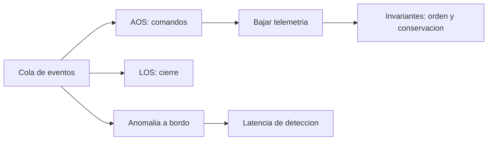

# B96-C20 — Simulación de jornada de control de misión

<!-- nav:top -->
[🏠 Programa](../../../../README.md) · [📚 Bloque B96](../../../tronco-comun/B96-control-y-operacion-de-misiones-espaciales.md) · [← Anterior: B96-C19 — Lecciones aprendidas operativas](../B96-C19-lecciones-aprendidas-operativas/CLASE.md) · [Siguiente: B96-C21 — Diagnóstico explicable de anomalías →](../B96-C21-diagnostico-explicable-de-anomalias/CLASE.md)
<!-- /nav -->

## 1. Ubicación, nivel y alcance

Clase 20 del bloque B96. Nivel N3. Una **simulación de jornada** ensaya la operación completa: pasadas, comandos, telemetría y una anomalía, con indicadores al final. Aquí construyes una simulación de eventos discretos de 24 h con las 4 pasadas de C04, 12 comandos pendientes, telemetría continua y una anomalía a bordo en un instante sintético; verificas invariantes (orden temporal, conservación de datos, comandos dentro del contacto). Todo es **sintético**. Todos los datos son **sintéticos** salvo los que se rotulan como consultados.

## 2. Por qué esta clase existe

Un ensayo en frío revela conflictos entre contactos, comandos y datos que no se ven sumando números aislados. La decisión central: **¿la jornada funciona de punta a punta y cuándo se detecta una anomalía?**

## 3. Lo que podrás hacer al terminar

1. Construir una simulación de eventos con una cola de prioridad.
2. Modelar comandos limitados por el tiempo de contacto.
3. Modelar la acumulación y bajada de telemetría.
4. Verificar invariantes: orden temporal y conservación de datos.
5. Medir la latencia de detección de una anomalía.
6. Separar lo consultado de lo sintético.

La evidencia es la **informe de jornada simulada** del ejercicio 12 (sección 20).

## 4. Con qué llegas y cómo comprobarlo

1. ¿Qué es una cola de prioridad?
2. ¿Qué es un evento discreto?
3. ¿Qué es un invariante?
4. ¿Qué es AOS/LOS?
5. ¿Qué es conservar los datos?

<details>
<summary>Ver respuestas</summary>

1. Una estructura que entrega primero el evento de menor tiempo. 2. Un hecho que ocurre en un instante (inicio de pasada, anomalía). 3. Una condición que debe cumplirse durante toda la simulación. 4. Inicio y fin de contacto. 5. Lo generado es igual a lo bajado más lo guardado en el buffer.
</details>

Con cuatro o cinco aciertos, sigue; si no, repasa los prerrequisitos.

## 5. Un caso de contexto y casos de referencia

En la jornada **sintética**, 4 pasadas dan 1 490 s de contacto; los 12 comandos (12 s cada uno) se ejecutan en la primera pasada (144 s, 9,7 % del contacto). La telemetría generada es 21,600 MB, se bajan 20,301 MB y 1,299 MB quedan en el buffer al cierre. La anomalía ocurre en el segundo 16 083 y se detecta en el 42 210, al inicio de la segunda pasada: 435,5 min de latencia.

## 6. Vocabulario

**Evento:** hecho en un instante. **Cola de eventos:** lista ordenada por tiempo. **Buffer:** almacén de datos a bordo. **Invariante:** condición siempre verdadera. **Latencia de detección:** tiempo hasta ver la anomalía.

## 7. Modelo mental



*Descripción textual:* la cola entrega eventos en orden temporal; en cada contacto se ejecutan comandos y se baja telemetría; la anomalía solo se ve al siguiente contacto; al final se verifican los invariantes.

Analogía: una simulación de jornada es como un ensayo general de teatro: se corre todo el guion para ver dónde se atasca. Límite: el ensayo no incluye las sorpresas del público.

## 8. La explicación, paso a paso

### 8.1 Qué dicen las fuentes

ECSS-E-ST-70-11C (S1) busca que la nave pueda operarse en situaciones nominales o de contingencia predefinidas, y ECSS-E-ST-70-32C (S2) trata los procedimientos de operación. El capítulo de la NASA sobre sistemas terrestres (S3) describe el MOC, el SOC y los contactos directos. Solo se leyeron los resúmenes y la parte inicial del capítulo; los números de esta clase son **sintéticos**.

### 8.2 Modelo

Una cola de prioridad (`heapq`) ordena eventos AOS, LOS, ANOMALIA y FIN. Entre eventos se acumula telemetría a 2 000 bit/s; durante el contacto se baja a 1,7 Mbit/s (2 Mbit/s con 85 % de eficiencia). En cada AOS se ejecutan hasta `⌊(duración − 40 s)/12 s⌋` comandos.

### 8.3 Resultados

| Magnitud | Valor |
|---|---|
| Pasadas | 4 (1 490 s de contacto) |
| Comandos ejecutados | 12 de 12 |
| Tiempo de comando | 144 s (9,7 % del contacto) |
| Telemetría generada / bajada / buffer | 21,600 / 20,301 / 1,299 MB |
| Anomalía / detección / latencia | 16 083 s / 42 210 s / 435,5 min |

### 8.4 Invariantes y lectura

(1) Los eventos salen en orden temporal; (2) `generado − bajado − buffer = 0` con tolerancia `10⁻⁶` relativa; (3) las pasadas no se solapan; (4) el tiempo de comandos no supera el contacto. La latencia de 435,5 min es la consecuencia de tener una sola estación: la anomalía solo se ve en el siguiente contacto. Ese resultado enlaza con la emergencia (C15) y la coordinación (C17).

## 9. Magnitudes, símbolos y unidades

| Símbolo | Qué es | Unidad | Valor / nota |
|---|---|---|---|
| `t` | tiempo | s | 0 a 86 400 |
| `r_TM` | telemetría | bit/s | 2 000 |
| `r_DL` | bajada útil | bit/s | 1,7×10⁶ |
| `T_c` | tiempo por comando | s | 12 |
| `Λ` | latencia de detección | min | 435,5 |

## 10. Convenciones y referencias

Tiempo en s desde el inicio del día; órbita de 550 km y estación como en C04 (todo **sintético**); sin pérdidas de enlace; anomalía en un instante uniforme entre 2 000 y 40 000 s (semilla 96). Tolerancias: orden temporal exacto; conservación de datos `< 10⁻⁶` relativa; comandos `≤` contacto.

## 11. De dónde sale lo que afirmamos

| ID | Fuente | Localizador | Respalda | Estado |
|---|---|---|---|---|
| S1 | ECSS, «ECSS-E-ST-70-11C — Space segment operability», 31 jul 2008 (cancelada y reemplazada por la Rev.1 del 15 oct 2025) — https://ecss.nl/standard/ecss-e-st-70-11c-space-segment-operability/ (consultada 2026-11-10) | página de la norma (solo el resumen; no el texto de requisitos) | disposiciones de diseño de las funciones de a bordo de un segmento espacial no tripulado para que pueda operarse en vuelo en situaciones nominales o de contingencia predefinidas; excluye la operabilidad específica de cada misión | Consultada (solo la página) |
| S2 | ECSS, «ECSS-E-ST-70-32C — Test and operations procedure language», 31 jul 2008 — https://ecss.nl/standard/ecss-e-st-70-32c-test-and-operations-procedure-language/ (consultada 2026-11-10) | página de la norma (solo el resumen) | define las capacidades del lenguaje con que se escriben procedimientos de prueba y de operación y especifica el lenguaje PLUTO | Consultada (solo la página) |
| S3 | NASA, «Ground Data Systems and Mission Operations», en State-of-the-Art of Small Spacecraft Technology — https://www.nasa.gov/smallsat-institute/sst-soa/ground-data-systems-and-mission-operations/ (consultada 2026-11-10; leídos los primeros 100 000 caracteres de 215 453) | capítulo (parte inicial) | un centro de operaciones de misión (MOC) comanda la nave y un centro de operaciones científicas (SOC) genera productos; enlaces directos a la Tierra frente a relevos; bandas UHF, S, X y Ka; la licencia tarda meses; las antenas suelen adquirir el satélite con 5–10° de elevación; margen típico de 3 dB para retorno de datos en LEO a 1 500 km de distancia oblicua | Consultada (parte del capítulo) |
| — | Libros de texto de operaciones de misión, comunicaciones espaciales y mecánica orbital (p. ej., Wertz y Larson, Montenbruck y Gill, Vallado) | — | — | No consultada |
| — | Relaciones y algoritmos estándar usados por el laboratorio (simulación de eventos discretos con cola de prioridad) | — | los verifica el laboratorio con una segunda vía o con pruebas | No consultada en una fuente concreta |

Límites: las fuentes se leyeron solo en resumen o en parte; no hay pérdidas de enlace, fallos del operador ni concurrencia entre estaciones. Lo simulado no se presenta como dato de vuelo ni como medición.

## 12. Cómo ver los resultados

| Magnitud | Valor |
|---|---|
| Contacto total | 1 490 s |
| Comandos ejecutados | 12 |
| Telemetría bajada | 20,301 MB de 21,600 MB |
| Latencia de la anomalía | 435,5 min |

Descripción larga: los comandos ocupan una décima parte del contacto y la telemetría casi entera se baja; la limitación operativa real es el tiempo que pasa hasta el siguiente contacto.

## 13. Ejemplo trabajado

**Paso 1 · Eventos.** 4 AOS, 4 LOS, 1 anomalía y 1 FIN.

**Paso 2 · Primera pasada.** 12 comandos en 144 s.

**Paso 3 · Telemetría.** 20,301 MB bajados.

**Paso 4 · Anomalía.** Detectada 435,5 min después.

**Paso 5 · Invariantes.** Orden y conservación cumplidos.

## 14. Distintas formas de describir el problema

**Por simulación:** eventos (esta clase). **Por tabla:** línea de tiempo de la jornada. **Por métricas:** contacto, comandos, datos y latencia. **Por escenarios:** variar anomalía y estaciones.

## 15. Práctica guiada

**Ejercicio 1 · con los pasos indicados.** Calcula cuántos comandos caben en una pasada de 425 s con 40 s de enganche y cierre.

<details><summary>Solución comentada</summary>

`⌊385/12⌋ = 32`.
</details>

**Ejercicio 2 · con una pista.** ¿Cuántos MB genera 2 kbit/s en un día?

<details><summary>Solución comentada</summary>

`2 000 × 86 400/8/10⁶ = 21,6 MB`.
</details>

**Ejercicio 3 · casi autónomo.** ¿Cuánto ocupa el tiempo de comando como porcentaje del contacto?

<details><summary>Solución comentada</summary>

`144/1 490 = 9,7 %`.
</details>

## 16. Práctica autónoma, transferencia e integrador

**Ejercicio 4 · autónomo.** ¿Qué pasa si hay 40 comandos pendientes?

<details><summary>Solución comentada</summary>

En la primera pasada caben 32; los otros 8 pasan a la siguiente.
</details>

**Ejercicio 5 · autónomo.** ¿Qué indica la latencia de 435,5 min?

<details><summary>Solución comentada</summary>

Que la anomalía ocurrió 435,5 min antes del primer contacto posterior.
</details>

**Ejercicio 6 · autónomo.** ¿Cómo reducirías esa latencia?

<details><summary>Solución comentada</summary>

Con una segunda estación o con detección a bordo y mensajes de alerta.
</details>

**Ejercicio 7 · autónomo.** ¿Por qué se usa una cola de prioridad?

<details><summary>Solución comentada</summary>

Para procesar los eventos en orden temporal sin importar cómo se insertaron.
</details>

**Ejercicio 8 · autónomo.** ¿Qué detecta el invariante de conservación?

<details><summary>Solución comentada</summary>

Datos perdidos o creados por error en el modelo.
</details>

**Ejercicio 9 · transferencia.** **Transferencia.** Un colega ejecuta la simulación una sola vez con una semilla y concluye. ¿Qué falta?

<details><summary>Solución comentada</summary>

Repetir con varias semillas y estudiar la distribución de la latencia.
</details>

**Ejercicio 10 · transferencia.** **Transferencia.** ¿Qué sorpresas reales no incluye esta simulación?

<details><summary>Solución comentada</summary>

Pérdidas de enlace, fallos de operador, conflictos entre estaciones y anomalías durante el contacto.
</details>

**Ejercicio 11 · transferencia.** **Transferencia.** ¿Qué indicador añadirías para operaciones?

<details><summary>Solución comentada</summary>

Tiempo medio de respuesta del operador y comandos rechazados.
</details>

**Ejercicio 12 · integrador.** **Integrador.** Elabora tu *informe de jornada simulada*: eventos, indicadores, invariantes, latencia, límites y lista de lo consultado, sintético y no consultado.

<details><summary>Solución comentada</summary>

Secciones 8.2–8.4 y la salida del laboratorio.
</details>

## 17. Laboratorio: jornada de 24 h por eventos discretos

El script [jornada_simulada.py](jornada_simulada.py) usa la biblioteca común [b96_comun.py](../b96_comun.py) para obtener las pasadas, procesa una cola de eventos con comandos, telemetría y una anomalía y **comprueba** el orden temporal, la conservación de datos y que los comandos caben en el contacto.

**Datos:** pasadas, comandos, telemetría y anomalía **sintéticos**; semilla 96. **Predice antes de ejecutar:** ¿cuánto tarda en detectarse la anomalía? (hasta el siguiente AOS: ≈ 435 min). **Ejecución del 2026-11-10 (Python 3.12.9):**

```text
Python 3.12.9
Datos SINTETICOS: satelite de 550 km, estacion 40 N 0 E; telemetria, comandos y anomalia ficticios; semilla 96
t=     415 s AOS pasada 1: 12 comandos ejecutados (0 pendientes)
t=     840 s LOS pasada 1: buffer pendiente = 0.000 MB
t=   16083 s ANOMALIA a bordo (inicio)
t=   42210 s AOS pasada 2: 0 comandos ejecutados (0 pendientes)
t=   42210 s anomalia detectada en la telemetria de la pasada 2
t=   42630 s LOS pasada 2: buffer pendiente = 0.000 MB
t=   47920 s AOS pasada 3: 0 comandos ejecutados (0 pendientes)
t=   48250 s LOS pasada 3: buffer pendiente = 0.000 MB
t=   80890 s AOS pasada 4: 0 comandos ejecutados (0 pendientes)
t=   81205 s LOS pasada 4: buffer pendiente = 0.000 MB
Pasadas = 4 ; comandos ejecutados = 12 de 12 ; pendientes = 0
Telemetria generada = 21.600 MB ; bajada = 20.301 MB ; en buffer al final = 1.299 MB
Anomalia en t = 16083 s ; detectada en t = 42210 s ; latencia = 435.5 min
Tiempo de comando = 144 s de 1490 s de contacto (9.7 %)
Pruebas superadas.
```

```bash
python programa/clases/B96/B96-C20-simulacion-de-jornada-de-control-de-mision/jornada_simulada.py
```

**Límites:** una estación, sin pérdidas de enlace, sin fallos de operador ni anomalías durante el contacto.

## 18. Errores frecuentes y cómo corregirlos

**Simular sin invariantes.** Añade verificaciones (8.4)

**Concluir con una sola corrida.** Repite con varias semillas (ejercicio 9)

**Presentar la simulación como observación.** Revisa la sección 10

## 19. Cómo sabrás que vas bien

Tras 8.3: ¿qué limita la detección de la anomalía? Si dudas, repasa el ejercicio 5. Tras el laboratorio: ¿qué comprueba la conservación? (ver sección 17).

## 20. Qué entregas y cómo se evalúa

El producto es tu **informe de jornada simulada** (ejercicio 12).

| Criterio | Inicial | En desarrollo | Logrado | Destacado |
|---|---|---|---|---|
| Conceptos | Los confunde | Parciales | Explica el método y su dominio | Explica los límites y las alternativas |
| Cálculo | Sin unidades | Con errores | Resultados con unidades y comprobados | Resuelve casos nuevos |
| Numérico | Sin comprobar | Un caso | Verifica con una segunda vía en varios casos | Interpreta las diferencias y los fallos |
| Fuentes | Sin fuente | Sin fecha | Fuentes con fecha y estado | Declara lo sintético y lo no consultado |
| Límites | No los nombra | Uno | Tres | Discute qué falta del modelo |

**Condiciones críticas (no se compensan con promedio):** rotular los datos como sintéticos; comprobar cada resultado con una segunda vía; citar solo lo consultado.

## 21. Ética, seguridad y límites

Clase educativa: los modelos son simplificados y los datos son sintéticos; ningún resultado describe una misión real, certifica conformidad con una norma ni sustituye la revisión de especialistas.  Accesibilidad: tablas equivalentes a las gráficas, fórmulas en texto, ejercicios sin conexión.

## 22. Para cerrar y seguir

La jornada sintética ejecuta 12 comandos en 144 s de 1 490 s de contacto, baja 20,301 de 21,600 MB y detecta la anomalía 435,5 min después de ocurrir. Queda una pregunta: ¿cómo se explica un diagnóstico automático?

**Glosario español–inglés.** simulación · *simulation*; evento discreto · *discrete event*; buffer · *buffer*; invariante · *invariant*; latencia · *latency*.

**Continuidad.** [B96-C21](../B96-C21-diagnostico-explicable-de-anomalias/CLASE.md) trata el diagnóstico explicable de anomalías.

**Referencias:** ver sección 11.

<!-- nav:bottom -->
---

[← Anterior: B96-C19 — Lecciones aprendidas operativas](../B96-C19-lecciones-aprendidas-operativas/CLASE.md) · [📚 Bloque B96](../../../tronco-comun/B96-control-y-operacion-de-misiones-espaciales.md) · [Siguiente: B96-C21 — Diagnóstico explicable de anomalías →](../B96-C21-diagnostico-explicable-de-anomalias/CLASE.md)
<!-- /nav -->
