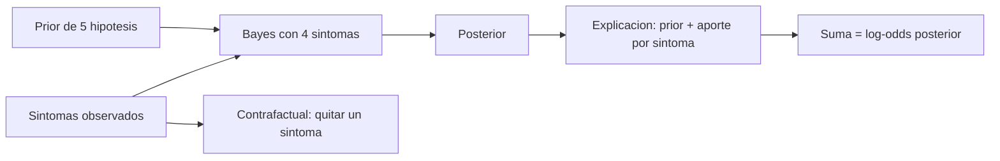

# B96-C21 — Diagnóstico explicable de anomalías

<!-- nav:top -->
[🏠 Programa](../../../../README.md) · [📚 Bloque B96](../../../tronco-comun/B96-control-y-operacion-de-misiones-espaciales.md) · [← Anterior: B96-C20 — Simulación de jornada de control de misión](../B96-C20-simulacion-de-jornada-de-control-de-mision/CLASE.md) · [Siguiente: B96-C22 — Transferencia de datos entre estación y centro de datos →](../B96-C22-transferencia-de-datos-entre-estacion-y-centro-de-datos/CLASE.md)
<!-- /nav -->

## 1. Ubicación, nivel y alcance

Clase 21 del bloque B96. Nivel N3. Un diagnóstico automático que no se puede justificar no se acepta en una sala de control. Aquí construyes un diagnóstico **bayesiano** con cinco hipótesis y cuatro síntomas **sintéticos** de un problema de energía, y descompones la conclusión en el **aporte de cada síntoma** (log-razón de verosimilitud), verificando que la suma reproduce el resultado. No se usa ninguna telemetría real. Todos los datos son **sintéticos** salvo los que se rotulan como consultados.

## 2. Por qué esta clase existe

C13 detecta que algo anda mal; esta clase responde por qué la máquina cree lo que cree. La decisión central: **¿qué hipótesis es la más probable y qué evidencia la sostiene, de modo que un operador pueda aceptarla o refutarla?**

## 3. Lo que podrás hacer al terminar

1. Calcular el posterior de cada hipótesis con el teorema de Bayes y síntomas independientes.
2. Descomponer el log-odds posterior en prior y aportes de cada síntoma.
3. Verificar que la suma de aportes reproduce el posterior.
4. Hacer un análisis contrafactual quitando el síntoma de mayor aporte.
5. Leer la incertidumbre con el segundo candidato.
6. Separar lo consultado de lo sintético.

La evidencia es la **informe de diagnóstico con explicación** del ejercicio 12 (sección 20).

## 4. Con qué llegas y cómo comprobarlo

1. ¿Qué es el teorema de Bayes?
2. ¿Qué es la razón de verosimilitud?
3. ¿Qué es un log-odds?
4. ¿Qué es la independencia condicional?
5. ¿Qué es un contrafactual?

<details>
<summary>Ver respuestas</summary>

1. `P(H|E) ∝ P(H) P(E|H)`. 2. El cociente de lo probable que es la evidencia bajo dos hipótesis. 3. El logaritmo del cociente de probabilidades; los efectos independientes se suman. 4. Los síntomas son independientes dado el estado real. 5. Qué conclusión se obtendría si una evidencia fuera distinta.
</details>

Con cuatro o cinco aciertos, sigue; si no, repasa los prerrequisitos.

## 5. Un caso de contexto y casos de referencia

Con el prior **sintético** (90 % nominal) y los síntomas observados «generación baja en luz» y «SOC baja de órbita en órbita» (los otros dos ausentes), el posterior es 0,8958 para «panel degradado», 0,0745 para «carga extra» y 0,0221 para «nominal». La explicación frente a nominal suma `−1,4771` (prior) `+1,6532 + 1,4771` (síntomas presentes) `− 0,0325 − 0,0135` (ausentes) `= +1,6072` log₁₀-odds. Sin el síntoma de generación baja, el diagnóstico pasa a «nominal» (0,5429).

## 6. Vocabulario

**Hipótesis:** posible causa. **Síntoma:** evidencia observable. **Prior:** probabilidad previa. **Posterior:** probabilidad tras la evidencia. **Aporte:** `log₁₀` de la razón de verosimilitud de un síntoma. **Explicabilidad:** capacidad de justificar una conclusión.

## 7. Modelo mental



*Descripción textual:* el prior y los síntomas dan el posterior; la explicación descompone el log-odds en el prior y el aporte de cada síntoma; la suma debe reproducir el resultado, y el contrafactual muestra qué evidencia sostiene la conclusión.

Analogía: es como un juez que enumera cada prueba y cuánto pesa; si se retira la prueba principal, la sentencia cambia. Límite: el modelo supone síntomas independientes, y en una nave suelen estar correlacionados.

## 8. La explicación, paso a paso

### 8.1 Qué dicen las fuentes

ECSS-E-ST-70-11C (S1) busca que las funciones de a bordo permitan operar la nave en contingencias predefinidas y ECSS-E-ST-70-31C (S2) fija los datos de vigilancia y control (parámetros, límites) que sirven de síntomas. Solo se leyeron los resúmenes; **ninguna** trata el diagnóstico bayesiano. El método es estándar y lo verifica el laboratorio; hipótesis, probabilidades y síntomas son **sintéticos**.

### 8.2 Posterior

`P(H|s) ∝ P(H) Π P(sⱼ|H)`, con `P(sⱼ|H)` si el síntoma está presente y `1 − P(sⱼ|H)` si está ausente.

| Hipótesis | Prior | Verosimilitud | Posterior |
|---|---|---|---|
| Nominal | 0,900 | 0,000380 | 0,02213 |
| Panel degradado | 0,030 | 0,461700 | 0,89583 |
| Batería degradada | 0,030 | 0,003563 | 0,00691 |
| Sensor de corriente sesgado | 0,020 | 0,000475 | 0,00061 |
| Carga extra no prevista | 0,020 | 0,057600 | 0,07451 |

### 8.3 Explicación

Frente a «nominal», `log₁₀(post_H/post_N) = log₁₀(prior_H/prior_N) + Σⱼ log₁₀(L_Hⱼ/L_Nⱼ)`:

| Término | Aporte |
|---|---|
| Prior | −1,4771 |
| Generación baja en luz (presente) | +1,6532 |
| Tensión cae en eclipse (ausente) | −0,0325 |
| SOC baja de órbita en órbita (presente) | +1,4771 |
| Corriente no cuadra (ausente) | −0,0135 |
| **Suma** | **+1,6072** |

La suma coincide con el log-odds posterior (+1,6072) a `10⁻¹²`.

### 8.4 Contrafactual e incertidumbre

Quitar el síntoma de mayor aporte (generación baja) cambia el diagnóstico a «nominal» (0,5429): la conclusión depende de esa evidencia. El segundo candidato (carga extra, 0,0745) es 12 veces menos probable: un operador debería comprobar primero el panel y descartar la carga extra con una medición.

## 9. Magnitudes, símbolos y unidades

| Símbolo | Qué es | Unidad | Valor / nota |
|---|---|---|---|
| `P(H)` | prior | — | 0,02 a 0,90 |
| `P(s|H)` | probabilidad del síntoma | — | 0,02 a 0,90 |
| `P(H|s)` | posterior | — | 0,0006 a 0,8958 |
| `aporte` | log₁₀ de la razón de verosimilitud | — | −1,48 a +1,65 |
| `N` | hipótesis | — | 5 |

## 10. Convenciones y referencias

Síntomas binarios e independientes dado el estado real; probabilidades fijas; logaritmo decimal. Todo **sintético**: hipótesis, síntomas y probabilidades son de ejemplo. Tolerancias: suma de aportes igual al log-odds posterior a `10⁻¹²`; posteriores suman 1 a `10⁻¹²`.

## 11. De dónde sale lo que afirmamos

| ID | Fuente | Localizador | Respalda | Estado |
|---|---|---|---|---|
| S1 | ECSS, «ECSS-E-ST-70-11C — Space segment operability», 31 jul 2008 (cancelada y reemplazada por la Rev.1 del 15 oct 2025) — https://ecss.nl/standard/ecss-e-st-70-11c-space-segment-operability/ (consultada 2026-11-10) | página de la norma (solo el resumen; no el texto de requisitos) | disposiciones de diseño de las funciones de a bordo de un segmento espacial no tripulado para que pueda operarse en vuelo en situaciones nominales o de contingencia predefinidas; excluye la operabilidad específica de cada misión | Consultada (solo la página) |
| S2 | ECSS, «ECSS-E-ST-70-31C — Ground systems and operations — Monitoring and control data definition», 31 jul 2008 — https://ecss.nl/standard/ecss-e-st-70-31c-ground-systems-and-operations-monitoring-and-control-data/ (consultada 2026-11-10) | página de la norma (solo el resumen) | especifica la información de vigilancia y control que un proveedor entrega con su producto para integrarlo, probarlo y operarlo; indica qué datos, no el formato de entrega | Consultada (solo la página) |
| — | Libros de texto de operaciones de misión, comunicaciones espaciales y mecánica orbital (p. ej., Wertz y Larson, Montenbruck y Gill, Vallado) | — | — | No consultada |
| — | Relaciones y algoritmos estándar usados por el laboratorio (teorema de Bayes y descomposición de log-odds) | — | los verifica el laboratorio con una segunda vía o con pruebas | No consultada en una fuente concreta |

Límites: las normas se leyeron solo en su resumen y no tratan el diagnóstico; la independencia entre síntomas es una simplificación fuerte. Lo simulado no se presenta como dato de vuelo ni como medición.

## 12. Cómo ver los resultados

| Hipótesis | Posterior |
|---|---|
| Panel degradado | 0,8958 |
| Carga extra | 0,0745 |
| Nominal | 0,0221 |
| Batería degradada | 0,0069 |
| Sensor sesgado | 0,0006 |

Descripción larga: un solo candidato concentra casi el 90 % de la probabilidad; el segundo es doce veces menos probable.

## 13. Ejemplo trabajado

**Paso 1 · Verosimilitud.** Panel: `0,90 × 0,90 × 0,60 × 0,95 = 0,4617`.

**Paso 2 · Posterior.** `0,03 × 0,4617/Z = 0,8958`.

**Paso 3 · Aportes.** `+1,6532` y `+1,4771` de los síntomas presentes.

**Paso 4 · Suma.** `−1,4771 + 1,6532 − 0,0325 + 1,4771 − 0,0135 = +1,6072`.

**Paso 5 · Contrafactual.** Sin generación baja: nominal.

## 14. Distintas formas de describir el problema

**Por probabilidad:** posterior (esta clase). **Por reglas:** árbol de decisión con trazas. **Por detección:** estadística de C13. **Por procedimiento:** recuperación de C14.

## 15. Práctica guiada

**Ejercicio 1 · con los pasos indicados.** Calcula la verosimilitud de «nominal» con los síntomas observados.

<details><summary>Solución comentada</summary>

`0,02 × 0,97 × 0,02 × 0,98 = 3,80×10⁻⁴`.
</details>

**Ejercicio 2 · con una pista.** ¿Cuánto es `log₁₀(0,03/0,90)`?

<details><summary>Solución comentada</summary>

`−1,4771`.
</details>

**Ejercicio 3 · casi autónomo.** ¿Qué significa un aporte positivo?

<details><summary>Solución comentada</summary>

El síntoma favorece la hipótesis frente a nominal.
</details>

## 16. Práctica autónoma, transferencia e integrador

**Ejercicio 4 · autónomo.** ¿Por qué los síntomas ausentes aportan algo?

<details><summary>Solución comentada</summary>

Porque la ausencia también es evidencia: `1 − P(s|H)` frente a `1 − P(s|Nominal)`.
</details>

**Ejercicio 5 · autónomo.** ¿Qué pasa con el posterior si el prior de panel degradado sube a 0,10?

<details><summary>Solución comentada</summary>

Aumenta: el posterior es proporcional al prior.
</details>

**Ejercicio 6 · autónomo.** Calcula la razón entre el primer y el segundo candidato.

<details><summary>Solución comentada</summary>

`0,8958/0,0745 = 12,0`.
</details>

**Ejercicio 7 · autónomo.** ¿Qué mide la razón entre candidatos?

<details><summary>Solución comentada</summary>

Cuánta ventaja tiene el diagnóstico principal sobre el siguiente.
</details>

**Ejercicio 8 · autónomo.** Si un síntoma tiene `P(s|H) = P(s|Nominal)`, ¿cuál es su aporte?

<details><summary>Solución comentada</summary>

Cero: no discrimina.
</details>

**Ejercicio 9 · transferencia.** **Transferencia.** Un colega presenta el diagnóstico sin la explicación. ¿Qué respondes?

<details><summary>Solución comentada</summary>

Debe mostrar el aporte de cada síntoma para que el operador pueda aceptarlo o refutarlo.
</details>

**Ejercicio 10 · transferencia.** **Transferencia.** ¿Qué efecto tendría que dos síntomas estén correlacionados?

<details><summary>Solución comentada</summary>

El modelo cuenta dos veces la misma evidencia y sobreestima el posterior.
</details>

**Ejercicio 11 · transferencia.** **Transferencia.** ¿Qué medición añadirías para distinguir panel de carga extra?

<details><summary>Solución comentada</summary>

La corriente de los paneles en luz con carga conocida.
</details>

**Ejercicio 12 · integrador.** **Integrador.** Elabora tu *informe de diagnóstico con explicación*: posterior, descomposición por síntoma, contrafactual, segundo candidato y lista de lo consultado, sintético y no consultado.

<details><summary>Solución comentada</summary>

Secciones 8.2–8.4 y la salida del laboratorio.
</details>

## 17. Laboratorio: posterior y explicación por síntoma

El script [diagnostico_explicable.py](diagnostico_explicable.py) calcula el posterior de cinco hipótesis, descompone el log-odds en prior y aportes de cada síntoma, verifica que la suma lo reproduce, ejecuta un contrafactual y mide la razón entre candidatos; **comprueba** la suma de aportes y la normalización.

**Datos:** hipótesis, síntomas y probabilidades **sintéticos**. **Predice antes de ejecutar:** ¿qué hipótesis gana? (panel degradado, 0,8958). **Ejecución del 2026-11-10 (Python 3.12.9):**

```text
Python 3.12.9
Datos SINTETICOS: hipotesis, sintomas y probabilidades ficticios
Observado: {'Generacion baja en luz': True, 'Tension de bateria cae en eclipse': False, 'SOC baja de orbita en orbita': True, 'Corriente medida no cuadra con la suma de cargas': False}
Hipotesis                      prior   verosimilitud  posterior
Nominal                         0.900       0.000380    0.02213
Panel degradado                 0.030       0.461700    0.89583
Bateria degradada               0.030       0.003563    0.00691
Sensor de corriente sesgado     0.020       0.000475    0.00061
Carga extra no prevista         0.020       0.057600    0.07451
Diagnostico = Panel degradado (posterior 0.8958)
Explicacion de 'Panel degradado' frente a 'Nominal' (log10 de razon de verosimilitud por sintoma):
  prior log10-odds = -1.4771
  Generacion baja en luz                             presente=1  aporte = +1.6532
  Tension de bateria cae en eclipse                  presente=0  aporte = -0.0325
  SOC baja de orbita en orbita                       presente=1  aporte = +1.4771
  Corriente medida no cuadra con la suma de cargas   presente=0  aporte = -0.0135
  suma = +1.6072 ; log10-odds posterior = +1.6072
Sin el sintoma 'Generacion baja en luz': diagnostico = Nominal (posterior 0.5429)
Segundo candidato = Carga extra no prevista (0.0745) ; razon = 12.0
Pruebas superadas.
```

```bash
python programa/clases/B96/B96-C21-diagnostico-explicable-de-anomalias/diagnostico_explicable.py
```

**Límites:** síntomas independientes, probabilidades fijas y un solo conjunto de observaciones.

## 18. Errores frecuentes y cómo corregirlos

**Dar el diagnóstico sin explicación.** Muestra el aporte de cada síntoma (8.3)

**Ignorar la evidencia ausente.** Incluye `1 − P` (8.2)

**Suponer independencia sin discutirla.** Revisa el ejercicio 10

## 19. Cómo sabrás que vas bien

Tras 8.3: ¿qué síntoma pesa más? Si dudas, repasa el ejercicio 3. Tras el laboratorio: ¿qué comprueba la suma de aportes? (ver sección 17).

## 20. Qué entregas y cómo se evalúa

El producto es tu **informe de diagnóstico con explicación** (ejercicio 12).

| Criterio | Inicial | En desarrollo | Logrado | Destacado |
|---|---|---|---|---|
| Conceptos | Los confunde | Parciales | Explica el método y su dominio | Explica los límites y las alternativas |
| Cálculo | Sin unidades | Con errores | Resultados con unidades y comprobados | Resuelve casos nuevos |
| Numérico | Sin comprobar | Un caso | Verifica con una segunda vía en varios casos | Interpreta las diferencias y los fallos |
| Fuentes | Sin fuente | Sin fecha | Fuentes con fecha y estado | Declara lo sintético y lo no consultado |
| Límites | No los nombra | Uno | Tres | Discute qué falta del modelo |

**Condiciones críticas (no se compensan con promedio):** rotular los datos como sintéticos; comprobar cada resultado con una segunda vía; citar solo lo consultado.

## 21. Ética, seguridad y límites

Clase educativa: los modelos son simplificados y los datos son sintéticos; ningún resultado describe una misión real, certifica conformidad con una norma ni sustituye la revisión de especialistas.  Accesibilidad: tablas equivalentes a las gráficas, fórmulas en texto, ejercicios sin conexión.

## 22. Para cerrar y seguir

El diagnóstico sintético asigna 0,8958 a «panel degradado», y la descomposición muestra que la generación baja y la caída del SOC suman +3,13 log₁₀ a su favor; sin la primera, el diagnóstico cambia. Queda una pregunta: ¿cómo llegan los datos de la estación al centro de procesamiento?

**Glosario español–inglés.** diagnóstico · *diagnosis*; probabilidad a posteriori · *posterior probability*; razón de verosimilitud · *likelihood ratio*; explicabilidad · *explainability*; contrafactual · *counterfactual*.

**Continuidad.** [B96-C22](../B96-C22-transferencia-de-datos-entre-estacion-y-centro-de-datos/CLASE.md) trata la transferencia de datos entre estación y centro de datos.

**Referencias:** ver sección 11.

<!-- nav:bottom -->
---

[← Anterior: B96-C20 — Simulación de jornada de control de misión](../B96-C20-simulacion-de-jornada-de-control-de-mision/CLASE.md) · [📚 Bloque B96](../../../tronco-comun/B96-control-y-operacion-de-misiones-espaciales.md) · [Siguiente: B96-C22 — Transferencia de datos entre estación y centro de datos →](../B96-C22-transferencia-de-datos-entre-estacion-y-centro-de-datos/CLASE.md)
<!-- /nav -->
