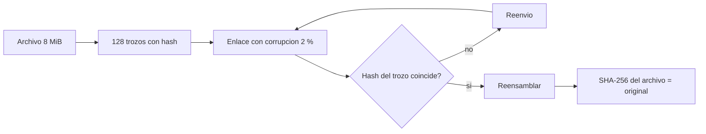

# B96-C22 — Transferencia de datos entre estación y centro de datos

<!-- nav:top -->
[🏠 Programa](../../../../README.md) · [📚 Bloque B96](../../../tronco-comun/B96-control-y-operacion-de-misiones-espaciales.md) · [← Anterior: B96-C21 — Diagnóstico explicable de anomalías](../B96-C21-diagnostico-explicable-de-anomalias/CLASE.md) · [Siguiente: B96-C23 — Continuidad y redundancia de las operaciones terrestres →](../B96-C23-continuidad-y-redundancia-de-las-operaciones-terrestres/CLASE.md)
<!-- /nav -->

## 1. Ubicación, nivel y alcance

Clase 22 del bloque B96. Nivel N3. Los datos recibidos en la estación deben llegar al **centro de procesamiento** íntegros y a tiempo. Aquí transfieres por trozos un archivo **sintético** de 8 MiB con corrupción aleatoria, detectas los trozos dañados con **SHA-256** y confirmas que el archivo reconstruido coincide con el original; luego calculas el plazo esperado de un volumen grande con pérdidas y lo verificas por Monte Carlo. El enlace y los volúmenes son ficticios. Todos los datos son **sintéticos** salvo los que se rotulan como consultados.

## 2. Por qué esta clase existe

Un dato dañado que se acepta sin verificar contamina los productos científicos; y una transferencia lenta rompe el plazo de entrega. La decisión central: **¿cómo se comprueba la integridad y cuánto tarda la transferencia con reintentos?**

## 3. Lo que podrás hacer al terminar

1. Dividir un archivo en trozos y calcular el hash de cada uno.
2. Detectar trozos corrompidos y reenviarlos.
3. Verificar la integridad de extremo a extremo con el hash del archivo.
4. Mostrar el fallo que ocurre sin verificación.
5. Calcular el tiempo esperado de transferencia con pérdidas y verificarlo por Monte Carlo.
6. Separar lo consultado de lo sintético.

La evidencia es la **plan de transferencia con plazo y verificación** del ejercicio 12 (sección 20).

## 4. Con qué llegas y cómo comprobarlo

1. ¿Qué es una función hash?
2. ¿Qué es SHA-256?
3. ¿Qué es un trozo?
4. ¿Qué es el tiempo esperado con reintentos?
5. ¿Qué es la integridad de extremo a extremo?

<details>
<summary>Ver respuestas</summary>

1. Una función que da una huella de tamaño fijo de unos datos; un cambio de un bit cambia la huella. 2. Una función hash de 256 bits. 3. Una parte del archivo transferida como unidad. 4. `n t/(1 − p)` para pérdida `p` por intento. 5. Que lo recibido es idéntico a lo enviado.
</details>

Con cuatro o cinco aciertos, sigue; si no, repasa los prerrequisitos.

## 5. Un caso de contexto y casos de referencia

Un archivo **sintético** de 8 MiB se divide en 128 trozos de 64 KiB; con 2 % de corrupción por intento se detectan y reenvían 3 trozos; el SHA-256 final coincide con el del original. Sin verificación quedó 1 trozo corrupto y el hash final no coincide. Para 20 GB a 90 Mbit/s útiles, en trozos de 4 MiB (4 768 trozos de 0,373 s), la transferencia dura 0,494 h sin pérdidas y 0,520 h con 5 % de reintentos, bien dentro de un plazo ficticio de 6,5 h.

## 6. Vocabulario

**Hash:** huella de datos. **SHA-256:** hash de 256 bits. **Trozo:** unidad de transferencia. **Reenvío:** nuevo intento de un trozo dañado. **Integridad:** igualdad entre lo enviado y lo recibido. **Plazo:** tiempo límite de entrega.

## 7. Modelo mental



*Descripción textual:* cada trozo viaja con su hash; si la verificación falla se reenvía; con todos los trozos válidos se reensambla y se compara el hash del archivo con el original.

Analogía: es como mandar una colección de piezas numeradas con su sello: si un sello no coincide se pide de nuevo, y al final se verifica el conjunto. Límite: el sello detecta daños accidentales, no una manipulación deliberada si el hash viaja junto con el dato.

## 8. La explicación, paso a paso

### 8.1 Qué dicen las fuentes

El capítulo de la NASA sobre sistemas terrestres (S1) describe que el MOC y el SOC se conectan con las estaciones y que la NSN maneja unos 30 TB de datos al día (según el capítulo, parte leída). ECSS-E-ST-70-41C (S2) define el uso de paquetes de telemetría y telecomando. Ninguna trata el protocolo de transferencia; SHA-256 y la fórmula de reintentos son estándar y los verifica el laboratorio. Los volúmenes y el enlace son **sintéticos**.

### 8.2 Integridad

Cada trozo se acompaña de `SHA-256(trozo)`. Se simula una corrupción de un bit con probabilidad 2 % por intento: 3 trozos de 128 se detectan y se reenvían. El hash del archivo reconstruido coincide con el del original. Sin hash por trozo, 1 trozo quedó dañado y el hash final difiere.

### 8.3 Plazo

Para `V = 20 GB`, `B = 90 Mbit/s` útiles y trozos de 4 MiB: `n = 4 768`, `t = 0,373 s`. Con pérdida `p` por trozo, el tiempo esperado es `n t/(1 − p)`:

| `p` | Tiempo esperado (h) |
|---|---|
| 0 | 0,494 |
| 0,01 | 0,499 |
| 0,05 | 0,520 |

### 8.4 Verificación estadística

En un Monte Carlo de 4 000 repeticiones de 200 trozos con `p = 5 %`, la media de intentos es 210,54 frente a 210,53 esperados `(200/0,95)`. El plazo de 6,5 h se cumple con amplio margen (0,52 h).

## 9. Magnitudes, símbolos y unidades

| Símbolo | Qué es | Unidad | Valor / nota |
|---|---|---|---|
| `n` | trozos | — | 128 y 4 768 |
| `p` | probabilidad de corrupción o pérdida | — | 0,02; 0,05 |
| `B` | caudal útil | Mbit/s | 90 (sintético) |
| `V` | volumen | GB | 20 (sintético) |
| `t` | tiempo esperado | h | 0,494 a 0,520 |

## 10. Convenciones y referencias

MiB = 1 048 576 bytes; GB = 10⁹ bytes; SHA-256 de Python (`hashlib`); datos pseudoaleatorios con semilla 96; corrupción de un bit por intento. Todo **sintético**. Tolerancias: hash final igual al original tras verificación (exacto); media de intentos simulada frente a esperada `< 0,5`.

## 11. De dónde sale lo que afirmamos

| ID | Fuente | Localizador | Respalda | Estado |
|---|---|---|---|---|
| S1 | NASA, «Ground Data Systems and Mission Operations», en State-of-the-Art of Small Spacecraft Technology — https://www.nasa.gov/smallsat-institute/sst-soa/ground-data-systems-and-mission-operations/ (consultada 2026-11-10; leídos los primeros 100 000 caracteres de 215 453) | capítulo (parte inicial) | un centro de operaciones de misión (MOC) comanda la nave y un centro de operaciones científicas (SOC) genera productos; enlaces directos a la Tierra frente a relevos; bandas UHF, S, X y Ka; la licencia tarda meses; las antenas suelen adquirir el satélite con 5–10° de elevación; margen típico de 3 dB para retorno de datos en LEO a 1 500 km de distancia oblicua | Consultada (parte del capítulo) |
| S2 | ECSS, «ECSS-E-ST-70-41C — Telemetry and telecommand packet utilization», 15 abr 2016 — https://ecss.nl/standard/ecss-e-st-70-41c-space-engineering-telemetry-and-telecommand-packet-utilization-15-april-2016/ (consultada 2026-11-10) | página de la norma (solo el resumen) | cómo se usan los paquetes de telecomando y telemetría para vigilar y controlar subsistemas y cargas útiles; servicios opcionales adaptables por misión; excluye paquetes de datos de carga útil propios de cada misión, audio y vídeo | Consultada (solo la página) |
| — | Libros de texto de operaciones de misión, comunicaciones espaciales y mecánica orbital (p. ej., Wertz y Larson, Montenbruck y Gill, Vallado) | — | — | No consultada |
| — | Relaciones y algoritmos estándar usados por el laboratorio (hash criptográfico por trozos y esperanza geométrica de intentos) | — | los verifica el laboratorio con una segunda vía o con pruebas | No consultada en una fuente concreta |

Límites: el capítulo se leyó solo en parte y la norma solo en su resumen; no hay latencia de red, ventanas de retransmisión ni ataque deliberado (el hash no autentica). Lo simulado no se presenta como dato de vuelo ni como medición.

## 12. Cómo ver los resultados

| Prueba | Resultado |
|---|---|
| Con hash por trozo | 3 reenvíos; archivo íntegro |
| Sin hash por trozo | 1 trozo dañado; hash distinto |
| 20 GB, `p = 5 %` | 0,520 h |
| Monte Carlo (200 trozos) | 210,54 vs 210,53 intentos |

Descripción larga: la verificación por trozo convierte un daño silencioso en un reenvío; el costo en tiempo de las pérdidas es pequeño frente al plazo.

## 13. Ejemplo trabajado

**Paso 1 · Trozos.** `8 MiB/64 KiB = 128`.

**Paso 2 · Daños.** 3 detectados por hash.

**Paso 3 · Reconstrucción.** SHA-256 final = original.

**Paso 4 · Plazo.** `4 768 × 0,373/0,95 = 0,52 h`.

**Paso 5 · Monte Carlo.** `200/0,95 = 210,53`.

## 14. Distintas formas de describir el problema

**Por trozos:** hash por trozo (esta clase). **Por archivo:** hash de extremo a extremo. **Por plazo:** tiempo esperado. **Por registro:** bitácora de la transferencia (C30).

## 15. Práctica guiada

**Ejercicio 1 · con los pasos indicados.** ¿Cuántos trozos de 64 KiB tiene 8 MiB?

<details><summary>Solución comentada</summary>

`128`.
</details>

**Ejercicio 2 · con una pista.** Calcula `t` para un trozo de 4 MiB a 90 Mbit/s.

<details><summary>Solución comentada</summary>

`4 194 304 × 8/90×10⁶ = 0,373 s`.
</details>

**Ejercicio 3 · casi autónomo.** Calcula el tiempo para 1 000 trozos con `p = 2 %`.

<details><summary>Solución comentada</summary>

`1 000 × 0,373/0,98 = 380,6 s`.
</details>

## 16. Práctica autónoma, transferencia e integrador

**Ejercicio 4 · autónomo.** ¿Qué pasa con un bit cambiado en un trozo?

<details><summary>Solución comentada</summary>

Su SHA-256 cambia por completo y el trozo se rechaza.
</details>

**Ejercicio 5 · autónomo.** ¿Cuántos intentos se esperan por trozo con `p = 5 %`?

<details><summary>Solución comentada</summary>

`1/0,95 = 1,053`.
</details>

**Ejercicio 6 · autónomo.** ¿Por qué se verifica también el hash del archivo?

<details><summary>Solución comentada</summary>

Para detectar errores de reensamblado o trozos faltantes aunque cada uno sea válido.
</details>

**Ejercicio 7 · autónomo.** ¿Qué no protege un hash que viaja junto al dato?

<details><summary>Solución comentada</summary>

Una manipulación deliberada: el atacante puede recalcular el hash; hace falta un hash anclado o una firma.
</details>

**Ejercicio 8 · autónomo.** Si el plazo fuera 0,5 h y `p = 5 %`, ¿cumple?

<details><summary>Solución comentada</summary>

0,520 > 0,5: no cumple; hay que subir el caudal o dividir el volumen.
</details>

**Ejercicio 9 · transferencia.** **Transferencia.** Un colega transfiere sin hash porque 'el enlace tiene CRC'. ¿Qué respondes?

<details><summary>Solución comentada</summary>

Un CRC de enlace no cubre errores de almacenamiento ni de reensamblado; se necesita verificación de extremo a extremo.
</details>

**Ejercicio 10 · transferencia.** **Transferencia.** ¿Qué efecto tiene una pérdida en ráfaga sobre el tiempo esperado?

<details><summary>Solución comentada</summary>

Aumenta la varianza y puede subir la media con reintentos agrupados.
</details>

**Ejercicio 11 · transferencia.** **Transferencia.** ¿Qué falta para un transporte real?

<details><summary>Solución comentada</summary>

Latencia, ventanas, control de congestión, autenticación y registro.
</details>

**Ejercicio 12 · integrador.** **Integrador.** Elabora tu *plan de transferencia con plazo y verificación*: trozos y hashes, reenvíos, hash final, plazo esperado y lista de lo consultado, sintético y no consultado.

<details><summary>Solución comentada</summary>

Secciones 8.2–8.4 y la salida del laboratorio.
</details>

## 17. Laboratorio: transferencia por trozos con hash

El script [transferencia_verificada.py](transferencia_verificada.py) genera un archivo de 8 MiB, lo transfiere por trozos con corrupción aleatoria y reenvío por hash, muestra el fallo sin verificación, calcula el plazo esperado y lo verifica por Monte Carlo; **comprueba** el hash final y la media de intentos.

**Datos:** archivo, enlace y volumen **sintéticos**; semilla 96. **Predice antes de ejecutar:** ¿coincide el hash final con el original? (sí, con verificación por trozo). **Ejecución del 2026-11-10 (Python 3.12.9):**

```text
Python 3.12.9
Datos SINTETICOS: archivo de 8 MiB pseudoaleatorio, enlace ficticio; semilla 96
Archivo = 8388608 B ; trozos = 128 de 65536 B ; SHA-256 = e6e73aa3ba06a00b...
Reenvios por hash de trozo = 3 ; trozos corruptos detectados = 3
SHA-256 del archivo reconstruido = e6e73aa3ba06a00b... ; coincide: True
Sin verificacion: trozos corruptos = 1 ; hash final coincide: False
p = 0.00: tiempo esperado = 0.494 h ; (4768 trozos de 0.373 s)
p = 0.01: tiempo esperado = 0.499 h ; (4768 trozos de 0.373 s)
p = 0.05: tiempo esperado = 0.520 h ; (4768 trozos de 0.373 s)
Intentos para 200 trozos con p = 5 %: media simulada = 210.54 ; esperada = 210.53
Plazo = 6.5 h ; transferencia con p = 5 % = 0.52 h ; cumple: True
Pruebas superadas.
```

```bash
python programa/clases/B96/B96-C22-transferencia-de-datos-entre-estacion-y-centro-de-datos/transferencia_verificada.py
```

**Límites:** un bit corrupto por trozo y por intento, sin latencia ni ráfagas, sin autenticación.

## 18. Errores frecuentes y cómo corregirlos

**Confiar solo en el CRC del enlace.** Verifica de extremo a extremo (8.2)

**Ignorar el plazo.** Calcula el tiempo esperado (8.3)

**Creer que el hash autentica.** Anota su límite (sección 10)

## 19. Cómo sabrás que vas bien

Tras 8.3: ¿cuánto tarda con `p = 5 %`? Si dudas, repasa el ejercicio 3. Tras el laboratorio: ¿qué comprueba el hash final? (ver sección 17).

## 20. Qué entregas y cómo se evalúa

El producto es tu **plan de transferencia con plazo y verificación** (ejercicio 12).

| Criterio | Inicial | En desarrollo | Logrado | Destacado |
|---|---|---|---|---|
| Conceptos | Los confunde | Parciales | Explica el método y su dominio | Explica los límites y las alternativas |
| Cálculo | Sin unidades | Con errores | Resultados con unidades y comprobados | Resuelve casos nuevos |
| Numérico | Sin comprobar | Un caso | Verifica con una segunda vía en varios casos | Interpreta las diferencias y los fallos |
| Fuentes | Sin fuente | Sin fecha | Fuentes con fecha y estado | Declara lo sintético y lo no consultado |
| Límites | No los nombra | Uno | Tres | Discute qué falta del modelo |

**Condiciones críticas (no se compensan con promedio):** rotular los datos como sintéticos; comprobar cada resultado con una segunda vía; citar solo lo consultado.

## 21. Ética, seguridad y límites

Clase educativa: los modelos son simplificados y los datos son sintéticos; ningún resultado describe una misión real, certifica conformidad con una norma ni sustituye la revisión de especialistas.  Accesibilidad: tablas equivalentes a las gráficas, fórmulas en texto, ejercicios sin conexión.

## 22. Para cerrar y seguir

La verificación por hash convierte 3 trozos dañados en 3 reenvíos y deja el archivo íntegro; para 20 GB sintéticos con 5 % de pérdida el plazo esperado es 0,52 h. Queda una pregunta: ¿qué pasa si la estación misma deja de estar disponible?

**Glosario español–inglés.** hash · *hash*; integridad · *integrity*; trozo · *chunk*; reenvío · *retransmission*; plazo · *deadline*.

**Continuidad.** [B96-C23](../B96-C23-continuidad-y-redundancia-de-las-operaciones-terrestres/CLASE.md) trata la continuidad y la redundancia de las operaciones terrestres.

**Referencias:** ver sección 11.

<!-- nav:bottom -->
---

[← Anterior: B96-C21 — Diagnóstico explicable de anomalías](../B96-C21-diagnostico-explicable-de-anomalias/CLASE.md) · [📚 Bloque B96](../../../tronco-comun/B96-control-y-operacion-de-misiones-espaciales.md) · [Siguiente: B96-C23 — Continuidad y redundancia de las operaciones terrestres →](../B96-C23-continuidad-y-redundancia-de-las-operaciones-terrestres/CLASE.md)
<!-- /nav -->
