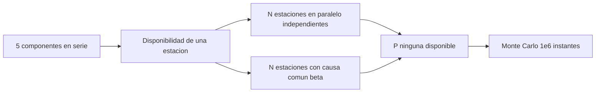

# B96-C23 — Continuidad y redundancia de las operaciones terrestres

<!-- nav:top -->
[🏠 Programa](../../../../README.md) · [📚 Bloque B96](../../../tronco-comun/B96-control-y-operacion-de-misiones-espaciales.md) · [← Anterior: B96-C22 — Transferencia de datos entre estación y centro de datos](../B96-C22-transferencia-de-datos-entre-estacion-y-centro-de-datos/CLASE.md) · [Siguiente: B96-C24 — Operación remota y automatizada de estaciones →](../B96-C24-operacion-remota-y-automatizada-de-estaciones/CLASE.md)
<!-- /nav -->

## 1. Ubicación, nivel y alcance

Clase 23 del bloque B96. Nivel N3. Una estación que falla en un contacto irrepetible hace perder datos o una maniobra. Aquí calculas la **disponibilidad** de una estación con cinco componentes en serie (**MTBF**, **MTTR**), la de varias estaciones independientes en paralelo, el efecto de una fracción de **causa común** y lo verificas con un Monte Carlo de un millón de instantes. Todas las tasas son **sintéticas**. Todos los datos son **sintéticos** salvo los que se rotulan como consultados.

## 2. Por qué esta clase existe

Redundancia no es solo tener más estaciones: si comparten la causa de falla (red, energía, software) el beneficio desaparece. La decisión central: **¿cuántas estaciones y qué independencia hacen falta para que la probabilidad de perder un contacto sea aceptable?**

## 3. Lo que podrás hacer al terminar

1. Calcular la disponibilidad `A = MTBF/(MTBF + MTTR)` de un componente.
2. Combinar componentes en serie y estaciones en paralelo.
3. Incluir una fracción de causa común.
4. Verificar el cálculo con un Monte Carlo y su tolerancia estadística.
5. Interpretar horas de indisponibilidad al año.
6. Separar lo consultado de lo sintético.

La evidencia es la **cálculo de continuidad con verificación** del ejercicio 12 (sección 20).

## 4. Con qué llegas y cómo comprobarlo

1. ¿Qué es el MTBF?
2. ¿Qué es el MTTR?
3. ¿Cómo se combinan disponibilidades en serie?
4. ¿Cómo se combinan en paralelo independiente?
5. ¿Qué es una causa común?

<details>
<summary>Ver respuestas</summary>

1. El tiempo medio entre fallas. 2. El tiempo medio de reparación. 3. Se multiplican. 4. `1 − Π(1 − Aᵢ)`. 5. Una falla que afecta a varias unidades a la vez.
</details>

Con cuatro o cinco aciertos, sigue; si no, repasa los prerrequisitos.

## 5. Un caso de contexto y casos de referencia

Una estación **sintética** tiene cinco componentes en serie (antena y rotor, cadena RF, banda base, red y energía, software) y disponibilidad `A = 0,989806` (89,3 h/año indisponible). Con 2 estaciones independientes, la probabilidad de que ninguna esté disponible es 1,039×10⁻⁴; con 3, 1,059×10⁻⁶. Con 10 % de causa común, bajan a solo 1,104×10⁻³ y 1,020×10⁻³: la tercera estación casi no ayuda.

## 6. Vocabulario

**MTBF/MTTR:** tiempo medio entre fallas y de reparación. **Disponibilidad:** fracción del tiempo en servicio. **Serie:** todos los componentes deben funcionar. **Paralelo:** basta uno. **Causa común (β):** fracción de la indisponibilidad que afecta a todas las unidades.

## 7. Modelo mental



*Descripción textual:* los componentes en serie dan la disponibilidad de una estación; varias estaciones en paralelo reducen la probabilidad de que ninguna esté disponible; la causa común limita esa reducción; un Monte Carlo lo verifica.

Analogía: tener varias estaciones sin independencia es como tener varias llaves pero una sola puerta: si falla la puerta, ninguna llave sirve. Límite: aquí la causa común es un único parámetro; en realidad hay varias.

## 8. La explicación, paso a paso

### 8.1 Qué dicen las fuentes

El capítulo de la NASA sobre sistemas terrestres (S1) describe redes de estaciones (NSN, DSN y proveedores comerciales) que dan alternativas de contacto. Solo se leyó la parte inicial; no da MTBF ni MTTR. Las relaciones de disponibilidad son estándar y las verifica el laboratorio; las cifras son **sintéticas**.

### 8.2 Una estación

| Componente | MTBF (h) | MTTR (h) | `A` |
|---|---|---|---|
| Antena y rotor | 4 000 | 24 | 0,994036 |
| Cadena RF | 8 000 | 8 | 0,999001 |
| Banda base | 10 000 | 6 | 0,999400 |
| Red y energía | 2 000 | 4 | 0,998004 |
| Software de control | 1 500 | 1 | 0,999334 |

Serie: `A = Π Aᵢ = 0,989806`; indisponible `(1 − A) × 8 760 = 89,3 h/año`.

### 8.3 Varias estaciones

Independientes: `P(ninguna) = (1 − A)ᴺ`: 1,019×10⁻² (N = 1), 1,039×10⁻⁴ (2), 1,059×10⁻⁶ (3). Con causa común `β = 0,10`: `P = β(1 − A) + ((1 − β)(1 − A))ᴺ`: 1,104×10⁻³ (2) y 1,020×10⁻³ (3). El término `β(1 − A)` domina y la tercera estación no mejora.

### 8.4 Verificación

El Monte Carlo de 10⁶ instantes con N = 2 da 95 pérdidas frente a 103,9 esperadas; con causa común, 1 046 frente a 1 103,5. Ambas dentro de 4σ de la teoría.

## 9. Magnitudes, símbolos y unidades

| Símbolo | Qué es | Unidad | Valor / nota |
|---|---|---|---|
| `A` | disponibilidad | — | 0,989806 |
| `MTBF, MTTR` | tiempos medios | h | ver tabla |
| `N` | estaciones | — | 1 a 3 |
| `β` | fracción de causa común | — | 0,10 |
| `P` | probabilidad de ninguna disponible | — | 10⁻⁶ a 10⁻² |

## 10. Convenciones y referencias

Tiempos en horas, año de 8 760 h; fallas independientes salvo la causa común; disponibilidad estacionaria. Todo **sintético**. Semilla 96, 10⁶ instantes. Tolerancias: pérdidas simuladas dentro de `4√esperadas + 1`; `A ≤ Aᵢ` para cada componente.

## 11. De dónde sale lo que afirmamos

| ID | Fuente | Localizador | Respalda | Estado |
|---|---|---|---|---|
| S1 | NASA, «Ground Data Systems and Mission Operations», en State-of-the-Art of Small Spacecraft Technology — https://www.nasa.gov/smallsat-institute/sst-soa/ground-data-systems-and-mission-operations/ (consultada 2026-11-10; leídos los primeros 100 000 caracteres de 215 453) | capítulo (parte inicial) | un centro de operaciones de misión (MOC) comanda la nave y un centro de operaciones científicas (SOC) genera productos; enlaces directos a la Tierra frente a relevos; bandas UHF, S, X y Ka; la licencia tarda meses; las antenas suelen adquirir el satélite con 5–10° de elevación; margen típico de 3 dB para retorno de datos en LEO a 1 500 km de distancia oblicua | Consultada (parte del capítulo) |
| — | Libros de texto de operaciones de misión, comunicaciones espaciales y mecánica orbital (p. ej., Wertz y Larson, Montenbruck y Gill, Vallado) | — | — | No consultada |
| — | Relaciones y algoritmos estándar usados por el laboratorio (disponibilidad de serie y paralelo con causa común y Monte Carlo) | — | los verifica el laboratorio con una segunda vía o con pruebas | No consultada en una fuente concreta |

Límites: el capítulo se leyó solo en parte; sin datos reales de fallas; la causa común es un único factor `β` y la reparación es instantánea en el cambio a otra estación. Lo simulado no se presenta como dato de vuelo ni como medición.

## 12. Cómo ver los resultados

| Estaciones | Independientes | Con β = 0,10 |
|---|---|---|
| 1 | 1,019×10⁻² | — |
| 2 | 1,039×10⁻⁴ | 1,104×10⁻³ |
| 3 | 1,059×10⁻⁶ | 1,020×10⁻³ |

Descripción larga: sin causa común, cada estación adicional reduce la probabilidad de pérdida cien veces; con 10 % de causa común la mejora se estanca cerca de 10⁻³.

## 13. Ejemplo trabajado

**Paso 1 · Componente.** `4 000/4 024 = 0,994036`.

**Paso 2 · Estación.** Producto: `0,989806`.

**Paso 3 · Dos estaciones.** `(0,010194)² = 1,039×10⁻⁴`.

**Paso 4 · Causa común.** `0,1 × 0,010194 + (0,9 × 0,010194)² = 1,104×10⁻³`.

**Paso 5 · Monte Carlo.** 95 frente a 103,9 esperadas.

## 14. Distintas formas de describir el problema

**Por fórmula:** serie, paralelo y causa común (esta clase). **Por simulación:** Monte Carlo. **Por plan:** estaciones de respaldo (C17). **Por incidente:** respuesta a la falla (C26).

## 15. Práctica guiada

**Ejercicio 1 · con los pasos indicados.** Calcula `A` con MTBF = 2 000 h y MTTR = 4 h.

<details><summary>Solución comentada</summary>

`2 000/2 004 = 0,998004`.
</details>

**Ejercicio 2 · con una pista.** Calcula la disponibilidad en serie de dos componentes de 0,99.

<details><summary>Solución comentada</summary>

`0,9801`.
</details>

**Ejercicio 3 · casi autónomo.** Calcula la indisponibilidad anual con `A = 0,99`.

<details><summary>Solución comentada</summary>

`0,01 × 8 760 = 87,6 h`.
</details>

## 16. Práctica autónoma, transferencia e integrador

**Ejercicio 4 · autónomo.** Calcula `P(ninguna)` con 2 estaciones de `A = 0,99`.

<details><summary>Solución comentada</summary>

`0,01² = 10⁻⁴`.
</details>

**Ejercicio 5 · autónomo.** Con β = 0,2 y `1 − A = 0,01`, calcula `P(ninguna)` con 2 estaciones.

<details><summary>Solución comentada</summary>

`0,2 × 0,01 + (0,008)² = 2,064×10⁻³`.
</details>

**Ejercicio 6 · autónomo.** ¿Qué componente limita más la disponibilidad de la estación?

<details><summary>Solución comentada</summary>

La antena y rotor (0,994036): el de menor `A`.
</details>

**Ejercicio 7 · autónomo.** Si el MTTR de la antena baja de 24 a 12 h, ¿cuál es su `A`?

<details><summary>Solución comentada</summary>

`4 000/4 012 = 0,997009`.
</details>

**Ejercicio 8 · autónomo.** ¿Por qué 3 estaciones no mejoran con β = 0,10?

<details><summary>Solución comentada</summary>

El término de causa común `β(1 − A)` domina y no depende de N.
</details>

**Ejercicio 9 · transferencia.** **Transferencia.** Un colega afirma que dos estaciones dan 10⁻⁴ siempre. ¿Qué respondes?

<details><summary>Solución comentada</summary>

Solo si las fallas son independientes; con causa común la probabilidad es diez veces mayor.
</details>

**Ejercicio 10 · transferencia.** **Transferencia.** ¿Cómo reducirías la causa común?

<details><summary>Solución comentada</summary>

Con diversidad: proveedores de red, energía y software distintos, y estaciones en regiones distintas.
</details>

**Ejercicio 11 · transferencia.** **Transferencia.** ¿Qué no modela este cálculo?

<details><summary>Solución comentada</summary>

Fallas parciales, tiempos de conmutación, mantenimiento programado y la visibilidad real de cada estación.
</details>

**Ejercicio 12 · integrador.** **Integrador.** Elabora tu *cálculo de continuidad con verificación*: componentes, disponibilidad de la estación, N estaciones con y sin causa común, Monte Carlo y lista de lo consultado, sintético y no consultado.

<details><summary>Solución comentada</summary>

Secciones 8.2–8.4 y la salida del laboratorio.
</details>

## 17. Laboratorio: disponibilidad en serie y paralelo con causa común

El script [continuidad_de_estaciones.py](continuidad_de_estaciones.py) calcula la disponibilidad de cinco componentes y de la estación, la probabilidad de que ninguna de N estaciones esté disponible con y sin causa común y la verifica con un Monte Carlo de 10⁶ instantes; **comprueba** que las pérdidas están dentro de 4σ de la teoría.

**Datos:** MTBF, MTTR y β **sintéticos**; semilla 96. **Predice antes de ejecutar:** ¿cuántas horas al año está indisponible una estación? (≈ 89 h). **Ejecución del 2026-11-10 (Python 3.12.9):**

```text
Python 3.12.9
Datos SINTETICOS: MTBF, MTTR y fracciones de causa comun ficticios; semilla 96
Antena y rotor           MTBF =    4000 h ; MTTR =  24.0 h ; A = 0.994036
Cadena RF                MTBF =    8000 h ; MTTR =   8.0 h ; A = 0.999001
Equipo de banda base     MTBF =   10000 h ; MTTR =   6.0 h ; A = 0.999400
Red y energia            MTBF =    2000 h ; MTTR =   4.0 h ; A = 0.998004
Software de control      MTBF =    1500 h ; MTTR =   1.0 h ; A = 0.999334
Disponibilidad de una estacion (serie) = 0.989806 ; indisponible = 89.3 h/anio
N  P(ninguna disponible)  disponibilidad del conjunto
1  1.019e-02  0.989806471
2  1.039e-04  0.999896092
3  1.059e-06  0.999998941
N = 2, causa comun beta = 0.1: P(ninguna) = 1.104e-03  (sin causa comun: 1.039e-04)
N = 3, causa comun beta = 0.1: P(ninguna) = 1.020e-03  (sin causa comun: 1.059e-06)
Monte Carlo (N=2, 1e6 instantes): perdidas = 95 (9.500e-05) ; teoria = 103.9 (1.039e-04)
Monte Carlo con causa comun: perdidas = 1046 (1.046e-03) ; teoria = 1103.5
Pruebas superadas.
```

```bash
python programa/clases/B96/B96-C23-continuidad-y-redundancia-de-las-operaciones-terrestres/continuidad_de_estaciones.py
```

**Límites:** fallas independientes salvo una causa común única, sin mantenimiento programado ni fallas parciales.

## 18. Errores frecuentes y cómo corregirlos

**Multiplicar en paralelo.** Combina `1 − Π(1 − A)` (8.3)

**Olvidar la causa común.** Añade `β` (8.3)

**Usar MTBF sin MTTR.** Calcula `A` (8.2)

## 19. Cómo sabrás que vas bien

Tras 8.3: ¿qué limita la mejora con 10 % de causa común? Si dudas, repasa el ejercicio 8. Tras el laboratorio: ¿qué comprueba el Monte Carlo? (ver sección 17).

## 20. Qué entregas y cómo se evalúa

El producto es tu **cálculo de continuidad con verificación** (ejercicio 12).

| Criterio | Inicial | En desarrollo | Logrado | Destacado |
|---|---|---|---|---|
| Conceptos | Los confunde | Parciales | Explica el método y su dominio | Explica los límites y las alternativas |
| Cálculo | Sin unidades | Con errores | Resultados con unidades y comprobados | Resuelve casos nuevos |
| Numérico | Sin comprobar | Un caso | Verifica con una segunda vía en varios casos | Interpreta las diferencias y los fallos |
| Fuentes | Sin fuente | Sin fecha | Fuentes con fecha y estado | Declara lo sintético y lo no consultado |
| Límites | No los nombra | Uno | Tres | Discute qué falta del modelo |

**Condiciones críticas (no se compensan con promedio):** rotular los datos como sintéticos; comprobar cada resultado con una segunda vía; citar solo lo consultado.

## 21. Ética, seguridad y límites

Clase educativa: los modelos son simplificados y los datos son sintéticos; ningún resultado describe una misión real, certifica conformidad con una norma ni sustituye la revisión de especialistas.  Accesibilidad: tablas equivalentes a las gráficas, fórmulas en texto, ejercicios sin conexión.

## 22. Para cerrar y seguir

Una estación sintética está disponible el 98,98 % del tiempo; dos independientes dejan 10⁻⁴ de pérdida, pero con 10 % de causa común el valor se estanca cerca de 10⁻³. Queda una pregunta: ¿cómo se opera una estación a distancia y de forma automática?

**Glosario español–inglés.** disponibilidad · *availability*; tiempo medio entre fallas · *mean time between failures (MTBF)*; tiempo medio de reparación · *mean time to repair (MTTR)*; causa común · *common cause*; redundancia · *redundancy*.

**Continuidad.** [B96-C24](../B96-C24-operacion-remota-y-automatizada-de-estaciones/CLASE.md) trata la operación remota y automatizada de estaciones.

**Referencias:** ver sección 11.

<!-- nav:bottom -->
---

[← Anterior: B96-C22 — Transferencia de datos entre estación y centro de datos](../B96-C22-transferencia-de-datos-entre-estacion-y-centro-de-datos/CLASE.md) · [📚 Bloque B96](../../../tronco-comun/B96-control-y-operacion-de-misiones-espaciales.md) · [Siguiente: B96-C24 — Operación remota y automatizada de estaciones →](../B96-C24-operacion-remota-y-automatizada-de-estaciones/CLASE.md)
<!-- /nav -->
