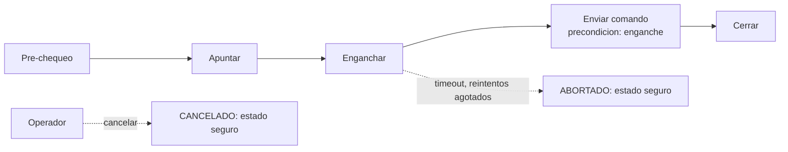

# B96-C24 — Operación remota y automatizada de estaciones

<!-- nav:top -->
[🏠 Programa](../../../../README.md) · [📚 Bloque B96](../../../tronco-comun/B96-control-y-operacion-de-misiones-espaciales.md) · [← Anterior: B96-C23 — Continuidad y redundancia de las operaciones terrestres](../B96-C23-continuidad-y-redundancia-de-las-operaciones-terrestres/CLASE.md) · [Siguiente: B96-C25 — Seguridad física y control de acceso de estaciones terrestres →](../B96-C25-seguridad-fisica-y-control-de-acceso-de-estaciones-terrestres/CLASE.md)
<!-- /nav -->

## 1. Ubicación, nivel y alcance

Clase 24 del bloque B96. Nivel N3. Muchas estaciones se operan a distancia y de forma automática: un **ejecutor** corre la pasada paso a paso, con **precondiciones**, **tiempos límite**, **reintentos** y **cancelación manual**. Aquí construyes un ejecutor **sintético** de cinco pasos y lo pruebas con 2 916 escenarios de fallo; verificas que nunca envía un comando sin enganche y que siempre termina en estado seguro. Pasos y tiempos son ficticios. Todos los datos son **sintéticos** salvo los que se rotulan como consultados.

## 2. Por qué esta clase existe

Un ejecutor automático sin límites puede colgarse o comandar con el enlace caído. La decisión central: **¿qué debe garantizar el ejecutor ante cualquier combinación de fallos y cómo se prueba?**

## 3. Lo que podrás hacer al terminar

1. Modelar una pasada automática como pasos con tiempo límite y reintentos.
2. Definir propiedades de seguridad del ejecutor.
3. Probar de forma exhaustiva todas las combinaciones de resultados.
4. Verificar que la cancelación manual funciona en cualquier paso.
5. Medir la duración máxima con reintentos.
6. Separar lo consultado de lo sintético.

La evidencia es la **ejecutor de pasada con casos de fallo** del ejercicio 12 (sección 20).

## 4. Con qué llegas y cómo comprobarlo

1. ¿Qué es una precondición?
2. ¿Qué es un tiempo límite?
3. ¿Qué es un reintento?
4. ¿Qué es un estado seguro?
5. ¿Qué es una prueba exhaustiva?

<details>
<summary>Ver respuestas</summary>

1. Una condición que debe cumplirse antes de un paso. 2. El máximo que se espera a un paso antes de declararlo fallido. 3. Repetir un paso fallido. 4. Uno desde el cual no hay acciones peligrosas en curso. 5. Evaluar todas las combinaciones de un espacio finito.
</details>

Con cuatro o cinco aciertos, sigue; si no, repasa los prerrequisitos.

## 5. Un caso de contexto y casos de referencia

El ejecutor **sintético** tiene cinco pasos (pre-chequeo 20 s, apuntar 30 s, enganchar 25 s, enviar comando 12 s y cerrar 15 s: 102 s nominales). Cada paso puede dar ok, falla o timeout, con o sin éxito en el reintento, y el operador puede cancelar en cualquier paso o no cancelar: `3⁵ × 2 × 6 = 2 916` escenarios. Hay 82 pasadas completas, 1 256 abortadas y 1 578 canceladas; **0 violaciones** de las propiedades; duración máxima 291 s. Una falla de enganche agota los reintentos en 200 s sin enviar el comando.

## 6. Vocabulario

**Ejecutor:** programa que corre una secuencia. **Tiempo límite:** plazo de un paso. **Precondición:** condición previa. **Cancelación manual:** orden del operador que detiene la pasada. **Propiedad de seguridad:** condición que siempre debe cumplirse.

## 7. Modelo mental



*Descripción textual:* los cinco pasos se ejecutan en orden; el comando exige el enganche como precondición; un fallo con reintentos agotados aborta y el operador puede cancelar en cualquier paso; ambos terminan en estado seguro.

Analogía: el ejecutor es como un sistema automático de un ascensor con botón de parada: sigue el plan, pero cualquier anomalía lo detiene y una persona siempre puede tomar el mando. Límite: el ejecutor no entiende el contexto; solo aplica reglas.

## 8. La explicación, paso a paso

### 8.1 Qué dicen las fuentes

ECSS-E-ST-70-32C (S1) define el lenguaje de procedimientos de operación (PLUTO) y ECSS-E-ST-70-01C (S2) trata los procedimientos de control a bordo (ejecución y preparación en tierra). El capítulo de la NASA (S3) describe la planificación y programación de servicios de estación. Solo se leyeron los resúmenes o la parte inicial. El ejecutor de esta clase es un **modelo sintético** de banco, no una implementación de esas normas.

### 8.2 El ejecutor

Cada paso tiene `(duración, tiempo límite, reintentos, es comando)`. Si el resultado es `ok`, consume la duración; si es `falla`, también; si es `timeout`, consume el tiempo límite. Tras agotar los reintentos el ejecutor **aborta**. Un paso de comando exige que el enganche esté confirmado; de lo contrario se bloquea. El operador puede cancelar antes de cualquier paso.

### 8.3 Prueba exhaustiva

Se prueban 2 916 escenarios: resultado del primer intento de cada paso (3⁵), éxito o repetición del fallo en el reintento (2) y cancelación en uno de cinco pasos o ninguna (6). Propiedades: (1) nunca queda `EN_CURSO`; (2) nunca se envía un comando sin enganche; (3) siempre termina en estado seguro; (4) si hay cancelación nunca se completa la pasada. Violaciones: 0.

| Estado final | Escenarios |
|---|---|
| Completado | 82 |
| Abortado | 1 256 |
| Cancelado | 1 578 |

### 8.4 Lectura

La duración máxima observada es 291 s frente a 102 s nominales: un ejecutor sin tiempos límite no tendría cota. La falla de enganche con reintentos agotados aborta a los 200 s sin enviar el comando.

## 9. Magnitudes, símbolos y unidades

| Símbolo | Qué es | Unidad | Valor / nota |
|---|---|---|---|
| `d` | duración nominal por paso | s | 12 a 30 |
| `T` | tiempo límite | s | 24 a 60 |
| `r` | reintentos | — | 0 a 2 |
| `N` | escenarios | — | 2 916 |
| `t_max` | duración máxima | s | 291 |

## 10. Convenciones y referencias

Tiempo en segundos; resultados ok, falla o timeout; un paso usa su duración nominal si falla y su tiempo límite si hay timeout; después del primer intento los siguientes repiten el segundo resultado de la lista. Todo **sintético**. Tolerancias: violaciones de propiedad = 0; 2 916 escenarios exactos; pasada nominal = 102 s exactos.

## 11. De dónde sale lo que afirmamos

| ID | Fuente | Localizador | Respalda | Estado |
|---|---|---|---|---|
| S1 | ECSS, «ECSS-E-ST-70-32C — Test and operations procedure language», 31 jul 2008 — https://ecss.nl/standard/ecss-e-st-70-32c-test-and-operations-procedure-language/ (consultada 2026-11-10) | página de la norma (solo el resumen) | define las capacidades del lenguaje con que se escriben procedimientos de prueba y de operación y especifica el lenguaje PLUTO | Consultada (solo la página) |
| S2 | ECSS, «ECSS-E-ST-70-01C — Spacecraft on-board control procedures», 16 abr 2010 — https://ecss.nl/standard/ecss-e-st-70-01c-on-board-control-procedures/ (consultada 2026-11-10) | página de la norma (solo el resumen) | marco para sistemas de procedimientos de control a bordo (OBCP): ejecución a bordo y preparación y gestión en tierra, y su ciclo de desarrollo | Consultada (solo la página) |
| S3 | NASA, «Ground Data Systems and Mission Operations», en State-of-the-Art of Small Spacecraft Technology — https://www.nasa.gov/smallsat-institute/sst-soa/ground-data-systems-and-mission-operations/ (consultada 2026-11-10; leídos los primeros 100 000 caracteres de 215 453) | capítulo (parte inicial) | un centro de operaciones de misión (MOC) comanda la nave y un centro de operaciones científicas (SOC) genera productos; enlaces directos a la Tierra frente a relevos; bandas UHF, S, X y Ka; la licencia tarda meses; las antenas suelen adquirir el satélite con 5–10° de elevación; margen típico de 3 dB para retorno de datos en LEO a 1 500 km de distancia oblicua | Consultada (parte del capítulo) |
| — | Libros de texto de operaciones de misión, comunicaciones espaciales y mecánica orbital (p. ej., Wertz y Larson, Montenbruck y Gill, Vallado) | — | — | No consultada |
| — | Relaciones y algoritmos estándar usados por el laboratorio (prueba exhaustiva de una máquina de estados finita) | — | los verifica el laboratorio con una segunda vía o con pruebas | No consultada en una fuente concreta |

Límites: las normas se leyeron solo en su resumen; el ejecutor no maneja concurrencia, reloj real, comandos parciales ni autenticación. Lo simulado no se presenta como dato de vuelo ni como medición.

## 12. Cómo ver los resultados

| Escenario | Resultado |
|---|---|
| Nominal | Completado en 102 s |
| Falla de enganche, 3 timeouts | Abortado en 200 s, sin comando |
| Cualquier combinación | Estado seguro al final |
| Violaciones en 2 916 | 0 |

Descripción larga: el 54 % de los escenarios termina cancelado y el 43 %, abortado; solo el 3 % completa la pasada, porque el espacio de prueba incluye fallos y cancelaciones a propósito.

## 13. Ejemplo trabajado

**Paso 1 · Nominal.** `20 + 30 + 25 + 12 + 15 = 102 s`.

**Paso 2 · Falla de enganche.** 3 timeouts de 50 s: aborta.

**Paso 3 · Comando.** No se envía.

**Paso 4 · Prueba.** 2 916 escenarios.

**Paso 5 · Propiedades.** 0 violaciones.

## 14. Distintas formas de describir el problema

**Por tabla:** pasos y tiempos (esta clase). **Por máquina de estados:** EN_CURSO, COMPLETADO, ABORTADO, CANCELADO. **Por lenguaje:** procedimientos PLUTO (ECSS-E-ST-70-32C, solo resumen). **Por seguridad:** autorización (C07).

## 15. Práctica guiada

**Ejercicio 1 · con los pasos indicados.** Suma las duraciones nominales de los cinco pasos.

<details><summary>Solución comentada</summary>

`102 s`.
</details>

**Ejercicio 2 · con una pista.** ¿Cuántos escenarios tiene la prueba?

<details><summary>Solución comentada</summary>

`3⁵ × 2 × 6 = 2 916`.
</details>

**Ejercicio 3 · casi autónomo.** ¿Qué pasa si el paso de enganche agota sus 2 reintentos?

<details><summary>Solución comentada</summary>

Aborta sin enviar el comando.
</details>

## 16. Práctica autónoma, transferencia e integrador

**Ejercicio 4 · autónomo.** ¿Cuál es la duración máxima de un paso con 2 reintentos y timeout de 50 s?

<details><summary>Solución comentada</summary>

`3 × 50 = 150 s`.
</details>

**Ejercicio 5 · autónomo.** ¿Por qué el comando exige el enganche como precondición?

<details><summary>Solución comentada</summary>

Porque enviarlo sin enlace confirmado podría perderse o ejecutarse sin verificación.
</details>

**Ejercicio 6 · autónomo.** ¿Qué pasa si el operador cancela en el paso 3?

<details><summary>Solución comentada</summary>

Estado CANCELADO y seguro; no se ejecutan los pasos 3 a 5.
</details>

**Ejercicio 7 · autónomo.** ¿Qué porcentaje de los escenarios completa la pasada?

<details><summary>Solución comentada</summary>

`82/2 916 = 2,8 %`.
</details>

**Ejercicio 8 · autónomo.** Si se elimina el tiempo límite, ¿qué propiedad se pierde?

<details><summary>Solución comentada</summary>

La cota de duración: un paso colgado bloquea el ejecutor indefinidamente.
</details>

**Ejercicio 9 · transferencia.** **Transferencia.** Un colega propone quitar la cancelación manual para evitar errores. ¿Qué respondes?

<details><summary>Solución comentada</summary>

Se pierde la capacidad de detener una acción en curso; el operador debe poder cancelar siempre.
</details>

**Ejercicio 10 · transferencia.** **Transferencia.** ¿Qué escenarios no cubre la prueba exhaustiva?

<details><summary>Solución comentada</summary>

Fallas simultáneas del propio ejecutor, pérdida de energía y retardos entre estados.
</details>

**Ejercicio 11 · transferencia.** **Transferencia.** ¿Cómo añadirías un sexto paso?

<details><summary>Solución comentada</summary>

Ampliando la prueba a `3⁶` combinaciones y verificando las mismas propiedades.
</details>

**Ejercicio 12 · integrador.** **Integrador.** Elabora tu *ejecutor de pasada con casos de fallo*: pasos y tiempos, propiedades, resultados de la prueba exhaustiva y lista de lo consultado, sintético y no consultado.

<details><summary>Solución comentada</summary>

Secciones 8.2–8.4 y la salida del laboratorio.
</details>

## 17. Laboratorio: prueba exhaustiva del ejecutor de pasada

El script [ejecutor_de_pasada.py](ejecutor_de_pasada.py) implementa un ejecutor con tiempos límite, reintentos y cancelación, lo prueba con 2 916 escenarios y **comprueba** que no envía comandos sin enganche, que nunca queda en curso y que siempre termina en estado seguro.

**Datos:** pasos, tiempos y resultados **sintéticos**. **Predice antes de ejecutar:** ¿cuántas violaciones de propiedad hay? (0). **Ejecución del 2026-11-10 (Python 3.12.9):**

```text
Python 3.12.9
Datos SINTETICOS: pasos y tiempos ficticios; el ejecutor es una maquina de estados de banco
Escenarios probados = 2916 ; estados finales = {'COMPLETADO': 82, 'ABORTADO': 1256, 'CANCELADO': 1578} ; violaciones de propiedad = 0
Duracion maxima observada = 291 s ; nominal = 102 s
Pasada nominal: COMPLETADO en 102 s
  t=   20 s  Pre-chequeo de equipos    ok (intento 1)
  t=   50 s  Apuntar antena            ok (intento 1)
  t=   75 s  Enganchar portadora       ok (intento 1)
  t=   87 s  Enviar comando            ok (intento 1)
  t=  102 s  Cerrar pasada             ok (intento 1)
Falla de enganche con reintentos agotados: ABORTADO en 200 s ; comando enviado = False
Pruebas superadas.
```

```bash
python programa/clases/B96/B96-C24-operacion-remota-y-automatizada-de-estaciones/ejecutor_de_pasada.py
```

**Límites:** ejecutor secuencial sin concurrencia, reloj simulado y sin autenticación.

## 18. Errores frecuentes y cómo corregirlos

**Ejecutar sin tiempo límite.** Pon cota a cada paso (8.2)

**No probar la cancelación.** Inclúyela en la prueba (8.3)

**Comandar sin precondición.** Exige el enganche (8.2)

## 19. Cómo sabrás que vas bien

Tras 8.3: ¿cuántos escenarios tiene la prueba? Si dudas, repasa el ejercicio 2. Tras el laboratorio: ¿qué comprueba la propiedad de seguridad? (ver sección 17).

## 20. Qué entregas y cómo se evalúa

El producto es tu **ejecutor de pasada con casos de fallo** (ejercicio 12).

| Criterio | Inicial | En desarrollo | Logrado | Destacado |
|---|---|---|---|---|
| Conceptos | Los confunde | Parciales | Explica el método y su dominio | Explica los límites y las alternativas |
| Cálculo | Sin unidades | Con errores | Resultados con unidades y comprobados | Resuelve casos nuevos |
| Numérico | Sin comprobar | Un caso | Verifica con una segunda vía en varios casos | Interpreta las diferencias y los fallos |
| Fuentes | Sin fuente | Sin fecha | Fuentes con fecha y estado | Declara lo sintético y lo no consultado |
| Límites | No los nombra | Uno | Tres | Discute qué falta del modelo |

**Condiciones críticas (no se compensan con promedio):** rotular los datos como sintéticos; comprobar cada resultado con una segunda vía; citar solo lo consultado.

## 21. Ética, seguridad y límites

Clase educativa: los modelos son simplificados y los datos son sintéticos; ningún resultado describe una misión real, certifica conformidad con una norma ni sustituye la revisión de especialistas.  Accesibilidad: tablas equivalentes a las gráficas, fórmulas en texto, ejercicios sin conexión.

## 22. Para cerrar y seguir

El ejecutor sintético pasa 2 916 escenarios sin violar sus propiedades: nunca comanda sin enganche y siempre termina en estado seguro, con una duración máxima de 291 s. Queda una pregunta: ¿cómo se protege la estación misma?

**Glosario español–inglés.** ejecutor · *executor*; tiempo límite · *timeout*; reintento · *retry*; estado seguro · *safe state*; cancelación manual · *manual abort*.

**Continuidad.** [B96-C25](../B96-C25-seguridad-fisica-y-control-de-acceso-de-estaciones-terrestres/CLASE.md) trata la seguridad física y el control de acceso de las estaciones terrestres.

**Referencias:** ver sección 11.

<!-- nav:bottom -->
---

[← Anterior: B96-C23 — Continuidad y redundancia de las operaciones terrestres](../B96-C23-continuidad-y-redundancia-de-las-operaciones-terrestres/CLASE.md) · [📚 Bloque B96](../../../tronco-comun/B96-control-y-operacion-de-misiones-espaciales.md) · [Siguiente: B96-C25 — Seguridad física y control de acceso de estaciones terrestres →](../B96-C25-seguridad-fisica-y-control-de-acceso-de-estaciones-terrestres/CLASE.md)
<!-- /nav -->
